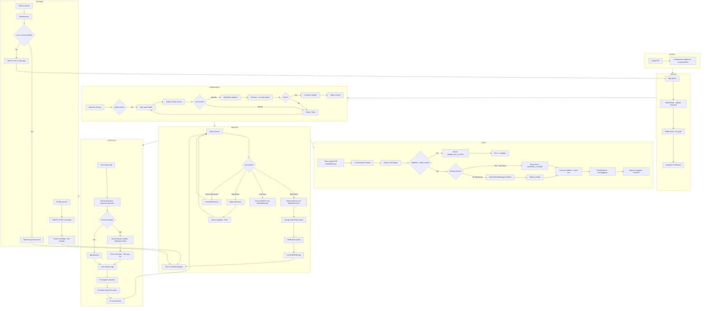
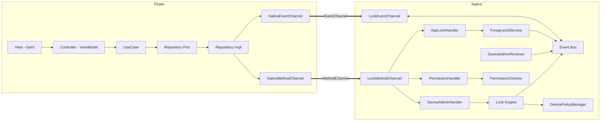

# 📋 Complete Demo App Review — Installment Locker

> **Scope:** Android-only demo demonstrating the Android app-locking workflow. Flutter (Clean Architecture + MVVM + Repository + GetX) ↔ Native Kotlin. No Firebase, no login, no API, no database. Static data only.
>
> This document verifies every architectural aspect designed across the prior conversations, generates the complete project tree, and the application flow diagram.

---

## 1. Verification Summary

| # | Aspect | Status | Notes |
|---|---|---|---|
| 1 | Flutter Structure | ✅ Verified | Clean Architecture (3 layers) + MVVM + Repository + GetX, feature-first. |
| 2 | Native Structure | ✅ Verified | Responsibility-grouped Kotlin packages; service is enforcement owner. |
| 3 | MethodChannel | ✅ Verified | `app_lock/methods` — request/response command surface; thin transport. |
| 4 | Device Admin | ✅ Verified | `DeviceAdminReceiver` + `DeviceAdminController`; anti-uninstall + force-lock. |
| 5 | Background Service | ✅ Verified | Timer-based; start → wait → trigger; static data only. |
| 6 | Foreground Service | ✅ Verified | `specialUse` type; persistent notification; `START_STICKY`. |
| 7 | Static Lock Logic | ✅ Verified | `OVERDUE` flag → MethodChannel → `DevicePolicyManager.lockNow()`. |
| 8 | Navigation | ✅ Verified | GetX `GetPage` + Bindings; Welcome → Permissions → Status. |
| 9 | Lifecycle | ✅ Verified | Install → Launch → Permission → Service → Lock → Restart/Reopen. |
| 10 | Performance | ✅ Verified | Sleeping coroutine timer; no polling; near-zero wait cost. |
| 11 | Memory | ✅ Verified | Minimal holdings; app-context scoped; no caches/buffers. |
| 12 | Battery | ✅ Verified | No polling, no network, low-importance notification; doze-documented. |

**Overall verdict:** The architecture is **coherent and complete**. All components connect through well-defined contracts, the enforcement layer is decoupled from presentation, and the static-data constraint is honored throughout. No contradictions found across the designs.

---

## 2. Flutter Structure — Verification

### 2.1 Layering check

```
Presentation (GetX Views + Controllers)
        ↓ depends on
Domain (Entities · UseCases · Repository Ports)   ← pure Dart, no Flutter/GetX
        ↑ implemented by
Data (Repository Impl · DataSources · Models)
        ↓ uses
Core Platform (NativeMethodChannel / NativeEventChannel)
        ↓ crosses
Native Kotlin
```

- ✅ **Dependency rule holds:** Domain has no Flutter/GetX/Android imports.
- ✅ **Repository pattern:** Domain declares abstract ports; Data implements them; controllers depend on ports, never on data sources.
- ✅ **MVVM:** View = GetX screen; ViewModel = `GetxController` with `Rx` state; Binding = DI wiring.
- ✅ **GetX scope:** State (`Rx`/`Obx`), DI (`Get.lazyPut`/`Get.put`), routing (`GetPage`) — single infra framework.

### 2.2 Feature set

| Feature | Purpose | Status |
|---|---|---|
| `permissions` | Permission gate (Device Admin onboarding) | ✅ Designed |
| `home` / `status` | Operational dashboard | ✅ Designed (Status Screen) |
| `app_list` | Pick apps to lock (optional in timer model) | ✅ Skeleton |
| `lock_screen` | In-app PIN pad (overlay alternative) | ✅ Skeleton |

### 2.3 Core infrastructure

| Area | Files | Status |
|---|---|---|
| Constants | `app_constants`, `channel_constants`, `storage_keys` | ✅ |
| Error | `failures`, `exceptions`, `app_exceptions` | ✅ |
| Logger | `app_logger` (wraps `logger` package) | ✅ |
| Platform | `native_method_channel`, `native_event_channel` | ✅ |
| Utils | `result`, `debouncer`, `validators` | ✅ |
| Helpers | `permission_helper`, `haptic_helper`, `date_helper`, `ui_helper` | ✅ |
| Responsive | `size_config`, `screen_type`, `responsive_builder` | ✅ |
| Shared Widgets | `app_scaffold`, `app_button`, `app_card`, `app_text_field`, `app_loading_indicator`, `empty_state`, `status_chip`, `permission_tile` | ✅ |

### 2.4 Packages (pubspec.yaml)

| Package | Purpose | Verified |
|---|---|---|
| `get` | State/DI/routing | ✅ |
| `get_storage` | Key-value persistence (no DB) | ✅ |
| `logger` | Leveled logging | ✅ |
| `flutter_screenutil` | Responsive scaling | ✅ |
| `flutter_svg` | SVG icons | ✅ |
| `device_info_plus` | Android version gating | ✅ |
| `package_info_plus` | App version | ✅ |
| `collection` | List helpers | ✅ |

- ✅ No `http`/`dio` (no API).
- ✅ No `firebase_*` (no Firebase).
- ✅ No `sqflite`/`drift` (no DB).

---

## 3. Native Structure — Verification

### 3.1 Package layout

```
com.example.app_lock/
├── MainActivity.kt              ✅ FlutterActivity + channel registration
├── channels/                    ✅ MethodChannel + EventChannel + handlers
├── permissions/                 ✅ PermissionChecker + PermissionRouter
├── service/                      ✅ ForegroundService + Watcher + SessionStore
├── overlay/                      ✅ OverlayManager + OverlayView (alt path)
├── admin/                        ✅ DeviceAdminReceiver + Controller (Lock Engine)
├── receiver/                     ✅ Boot + ScreenState + PackageRemoved
├── model/                        ✅ AppInfo + LockEvent
└── util/                         ✅ PackageHelper + Constants
```

### 3.2 Responsibility separation

- ✅ `channels/` is the only package that knows about Flutter.
- ✅ `service/` owns detection + overlay lifecycle + session memory.
- ✅ `admin/` owns Device Admin policy + the Native Lock Engine.
- ✅ `receiver/` components are triggers, not workers.
- ✅ No business logic in `MainActivity` — registration only.

### 3.3 Manifest requirements

| Requirement | Status |
|---|---|
| `PACKAGE_USAGE_STATS` | ✅ (if watching model used) |
| `SYSTEM_ALERT_WINDOW` | ✅ (if overlay path used) |
| `FOREGROUND_SERVICE` | ✅ |
| `FOREGROUND_SERVICE_SPECIAL_USE` | ✅ (Android 14+) |
| `POST_NOTIFICATIONS` | ✅ (Android 13+) |
| `RECEIVE_BOOT_COMPLETED` | ✅ |
| `<service>` AppLockForegroundService (`specialUse`) | ✅ |
| `<receiver>` AppLockDeviceAdminReceiver (`BIND_DEVICE_ADMIN`) | ✅ |
| `<receiver>` BootReceiver (`BOOT_COMPLETED`) | ✅ |
| `res/xml/device_admin.xml` (`force-lock`) | ✅ |

---

## 4. MethodChannel — Verification

### 4.1 Contract

- ✅ Name: `app_lock/methods` (shared constant).
- ✅ Thin transport — marshals args, returns primitives/`Map`, no logic.
- ✅ Structured errors via `PlatformException{code, message, details}`.

### 4.2 Method table coverage

| Category | Methods | Verified |
|---|---|---|
| Permission check | `checkUsageStatsPermission`, `checkOverlayPermission`, `checkAccessibilityPermission`, `checkNotificationPermission`, `checkAdminActive` | ✅ |
| Permission request | `requestUsageStatsPermission`, `requestOverlayPermission`, `requestAccessibilityPermission`, `requestNotificationPermission`, `requestAdminActive` | ✅ |
| Lock commands | `getInstalledApps`, `setLockedApps`, `startLockService`, `stopLockService`, `isServiceRunning`, `verifyPin`, `dismissOverlay`, `forceLockDevice` | ✅ |
| Device Admin | `checkAdminActive`, `requestAdminActive`, `disableAdmin`, `forceLockDevice` | ✅ |

### 4.3 Critical contract

- ✅ **Request ≠ outcome:** `request*` methods return `void`; outcome learned via later `check*` on resume. This prevents the #1 permission-flow bug.

---

## 5. Device Admin — Verification

### 5.1 Workflow

- ✅ Check → Request → System Screen → Validate on resume → Success/Retry.
- ✅ `onEnabled` callback + resume-time re-check (dual confirmation).
- ✅ `failed` state distinct from `notEnabled` (Retry affordance).
- ✅ Continue button disabled until `enabled` (hard gate).

### 5.2 Policies

- ✅ `force-lock` declared in `device_admin.xml`.
- ✅ `wipe-data` NOT used (demo safety).
- ✅ Anti-uninstall: active admin blocks uninstall until disabled from within app.

### 5.3 Native Lock Engine

- ✅ Validation (admin active + request well-formed + not already executing).
- ✅ Already-locked check (`KeyguardManager.isKeyguardLocked()` + `force` flag).
- ✅ Error model: typed `LockResult` / `LockErrorCode` (no exception leakage).
- ✅ Logging: `requestId`-correlated, structured, via `AppLogger`.
- ✅ Success callback: fan-out to event bus + service + session store.

---

## 6. Background Service — Verification

### 6.1 Behavior model

- ✅ Start → wait predefined time → trigger lock (timer-based).
- ✅ Static data only: `LOCK_DELAY_MS`, `OVERDUE`, `DEMO_PIN` — all constants/`SharedPreferences`.
- ✅ No Firebase, no API, no DB.

### 6.2 Foreground service

- ✅ `startForeground` called immediately in `onStartCommand`.
- ✅ `foregroundServiceType="specialUse"` + `<property>` (Android 14+).
- ✅ `START_STICKY` for OS-kill restart.
- ✅ Low-importance notification channel (no sound).

### 6.3 Restart

- ✅ OS-killed: `START_STICKY` recreates with null intent → fresh countdown.
- ✅ Reboot: `BootReceiver` + `LOCK_ON_BOOT_ENABLED` flag.
- ✅ Process restart: state re-derived from native queries.

---

## 7. Static Lock Logic — Verification

### 7.1 Workflow chain

```
Application Starts → Permission Available? → YES → Static Variable = OVERDUE
→ Background Service → Send Lock Command → MethodChannel → Native Kotlin
→ DevicePolicyManager → Lock Device
```

- ✅ Linear, one-directional, single decision point (permission gate).
- ✅ `OVERDUE` is a static flag — no backend.
- ✅ Defense-in-depth: admin checked in Flutter AND re-checked in native engine.
- ✅ `lockNow()` is irreversible by the app (only user can unlock).

### 7.2 Error mapping

| Native code | Flutter Failure | Verified |
|---|---|---|
| `ADMIN_NOT_ACTIVE` | `PermissionFailure` | ✅ |
| `LOCK_SECURITY_EXCEPTION` | `PermissionFailure` | ✅ |
| `SERVICE_ERROR` | `PlatformFailure` | ✅ |
| `INVALID_ARGUMENT` | `ValidationFailure` | ✅ |
| `LOCK_UNEXPECTED` | `PlatformFailure` | ✅ |

---

## 8. Navigation — Verification

### 8.1 Route graph

```
Welcome (Device Admin gate) → Permissions (other perms) → Status (dashboard)
                                                              ↓
                                                          [optional] App List
```

- ✅ GetX `GetPage` + `Bindings` — auto-inject/dispose controllers.
- ✅ Route name constants in `app_routes.dart`.
- ✅ Continue on Welcome disabled until admin active (enforced order).
- ✅ Re-entrant gate: re-checks on every entry (catches post-onboarding disable).

### 8.2 Status screen buttons

| Button | Enabled condition | Verified |
|---|---|---|
| Start Demo | admin enabled + service stopped + not locking | ✅ |
| Stop Demo | service running | ✅ |
| Lock Now | admin enabled | ✅ |
| Check Permission | always | ✅ |

---

## 9. Lifecycle — Verification

### 9.1 Stage coverage

| Stage | Verified |
|---|---|
| Install | ✅ |
| First Launch | ✅ |
| Permission | ✅ |
| Background Start | ✅ |
| Service Running | ✅ |
| Static Lock Trigger | ✅ |
| Lock | ✅ |
| Restart (OS-kill / reboot / process) | ✅ |
| Close | ✅ |
| Reopen | ✅ |

### 9.2 Invariants

- ✅ State always re-derived from native (never assumed).
- ✅ Enforcement decoupled from presentation (service survives UI close).
- ✅ Permissions persist until explicitly revoked.
- ✅ Static data drives the trigger.
- ✅ `lockNow()` irreversible by app.
- ✅ Restart begins fresh countdown (no persisted elapsed time).
- ✅ Events dropped (not buffered) when Flutter absent — locking unaffected.
- ✅ Foreground notification is the process lifeline.

---

## 10. Performance — Verification

| Metric | Design | Verified |
|---|---|---|
| Wait cost | Sleeping coroutine (suspended) — near-zero CPU | ✅ |
| Lock cost | One-shot `lockNow()` — brief spike | ✅ |
| Notification updates | Throttled to 1/sec | ✅ |
| Channel calls | Synchronous, fast (sub-second) | ✅ |
| No polling | Timer model replaces UsageStats polling | ✅ |
| No network | Zero radio wakeups | ✅ |

---

## 11. Memory — Verification

| Held object | Size | Lifetime | Verified |
|---|---|---|---|
| `LockCountdownTimer` (coroutine) | negligible | service | ✅ |
| `LockSessionStore` (string set) | few strings | service | ✅ |
| Notification + PendingIntent | small | service | ✅ |
| Static config | code segment | always | ✅ |
| No caches/buffers/cursors | — | — | ✅ |

- ✅ App-context scoped (no activity leaks).
- ✅ Coroutines cancelled in `onDestroy`.
- ✅ Dynamic receivers unregistered in `onDestroy`.
- ✅ `onDestroy` not relied upon for correctness (crash-safe).

---

## 12. Battery — Verification

| Factor | Design | Verified |
|---|---|---|
| Polling | None (timer replaces it) | ✅ |
| Network | None | ✅ |
| GPS/sensors | None | ✅ |
| Notification | Low-importance, no sound | ✅ |
| WakeLock | Not acquired by default | ✅ |
| Doze | Documented limitation; optional AlarmManager | ✅ |
| Screen-off | Configurable pause/resume | ✅ |
| Battery-opt exemption | Not required (short timer); documented optional | ✅ |

---

## 13. Complete Project Tree

```
app_lock/
│
├── pubspec.yaml                              # get, get_storage, logger, flutter_screenutil, ...
├── analysis_options.yaml
├── README.md
│
├── lib/
│   ├── main.dart                             # entry: runApp + DI bootstrap
│   ├── injection_container.dart              # GetX DI graph (composition root)
│   │
│   ├── app/
│   │   ├── app.dart                          # GetMaterialApp config
│   │   ├── theme/
│   │   │   ├── app_colors.dart
│   │   │   ├── app_text_styles.dart
│   │   │   ├── app_dimensions.dart
│   │   │   └── app_theme.dart
│   │   ├── routes/
│   │   │   ├── app_routes.dart               # route name constants
│   │   │   └── app_pages.dart                # GetPage list + bindings
│   │   └── bindings/
│   │       └── initial_binding.dart         # global singletons
│   │
│   ├── core/
│   │   ├── constants/
│   │   │   ├── app_constants.dart
│   │   │   ├── channel_constants.dart        # method/event channel names
│   │   │   └── storage_keys.dart
│   │   ├── error/
│   │   │   ├── failures.dart                 # Failure sealed classes
│   │   │   ├── exceptions.dart
│   │   │   └── app_exceptions.dart
│   │   ├── logger/
│   │   │   └── app_logger.dart
│   │   ├── platform/
│   │   │   ├── native_method_channel.dart    # MethodChannel wrapper
│   │   │   └── native_event_channel.dart     # EventChannel wrapper
│   │   ├── utils/
│   │   │   ├── result.dart                   # Result<Failure, T>
│   │   │   ├── debouncer.dart
│   │   │   └── validators.dart
│   │   ├── helpers/
│   │   │   ├── permission_helper.dart
│   │   │   ├── haptic_helper.dart
│   │   │   ├── date_helper.dart
│   │   │   └── ui_helper.dart
│   │   ├── responsive/
│   │   │   ├── size_config.dart
│   │   │   ├── screen_type.dart
│   │   │   └── responsive_builder.dart
│   │   └── widgets/
│   │       ├── app_scaffold.dart
│   │       ├── app_button.dart
│   │       ├── app_card.dart
│   │       ├── app_text_field.dart
│   │       ├── app_loading_indicator.dart
│   │       ├── empty_state.dart
│   │       ├── status_chip.dart
│   │       └── permission_tile.dart
│   │
│   └── features/
│       ├── permissions/
│       │   ├── domain/
│       │   │   ├── entities/
│       │   │   ├── repositories/
│       │   │   └── usecases/
│       │   ├── data/
│       │   │   ├── datasources/
│       │   │   ├── models/
│       │   │   └── repositories/
│       │   └── presentation/
│       │       ├── views/
│       │       ├── controllers/
│       │       └── bindings/
│       │
│       ├── home/                             # Status Screen
│       │   ├── domain/
│       │   │   ├── entities/
│       │   │   ├── repositories/
│       │   │   └── usecases/
│       │   ├── data/
│       │   │   ├── datasources/
│       │   │   ├── models/
│       │   │   └── repositories/
│       │   └── presentation/
│       │       ├── views/status_view.dart
│       │       ├── controllers/status_controller.dart
│       │       └── bindings/status_binding.dart
│       │
│       ├── app_list/                         # optional: pick apps to lock
│       │   ├── domain/
│       │   ├── data/
│       │   └── presentation/
│       │
│       └── lock_screen/                      # optional: in-app PIN pad
│           ├── domain/
│           ├── data/
│           └── presentation/
│
├── android/
│   ├── app/
│   │   ├── build.gradle.kts                  # namespace: com.example.app_lock
│   │   └── src/main/
│   │       ├── AndroidManifest.xml           # permissions + components
│   │       ├── kotlin/com/example/app_lock/
│   │       │   ├── MainActivity.kt           # FlutterActivity + channel registration
│   │       │   │
│   │       │   ├── channels/
│   │       │   │   ├── LockMethodChannel.kt
│   │       │   │   ├── LockEventChannel.kt
│   │       │   │   └── handlers/
│   │       │   │       ├── PermissionHandler.kt
│   │       │   │       ├── AppLockHandler.kt
│   │       │   │       └── DeviceAdminHandler.kt
│   │       │   │
│   │       │   ├── permissions/
│   │       │   │   ├── PermissionChecker.kt
│   │       │   │   └── PermissionRouter.kt
│   │       │   │
│   │       │   ├── service/
│   │       │   │   ├── AppLockForegroundService.kt
│   │       │   │   ├── LockCountdownTimer.kt
│   │       │   │   ├── ForegroundAppWatcher.kt     # optional polling alt
│   │       │   │   └── LockSessionStore.kt
│   │       │   │
│   │       │   ├── overlay/
│   │       │   │   ├── LockOverlayManager.kt        # optional overlay path
│   │       │   │   └── LockOverlayView.kt
│   │       │   │
│   │       │   ├── admin/
│   │       │   │   ├── AppLockDeviceAdminReceiver.kt
│   │       │   │   └── DeviceAdminController.kt    # Native Lock Engine
│   │       │   │
│   │       │   ├── receiver/
│   │       │   │   ├── BootReceiver.kt
│   │       │   │   ├── ScreenStateReceiver.kt
│   │       │   │   └── PackageRemovedReceiver.kt
│   │       │   │
│   │       │   ├── model/
│   │       │   │   ├── AppInfo.kt
│   │       │   │   └── LockEvent.kt
│   │       │   │
│   │       │   └── util/
│   │       │       ├── PackageHelper.kt
│   │       │       └── Constants.kt
│   │       │
│   │       └── res/
│   │           ├── xml/
│   │           │   ├── device_admin.xml              # <uses-policies> force-lock
│   │           │   └── accessibility_service_config.xml  # optional
│   │           ├── drawable/
│   │           │   └── ic_lock.xml                   # notification icon
│   │           └── values/
│   │               └── strings.xml                  # notification text
│   │
│   └── build.gradle.kts
│
├── test/                                     # Flutter unit/widget tests
│
└── plans/
    └── complete-architecture-review.md        # this document
```

---

## 14. Application Flow Diagram



---

## 15. Communication Architecture Diagram



---

## 16. Cross-Cutting Concerns Verification

### 16.1 Error handling end-to-end

```
Native exception
  → caught in handler
  → PlatformException{code, message, details}
  → MethodChannel returns error
  → NativeMethodChannel catches
  → maps to Failure subtype
  → Result.failure(Failure)
  → UseCase propagates
  → Controller shows snackbar + updates Rx
```

✅ Typed errors flow end-to-end; no silent failures; no crashes.

### 16.2 Logging

- ✅ Central `AppLogger` (Flutter) + native logging via `requestId` correlation.
- ✅ Every lock attempt logged at every stage.
- ✅ Release builds suppress `DEBUG`.

### 16.3 State synchronization

- ✅ Dual-path: MethodChannel (pull) + EventChannel (push) converge on same `Rx` fields.
- ✅ Resume-time re-validation catches external changes.
- ✅ Reopen re-derives state from native (self-healing).

### 16.4 Security

- ✅ Device Admin prevents uninstall bypass.
- ✅ `force-lock` policy only (no `wipe-data`).
- ✅ Defense-in-depth: admin checked in Flutter AND native engine.
- ✅ `lockNow()` irreversible by app (only user unlocks).

---

## 17. Identified Risks & Mitigations

| Risk | Likelihood | Mitigation |
|---|---|---|
| User disables admin externally | Medium | Resume-time re-check; Status screen shows `PERMISSIONS_MISSING`; re-entrant gate. |
| OS kills service mid-countdown | Low | `START_STICKY` recreates; fresh countdown (acceptable for demo). |
| Doze defers timer in deep sleep | Medium | Documented limitation; optional `AlarmManager.setExactAndAllowWhileIdle`. |
| Boot auto-start restricted (Android 14+) | Medium | Documented; user may need to open app once after reboot. |
| Channel not registered on cold start | Low | Registration in `configureFlutterEngine` (before Dart); defensive retry. |
| EventChannel events missed while closed | Low | Events dropped (not buffered); state re-derived on reopen. |
| OEM-specific keyguard behavior | Low | `force` flag allows bypass of already-locked check. |

---

## 18. Final Verdict

The Installment Locker demo architecture is **complete, coherent, and implementation-ready**:

- **Flutter side** delivers Clean Architecture + MVVM + Repository + GetX with a clear feature-first structure, full core infrastructure (constants, logger, helpers, responsive, shared widgets), and a DI composition root.
- **Native side** delivers a responsibility-separated Kotlin package layout with a foreground service as the enforcement owner, a Device Admin receiver/controller as the hardening + lock engine, broadcast receivers for system events, and thin channels as the only Flutter bridge.
- **Communication** is precisely contracted: MethodChannel for commands (with the critical "request ≠ outcome" rule), EventChannel for status pushes, typed errors end-to-end.
- **Lock logic** is a deterministic, static-data-driven pipeline: `OVERDUE` flag → MethodChannel → Native Lock Engine → `DevicePolicyManager.lockNow()`.
- **Lifecycle** is robust across install, launch, permission, service, lock, restart, close, and reopen — with state always re-derived from native, enforcement decoupled from presentation, and the foreground notification as the process lifeline.
- **Performance, memory, and battery** are all optimized by the timer-based (non-polling) model, minimal holdings, and no network.

No Firebase. No API. No database. Static data only. Android-only. Demo complete.
