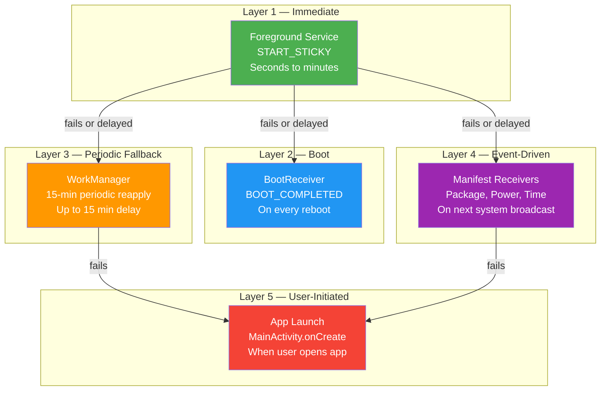
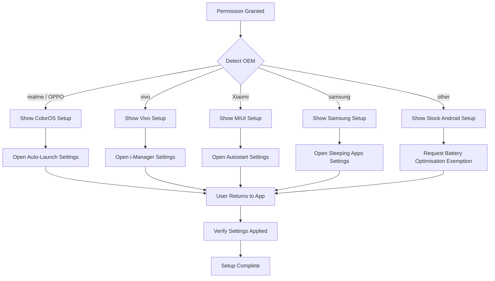
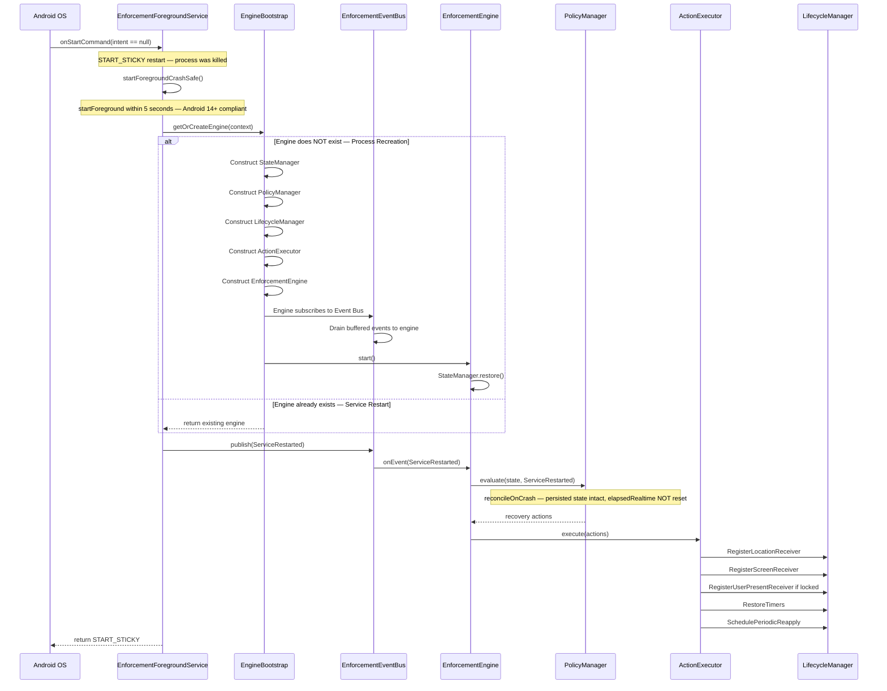
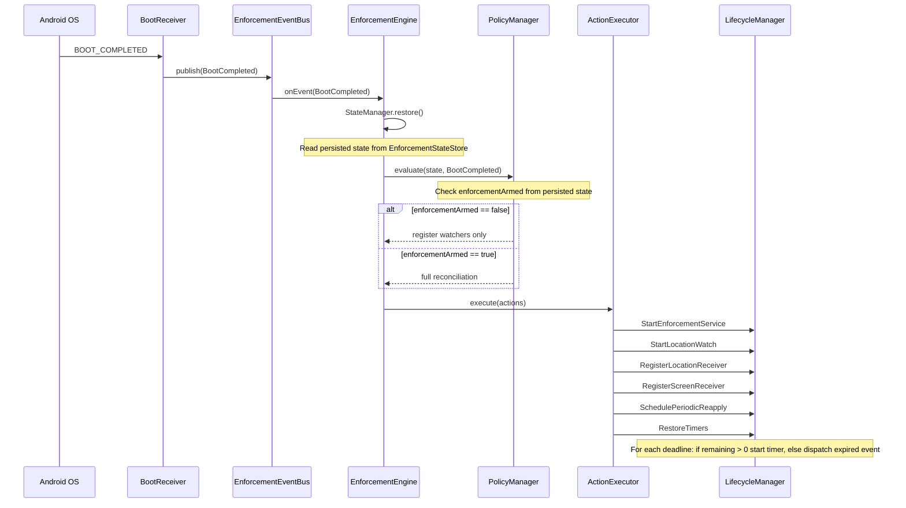
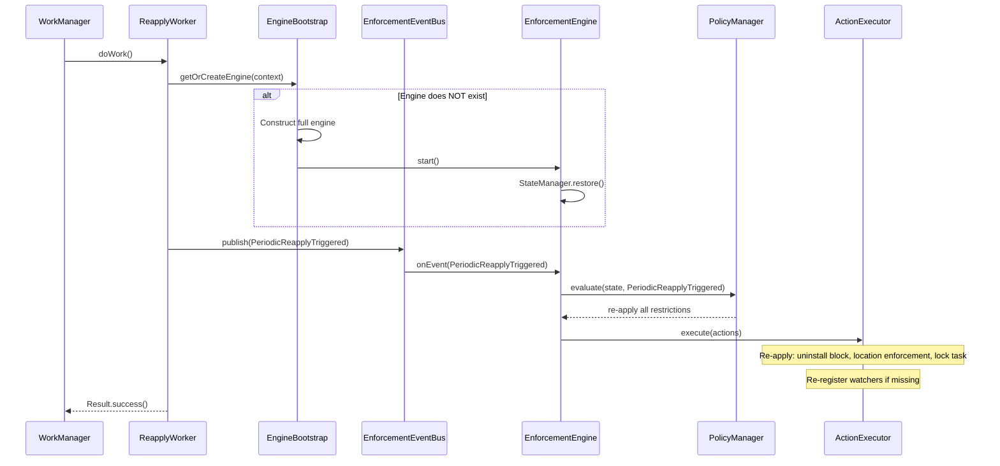
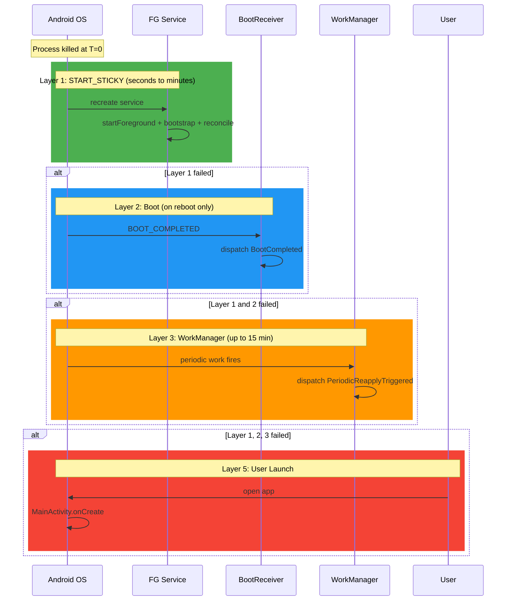

# 🛡️ Background Stability — Production Survival Architecture

> **Scope:** This document defines the production-ready architecture that keeps
> location-compliance enforcement alive across process death, service restart,
> device reboot, OEM battery optimisation, and Android version 11–15 quirks.
>
> **No code.** Architecture, contracts, and decision logic only.
>
> **Parent documents:**
> - [`plans/enforcement-engine-design.md`](plans/enforcement-engine-design.md) — EnforcementEngine, EventDispatcher, StateManager, PolicyManager
> - [`plans/enforcement-foreground-service.md`](plans/enforcement-foreground-service.md) — unified service, START_STICKY, crash-safe startForeground
> - [`plans/enforcement-state-machine.md`](plans/enforcement-state-machine.md) — crash/reboot recovery, state reconciliation, timer restoration
> - [`plans/enforcement-lifecycle-manager.md`](plans/enforcement-lifecycle-manager.md) — 12 lifecycle scenarios, EngineBootstrap, receiver/timer/work management
> - [`plans/enforcement-receivers.md`](plans/enforcement-receivers.md) — manifest vs runtime receivers, registration lifecycle
> - [`plans/architecture-analysis.md`](plans/architecture-analysis.md) — problems P-09, P-10, P-11, P-17

---

## Table of Contents

1. [Design Goals](#1-design-goals)
2. [The Survival Problem](#2-the-survival-problem)
3. [Defense-in-Depth Architecture](#3-defense-in-depth-architecture)
4. [Layer 1 — Foreground Service + START_STICKY](#4-layer-1--foreground-service--start_sticky)
5. [Layer 2 — Boot Receiver](#5-layer-2--boot-receiver)
6. [Layer 3 — WorkManager Periodic Reapply](#6-layer-3--workmanager-periodic-reapply)
7. [Layer 4 — Manifest Receivers](#7-layer-4--manifest-receivers)
8. [Layer 5 — User-Initiated App Launch](#8-layer-5--user-initiated-app-launch)
9. [EngineBootstrap — Process Recreation Without Flutter](#9-enginebootstrap--process-recreation-without-flutter)
10. [Receiver Recovery](#10-receiver-recovery)
11. [Timer Recovery](#11-timer-recovery)
12. [State Recovery](#12-state-recovery)
13. [Crash Recovery](#13-crash-recovery)
14. [Memory Recovery](#14-memory-recovery)
15. [Event Buffering During Recovery](#15-event-buffering-during-recovery)
16. [Battery Optimisation Strategy — Android Stock](#16-battery-optimisation-strategy--android-stock)
17. [Battery Optimisation Strategy — OEM-Specific](#17-battery-optimisation-strategy--oem-specific)
18. [Android Version Matrix — 11 to 15](#18-android-version-matrix--11-to-15)
19. [Survival Decision Tree](#19-survival-decision-tree)
20. [Recovery Sequence Diagrams](#20-recovery-sequence-diagrams)
21. [Survival Guarantees Matrix](#21-survival-guarantees-matrix)
22. [Problems Solved](#22-problems-solved)
23. [Appendix A — OEM Settings Instructions](#appendix-a--oem-settings-instructions)
24. [Appendix B — Document Cross-Reference](#appendix-b--document-cross-reference)

---

## 1. Design Goals

| ID | Goal | Description |
|----|------|-------------|
| **BS-1** | **Zero enforcement gap** | If location is disabled while enforcement is armed, the device must be locked — even if the process was dead, the service was killed, or the device rebooted. |
| **BS-2** | **Defense in depth** | No single survival mechanism is trusted alone. Five independent layers ensure that if one fails, the next catches up. |
| **BS-3** | **Idempotent recovery** | Every recovery action is idempotent. Running recovery twice produces the same result as running it once. |
| **BS-4** | **Stateless service** | The foreground service holds no business state. All state lives in `EnforcementStateStore` (persisted) and `StateManager` (in-memory, restored from persistence). |
| **BS-5** | **Flutter-independent** | The engine must survive and enforce without Flutter. `MainActivity` may be destroyed; the engine continues via the service. |
| **BS-6** | **OEM-aware** | The architecture acknowledges that stock Android battery optimisation is insufficient. OEM-specific auto-start and battery settings are addressed. |
| **BS-7** | **Version-resilient** | The architecture works on Android 11 through 15, accounting for foreground service type restrictions, background launch limits, and notification permissions. |

### 1.1 The Golden Rule

> **The enforcement engine must survive every kill vector the OS and OEMs can throw at it — process death, service kill, app swipe, reboot, package update, low memory, and OEM battery optimisation — and resume enforcement with zero gap.**

---

## 2. The Survival Problem

Android aggressively kills background processes. The following table catalogues every kill vector and what survives each:

| Kill Vector | What Dies | What Survives | Recovery Trigger |
|-------------|-----------|---------------|------------------|
| **OS memory pressure** | Entire process | Persisted state, manifest receivers, WorkManager schedule | START_STICKY service recreation |
| **App swipe (recent apps)** | `MainActivity` + process (if no FG service) | Persisted state, manifest receivers, WorkManager | START_STICKY (if service was running) or manifest receiver or WorkManager or user relaunch |
| **App swipe (service running)** | `MainActivity` only | Process, engine, service, persisted state | None needed — engine continues |
| **Force stop (Settings → Force Stop)** | Entire process + all receivers + WorkManager | Persisted state only | User must relaunch app manually |
| **Device reboot** | Entire process + runtime receivers + timers | Persisted state, manifest receivers, WorkManager schedule | `BOOT_COMPLETED` broadcast |
| **Package update** | Entire process | Persisted state, manifest receivers, WorkManager schedule | `PACKAGE_REPLACED` broadcast |
| **OEM battery optimisation** | Entire process (aggressive) | Persisted state (maybe) | Depends on OEM — may require user to whitelist app |
| **Doze mode** | Network, alarms, sync deferred | Foreground service exempt; WorkManager deferred | Doze maintenance window or exit from Doze |
| **App Standby** | Process killed if idle | Persisted state, WorkManager (deferred) | User relaunch or WorkManager maintenance window |

### 2.1 What Does NOT Survive Process Death

| Resource | Why It's Lost | How It's Recovered |
|----------|---------------|-------------------|
| **In-memory `EnforcementState`** | Lives in `StateManager` (RAM) | `StateManager.restore()` reads from `EnforcementStateStore` (disk) |
| **Runtime receivers** (Location, Screen, UserPresent) | Registered via `Context.registerReceiver()` — lost when process dies | `LifecycleManager` re-registers based on persisted state |
| **Timers** (grace, lock countdown, timed lock) | `Handler.postDelayed()` callbacks live in RAM | `TimerManager.restoreFromPersistence()` recalculates remaining time from wall-clock deadlines |
| **Flutter UI** (`MainActivity`) | Activity destroyed | Not needed for enforcement. Re-attached when user opens app. |
| **EventChannel sink** | Flutter engine gone | `ChannelBridge` buffers events; flushes when Flutter re-attaches |
| **`elapsedRealtime`** (on reboot only) | Resets to 0 | All persisted deadlines use wall-clock ms (`System.currentTimeMillis()`) |

### 2.2 What DOES Survive Process Death

| Resource | Why It Survives | Used By |
|----------|-----------------|---------|
| **`EnforcementStateStore`** (SharedPreferences / DataStore) | Written to disk | `StateManager.restore()` |
| **Manifest receivers** (Boot, Package, Power, Time) | Registered in `AndroidManifest.xml` — OS instantiates them | Boot recovery, package update recovery |
| **WorkManager schedule** | Persisted to disk by WorkManager | Periodic reapply fallback |
| **Device Admin policies** (uninstall block, lock task allowlist) | Managed by `DevicePolicyManager` — survives reboot | `PolicyManager` re-verifies on recovery |
| **Wall-clock time** | `System.currentTimeMillis()` continues across reboot (NTP-corrected) | Deadline recalculation |

---

## 3. Defense-in-Depth Architecture

The architecture uses **five independent survival layers**, ordered from fastest to slowest:



### 3.1 Layer Responsibilities

| Layer | Mechanism | Trigger | Max Delay | Recovery Type |
|-------|-----------|---------|-----------|---------------|
| **1** | Foreground Service + `START_STICKY` | OS kills process under service | Seconds to minutes | Service Restart / Process Recreation |
| **2** | `BootReceiver` (manifest) | `BOOT_COMPLETED` | On reboot | Reboot Recovery |
| **3** | `ReapplyWorker` (WorkManager) | Periodic (15 min) | 15 minutes | Periodic Reapply |
| **4** | Manifest receivers (Package, Power, Time) | System broadcasts | Variable (next broadcast) | Event-Driven Recovery |
| **5** | `MainActivity.onCreate()` | User opens app | Until user opens app | Full Reconstruction |

### 3.2 Layer Independence

Each layer is **independently sufficient** to restore enforcement:

- Layer 1 fails → Layer 3 catches up within 15 minutes
- Layer 2 only fires on reboot → Layer 1 or 3 handles non-reboot deaths
- Layer 3 is deferred in Doze → Layer 1 (foreground service) is Doze-exempt
- Layer 4 only fires on specific broadcasts → Layer 3 is time-based
- Layer 5 requires user action → Layers 1–4 are automatic

**No layer depends on another layer to function.** They overlap for redundancy.

---

## 4. Layer 1 — Foreground Service + START_STICKY

> **Source:** [`plans/enforcement-foreground-service.md`](plans/enforcement-foreground-service.md) §11, §12

### 4.1 What START_STICKY Guarantees

| Guarantee | Description |
|-----------|-------------|
| Service recreation | OS recreates the `EnforcementForegroundService` after killing the process |
| Null intent | `onStartCommand` is called with `intent == null` |
| Delayed restart | OS may delay restart based on memory pressure (seconds to minutes) |

### 4.2 What START_STICKY Does NOT Guarantee

| Non-Guarantee | Impact | Mitigation |
|---------------|--------|------------|
| Immediate restart | Delay of seconds to minutes | WorkManager 15-min fallback (Layer 3) |
| Process survival | Process was killed — all RAM state lost | `StateManager.restore()` from persistence |
| Receiver survival | Runtime receivers lost | `LifecycleManager` re-registers |
| Timer survival | `Handler` callbacks lost | `TimerManager.restoreFromPersistence()` |
| Engine survival | Engine was in RAM | `EngineBootstrap.getOrCreateEngine()` reconstructs |
| Original intent | Intent is null — original action lost | Service treats null intent as "restart" — dispatches `ServiceRestarted` |

### 4.3 Null-Intent Restart Flow

```
OS kills process under memory pressure
  └─ OS recreates EnforcementForegroundService (START_STICKY)
     └─ Service.onCreate()
        └─ Initialize timerScheduler, notificationHelper
        └─ Create notification channel
     └─ Service.onStartCommand(intent == null, flags, startId)
        └─ Step 1: startForegroundCrashSafe()
           └─ startForeground(NOTIFICATION_ID, notification, type)
           └─ isRunning = true
        └─ Step 2: EngineBootstrap.getOrCreateEngine(context)
           ├─ if engine exists: return existing
           └─ if engine does NOT exist: construct full engine (see §9)
        └─ Step 3: EnforcementEventBus.publish(ServiceRestarted)
           └─ Engine receives ServiceRestarted
              └─ StateManager.restore()
              └─ PolicyManager.evaluate(state, ServiceRestarted)
                 └─ reconcileOnCrash()
              └─ ActionExecutor.execute(recovery actions)
                 ├─ RegisterLocationReceiver
                 ├─ RegisterScreenReceiver
                 ├─ RegisterUserPresentReceiver (if was locked)
                 ├─ RestoreTimers
                 ├─ SchedulePeriodicReapply
                 └─ UpdateNotification
        └─ Step 4: return START_STICKY
```

### 4.4 Crash-Safe startForeground (ServiceGuard Pattern)

> **Addresses:** P-09 (services restart with null intent but don't call `startForeground`)

On Android 14+ (API 34+), if a foreground service type is declared in the manifest, `startForeground()` must be called within **5 seconds** of `onStartCommand`. If the service crashes or delays, the OS throws `ForegroundServiceDidNotStartInTimeException`.

**ServiceGuard pattern:**

| Step | Action | Why |
|------|--------|-----|
| 1 | Pre-create notification in `onCreate()` | Notification object ready before `onStartCommand` |
| 2 | Call `startForeground()` as the **very first** thing in `onStartCommand` | Satisfies 5-second deadline before any logic runs |
| 3 | Wrap `startForeground()` in try-catch | If `startForeground()` throws (e.g., permission revoked), service degrades gracefully |
| 4 | Only then dispatch `ServiceRestarted` | Engine recovery runs after notification is visible |

### 4.5 Why START_STICKY (Not START_NOT_STICKY or START_REDELIVER_INTENT)

| Return Value | Behavior | Why Not Suitable |
|--------------|----------|------------------|
| `START_STICKY` | OS recreates service with null intent | ✅ **Chosen** — enforcement must survive |
| `START_NOT_STICKY` | OS does NOT recreate service | ❌ Enforcement would die permanently |
| `START_REDELIVER_INTENT` | OS recreates service with last intent | ❌ Last intent may be `ACTION_STOP` — service would restart then immediately stop |

### 4.6 Foreground Service Type — Android 14+

| Android Version | Requirement | Configuration |
|-----------------|-------------|---------------|
| 11–13 (API 30–33) | No type required | `foregroundServiceType` optional |
| 14+ (API 34+) | Type required | `foregroundServiceType="specialUse"` + `<property>` declaring subtype |
| 14+ (API 34+) | 5-second deadline | `startForeground()` must be called within 5 seconds of service start |
| 14+ (API 34+) | Type-specific permission | `FOREGROUND_SERVICE_SPECIAL_USE` permission in manifest |

**Manifest declaration:**
- Service: `foregroundServiceType="specialUse"`
- Property: `android.app.PROPERTY_SPECIAL_USE_FGS_SUBTYPE` = description of use case
- Permissions: `FOREGROUND_SERVICE`, `FOREGROUND_SERVICE_SPECIAL_USE`, `POST_NOTIFICATIONS`

---

## 5. Layer 2 — Boot Receiver

> **Source:** [`plans/enforcement-receivers.md`](plans/enforcement-receivers.md) §6.1, [`plans/enforcement-lifecycle-manager.md`](plans/enforcement-lifecycle-manager.md) Scenario 1 & 2

### 5.1 BootReceiver Design

| Aspect | Detail |
|--------|--------|
| **Registration** | Manifest-registered (`BOOT_COMPLETED` is on implicit-broadcast exception list) |
| **Actions** | `BOOT_COMPLETED`, `LOCKED_BOOT_COMPLETED` |
| **Responsibility** | Event-only — dispatches `BootCompleted(isLockedBoot)` to Event Bus |
| **Does NOT** | Read state, start service, make decisions, execute business logic |
| **Survives** | Process death (manifest-registered), reboot (it's the reboot trigger) |

### 5.2 Boot Recovery Flow

```
Device powers on / reboots
  └─ Android sends BOOT_COMPLETED
     └─ BootReceiver (manifest) instantiated by OS
        └─ BootReceiver.onReceive()
           └─ EnforcementEventBus.publish(BootCompleted)
              └─ Engine receives BootCompleted
                 └─ StateManager.restore()  // read persisted state
                 └─ PolicyManager.evaluate(state, BootCompleted)
                    ├─ if !enforcementArmed:
                    │   └─ [RegisterLocationReceiver, RegisterScreenReceiver,
                    │       SchedulePeriodicReapply]
                    │   └─ → NORMAL
                    └─ if enforcementArmed:
                        └─ reconcileOnReboot(persistedState, currentTime, locationEnabled)
                        └─ [StartEnforcementService, StartLocationWatch,
                            SchedulePeriodicReapply, RegisterLocationReceiver,
                            RegisterScreenReceiver, RestoreTimers]
                        └─ → reconciled state
```

### 5.3 Reboot Reconciliation Logic

```
reconcileOnReboot(persistedState, currentTime, locationEnabled):

  if (!persistedState.enforcementArmed || !persistedState.permissionGranted):
    → NORMAL  (enforcement not active, just re-arm watchers)

  if (locationEnabled):
    → LOCATION_RESTORED  (cleanup → NORMAL)

  // Location is OFF — resume enforcement from persisted state
  switch (persistedState.currentState):
    case NORMAL:           → LOCATION_DISABLED  (start fresh cycle)
    case LOCATION_DISABLED:
    case COUNTDOWN_RUNNING:
      if deadline expired: → COMPLIANCE  (grace expired during reboot)
      else:                → COUNTDOWN_RUNNING  (resume grace)
    case COMPLIANCE:
      if deadline expired: → LOCK_REQUIRED  (lock countdown expired)
      else:                → COMPLIANCE  (resume lock countdown)
    case LOCK_REQUIRED:
    case LOCKED:           → LOCK_REQUIRED  (re-execute lockNow — reboot unlocked device)
    case DEVICE_UNLOCKED:
    case VERIFYING:        → COMPLIANCE  (start new countdown)
    case LOCATION_RESTORED: → LOCATION_DISABLED  (start fresh cycle)
```

### 5.4 Reboot Special Cases

| Special Case | Handling |
|--------------|----------|
| Device was `LOCKED` before reboot | Reboot unlocks device → transition to `LOCK_REQUIRED` → re-execute `lockNow()` |
| Timed lock active | `timedLockDeadline` persisted → restore timer with remaining duration |
| `lockIteration` | Persisted in state store → preserved across reboot |
| Permission revoked during reboot | `enforcementArmed` check fails → `NORMAL` |
| Clock skew (NTP correction) | Wall-clock deadlines may shift → `reconcileOnReboot` checks `deadline expired` using current wall-clock |
| Uninstall block removed | `PolicyManager` re-verifies `isUninstallBlocked()` on recovery |

### 5.5 LOCKED_BOOT_COMPLETED

| Broadcast | When | Use |
|-----------|------|-----|
| `BOOT_COMPLETED` | After device boots and user unlocks | Standard boot recovery |
| `LOCKED_BOOT_COMPLETED` | After device boots, before user unlocks (Direct Boot) | If enforcement must begin before first unlock — requires `directBootAware` on receiver and service |

> **Decision:** For this app, `BOOT_COMPLETED` is sufficient. Enforcement does not need to run in Direct Boot mode. The device is unlocked by the user before enforcement begins.

---

## 6. Layer 3 — WorkManager Periodic Reapply

> **Source:** [`plans/enforcement-lifecycle-manager.md`](plans/enforcement-lifecycle-manager.md) §12, [`plans/architecture-analysis.md`](plans/architecture-analysis.md) P-10, P-11

### 6.1 Design

| Aspect | Detail |
|--------|--------|
| **Work ID** | `ENFORCEMENT_REAPPLY_WORK` |
| **Interval** | 15 minutes (minimum allowed by `WorkManager`) |
| **Constraints** | None — must run even in Doze (it's a fallback) |
| **Policy** | `UPDATE` (not `KEEP`) — ensures latest parameters are used |
| **Action** | Dispatches `PeriodicReapplyTriggered` event to Event Bus |
| **Engine response** | `PolicyManager` re-evaluates state, re-applies all restrictions |
| **Purpose** | Fallback for when receivers miss an event, or process was dead for extended period |

### 6.2 Why UPDATE (Not KEEP)

> **Addresses:** P-10 (WorkManager KEEP policy means stale parameters persist)

| Policy | Behavior | Problem |
|--------|----------|---------|
| `KEEP` | If work with same ID exists, keep old schedule | Stale parameters — worker doesn't see updated state |
| `UPDATE` ✅ | If work with same ID exists, update with new parameters | Always uses latest enforcement configuration |

### 6.3 Worker Responsibilities

The `ReapplyWorker` (`CoroutineWorker`):

| Step | Action |
|------|--------|
| 1 | Call `EngineBootstrap.getOrCreateEngine(context)` — ensures engine exists |
| 2 | Publish `PeriodicReapplyTriggered` to `EnforcementEventBus` |
| 3 | Engine processes event: `PolicyManager.evaluate(state, PeriodicReapplyTriggered)` |
| 4 | Engine re-applies all restrictions: uninstall block, location enforcement, lock task |
| 5 | Engine re-registers watchers if missing |
| 6 | Return `Result.success()` |

### 6.4 WorkManager Survival

| Property | Survives Process Death? | Survives Reboot? |
|----------|------------------------|-------------------|
| Work schedule | ✅ Persisted to disk | ✅ Persisted to disk |
| Work constraints | ✅ | ✅ |
| Work parameters | ✅ | ✅ |
| Worker execution | ❌ (process must be alive) | ❌ (process must be alive) |

> WorkManager automatically restores the work schedule when the process is recreated. No re-scheduling is needed on recovery — but the engine does it anyway for idempotency.

### 6.5 The 15-Minute Gap

The 15-minute interval is the **minimum** allowed by WorkManager. This means:

| Scenario | Max Enforcement Gap |
|----------|-------------------|
| Process killed, START_STICKY fails | Up to 15 minutes (until WorkManager fires) |
| Process killed, START_STICKY succeeds | Seconds to minutes (START_STICKY delay) |
| Reboot, BootReceiver fires | Immediate (on boot) |
| All layers fail | Until user opens app (Layer 5) |

> **Mitigation:** The foreground service (Layer 1) is the primary survival mechanism. WorkManager is the **last automatic line of defense**, not the first. The 15-minute gap only matters if START_STICKY also fails.

---

## 7. Layer 4 — Manifest Receivers

> **Source:** [`plans/enforcement-receivers.md`](plans/enforcement-receivers.md) §6, §8

### 7.1 Manifest Receivers (Survive Process Death)

| Receiver | Actions | Purpose |
|----------|---------|---------|
| `BootReceiver` | `BOOT_COMPLETED`, `LOCKED_BOOT_COMPLETED` | Reboot recovery (Layer 2) |
| `PackageReceiver` | `PACKAGE_REPLACED`, `PACKAGE_RESTARTED` | App update recovery |
| `PowerReceiver` | `BATTERY_LOW`, `BATTERY_OKAY`, `POWER_CONNECTED`, `POWER_DISCONNECTED` | Power event recovery |
| `TimeReceiver` | `TIME_SET`, `TIMEZONE_CHANGED` | Clock manipulation detection |

### 7.2 How Manifest Receivers Trigger Recovery

When a manifest receiver fires:

1. OS instantiates the receiver (even if process is dead)
2. Receiver dispatches event to `EnforcementEventBus`
3. If engine doesn't exist, `EngineBootstrap.getOrCreateEngine()` is called
4. Engine processes the event
5. `PolicyManager` evaluates and may trigger recovery actions

### 7.3 Package Update Recovery

| Aspect | Detail |
|--------|--------|
| **Trigger** | `PACKAGE_REPLACED` (own package) |
| **Receiver** | `PackageReceiver` (manifest) |
| **Event** | `PackageReplaced(packageName)` |
| **Key concern** | App code may have changed. Device admin permissions must be re-verified. |
| **Reconciliation** | Same as `reconcileOnCrash()` — `elapsedRealtime` is NOT reset (no reboot) |
| **Actions** | `RestoreState`, `StartEnforcementService`, `StartLocationWatch`, re-register receivers, `RestoreTimers`, `SchedulePeriodicReapply`, `ReapplyEnforcement` |

---

## 8. Layer 5 — User-Initiated App Launch

> **Source:** [`plans/enforcement-lifecycle-manager.md`](plans/enforcement-lifecycle-manager.md) §13

### 8.1 When This Layer Fires

| Scenario | Trigger |
|----------|---------|
| User opens app from launcher | `MainActivity.onCreate()` |
| User taps notification | `MainActivity.onCreate()` (via notification PendingIntent) |
| User opens from recent apps | `MainActivity.onCreate()` (if process was killed) |

### 8.2 Recovery Flow

```
User opens app
  └─ MainActivity.onCreate()
     └─ configureFlutterEngine(flutterEngine)
        └─ EngineBootstrap.getOrCreateEngine(context)
           ├─ if engine exists: return existing (service kept it alive)
           └─ if engine does NOT exist: construct full engine
        └─ EngineBootstrap.attachFlutterChannels(messenger)
           └─ ChannelBridge re-attaches to Event Bus
           └─ Flutter UI receives current state
        └─ Engine.start()
           └─ StateManager.restore()  // if not already started
           └─ Register watchers based on persisted state
           └─ If enforcementArmed: start service, start location watch, etc.
```

### 8.3 No State Restoration Needed If Service Was Running

If the foreground service kept the process alive (app swipe with service running), the engine is already running. `MainActivity` just re-attaches Flutter channels. No state restoration is needed.

---

## 9. EngineBootstrap — Process Recreation Without Flutter

> **Source:** [`plans/enforcement-lifecycle-manager.md`](plans/enforcement-lifecycle-manager.md) §13

### 9.1 The Bootstrap Problem

```
Normal flow:
  User opens app → MainActivity → configureFlutterEngine → Engine created

Process death flow:
  OS kills process → OS recreates Service (START_STICKY)
  → Service.onStartCommand(null) → needs engine → engine doesn't exist!

The service cannot process ServiceRestarted without an engine.
The Event Bus buffers the event, but who constructs the engine?
```

### 9.2 EngineBootstrap Solution

`EngineBootstrap` is a **process-level singleton** that constructs the engine on demand. It can be called by:

1. `MainActivity.configureFlutterEngine()` — normal app launch
2. `EnforcementForegroundService.onStartCommand(null)` — START_STICKY restart
3. `ReapplyWorker.doWork()` — WorkManager periodic reapply
4. Any manifest receiver's `onReceive()` — event-driven recovery

### 9.3 EngineBootstrap Contract

| Method | Called By | Behavior |
|--------|-----------|----------|
| `getOrCreateEngine(context)` | MainActivity, Service, Worker, Receivers | Constructs engine if not exists (full Composition Root). Returns existing if already constructed. Thread-safe: double-checked locking. |
| `attachFlutterChannels(messenger)` | `MainActivity.configureFlutterEngine()` | Registers `LockMethodChannel`, `ChannelBridge`. Sets `flutterAttached = true`. |
| `detachFlutterChannels()` | `MainActivity.onDestroy()` | `ChannelBridge` detaches from Event Bus. Engine continues running. Sets `flutterAttached = false`. |
| `getEngine()` | Any component | Returns current engine or null. |

### 9.4 Bootstrap Flow Comparison

```
NORMAL APP LAUNCH
  User opens app
    └─ MainActivity.onCreate()
       └─ configureFlutterEngine(flutterEngine)
          └─ EngineBootstrap.getOrCreateEngine(context)
             └─ Engine constructed (first time)
          └─ EngineBootstrap.attachFlutterChannels(messenger)
             └─ LockMethodChannel registered
             └─ ChannelBridge attached to Event Bus
          └─ Engine.start()
             └─ StateManager.restore()
             └─ Register watchers based on persisted state

  RESULT: Engine running, Flutter channels attached, enforcement restored


PROCESS RECREATION (START_STICKY)
  OS kills process → OS recreates Service
    └─ Service.onStartCommand(intent == null)
       └─ startForegroundCrashSafe()
       └─ EngineBootstrap.getOrCreateEngine(context)
          └─ Engine constructed (process was killed)
          └─ Engine subscribes to Event Bus
          └─ Buffered events drained to engine
       └─ Engine.start()
          └─ StateManager.restore()
       └─ EnforcementEventBus.publish(ServiceRestarted)
          └─ Engine processes ServiceRestarted
          └─ reconcileOnCrash() → recovery actions
       └─ return START_STICKY

  RESULT: Engine running, Flutter NOT attached, enforcement restored
          ChannelBridge buffers events for Flutter

  LATER: User opens app
    └─ MainActivity.onCreate()
       └─ configureFlutterEngine(flutterEngine)
          └─ EngineBootstrap.getOrCreateEngine(context)
             └─ Engine already exists — return existing
          └─ EngineBootstrap.attachFlutterChannels(messenger)
             └─ ChannelBridge re-attaches to Event Bus
             └─ Flutter UI receives current state
          └─ Engine.start() — no-op (already started)

  RESULT: Engine running, Flutter attached, enforcement continues
```

### 9.5 Key Design Decisions

1. **EngineBootstrap is a process-level singleton** — survives across `MainActivity` recreations. Engine is created once per process and reused.
2. **Service can bootstrap without Flutter** — engine operates without Flutter channels. `ChannelBridge` buffers events until Flutter attaches.
3. **`MainActivity.onDestroy()` does NOT destroy the engine** — only detaches Flutter channels. Engine continues running as long as the foreground service is alive.
4. **Double-checked locking** — `getOrCreateEngine()` uses double-checked locking to ensure the engine is created exactly once, even if multiple threads call it simultaneously.

---

## 10. Receiver Recovery

> **Source:** [`plans/enforcement-lifecycle-manager.md`](plans/enforcement-lifecycle-manager.md) §8, [`plans/enforcement-receivers.md`](plans/enforcement-receivers.md) §8

### 10.1 The Problem

Runtime receivers (Location, Screen, UserPresent) are registered via `Context.registerReceiver()`. When the process dies, these registrations are lost. The OS will not deliver broadcasts to a dead receiver.

### 10.2 Receiver Classification

| Receiver | Registration | Survives Process Death? | Recovery |
|----------|-------------|------------------------|----------|
| `BootReceiver` | Manifest | ✅ | N/A — always active |
| `PackageReceiver` | Manifest | ✅ | N/A — always active |
| `PowerReceiver` | Manifest | ✅ | N/A — always active |
| `TimeReceiver` | Manifest | ✅ | N/A — always active |
| `UnlockReceiver` | Runtime | ❌ | Re-registered by `LifecycleManager` |
| `LocationReceiver` | Runtime | ❌ | Re-registered by `LifecycleManager` |
| `ScreenReceiver` | Runtime | ❌ | Re-registered by `LifecycleManager` |

### 10.3 Recovery Procedure

On `ServiceRestarted` or `BootCompleted`:

| Step | Action | Condition |
|------|--------|-----------|
| 1 | `RegisterLocationReceiver` | `enforcementArmed == true` |
| 2 | `RegisterScreenReceiver` | `enforcementArmed == true` |
| 3 | `RegisterUserPresentReceiver` | `lockoutActive == true` OR `state == LOCKED` |

### 10.4 Registration Triggers

| Action | Triggered By | Condition |
|--------|-------------|-----------|
| `RegisterLocationReceiver` | `BootCompleted`, `DeviceAdminEnabled`, `SetEnforcementArmed(true)`, `ServiceRestarted` | `enforcementArmed == true` |
| `RegisterScreenReceiver` | `BootCompleted`, `SetEnforcementArmed(true)`, `ServiceRestarted` | `enforcementArmed == true` |
| `RegisterUserPresentReceiver` | `SetLockoutActive(true)`, `TransitionTo(LOCKED)`, `ScreenOn` (if LOCKED), `ServiceRestarted` | `lockoutActive == true` OR `state == LOCKED` |
| `UnregisterUserPresentReceiver` | `SetLockoutActive(false)`, `TransitionTo(NORMAL)`, `TransitionTo(LOCATION_RESTORED)`, `UserPresent` (processed) | — |
| `UnregisterLocationReceiver` | `SetEnforcementArmed(false)` | — |
| `UnregisterScreenReceiver` | `SetEnforcementArmed(false)` | — |
| `UnregisterAllReceivers` | `ServiceStopped`, `engine.shutdown()` | — |

### 10.5 Idempotency Guarantees

| Operation | Idempotent? | Behavior if Already in Desired State |
|-----------|-------------|--------------------------------------|
| `register(USER_PRESENT)` | ✅ | No-op — receiver already registered |
| `register(LOCATION)` | ✅ | No-op — receiver already registered |
| `register(SCREEN)` | ✅ | No-op — receiver already registered |
| `unregister(USER_PRESENT)` | ✅ | No-op — receiver not in map |
| `unregister(LOCATION)` | ✅ | No-op — receiver not in map |
| `unregister(SCREEN)` | ✅ | No-op — receiver not in map |
| `unregisterAll()` | ✅ | No-op — map is empty |

> Idempotency is critical because recovery may run multiple times (e.g., START_STICKY restart followed by WorkManager reapply). Duplicate registrations are silently ignored.

### 10.6 Export Flag Matrix

| Receiver | Export Flag | Reason |
|----------|-------------|--------|
| `UnlockReceiver` | `RECEIVER_NOT_EXPORTED` | `ACTION_USER_PRESENT` is a system broadcast |
| `LocationReceiver` | `RECEIVER_NOT_EXPORTED` | `PROVIDERS_CHANGED`, `MODE_CHANGED` are system broadcasts |
| `ScreenReceiver` | `RECEIVER_NOT_EXPORTED` | `ACTION_SCREEN_ON`, `ACTION_SCREEN_OFF` are system broadcasts |

> All runtime receivers use `RECEIVER_NOT_EXPORTED` because they only receive system broadcasts. This fixes P-02.

---

## 11. Timer Recovery

> **Source:** [`plans/enforcement-state-machine.md`](plans/enforcement-state-machine.md) §10.4, [`plans/enforcement-lifecycle-manager.md`](plans/enforcement-lifecycle-manager.md) §10

### 11.1 The Problem

Timers (grace, lock countdown, timed lock) use `Handler.postDelayed()`. When the process dies, these callbacks are lost. The timer's remaining duration is not automatically restored.

### 11.2 Timer Catalog

| Timer ID | Started By | Cancelled By | Fired Event | Persisted Deadline |
|----------|-----------|-------------|-------------|-------------------|
| `grace` | `StartGraceTimer(ms)` | `CancelAllTimers`, `PauseGraceTimer` | `GracePeriodExpired` | `countdownDeadline` (wall-clock ms) |
| `lockCountdown` | `StartLockCountdown(ms)` | `CancelAllTimers` | `LockCountdownExpired` | `lockCountdownDeadline` (wall-clock ms) |
| `timedLock` | `StartTimedLock(ms)` | `CancelAllTimers` | `TimedLockExpired` | `timedLockDeadline` (wall-clock ms) |

### 11.3 Wall-Clock vs elapsedRealtime

| Clock | Used For | Why |
|-------|---------|-----|
| `System.currentTimeMillis()` (wall-clock) | Persisted deadlines | Survives reboot — wall-clock continues across reboots (NTP-corrected) |
| `SystemClock.elapsedRealtime()` | In-memory timer durations | Not affected by clock changes, includes sleep time |
| `SystemClock.elapsedRealtimeNanos()` | Lockout deadline | Same as elapsedRealtime but nanosecond precision |

> **Critical:** `elapsedRealtime` resets to 0 on reboot. This is why all persisted deadlines use wall-clock ms. This addresses P-21.

### 11.4 Timer Restoration Procedure

```
restoreFromPersistence(deadlines: PersistedDeadlines):

  // Grace timer
  if (deadlines.countdownDeadline != null):
    remaining = deadlines.countdownDeadline - System.currentTimeMillis()
    if (remaining > 0):
      startGrace(remaining)
    else:
      EnforcementEventBus.publish(TimerExpired(GracePeriodExpired))
      // Grace expired while process was dead — dispatch immediately

  // Lock countdown timer
  if (deadlines.lockCountdownDeadline != null):
    remaining = deadlines.lockCountdownDeadline - System.currentTimeMillis()
    if (remaining > 0):
      startLockCountdown(remaining)
    else:
      EnforcementEventBus.publish(TimerExpired(LockCountdownExpired))

  // Timed lock timer
  if (deadlines.timedLockDeadline != null):
    remaining = deadlines.timedLockDeadline - System.currentTimeMillis()
    if (remaining > 0):
      startTimedLock(remaining)
    else:
      EnforcementEventBus.publish(TimerExpired(TimedLockExpired))
```

### 11.5 Timer Restoration Decision Logic

| Condition | Action |
|-----------|--------|
| `remaining > 0` | Start timer with `remaining` duration |
| `remaining <= 0` | Dispatch expired event immediately (timer expired while process was dead) |
| `deadline == null` | No timer was running — skip |

### 11.6 Timer Pause/Resume

| Operation | Affects | Does NOT Affect | Rationale |
|-----------|---------|-----------------|-----------|
| `PauseGraceTimer` | Grace timer only | Lock countdown, timed lock | User can't respond to compliance screen when screen is off or battery is low |
| `ResumeGraceTimer` | Grace timer only | Lock countdown, timed lock | Lock countdown must fire regardless of screen/battery state |
| `CancelAllTimers` | All timers | — | Used on state transitions to `NORMAL` or `LOCATION_RESTORED` |

---

## 12. State Recovery

> **Source:** [`plans/enforcement-state-machine.md`](plans/enforcement-state-machine.md) §9, §10, §11

### 12.1 Persisted State Schema

| Field | Type | Purpose |
|-------|------|---------|
| `version` | Int | Schema version for migration |
| `enforcementArmed` | Boolean | Is enforcement active? |
| `permissionGranted` | Boolean | Is device admin enabled? |
| `currentState` | String | Current compliance state (enum name) |
| `countdownDeadline` | Long? | Grace timer deadline (wall-clock ms) |
| `lockCountdownDeadline` | Long? | Lock countdown deadline (wall-clock ms) |
| `timedLockDeadline` | Long? | Timed lock deadline (wall-clock ms) |
| `timedLockDurationMs` | Long? | Original timed lock duration (for re-lock) |
| `lockIteration` | Int | Number of times device has been locked (bypass detection) |
| `lastStateChangeTime` | Long | Wall-clock timestamp of last state transition |
| `lastPersistTime` | Long | Wall-clock timestamp of last persistence write |

### 12.2 When to Persist

| Trigger | Persist? | Why |
|---------|----------|-----|
| Every state transition | ✅ | State must survive process death |
| Timer start/cancel | ✅ | Deadlines must survive process death |
| `enforcementArmed` change | ✅ | Must survive reboot |
| `permissionGranted` change | ✅ | Must survive reboot |
| `lockIteration` increment | ✅ | Must survive reboot |
| Engine shutdown | ✅ | Final state before shutdown |
| Periodic (every 60s) | ✅ | Defense-in-depth — ensures recent state is persisted |

### 12.3 Write Semantics

| Property | Value | Why |
|----------|-------|-----|
| Thread | Engine thread (single-threaded executor) | No concurrent writes |
| Atomicity | `apply()` (async) for non-critical, `commit()` (sync) for critical | Balance between performance and durability |
| Critical writes (sync) | State transitions, `enforcementArmed`, `permissionGranted` | Must be on disk before proceeding |
| Non-critical writes (async) | `lastStateChangeTime`, `lastPersistTime` | Can tolerate loss |

### 12.4 State Restoration Procedure

```
StateManager.restore():
  1. Read persisted state from EnforcementStateStore
  2. Check schema version — migrate if needed
  3. Build in-memory EnforcementState from persisted data
  4. Return restored state to engine
  5. Engine calls PolicyManager.evaluate(state, recoveryEvent)
  6. PolicyManager reconciles state with reality (see §13)
```

### 12.5 Schema Versioning

| Version | Migration |
|---------|-----------|
| 1 | Initial schema |
| 2+ | `migrate(oldVersion, oldState) → newState` — called if `persistedVersion < currentVersion` |

> If migration fails, state defaults to `NORMAL` with `enforcementArmed = false`. This is a safe degradation — enforcement restarts from scratch rather than operating on corrupt state.

---

## 13. Crash Recovery

> **Source:** [`plans/enforcement-state-machine.md`](plans/enforcement-state-machine.md) §10

### 13.1 Crash Scenario Classification

| Scenario | elapsedRealtime | Persisted State | Trigger |
|----------|-----------------|-----------------|---------|
| Process death (memory pressure) | NOT reset | Intact | `ServiceRestarted` |
| Service restart (START_STICKY) | NOT reset | Intact | `ServiceRestarted` |
| Engine crash (exception) | NOT reset | Intact | `ServiceRestarted` (service still running) |
| ANR recovery | NOT reset | Intact | `ServiceRestarted` (OS kills ANR process) |
| Reboot | Reset to 0 | Intact | `BootCompleted` |

### 13.2 Crash Recovery Procedure (4 Steps)

| Step | Action | Component |
|------|--------|-----------|
| 1 | Reconstruct engine | `EngineBootstrap.getOrCreateEngine()` |
| 2 | Restore persisted state | `StateManager.restore()` |
| 3 | Reconcile state with reality | `PolicyManager.evaluate(state, ServiceRestarted)` → `reconcileOnCrash()` |
| 4 | Execute recovery actions | `ActionExecutor.execute(actions)` |

### 13.3 Crash Recovery State Reconciliation

```
reconcileOnCrash(persistedState, currentTime, locationEnabled):

  if (!persistedState.enforcementArmed || !persistedState.permissionGranted):
    → NORMAL

  if (locationEnabled):
    → LOCATION_RESTORED  (cleanup → NORMAL)

  // Location is OFF — reconcile based on persisted state
  switch (persistedState.currentState):
    case NORMAL:           → LOCATION_DISABLED
    case LOCATION_DISABLED: → COUNTDOWN_RUNNING  (check deadline)
    case COUNTDOWN_RUNNING: → check deadline
      if expired: → COMPLIANCE
      else:       → COUNTDOWN_RUNNING  (resume)
    case COMPLIANCE:       → check lock deadline
      if expired: → LOCK_REQUIRED
      else:       → COMPLIANCE  (resume)
    case LOCK_REQUIRED:    → LOCK_REQUIRED  (re-execute lock)
    case LOCKED:           → re-arm UserPresentReceiver, stay LOCKED
    case DEVICE_UNLOCKED:  → VERIFYING
    case VERIFYING:        → re-query location
    case LOCATION_RESTORED: → NORMAL  (cleanup)
```

### 13.4 Per-State Recovery Actions

| Persisted State | Reconciliation | Recovery Actions |
|-----------------|---------------|-----------------|
| `NORMAL` | → `LOCATION_DISABLED` | Start grace timer |
| `LOCATION_DISABLED` | → `COUNTDOWN_RUNNING` | Restore grace timer (check deadline) |
| `COUNTDOWN_RUNNING` | Check deadline | If expired → `COMPLIANCE`; else resume timer |
| `COMPLIANCE` | Check lock deadline | If expired → `LOCK_REQUIRED`; else resume timer + re-launch activity |
| `LOCK_REQUIRED` | → `LOCK_REQUIRED` | Re-execute `lockNow()` |
| `LOCKED` | → `LOCKED` | Re-arm `UserPresentReceiver`, restore timed lock timer |
| `DEVICE_UNLOCKED` | → `VERIFYING` | Re-query location |
| `VERIFYING` | → `VERIFYING` | Re-query location |
| `LOCATION_RESTORED` | → `NORMAL` | Cleanup (cancel timers, unregister receivers) |

---

## 14. Memory Recovery

### 14.1 Low Memory Scenarios

| Scenario | OS Action | Impact | Recovery |
|----------|-----------|--------|----------|
| `onTrimMemory(TRIM_MEMORY_RUNNING_LOW)` | OS hints app to release memory | Engine should release non-essential caches | Continue running |
| `onTrimMemory(TRIM_MEMORY_RUNNING_CRITICAL)` | OS about to kill process | Engine should persist state immediately | `StateManager.persist()` (sync) |
| Process killed (OOM killer) | Process dies | All RAM state lost | START_STICKY → `ServiceRestarted` → full recovery |
| `onLowMemory()` | Final warning before kill | Persist state immediately | `StateManager.persist()` (sync) |

### 14.2 Memory Pressure Response

| Memory Level | Engine Action | Rationale |
|--------------|--------------|-----------|
| `TRIM_MEMORY_RUNNING_LOW` | Release non-essential caches (e.g., notification icon cache) | Reduce memory footprint |
| `TRIM_MEMORY_RUNNING_CRITICAL` | `StateManager.persist()` (sync `commit()`) | Ensure state is on disk before kill |
| `onLowMemory()` | `StateManager.persist()` (sync `commit()`) | Last chance to persist |

### 14.3 Process Death Survival

When the OS kills the process (OOM killer):

| What Happens | What Survives | Recovery |
|--------------|---------------|----------|
| Process dies | Persisted state (disk) | START_STICKY recreates service |
| Engine destroyed | Manifest receivers | `EngineBootstrap` reconstructs engine |
| Runtime receivers lost | WorkManager schedule | `LifecycleManager` re-registers |
| Timers lost | Wall-clock deadlines | `TimerManager.restoreFromPersistence()` |
| Flutter UI destroyed | Device Admin policies | User reopens app → `MainActivity` re-attaches |

### 14.4 Memory-Efficient Design

| Design Decision | Memory Benefit |
|-----------------|---------------|
| Single-threaded engine (no thread pool) | One thread, minimal stack memory |
| Event-driven (no polling) | No polling threads, no timer threads |
| `ChannelBridge` drops transient events when Flutter is gone | No unbounded event buffer |
| Notification content is static (no bitmap) | Minimal notification memory |
| `EnforcementState` is a single data class | No scattered state objects |

---

## 15. Event Buffering During Recovery

> **Source:** [`plans/enforcement-foreground-service.md`](plans/enforcement-foreground-service.md) §10.3, [`plans/enforcement-lifecycle-manager.md`](plans/enforcement-lifecycle-manager.md) §13.4

### 15.1 The Buffering Problem

During process recreation, there is a window where the engine does not exist but events are being generated:

```
OS recreates Service (START_STICKY)
  └─ Service.onStartCommand(null)
     └─ startForegroundCrashSafe()
     └─ EngineBootstrap.getOrCreateEngine()  ← engine being constructed
        └─ ... (construction takes time)
     └─ Engine subscribes to Event Bus  ← engine now receiving events
```

During the construction window, if a manifest receiver fires (e.g., `PACKAGE_REPLACED`), the event would be lost.

### 15.2 EventDispatcher Buffering

`EnforcementEventBus` (or `EventDispatcher`) buffers events when no engine is subscribed:

| State | Behavior |
|-------|----------|
| Engine subscribed | Events delivered immediately to engine |
| Engine NOT subscribed (during bootstrap) | Events buffered in a queue |
| Engine subscribes (bootstrap complete) | Buffered events drained to engine in order |

### 15.3 ChannelBridge Buffering (Flutter Side)

When Flutter is not attached (process recreation, app swipe):

| Event Type | Strategy | Why |
|------------|----------|-----|
| State-change events (`DeviceLocked`, `DeviceUnlocked`, `ComplianceStarted`, `ComplianceCompleted`, `PolicyChanged`) | **BUFFERED** | Flutter needs current state when re-attached |
| Transient events (`TimerExpired`, intermediate state) | **DROPPED** | Not useful to Flutter after the fact |

### 15.4 Buffering Guarantees

| Guarantee | Description |
|-----------|-------------|
| No event loss (engine side) | All events are buffered until engine subscribes |
| Ordered delivery | Buffered events are drained in FIFO order |
| Bounded buffer (Flutter side) | Only latest state-change events are kept; transient events are dropped |
| No event flood | When Flutter re-attaches, only current state is sent (not entire history) |

---

## 16. Battery Optimisation Strategy — Android Stock

### 16.1 Doze Mode

| Aspect | Behavior | Impact on Enforcement |
|--------|----------|----------------------|
| **What** | OS defers background work when device is idle (screen off, unplugged) | WorkManager deferred |
| **Foreground service** | **Exempt** from Doze | Enforcement continues |
| **Alarms** | Deferred to maintenance windows | Timers use `Handler` (not `AlarmManager`) — unaffected |
| **Network** | Deferred | Not used by enforcement |
| **Maintenance window** | OS periodically allows deferred work to run | WorkManager fires during maintenance window |

> **Key:** The foreground service keeps the process alive and exempt from Doze. Timers use `Handler.postDelayed()` which runs on the main looper — not affected by Doze.

### 16.2 App Standby

| Aspect | Behavior | Impact on Enforcement |
|--------|----------|----------------------|
| **What** | OS restricts background work for apps that haven't been used recently | WorkManager deferred |
| **Foreground service** | **Exempt** | Enforcement continues |
| **User launches app** | App exits App Standby | Not needed if service is running |

### 16.3 Background Process Limits (Android 8+)

| Restriction | Impact | Mitigation |
|-------------|--------|------------|
| Background service start | Cannot start service from background (API 26+) | Use `startForegroundService()` — allowed from background |
| Implicit broadcast limits | Most implicit broadcasts not delivered to manifest receivers | `BOOT_COMPLETED`, `PACKAGE_REPLACED` are on exception list |
| Background location limits | Background location restricted (API 29+) | Not used — enforcement uses `LocationManager.isProviderEnabled()` (not GPS) |

### 16.4 Requesting Battery Optimisation Exemption

| Step | Action | When |
|------|--------|------|
| 1 | Check `PowerManager.isIgnoringBatteryOptimizations(packageName)` | On app launch, after permission granted |
| 2 | If not ignoring, request `ACTION_REQUEST_IGNORE_BATTERY_OPTIMIZATIONS` | Prompt user during setup |
| 3 | User grants | App added to battery optimisation whitelist |

> **Note:** This is a **stock Android** mechanism. OEMs have their own battery optimisation that ignores this whitelist. See §17.

---

## 17. Battery Optimisation Strategy — OEM-Specific

> **Critical:** Stock Android battery optimisation whitelisting is **insufficient** on most OEM devices. Each manufacturer implements their own aggressive background process killer that ignores `REQUEST_IGNORE_BATTERY_OPTIMIZATIONS`.

### 17.1 OEM Kill Behaviours

| OEM | Kill Behavior | Auto-Start | Background Limit | WorkManager Survival |
|-----|--------------|------------|-----------------|---------------------|
| **Realme** | Kills background apps aggressively after screen off | Blocked by default | "App Auto-Launch" must be enabled | Unreliable |
| **Oppo** | Same as Realme (ColorOS) | Blocked by default | "App Auto-Launch" must be enabled | Unreliable |
| **Vivo** | Kills background apps; "i-Manager" controls | Blocked by default | "Background Management" must be enabled | Unreliable |
| **Xiaomi** | Kills background apps; "MIUI Optimization" | Blocked by default | "Auto-Start" must be enabled | Unreliable |
| **Samsung** | "Sleeping apps" list; kills after 3 days unused | Allowed by default | "Sleeping apps" must be disabled | Mostly reliable |

### 17.2 OEM Detection

The app detects the OEM by reading `Build.MANUFACTURER`:

| Manufacturer String | OEM | Settings App |
|---------------------|-----|-------------|
| `realme` | Realme | "App Management" → "Auto-Launch" |
| `OPPO` | Oppo | "App Management" → "Auto-Launch" |
| `vivo` | Vivo | "i-Manager" → "App Manager" → "Background Management" |
| `Xiaomi` | Xiaomi | "Permissions" → "Autostart" |
| `samsung` | Samsung | "Battery and Device Care" → "Sleeping Apps" |

### 17.3 OEM-Specific Strategy

#### 17.3.1 Realme / Oppo (ColorOS)

| Problem | Solution |
|---------|----------|
| App killed after screen off | User must enable "Auto-Launch" for the app |
| Background service killed | Foreground service helps, but may still be killed |
| WorkManager unreliable | WorkManager may not fire — rely on START_STICKY + foreground service |

**Setup flow:**
1. Detect `Build.MANUFACTURER == "realme"` or `"OPPO"`
2. Show setup screen: "Enable Auto-Launch for App Lock"
3. Provide button to open ColorOS settings: `Intent(Settings.ACTION_APPLICATION_DETAILS_SETTINGS)` with package URI
4. User navigates to "App Management" → "App Lock" → enable "Auto-Launch"
5. Verify: check if app is in battery optimisation whitelist (best available check)

**Runtime mitigation:**
- Foreground service with persistent notification (improves survival)
- START_STICKY (service recreated if killed)
- WorkManager periodic reapply (may be delayed but eventually fires)
- Manifest receivers (Boot, Package) survive ColorOS kills

#### 17.3.2 Vivo (FuntouchOS / OriginOS)

| Problem | Solution |
|---------|----------|
| "i-Manager" kills background apps | User must enable "Background Management" for the app |
| Auto-start blocked | User must enable "Auto-Start" in i-Manager |

**Setup flow:**
1. Detect `Build.MANUFACTURER == "vivo"`
2. Show setup screen: "Enable Background Management and Auto-Start"
3. Provide button to open i-Manager: `Intent("android.intent.action.MAIN").setPackage("com.iqoo.secure")`
4. User navigates to "App Manager" → "Background Management" → enable for App Lock
5. User navigates to "Auto-Start" → enable for App Lock

**Runtime mitigation:**
- Same as Realme/Oppo: foreground service + START_STICKY + WorkManager + manifest receivers

#### 17.3.3 Xiaomi (MIUI / HyperOS)

| Problem | Solution |
|---------|----------|
| "MIUI Optimization" kills background apps | User must enable "Auto-Start" for the app |
| Aggressive kill on screen off | User must disable "Battery Saver" for the app |
| WorkManager may not fire | Rely on START_STICKY + foreground service |

**Setup flow:**
1. Detect `Build.MANUFACTURER == "Xiaomi"`
2. Show setup screen: "Enable Auto-Start and disable Battery Saver"
3. Provide button to open MIUI permissions: `Intent("android.intent.action.APPLICATION_DETAILS_SETTINGS")` with package URI
4. User navigates to "Permissions" → "Autostart" → enable for App Lock
5. User navigates to "Battery" → "Battery Saver" → set "No restrictions" for App Lock

**Runtime mitigation:**
- Same as above: foreground service + START_STICKY + WorkManager + manifest receivers
- Additional: `PowerManager.isIgnoringBatteryOptimizations()` check (MIUI partially respects this)

#### 17.3.4 Samsung (One UI)

| Problem | Solution |
|---------|----------|
| "Sleeping apps" list kills apps after 3 days unused | User must remove app from "Sleeping apps" |
| "Put unused apps to sleep" feature | User must disable this feature for the app |

**Setup flow:**
1. Detect `Build.MANUFACTURER == "samsung"`
2. Show setup screen: "Remove App Lock from Sleeping Apps"
3. Provide button to open Samsung battery settings: `Intent("android.intent.action.MAIN").setClassName("com.samsung.android.lool", "com.samsung.android.sm.battery.ui.BatteryActivity")`
4. User navigates to "Sleeping Apps" → remove App Lock
5. User navigates to "Auto-disable unused apps" → disable for App Lock

**Runtime mitigation:**
- Samsung is **less aggressive** than Chinese OEMs
- Foreground service + START_STICKY is usually sufficient
- WorkManager is mostly reliable on Samsung

### 17.4 OEM Setup Screen Flow



### 17.5 OEM Verification

Since OEMs don't provide APIs to check if auto-start is enabled, verification is best-effort:

| Check | Method | Reliability |
|-------|--------|-------------|
| Battery optimisation whitelist | `PowerManager.isIgnoringBatteryOptimizations()` | Stock Android: reliable; OEMs: unreliable |
| Foreground service running | `EnforcementForegroundService.isRunning` | Reliable (in-process) |
| WorkManager scheduled | `WorkManager.getWorkInfoById()` | Reliable |
| Last known alive time | Persisted timestamp, checked on next launch | Best indicator of OEM kill behavior |

> **Strategy:** If the app was killed and START_STICKY didn't recreate the service within a reasonable time, the OEM is likely killing the app. The setup screen should re-prompt the user to check OEM settings.

### 17.6 OEM Survival Priority

| Priority | Mechanism | OEM Reliability |
|----------|-----------|-----------------|
| 1 | Foreground service (persistent notification) | High — OEMs hesitate to kill foreground services |
| 2 | START_STICKY | Medium — OEMs may delay or skip service recreation |
| 3 | Manifest receivers (Boot, Package) | High — OS delivers to manifest receivers regardless of OEM |
| 4 | WorkManager | Low on Chinese OEMs; High on Samsung |
| 5 | User relaunch | Always works (but requires user action) |

---

## 18. Android Version Matrix — 11 to 15

### 18.1 Version-Specific Considerations

| Android Version | API Level | Key Change | Impact on Enforcement | Mitigation |
|-----------------|-----------|------------|----------------------|------------|
| **11** | 30 | Background location permission split | Not affected (uses `isProviderEnabled()`, not GPS) | N/A |
| **11** | 30 | `PACKAGE_REPLACED` requires explicit receiver | Already manifest-registered | N/A |
| **11** | 30 | Foreground service background start restriction | `startForegroundService()` from background allowed | N/A |
| **12** | 31 | `RECEIVER_EXPORTED` / `RECEIVER_NOT_EXPORTED` required for runtime receivers | Must specify export flag | All runtime receivers use `RECEIVER_NOT_EXPORTED` |
| **12** | 31 | Foreground service launch restrictions from background | `startForegroundService()` from background restricted | Use `WorkManager` with `setExpedited()` if needed |
| **12** | 31 | Exact alarm permission | Not used (timers use `Handler`) | N/A |
| **13** | 33 | `POST_NOTIFICATIONS` runtime permission | Foreground service notification requires permission | Request at setup; service degrades gracefully if denied |
| **13** | 33 | Foreground service type required for some types | `specialUse` type not yet required | N/A |
| **14** | 34 | Foreground service type **required** | Must declare `foregroundServiceType="specialUse"` | Manifest declaration + `FOREGROUND_SERVICE_SPECIAL_USE` permission |
| **14** | 34 | 5-second `startForeground()` deadline | Must call `startForeground()` within 5 seconds | `ServiceGuard` pattern — call `startForeground()` first |
| **14** | 34 | `PROPERTY_SPECIAL_USE_FGS_SUBTYPE` required | Must declare use case | Manifest `<property>` element |
| **14** | 34 | Background activity launch restrictions tightened | Compliance activity launch may be restricted | Use `PendingIntent` from foreground service; `showWhenLocked` + `turnScreenOn` |
| **15** | 35 | Foreground service type enforcement tightened | `specialUse` type must match actual use case | Ensure description is accurate |
| **15** | 35 | `BOOT_COMPLETED` delivery unchanged | No impact | N/A |
| **15** | 35 | WorkManager behavior unchanged | No impact | N/A |

### 18.2 Foreground Service Type Evolution

| Android Version | Type Required? | Type Used | Permission |
|-----------------|---------------|-----------|------------|
| 11–13 | Optional | N/A | `FOREGROUND_SERVICE` |
| 14+ | **Required** | `specialUse` | `FOREGROUND_SERVICE` + `FOREGROUND_SERVICE_SPECIAL_USE` |

### 18.3 Notification Permission Evolution

| Android Version | `POST_NOTIFICATIONS` | Behavior if Denied |
|-----------------|---------------------|-------------------|
| 11–12 | Manifest declaration only | Notification shown |
| 13+ | Runtime permission required | Notification **not shown** — `startForeground()` may throw `SecurityException` |

> **Mitigation:** Request `POST_NOTIFICATIONS` at setup. If denied, `ServiceGuard` catches `SecurityException` and service continues without notification (may be killed by OS, but START_STICKY recovers).

### 18.4 Background Launch Restrictions

| Android Version | Restriction | Impact | Mitigation |
|-----------------|-------------|--------|------------|
| 10+ | Background activity launch restricted | Compliance activity may not launch from background | Use `PendingIntent` from foreground service context |
| 12+ | Foreground service start from background restricted | `startForegroundService()` may fail from background | Use `WorkManager` with `setExpedited()` or start from foreground context |
| 14+ | Background activity launch further restricted | Compliance activity launch may fail | `showWhenLocked` + `turnScreenOn` + `FLAG_ACTIVITY_NEW_TASK` |

### 18.5 Compatibility Strategy

| Target SDK | Min SDK | Strategy |
|------------|---------|----------|
| 35 (Android 15) | 30 (Android 11) | Compile against API 35, min SDK 30 |

**Runtime checks:**
- `Build.VERSION.SDK_INT >= Build.VERSION_CODES.S` (API 31) → use `RECEIVER_NOT_EXPORTED`
- `Build.VERSION.SDK_INT >= Build.VERSION_CODES.TIRAMISU` (API 33) → request `POST_NOTIFICATIONS`
- `Build.VERSION.SDK_INT >= Build.VERSION_CODES.UPSIDE_DOWN_CAKE` (API 34) → use `foregroundServiceType="specialUse"` + 5-second deadline

---

## 19. Survival Decision Tree

```
Process killed
  │
  ├─ Was foreground service running?
  │
  ├─ YES:
  │   └─ OS recreates service (START_STICKY)
  │      └─ Service.onStartCommand(null)
  │         └─ startForegroundCrashSafe()
  │         └─ EngineBootstrap.getOrCreateEngine()
  │            ├─ Engine exists? → return existing
  │            └─ Engine doesn't exist? → construct full engine
  │         └─ Publish ServiceRestarted
  │            └─ reconcileOnCrash()
  │            └─ Re-register receivers
  │            └─ Restore timers
  │            └─ Re-schedule WorkManager
  │         └─ return START_STICKY
  │         └─ ENFORCEMENT RESUMED (seconds to minutes)
  │
  └─ NO (service was not running, enforcement idle):
      │
      ├─ Manifest receiver fires?
      │   ├─ YES (Boot, Package, Power, Time):
      │   │   └─ Receiver dispatches event
      │   │      └─ EngineBootstrap.getOrCreateEngine()
      │   │      └─ Engine processes event
      │   │      └─ ENFORCEMENT RESUMED (on next broadcast)
      │   │
      │   └─ NO:
      │       │
      │       ├─ WorkManager fires (within 15 min)?
      │       │   └─ Worker dispatches PeriodicReapplyTriggered
      │       │      └─ EngineBootstrap.getOrCreateEngine()
      │       │      └─ Engine re-applies enforcement
      │       │      └─ ENFORCEMENT RESUMED (up to 15 min)
      │       │
      │       └─ WorkManager doesn't fire (OEM kill):
      │           │
      │           ├─ User opens app?
      │           │   └─ MainActivity.onCreate()
      │           │      └─ EngineBootstrap.getOrCreateEngine()
      │           │      └─ Engine.start()
      │           │      └─ ENFORCEMENT RESUMED (on user launch)
      │           │
      │           └─ User doesn't open app:
      │               └─ Enforcement paused
      │               └─ Persisted state survives
      │               └─ Next boot/receiver/workmanager/user launch resumes
```

---

## 20. Recovery Sequence Diagrams

### 20.1 START_STICKY Recovery (Service Restart)



### 20.2 Boot Recovery



### 20.3 WorkManager Periodic Reapply



### 20.4 Full Recovery Timeline (All Layers)



---

## 21. Survival Guarantees Matrix

### 21.1 Kill Vector × Survival Layer

| Kill Vector | Layer 1 (FG Service) | Layer 2 (Boot) | Layer 3 (WorkManager) | Layer 4 (Manifest RX) | Layer 5 (User Launch) |
|-------------|---------------------|----------------|----------------------|----------------------|----------------------|
| OS memory pressure | ✅ START_STICKY | — | ✅ (15 min) | ✅ (on broadcast) | ✅ |
| App swipe (service running) | ✅ Service survives | — | — | — | ✅ Re-attach |
| App swipe (service not running) | ❌ | — | ✅ (15 min) | ✅ (on broadcast) | ✅ |
| Force stop | ❌ | ❌ | ❌ | ❌ | ✅ (manual) |
| Reboot | ❌ | ✅ Boot RX | ✅ (restored) | ✅ (restored) | ✅ |
| Package update | ❌ | — | ✅ (restored) | ✅ Package RX | ✅ |
| OEM battery kill | ⚠️ (may survive) | ✅ Boot RX | ⚠️ (unreliable) | ✅ (on broadcast) | ✅ |
| Doze mode | ✅ Exempt | — | ⚠️ (deferred) | — | ✅ |
| App Standby | ✅ Exempt | — | ⚠️ (deferred) | — | ✅ |

### 21.2 Recovery Time by Kill Vector

| Kill Vector | Fastest Recovery | Typical Recovery | Worst Case |
|-------------|-----------------|-----------------|------------|
| OS memory pressure | Seconds (START_STICKY) | Minutes | 15 min (WorkManager) |
| App swipe (service running) | 0 (service survives) | 0 | 0 |
| App swipe (service not running) | 15 min (WorkManager) | 15 min | User launch |
| Force stop | User launch | User launch | Never (until user launches) |
| Reboot | Boot (immediate) | Boot | Boot |
| Package update | Package RX (immediate) | Package RX | 15 min (WorkManager) |
| OEM battery kill | Boot RX (on reboot) | User launch | Never (until user launches or reboots) |

### 21.3 What Is Guaranteed

| Guarantee | Condition |
|-----------|-----------|
| Enforcement resumes after process death | START_STICKY fires (or WorkManager within 15 min) |
| Enforcement resumes after reboot | BootReceiver fires (always, manifest-registered) |
| Enforcement resumes after package update | PackageReceiver fires (always, manifest-registered) |
| State is never lost | All state persisted to disk before state transitions |
| Timers are never lost | All deadlines persisted as wall-clock ms |
| Receivers are re-registered | LifecycleManager re-registers on recovery |
| Engine is reconstructed | EngineBootstrap handles process recreation |
| Enforcement works without Flutter | Engine runs via service, ChannelBridge buffers events |

### 21.4 What Is NOT Guaranteed

| Non-Guarantee | Reason | Mitigation |
|---------------|--------|------------|
| Enforcement survives Force Stop | OS kills all receivers and WorkManager | User must relaunch app |
| Enforcement survives OEM battery kill (no auto-start) | OEM kills service and blocks restart | User must enable auto-start in OEM settings |
| START_STICKY fires immediately | OS may delay based on memory pressure | WorkManager 15-min fallback |
| WorkManager fires on time in Doze | Doze defers WorkManager | Foreground service is Doze-exempt |
| Compliance activity launches from background | Android 10+ background launch restrictions | Use PendingIntent from foreground service |

---

## 22. Problems Solved

| Problem | Source | How This Architecture Solves It |
|---------|--------|-------------------------------|
| **P-09** (START_STICKY null intent crash) | [`architecture-analysis.md`](plans/architecture-analysis.md) §P-09 | `ServiceGuard` pattern: `startForeground()` called first in `onStartCommand`, before any logic. Null intent treated as restart. |
| **P-10** (WorkManager 15-min gap) | [`architecture-analysis.md`](plans/architecture-analysis.md) §P-10 | WorkManager is Layer 3 (fallback), not primary. Foreground service (Layer 1) is primary. `UPDATE` policy ensures fresh parameters. |
| **P-11** (Worker doesn't sync with engine) | [`architecture-analysis.md`](plans/architecture-analysis.md) §P-11 | Worker dispatches `PeriodicReapplyTriggered` to Event Bus. Engine processes it. Single enforcement path. |
| **P-17** (Service leaks receiver on restart) | [`architecture-analysis.md`](plans/architecture-analysis.md) §P-17 | Unified service doesn't register receivers. `LifecycleManager` manages all receivers, re-registers on recovery. |
| **P-21** (Wall-clock vs elapsedRealtime) | [`architecture-analysis.md`](plans/architecture-analysis.md) §P-21 | All persisted deadlines use wall-clock ms. `elapsedRealtime` only for in-memory timer durations. |
| **No boot recovery** | [`enforcement-lifecycle-manager.md`](plans/enforcement-lifecycle-manager.md) §2.2 | `BootReceiver` (manifest) dispatches `BootCompleted`. Engine reconciles via `reconcileOnReboot()`. |
| **No crash recovery** | [`enforcement-state-machine.md`](plans/enforcement-state-machine.md) §10 | 4-step crash recovery: reconstruct → restore → reconcile → execute. Per-state reconciliation logic. |
| **No process recreation handling** | [`enforcement-lifecycle-manager.md`](plans/enforcement-lifecycle-manager.md) §13 | `EngineBootstrap` constructs engine without Flutter. Service bootstraps on START_STICKY restart. |
| **OEM battery kills** | This document §17 | OEM detection, setup screens, OEM-specific intent URIs, runtime mitigation via foreground service. |
| **Android 14+ FGS type** | This document §18 | `foregroundServiceType="specialUse"` + `PROPERTY_SPECIAL_USE_FGS_SUBTYPE` + 5-second deadline via `ServiceGuard`. |
| **Android 13+ notification permission** | This document §18 | `POST_NOTIFICATIONS` requested at setup. `ServiceGuard` catches `SecurityException` if denied. |
| **Android 12+ receiver export flag** | This document §18 | All runtime receivers use `RECEIVER_NOT_EXPORTED`. |

---

## Appendix A — OEM Settings Instructions

### A.1 Realme / Oppo (ColorOS)

**Path:** Settings → App Management → App Lock → Auto-Launch

**Intent:**
```
Intent(Settings.ACTION_APPLICATION_DETAILS_SETTINGS)
    .setData(Uri.parse("package:$packageName"))
```

**Instructions for user:**
1. Open Settings
2. Go to "App Management"
3. Find "App Lock"
4. Enable "Auto-Launch"
5. Enable "Allow Background Activity"

### A.2 Vivo (FuntouchOS / OriginOS)

**Path:** i-Manager → App Manager → Background Management

**Intent:**
```
Intent("android.intent.action.MAIN")
    .setPackage("com.iqoo.secure")
```

**Instructions for user:**
1. Open i-Manager
2. Go to "App Manager"
3. Find "App Lock"
4. Enable "Background Management"
5. Go to "Auto-Start"
6. Enable "Auto-Start" for App Lock

### A.3 Xiaomi (MIUI / HyperOS)

**Path:** Settings → Apps → Permissions → Autostart

**Intent:**
```
Intent("android.intent.action.APPLICATION_DETAILS_SETTINGS")
    .setData(Uri.parse("package:$packageName"))
```

**Instructions for user:**
1. Open Settings
2. Go to "Apps" → "Permissions" → "Autostart"
3. Find "App Lock"
4. Enable "Autostart"
5. Go to "Apps" → "App Lock" → "Battery Saver"
6. Set to "No restrictions"

### A.4 Samsung (One UI)

**Path:** Settings → Battery and Device Care → Battery → Background Usage Limits → Sleeping Apps

**Intent:**
```
Intent("android.intent.action.MAIN")
    .setClassName("com.samsung.android.lool", "com.samsung.android.sm.battery.ui.BatteryActivity")
```

**Instructions for user:**
1. Open Settings
2. Go to "Battery and Device Care" → "Battery"
3. Go to "Background Usage Limits"
4. Check "Sleeping Apps" — remove App Lock if present
5. Disable "Auto-disable unused apps" for App Lock

### A.5 Stock Android

**Path:** Settings → Apps → App Lock → Battery → Unrestricted

**Intent:**
```
Intent(Settings.ACTION_REQUEST_IGNORE_BATTERY_OPTIMIZATIONS)
    .setData(Uri.parse("package:$packageName"))
```

**Instructions for user:**
1. When prompted, tap "Allow" on the battery optimisation dialog
2. App is now whitelisted from battery optimisation

---

## Appendix B — Document Cross-Reference

### B.1 Parent Document References

| Topic | Document | Section |
|-------|----------|---------|
| EnforcementEngine facade | [`enforcement-engine-design.md`](plans/enforcement-engine-design.md) | §4.1 |
| EventDispatcher buffering | [`enforcement-engine-design.md`](plans/enforcement-engine-design.md) | §4.2 |
| StateManager restore | [`enforcement-engine-design.md`](plans/enforcement-engine-design.md) | §4.3 |
| PolicyManager evaluate | [`enforcement-engine-design.md`](plans/enforcement-engine-design.md) | §4.4 |
| LifecycleManager | [`enforcement-engine-design.md`](plans/enforcement-engine-design.md) | §4.5 |
| START_STICKY guarantees | [`enforcement-foreground-service.md`](plans/enforcement-foreground-service.md) | §11 |
| Crash-safe startForeground | [`enforcement-foreground-service.md`](plans/enforcement-foreground-service.md) | §12 |
| Manifest declaration | [`enforcement-foreground-service.md`](plans/enforcement-foreground-service.md) | §13 |
| Crash recovery procedure | [`enforcement-state-machine.md`](plans/enforcement-state-machine.md) | §10 |
| Reboot recovery procedure | [`enforcement-state-machine.md`](plans/enforcement-state-machine.md) | §11 |
| Recovery decision tree | [`enforcement-state-machine.md`](plans/enforcement-state-machine.md) | §13 |
| Timer restoration | [`enforcement-state-machine.md`](plans/enforcement-state-machine.md) | §10.4 |
| Persisted state schema | [`enforcement-state-machine.md`](plans/enforcement-state-machine.md) | §9 |
| 12 lifecycle scenarios | [`enforcement-lifecycle-manager.md`](plans/enforcement-lifecycle-manager.md) | §5 |
| EngineBootstrap | [`enforcement-lifecycle-manager.md`](plans/enforcement-lifecycle-manager.md) | §13 |
| Receiver classification | [`enforcement-lifecycle-manager.md`](plans/enforcement-lifecycle-manager.md) | §8 |
| Timer catalog | [`enforcement-lifecycle-manager.md`](plans/enforcement-lifecycle-manager.md) | §10 |
| WorkManager survival | [`enforcement-lifecycle-manager.md`](plans/enforcement-lifecycle-manager.md) | §12 |
| BootReceiver design | [`enforcement-receivers.md`](plans/enforcement-receivers.md) | §6.1 |
| Manifest vs runtime | [`enforcement-receivers.md`](plans/enforcement-receivers.md) | §8 |
| Problems P-09, P-10, P-11 | [`architecture-analysis.md`](plans/architecture-analysis.md) | §3 |

### B.2 Problem Cross-Reference

| Problem | This Document Section |
|---------|----------------------|
| P-09 (START_STICKY null intent) | §4.3, §4.4 |
| P-10 (WorkManager 15-min gap) | §6.1, §6.5 |
| P-11 (Worker doesn't sync) | §6.3 |
| P-17 (Service leaks receiver) | §10 |
| P-21 (Wall-clock vs elapsedRealtime) | §11.3 |

### B.3 New Concepts Introduced

| Concept | Section |
|---------|---------|
| 5-layer defense-in-depth | §3 |
| OEM-specific battery optimisation | §17 |
| Android version matrix (11–15) | §18 |
| Survival guarantees matrix | §21 |
| OEM settings instructions | Appendix A |
| Memory pressure response | §14 |
| Event buffering during recovery | §15 |
