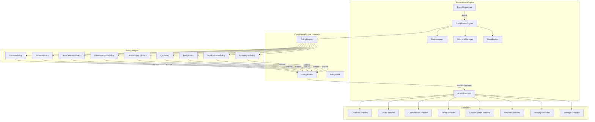
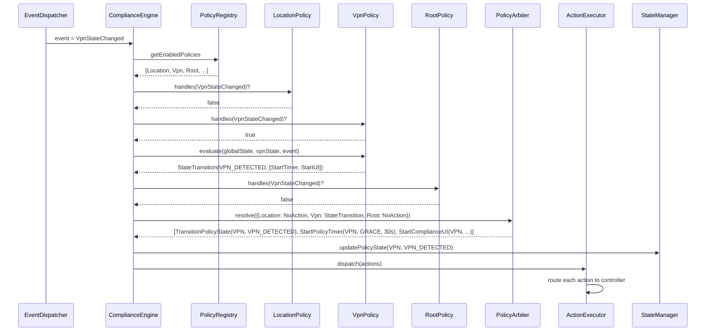
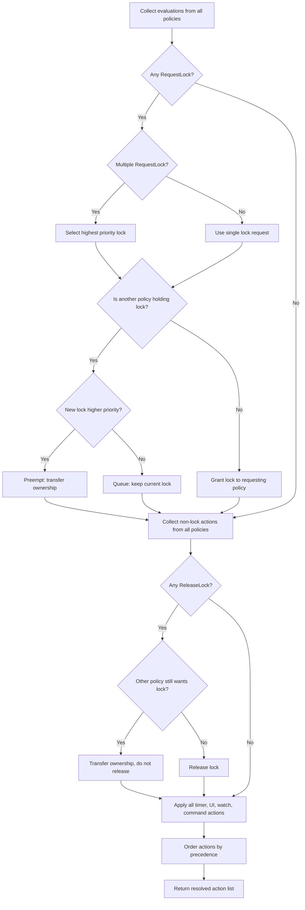
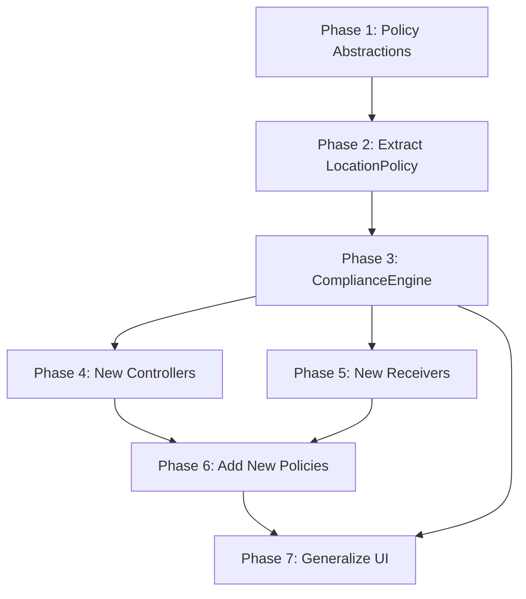

# 🛡️ Compliance Engine — Pluggable Policy Architecture

> **Status:** Architecture Design (No Code)
> **Parent:** [`enforcement-engine-design.md`](enforcement-engine-design.md)
> **Depends on:** [`enforcement-state-machine.md`](enforcement-state-machine.md), [`enforcement-controllers.md`](enforcement-controllers.md), [`enforcement-event-bus.md`](enforcement-event-bus.md), [`enforcement-lifecycle-manager.md`](enforcement-lifecycle-manager.md)

---

## Table of Contents

1. [Design Goals](#1-design-goals)
2. [Current Architecture Limitations](#2-current-architecture-limitations)
3. [Compliance Engine Architecture](#3-compliance-engine-architecture)
4. [Policy Plugin Contract](#4-policy-plugin-contract)
5. [ComplianceEngine — Policy Orchestrator](#5-complianceengine--policy-orchestrator)
6. [PolicyArbiter — Conflict Resolution](#6-policyarbiter--conflict-resolution)
7. [PolicyRegistry — Registration and Discovery](#7-policyregistry--registration-and-discovery)
8. [State Model — Global vs Per-Policy](#8-state-model--global-vs-per-policy)
9. [Event Model — Routing and Namespacing](#9-event-model--routing-and-namespacing)
10. [Action Model — Shared and Policy-Specific](#10-action-model--shared-and-policy-specific)
11. [Policy Priority and Composition](#11-policy-priority-and-composition)
12. [Lock Ownership Model](#12-lock-ownership-model)
13. [Specific Policy Designs](#13-specific-policy-designs)
14. [New Controllers](#14-new-controllers)
15. [New Receivers and Workers](#15-new-receivers-and-workers)
16. [Compliance UI Generalization](#16-compliance-ui-generalization)
17. [Notification Composition](#17-notification-composition)
18. [Flutter Integration](#18-flutter-integration)
19. [Recovery — Multi-Policy](#19-recovery--multi-policy)
20. [Persistence — Multi-Policy](#20-persistence--multi-policy)
21. [Integration with Existing Architecture](#21-integration-with-existing-architecture)
22. [Package Structure](#22-package-structure)
23. [Migration Path](#23-migration-path)
24. [Threading Model](#24-threading-model)
25. [Problems Solved](#25-problems-solved)
26. [Appendix A — Policy × Action Matrix](#appendix-a--policy--action-matrix)
27. [Appendix B — Policy × Event Matrix](#appendix-b--policy--event-matrix)
28. [Appendix C — Policy × Controller Matrix](#appendix-c--policy--controller-matrix)
29. [Appendix D — Relationship to Parent Documents](#appendix-d--relationship-to-parent-documents)

---

## 1. Design Goals

| Goal | Description |
|------|-------------|
| **G1 — Unlimited Policies** | The engine core never changes when a new policy is added. New policies are plug-in modules implementing a common interface. |
| **G2 — Policy Isolation** | Each policy owns its state machine, events, actions, and configuration. Policies cannot reference each other directly. |
| **G3 — Policy Composition** | When multiple policies are violated simultaneously, the engine resolves conflicts deterministically via a priority-based arbiter. |
| **G4 — Single Lock Authority** | Android supports one active lock at a time. The engine manages lock ownership transfer between policies with well-defined preemption rules. |
| **G5 — Backward Compatible** | The existing Location compliance behavior is preserved by extracting it into the first policy plugin — `LocationPolicy`. |
| **G6 — Testable** | Each policy is a pure-logic module with no Android dependencies. Policies are unit-testable in isolation. The arbiter is unit-testable with mock policies. |
| **G7 — Configurable** | Policies can be enabled/disabled at runtime. Each policy has its own configuration object. Policy dependencies are declared and validated. |
| **G8 — Observable** | Flutter receives per-policy state updates. Notifications show the most critical active violation. The event bus carries policy-namespaced events. |

---

## 2. Current Architecture Limitations

The current enforcement engine is **location-specific at every layer**:

| Layer | Current State | Problem |
|-------|---------------|---------|
| **PolicyManager** | Single `evaluate(state, event)` with hardcoded location logic | Cannot add new compliance domains without modifying this function |
| **EnforcementState** | Single `complianceState` enum with 9 location-specific states | No room for other policies' states |
| **EnforcementAction** | Sealed class with location-specific actions | Cannot express VPN/root/integrity actions |
| **EnforcementPolicy** | 7 location-specific parameters | Cannot configure other policies |
| **Controllers** | 7 controllers, all location-oriented | No network/security/settings controllers |
| **Event Bus** | 10 events, all location-specific | No VPN/root/integrity events |
| **State Machine** | 22 primary + 14 recovery transitions, all location-specific | Cannot model other policies' state machines |
| **Receivers** | Location, boot, unlock, screen, package, power, time | No network/VPN/settings observers |
| **Persistence** | 11 fields, all location-specific | No per-policy state storage |

**Root cause:** The PolicyManager is a monolithic decision function. Every new compliance domain would require modifying PolicyManager, EnforcementState, EnforcementAction, EnforcementPolicy, and potentially adding controller methods — violating the Open/Closed Principle.

**Solution:** Extract the decision logic into pluggable policy modules. The engine core becomes a generic orchestrator that iterates policies, collects their evaluations, resolves conflicts, and dispatches actions.

---

## 3. Compliance Engine Architecture

### 3.1 High-Level Architecture



### 3.2 Core Components

| Component | Role | Android Dependencies |
|-----------|------|----------------------|
| **ComplianceEngine** | Orchestrator. Receives events from EventDispatcher, iterates registered policies, collects evaluations, passes to PolicyArbiter, dispatches resolved actions. | None (pure orchestration) |
| **PolicyRegistry** | Holds all registered `CompliancePolicy` instances. Provides iteration, lookup by ID, and dependency validation. | None |
| **PolicyArbiter** | Collects action lists from all policies. Resolves conflicts. Produces a single ordered `List<EnforcementAction>`. | None (pure logic) |
| **PolicyStore** | Manages per-policy state slices. Reads/writes to `SharedPreferences` with namespaced keys. | Context (for SharedPreferences) |
| **CompliancePolicy** | Interface contract. Each implementation is a self-contained compliance domain. | None (pure logic) |

### 3.3 Design Principles

1. **Policies are pure logic** — No Android imports, no I/O, no side effects. Same principle as the existing PolicyManager.
2. **Policies are stateless** — They receive state and return actions. State is managed externally by StateManager/PolicyStore.
3. **Policies are isolated** — A policy cannot reference another policy. Cross-policy interaction happens only through the arbiter.
4. **Policies are composable** — Multiple policies can be active simultaneously. The arbiter resolves conflicts.
5. **Policies are pluggable** — Adding a new policy requires: implement `CompliancePolicy`, register in `PolicyRegistry`, add any needed controllers/receivers. The engine core does not change.

---

## 4. Policy Plugin Contract

### 4.1 CompliancePolicy Interface

Every policy implements this interface:

```
interface CompliancePolicy {
    // Identity
    val id: PolicyId
    val displayName: String
    val priority: PolicyPriority

    // Configuration
    val config: PolicyConfig

    // Dependencies
    val requiredControllers: Set<ControllerId>
    val requiredPermissions: Set<String>
    val dependsOn: Set<PolicyId>          // policy dependencies

    // Lifecycle
    fun initialState(): PolicyState

    // Core logic — pure function, no side effects
    fun evaluate(
        globalState: GlobalEnforcementState,
        policyState: PolicyState,
        event: EnforcementEvent
    ): PolicyEvaluationResult

    // State reducer — pure function
    fun reduce(state: PolicyState, action: PolicyAction): PolicyState

    // Event filtering — which events does this policy care about?
    fun handles(event: EnforcementEvent): Boolean

    // Recovery
    fun reconcileOnCrash(state: PolicyState): List<PolicyAction>
    fun reconcileOnReboot(state: PolicyState): List<PolicyAction>

    // Health check — can this policy function with current device state?
    fun isSupported(globalState: GlobalEnforcementState): Boolean
}
```

### 4.2 PolicyId

```
sealed class PolicyId(val key: String) {
    object LOCATION         : PolicyId("location")
    object NETWORK          : PolicyId("network")
    object ROOT_DETECTION   : PolicyId("root_detection")
    object DEVELOPER_MODE   : PolicyId("developer_mode")
    object USB_DEBUGGING    : PolicyId("usb_debugging")
    object VPN              : PolicyId("vpn")
    object PROXY            : PolicyId("proxy")
    object MOCK_LOCATION    : PolicyId("mock_location")
    object APP_INTEGRITY    : PolicyId("app_integrity")
    // Future policies extend this sealed class
}
```

### 4.3 PolicyPriority

```
enum class PolicyPriority(val weight: Int) {
    CRITICAL(100),   // Root detection, App integrity — immediate lock, no grace
    HIGH(75),        // Developer mode, USB debugging, VPN, Proxy, Mock location — short grace
    MEDIUM(50),      // Network compliance — medium grace
    LOW(25)          // Location compliance — existing behavior, longest grace
}
```

Higher weight = higher priority. When two policies produce conflicting actions, the higher-weight policy wins.

### 4.4 PolicyState

Each policy defines its own state. The base contract:

```
interface PolicyState {
    val policyId: PolicyId
    val isCompliant: Boolean        // true = no violation
    val isLocked: Boolean           // true = this policy has requested a lock
    val countdownDeadline: Long?    // wall-clock ms, null if no countdown active
    fun serialize(): String         // for persistence
    companion object { fun deserialize(policyId: PolicyId, json: String): PolicyState }
}
```

Each policy provides a concrete implementation. For example, `LocationPolicyState` wraps the existing 9-state enum plus countdown/lockout fields.

### 4.5 PolicyEvaluationResult

```
sealed class PolicyEvaluationResult {
    object NoAction : PolicyEvaluationResult()

    data class Actions(
        val actions: List<PolicyAction>
    ) : PolicyEvaluationResult()

    data class StateTransition(
        val newState: PolicyState,
        val actions: List<PolicyAction>
    ) : PolicyEvaluationResult()
}
```

### 4.6 PolicyConfig

```
interface PolicyConfig {
    val policyId: PolicyId
    val enabled: Boolean
    val gracePeriodMs: Long          // 0 = no grace, immediate lock
    val lockCountdownMs: Long        // 0 = no countdown, immediate lock
    val lockoutDurationMs: Long      // duration of timed lock
    val reapplyIntervalMinutes: Int  // periodic re-check interval
    val compliancePollIntervalMs: Long
    val countdownTickIntervalMs: Long
}
```

Each policy can extend this with policy-specific fields:

| Policy | Extra Config Fields |
|--------|-------------------|
| Location | `lockDelayMs`, `forceLocationOn` |
| Network | `allowedNetworks: Set<String>`, `requireWifi: Boolean` |
| Root Detection | `detectionMethods: Set<RootDetectionMethod>`, `checkIntervalMs: Long` |
| Developer Mode | `autoDisable: Boolean` |
| USB Debugging | `autoDisable: Boolean` |
| VPN | `allowedVpnApps: Set<String>`, `allowSystemVpn: Boolean` |
| Proxy | `allowedProxyHosts: Set<String>` |
| Mock Location | `detectionIntervalMs: Long` |
| App Integrity | `checkIntervalMs: Long`, `verificationMethod: IntegrityMethod` |

### 4.7 PolicyAction

Policy actions are high-level intents. The ActionExecutor maps them to concrete controller calls.

```
sealed class PolicyAction {
    // --- State actions ---
    data class TransitionPolicyState(
        val policyId: PolicyId,
        val newState: PolicyState
    ) : PolicyAction()

    // --- Timer actions ---
    data class StartPolicyTimer(
        val policyId: PolicyId,
        val timerType: PolicyTimerType,
        val durationMs: Long
    ) : PolicyAction()

    data class CancelPolicyTimer(
        val policyId: PolicyId,
        val timerType: PolicyTimerType
    ) : PolicyAction()

    data class CancelAllPolicyTimers(
        val policyId: PolicyId
    ) : PolicyAction()

    // --- Lock actions (shared — any policy can request) ---
    data class RequestLock(
        val policyId: PolicyId,
        val reason: LockReason,
        val lockType: LockType
    ) : PolicyAction()

    data class RequestTimedLock(
        val policyId: PolicyId,
        val reason: LockReason,
        val durationMs: Long
    ) : PolicyAction()

    data class ReleaseLock(
        val policyId: PolicyId
    ) : PolicyAction()

    // --- UI actions ---
    data class StartComplianceUI(
        val policyId: PolicyId,
        val title: String,
        val message: String,
        val countdownMs: Long?
    ) : PolicyAction()

    data class FinishComplianceUI(
        val policyId: PolicyId
    ) : PolicyAction()

    // --- Service actions ---
    object StartEnforcementService : PolicyAction()
    object StopEnforcementService : PolicyAction()

    // --- Watcher actions ---
    data class StartWatch(
        val policyId: PolicyId,
        val watchType: WatchType
    ) : PolicyAction()

    data class StopWatch(
        val policyId: PolicyId,
        val watchType: WatchType
    ) : PolicyAction()

    // --- Periodic reapply ---
    data class SchedulePeriodicCheck(
        val policyId: PolicyId,
        val intervalMinutes: Int
    ) : PolicyAction()

    data class CancelPeriodicCheck(
        val policyId: PolicyId
    ) : PolicyAction()

    // --- Notification ---
    data class EmitComplianceEvent(
        val event: ComplianceBusEvent
    ) : PolicyAction()

    // --- Policy-specific command (routed to policy's controller) ---
    data class ExecutePolicyCommand(
        val policyId: PolicyId,
        val command: PolicyCommand
    ) : PolicyAction()
}
```

### 4.8 Supporting Types

```
enum class PolicyTimerType {
    GRACE_PERIOD,
    LOCK_COUNTDOWN,
    TIMED_LOCK,
    LOCKOUT,
    PERIODIC_CHECK
}

enum class LockReason(val key: String) {
    LOCATION_DISABLED("location_disabled"),
    NETWORK_CHANGED("network_changed"),
    ROOT_DETECTED("root_detected"),
    DEVELOPER_MODE_ENABLED("developer_mode_enabled"),
    USB_DEBUGGING_ENABLED("usb_debugging_enabled"),
    VPN_ACTIVE("vpn_active"),
    PROXY_DETECTED("proxy_detected"),
    MOCK_LOCATION_DETECTED("mock_location_detected"),
    INTEGRITY_FAILED("integrity_failed"),
    MANUAL_LOCK("manual_lock")
}

enum class LockType {
    IMMEDIATE,      // lockNow() — no UI
    TIMED,          // lockForDuration() — no UI
    COMPLIANCE      // lock with compliance UI shown
}

enum class WatchType {
    LOCATION_PROVIDER,
    NETWORK_CONNECTIVITY,
    VPN_STATE,
    SETTINGS_GLOBAL,
    MOCK_LOCATION,
    ROOT_INDICATORS,
    APP_INTEGRITY
}

sealed class PolicyCommand {
    data class DisableDeveloperMode(val policyId: PolicyId) : PolicyCommand()
    data class DisableUsbDebugging(val policyId: PolicyId) : PolicyCommand()
    data class ForceLocationOn(val policyId: PolicyId) : PolicyCommand()
    data class RunRootCheck(val policyId: PolicyId) : PolicyCommand()
    data class RunIntegrityCheck(val policyId: PolicyId) : PolicyCommand()
    data class SetUninstallBlocked(val blocked: Boolean) : PolicyCommand()
    data class ArmLockTask(val policyId: PolicyId) : PolicyCommand()
    data class DisarmLockTask(val policyId: PolicyId) : PolicyCommand()
}
```

---

## 5. ComplianceEngine — Policy Orchestrator

### 5.1 Responsibilities

The ComplianceEngine replaces the current `PolicyManager`. It is the decision-making core of the enforcement engine, generalized for unlimited policies.

| Responsibility | Description |
|---------------|-------------|
| **Event reception** | Receives `EnforcementEvent` from `EventDispatcher` |
| **Policy iteration** | Iterates all registered, enabled policies |
| **Event routing** | Routes events to policies that handle them |
| **Evaluation collection** | Collects `PolicyEvaluationResult` from each policy |
| **Conflict resolution** | Passes collected results to `PolicyArbiter` |
| **Action dispatch** | Forwards resolved actions to `ActionExecutor` |
| **State synchronization** | Updates `StateManager` with per-policy state transitions |
| **Recovery coordination** | Orchestrates per-policy crash/reboot reconciliation |

### 5.2 Event Processing Flow

```
processEvent(event: EnforcementEvent):
    1. Acquire engine lock (single-threaded processing)
    2. Read current global state from StateManager
    3. For each registered, enabled policy:
       a. Check policy.handles(event)
       b. If true:
          - Read policy state from PolicyStore
          - Call policy.evaluate(globalState, policyState, event)
          - Store result in evaluationMap[policy.id]
       c. If false:
          - Store NoAction in evaluationMap[policy.id]
    4. Pass evaluationMap to PolicyArbiter.resolve()
    5. Receive resolved List<EnforcementAction>
    6. For each action:
       a. If TransitionPolicyState:
          - Update PolicyStore with new policy state
          - Update StateManager's policyStates map
       b. Else:
          - Route to ActionExecutor
    7. Persist state
    8. Release engine lock
```

### 5.3 Event Processing Diagram



### 5.4 What ComplianceEngine IS

- A pure orchestrator — no business logic, no Android dependencies
- Stateless — reads state from StateManager/PolicyStore, never caches
- Single-threaded — all processing on the engine thread
- Deterministic — same inputs always produce same outputs

### 5.5 What ComplianceEngine IS NOT

- Not a policy — it does not implement `CompliancePolicy`
- Not a controller — it does not execute commands
- Not a state owner — it delegates state to StateManager/PolicyStore
- Not an event source — it does not produce events (policies do, via `EmitComplianceEvent`)

---

## 6. PolicyArbiter — Conflict Resolution

### 6.1 Purpose

When multiple policies are violated simultaneously, each produces its own action list. The PolicyArbiter collects all action lists and produces a single, conflict-free, ordered `List<EnforcementAction>`.

### 6.2 Conflict Resolution Rules

| Action Type | Conflict Scenario | Resolution Rule | Rationale |
|-------------|------------------|-----------------|-----------|
| `RequestLock` | Multiple policies request lock | **Highest priority wins.** If equal priority, the one already holding the lock keeps it. | Most severe violation governs device state |
| `RequestTimedLock` | Multiple policies request timed lock | **Longest duration wins.** The most severe violation persists longest. | Ensures the device stays locked for the maximum required duration |
| `ReleaseLock` | One policy releases, another still wants lock | **Do not release.** Transfer ownership to next highest-priority policy that wants a lock. | Prevents premature unlock when multiple violations exist |
| `StartPolicyTimer` (grace) | Multiple policies start grace timers | **All started.** Each policy has its own namespaced timer. Shortest grace fires first. | Each policy tracks its own grace independently |
| `StartPolicyTimer` (countdown) | Multiple policies start countdowns | **All started.** Shortest countdown fires first, triggering lock. | Most urgent violation locks first |
| `StartComplianceUI` | Multiple policies want to show UI | **Highest priority wins.** Lower-priority UIs are queued. | User sees the most critical violation |
| `FinishComplianceUI` | Multiple policies finish UI | **All applied.** UI dismissed only when all policies finish. | Clean shutdown of all compliance UIs |
| `StartEnforcementService` | Any policy requests service start | **Start if any.** Service runs if any policy is active. | Service is shared infrastructure |
| `StopEnforcementService` | All policies request service stop | **Stop only if ALL request stop.** | Service stays alive while any policy needs it |
| `EmitComplianceEvent` | Multiple policies emit events | **All emitted.** Events are unioned. | All notifications delivered to Flutter |
| `TransitionPolicyState` | Each policy transitions its own state | **All applied.** Each policy owns its state slice. | No conflict — states are independent |
| `ExecutePolicyCommand` | Each policy sends its own commands | **All applied.** Commands are independent. | No conflict — commands target different controllers |
| `StartWatch` / `StopWatch` | Multiple policies manage watchers | **All applied.** Watchers are reference-counted.** | A watcher stays active while any policy needs it |
| `SchedulePeriodicCheck` | Multiple policies schedule checks | **All scheduled.** Each policy has its own WorkManager tag. | Independent periodic checks |

### 6.3 Action Ordering

The arbiter produces actions in a specific order to ensure correctness:

```
1. CancelAllPolicyTimers (for policies transitioning away from timed states)
2. TransitionPolicyState (update state first, so subsequent actions see correct state)
3. CancelPolicyTimer (cancel specific timers)
4. StartPolicyTimer (start new timers)
5. StartWatch / StopWatch (manage watchers)
6. StartEnforcementService (ensure service is running before UI)
7. StartComplianceUI / FinishComplianceUI (manage UI)
8. RequestLock / RequestTimedLock / ReleaseLock (lock actions)
9. ExecutePolicyCommand (policy-specific commands)
10. SchedulePeriodicCheck / CancelPeriodicCheck (periodic work)
11. StopEnforcementService (stop service last, only if all policies idle)
12. EmitComplianceEvent (emit notifications last, after all state changes)
```

### 6.4 Arbiter Decision Flow



---

## 7. PolicyRegistry — Registration and Discovery

### 7.1 Registration

Policies are registered at composition time (in the composition root / DI container):

```
PolicyRegistry:
    register(LocationPolicy(locationConfig))
    register(NetworkPolicy(networkConfig))
    register(RootDetectionPolicy(rootConfig))
    register(DeveloperModePolicy(devModeConfig))
    register(UsbDebuggingPolicy(usbConfig))
    register(VpnPolicy(vpnConfig))
    register(ProxyPolicy(proxyConfig))
    register(MockLocationPolicy(mockConfig))
    register(AppIntegrityPolicy(integrityConfig))
    // Future: just call register() again
```

### 7.2 Discovery

The ComplianceEngine queries the registry:

```
PolicyRegistry:
    fun getAll(): List<CompliancePolicy>
    fun getEnabled(): List<CompliancePolicy>
    fun getById(id: PolicyId): CompliancePolicy?
    fun getDependents(id: PolicyId): List<CompliancePolicy>
```

### 7.3 Dependency Validation

Some policies depend on others:

| Policy | Depends On | Reason |
|--------|-----------|--------|
| USB Debugging | Developer Mode | USB debugging requires developer mode to be enabled first |
| Mock Location | Developer Mode | Mock location is a developer setting |

At registration time, the registry validates:
1. All dependencies are registered before the dependent policy
2. If a dependency is disabled, the dependent policy is automatically disabled
3. If a dependency is unregistered, the dependent policy is unregistered

### 7.4 Dynamic Registration

Policies can be registered/unregistered at runtime (e.g., via remote config):

```
PolicyRegistry:
    fun register(policy: CompliancePolicy)
    fun unregister(id: PolicyId)
    fun setEnabled(id: PolicyId, enabled: Boolean)
```

When a policy is unregistered:
1. Its timers are cancelled
2. Its watchers are stopped
3. Its state is persisted (for re-registration)
4. If it holds the lock, ownership transfers to the next policy

When a policy is registered at runtime:
1. Its initial state is loaded from persistence (or `initialState()` if none)
2. Its watchers are started (if state requires)
3. Its timers are restored (if deadlines are in the future)
4. `reconcileOnCrash()` is called to sync with current device state

---

## 8. State Model — Global vs Per-Policy

### 8.1 State Architecture

The enforcement state is split into **global state** (shared across all policies) and **per-policy state** (owned by each policy).

```mermaid
graph LR
    subgraph GlobalEnforcementState
        GS1[serviceRunning]
        GS2[enforcementArmed]
        GS3[permissionGranted]
        GS4[uninstallBlocked]
        GS5[lockIteration]
        GS6[activeLockPolicy]
        GS7[activeLockReason]
        GS8[activeLockType]
    end

    subgraph Per-Policy State
        PS1[LocationPolicyState]
        PS2[NetworkPolicyState]
        PS3[RootPolicyState]
        PS4[DevModePolicyState]
        PS5[UsbDebugPolicyState]
        PS6[VpnPolicyState]
        PS7[ProxyPolicyState]
        PS8[MockLocPolicyState]
        PS9[IntegrityPolicyState]
    end

    GlobalEnforcementState -->|contains| Per-Policy State
```

### 8.2 GlobalEnforcementState

Fields shared across all policies. These represent the physical device state, not any single policy's compliance state:

| Field | Type | Description |
|-------|------|-------------|
| `serviceRunning` | Boolean | Is EnforcementForegroundService running? |
| `enforcementArmed` | Boolean | Is Lock Task Mode armed? |
| `permissionGranted` | Boolean | Does app have Device Admin/Owner? |
| `uninstallBlocked` | Boolean | Is uninstall blocked? |
| `lockIteration` | Int | How many times has device been locked? |
| `activeLockPolicy` | PolicyId? | Which policy currently owns the lock? |
| `activeLockReason` | LockReason? | Why was the device locked? |
| `activeLockType` | LockType? | What type of lock is active? |
| `policyStates` | Map<PolicyId, PolicyState> | Per-policy state slices |

### 8.3 Per-Policy State

Each policy defines its own state class implementing `PolicyState`. The base interface guarantees:

| Field | Type | Description |
|-------|------|-------------|
| `policyId` | PolicyId | Which policy owns this state |
| `isCompliant` | Boolean | Is the policy currently satisfied? |
| `isLocked` | Boolean | Has this policy requested a lock? |
| `countdownDeadline` | Long? | Wall-clock ms deadline for active countdown |
| `lockoutDeadline` | Long? | Wall-clock ms deadline for active lockout |

Each policy adds its own fields. See [§13 Specific Policy Designs](#13-specific-policy-designs) for per-policy state definitions.

### 8.4 State Access Rules

| Rule | Description |
|------|-------------|
| **R1** | Policies can READ global state but cannot WRITE it. Global state is modified only by the engine via `TransitionPolicyState` and state actions. |
| **R2** | Policies can READ and WRITE their own state slice only. They cannot access other policies' state slices. |
| **R3** | The arbiter can READ all policy states for conflict resolution but cannot WRITE any state. |
| **R4** | StateManager holds the global state. PolicyStore holds per-policy state slices. Both are updated atomically within the engine lock. |

### 8.5 State Composition Example

When Location is in `COUNTDOWN_RUNNING` and VPN is in `VPN_DETECTED`:

```
GlobalEnforcementState:
  serviceRunning: true
  enforcementArmed: true
  permissionGranted: true
  uninstallBlocked: true
  lockIteration: 2
  activeLockPolicy: null          ← no lock yet, both in grace/countdown
  activeLockReason: null
  activeLockType: null
  policyStates:
    LOCATION:
      policyState: COUNTDOWN_RUNNING
      countdownDeadline: 1709900000000
      isCompliant: false
      isLocked: false
    VPN:
      policyState: VPN_DETECTED
      countdownDeadline: 1709900001000   ← slightly later than location
      isCompliant: false
      isLocked: false
    ROOT_DETECTION:
      policyState: NORMAL
      isCompliant: true
      isLocked: false
    ... (other policies in NORMAL)
```

---

## 9. Event Model — Routing and Namespacing

### 9.1 Event Classification

Events are classified into three categories:

| Category | Description | Routing |
|----------|-------------|---------|
| **Global Events** | System-level events relevant to all policies | Broadcast to ALL policies |
| **Policy-Specific Events** | Events relevant to a single policy domain | Routed to the policy that handles it |
| **Timer Events** | Timer expiration events | Routed to the policy that owns the timer |

### 9.2 Global Events

These events are delivered to every registered, enabled policy:

| Event | Source | Why All Policies Care |
|-------|--------|----------------------|
| `BootCompleted` | BootReceiver | Every policy needs to re-check its domain after boot |
| `UserPresent` | UnlockReceiver | Every policy needs to re-evaluate after device unlock |
| `ServiceRestarted` | ForegroundService | Every policy needs to reconcile after process restart |
| `PermissionGranted` | DeviceAdminReceiver | Every policy needs to know when permissions are granted |
| `PermissionRevoked` | DeviceAdminReceiver | Every policy needs to know when permissions are revoked |
| `PackageReplaced` | PackageReceiver | Every policy needs to re-check after app update |
| `TimeChanged` | TimeReceiver | Every policy needs to detect clock manipulation |

### 9.3 Policy-Specific Events

Each policy defines which events it handles via `handles(event: EnforcementEvent)`:

| Policy | Events Handled |
|--------|---------------|
| Location | `LocationProviderChanged`, `LocationRestored` |
| Network | `NetworkChanged`, `NetworkRestored` |
| Root Detection | `RootCheckCompleted` |
| Developer Mode | `DeveloperModeChanged` |
| USB Debugging | `UsbDebuggingChanged` |
| VPN | `VpnStateChanged` |
| Proxy | `ProxyChanged` |
| Mock Location | `MockLocationDetected`, `MockLocationCleared` |
| App Integrity | `IntegrityCheckCompleted` |

### 9.4 Event Routing Flow

```
EventDispatcher receives event:
    1. If event is a global event:
       - Route to ALL enabled policies
    2. If event is policy-specific:
       - Route ONLY to policies where policy.handles(event) == true
    3. If event is a timer event:
       - Extract policyId from timer ID
       - Route ONLY to the policy that owns the timer
    4. Each policy evaluates independently
    5. All results collected by ComplianceEngine
    6. PolicyArbiter resolves
```

### 9.5 Timer Namespacing

Timers are namespaced by policy to prevent collisions:

```
TimerId format: "<PolicyId>:<TimerType>"

Examples:
  "location:GRACE_PERIOD"
  "location:LOCK_COUNTDOWN"
  "vpn:GRACE_PERIOD"
  "vpn:LOCK_COUNTDOWN"
  "root_detection:PERIODIC_CHECK"
  "app_integrity:PERIODIC_CHECK"
```

The TimerController manages a `Map<String, Timer>` instead of a fixed enum. This allows:
- Multiple policies to have independent grace timers
- Multiple policies to have independent countdown timers
- Each policy's timers are cancelled independently
- `CancelAllPolicyTimers(policyId)` cancels all timers for one policy without affecting others

### 9.6 Timer Fire → Event Mapping

When a namespaced timer fires:

```
TimerController:
    onTimerFired(timerId: String):
        val parts = timerId.split(":")
        val policyId = PolicyId.fromKey(parts[0])
        val timerType = PolicyTimerType.valueOf(parts[1])
        val event = TimerExpired(
            policyId = policyId,
            timerType = timerType,
            firedAt = System.currentTimeMillis()
        )
        EventDispatcher.dispatch(event)
```

The `TimerExpired` event carries `policyId` so the ComplianceEngine routes it to the correct policy.

### 9.7 Extended BusEvent Taxonomy

The event bus gains policy-namespaced events:

**Inbound (published by receivers/workers, consumed by ComplianceEngine):**

| Event | Published By | Payload |
|-------|-------------|---------|
| `LocationProviderChanged` | LocationReceiver | `enabled: Boolean` |
| `LocationRestored` | LocationReceiver | — |
| `NetworkChanged` | NetworkReceiver | `networkType: NetworkType`, `isConnected: Boolean` |
| `NetworkRestored` | NetworkReceiver | — |
| `RootCheckCompleted` | RootDetectionWorker | `isRooted: Boolean`, `indicators: List<String>` |
| `DeveloperModeChanged` | SettingsObserver | `enabled: Boolean` |
| `UsbDebuggingChanged` | SettingsObserver | `enabled: Boolean` |
| `VpnStateChanged` | VpnReceiver | `isActive: Boolean`, `packageName: String?` |
| `ProxyChanged` | SettingsObserver | `host: String?`, `port: Int?` |
| `MockLocationDetected` | MockLocationWorker | `packageName: String?` |
| `MockLocationCleared` | MockLocationWorker | — |
| `IntegrityCheckCompleted` | IntegrityWorker | `passed: Boolean`, `failureReason: String?` |
| `TimerExpired` | TimerController | `policyId: PolicyId`, `timerType: PolicyTimerType` |

**Outbound (published by ComplianceEngine, consumed by Flutter/listeners):**

| Event | Published By | Payload |
|-------|-------------|---------|
| `PolicyStateChanged` | ComplianceEngine | `policyId: PolicyId`, `newState: String`, `isCompliant: Boolean` |
| `PolicyViolationDetected` | ComplianceEngine | `policyId: PolicyId`, `reason: LockReason`, `priority: PolicyPriority` |
| `PolicyComplianceRestored` | ComplianceEngine | `policyId: PolicyId` |
| `LockAcquired` | ComplianceEngine | `policyId: PolicyId`, `reason: LockReason`, `lockType: LockType` |
| `LockReleased` | ComplianceEngine | `policyId: PolicyId`, `reason: String` |
| `LockPreempted` | ComplianceEngine | `fromPolicyId: PolicyId`, `toPolicyId: PolicyId`, `reason: String` |
| `ComplianceStarted` | ComplianceEngine | `policyId: PolicyId`, `countdownMs: Long` |
| `ComplianceCompleted` | ComplianceEngine | `policyId: PolicyId`, `reason: String` |
| `DeviceLocked` | ComplianceEngine | `lockType: LockType`, `reason: LockReason` |
| `DeviceUnlocked` | ComplianceEngine | — |
| `PolicyRegistered` | ComplianceEngine | `policyId: PolicyId` |
| `PolicyUnregistered` | ComplianceEngine | `policyId: PolicyId` |

---

## 10. Action Model — Shared and Policy-Specific

### 10.1 Action Categories

Policy actions fall into two categories:

| Category | Description | Examples |
|----------|-------------|---------|
| **Shared Actions** | Actions that any policy can produce. These map to existing controller operations. | `RequestLock`, `StartPolicyTimer`, `StartComplianceUI`, `StartEnforcementService` |
| **Policy-Specific Commands** | Actions unique to a policy. Wrapped in `ExecutePolicyCommand`. | `DisableDeveloperMode`, `RunRootCheck`, `ForceLocationOn` |

### 10.2 Shared Action → Controller Mapping

| PolicyAction | Controller Method | Notes |
|--------------|------------------|-------|
| `RequestLock(IMMEDIATE)` | `LockController.lockNow()` | Immediate device lock |
| `RequestLock(TIMED)` | `LockController.lockForDuration(ms)` | Timed lock |
| `RequestLock(COMPLIANCE)` | `LockController.lockNow()` + `ComplianceController.armLockTask()` | Lock with compliance UI |
| `ReleaseLock` | `ComplianceController.disarmLockTask()` | Release lock task (if compliance) |
| `StartPolicyTimer` | `TimerController.startTimer(id, ms)` | Namespaced timer |
| `CancelPolicyTimer` | `TimerController.cancelTimer(id)` | Cancel specific timer |
| `CancelAllPolicyTimers` | `TimerController.cancelTimersForPolicy(policyId)` | Cancel all timers for a policy |
| `StartComplianceUI` | `ActivityManager.startComplianceActivity(policyId, ...)` | Show compliance screen |
| `FinishComplianceUI` | `ActivityManager.finishComplianceActivity(policyId)` | Dismiss compliance screen |
| `StartEnforcementService` | `ServiceManager.startService()` | Start foreground service |
| `StopEnforcementService` | `ServiceManager.stopService()` | Stop foreground service |
| `StartWatch` | `ReceiverManager.registerReceiver(watchType)` | Start monitoring |
| `StopWatch` | `ReceiverManager.unregisterReceiver(watchType)` | Stop monitoring |
| `SchedulePeriodicCheck` | `WorkManager.schedule(policyId, interval)` | Schedule periodic worker |
| `CancelPeriodicCheck` | `WorkManager.cancel(policyId)` | Cancel periodic worker |
| `EmitComplianceEvent` | `EventEmitter.emit(event)` | Publish to event bus |

### 10.3 Policy-Specific Command → Controller Mapping

| ExecutePolicyCommand | Controller Method | Policy |
|----------------------|------------------|--------|
| `ForceLocationOn` | `LocationController.forceLocationOn()` | Location |
| `DisableDeveloperMode` | `SettingsController.setDeveloperMode(false)` | Developer Mode |
| `DisableUsbDebugging` | `SettingsController.setUsbDebugging(false)` | USB Debugging |
| `RunRootCheck` | `SecurityController.checkRoot()` | Root Detection |
| `RunIntegrityCheck` | `SecurityController.verifyIntegrity()` | App Integrity |
| `ArmLockTask` | `ComplianceController.armLockTask()` | Any compliance policy |
| `DisarmLockTask` | `ComplianceController.disarmLockTask()` | Any compliance policy |
| `SetUninstallBlocked` | `DeviceOwnerController.setUninstallBlocked(blocked)` | Global |

### 10.4 ActionExecutor Routing

The ActionExecutor gains a new routing rule for `ExecutePolicyCommand`:

```
ActionExecutor.execute(action: EnforcementAction):
    when (action):
        is PolicyAction.RequestLock ->
            route to LockController based on lockType
        is PolicyAction.StartPolicyTimer ->
            TimerController.startTimer("${action.policyId}:${action.timerType}", action.durationMs)
        is PolicyAction.ExecutePolicyCommand ->
            route to controller based on command type:
                ForceLocationOn     -> LocationController
                DisableDeveloperMode -> SettingsController
                DisableUsbDebugging  -> SettingsController
                RunRootCheck         -> SecurityController
                RunIntegrityCheck    -> SecurityController
                ArmLockTask          -> ComplianceController
                DisarmLockTask       -> ComplianceController
                SetUninstallBlocked  -> DeviceOwnerController
        ... (existing action routing unchanged)
```

---

## 11. Policy Priority and Composition

### 11.1 Priority Levels

| Priority | Weight | Policies | Grace Period | Lock Type |
|----------|--------|----------|-------------|-----------|
| CRITICAL | 100 | Root Detection, App Integrity | None (immediate lock) | IMMEDIATE |
| HIGH | 75 | Developer Mode, USB Debugging, VPN, Proxy, Mock Location | Short (30s) | COMPLIANCE |
| MEDIUM | 50 | Network | Medium (60s) | COMPLIANCE |
| LOW | 25 | Location | Long (120s) | COMPLIANCE |

### 11.2 Composition Scenarios

**Scenario 1: Location disabled + VPN active (simultaneous)**

```
Location (LOW, grace=120s):  LOCATION_DISABLED → start grace 120s
VPN (HIGH, grace=30s):       VPN_DETECTED → start grace 30s

→ VPN grace expires first (30s < 120s)
→ VPN transitions to COUNTDOWN_RUNNING, starts countdown
→ Location still in LOCATION_DISABLED with 90s grace remaining
→ VPN countdown expires → VPN requests lock
→ Lock granted to VPN (HIGH priority)
→ Location's grace continues; when it expires, Location also requests lock
→ Arbiter: VPN already holds lock (HIGH > LOW) → Location's lock request queued
→ When VPN lock is released (VPN compliance restored):
   → Check if Location still wants lock → yes
   → Transfer ownership to Location
   → Location lock begins
```

**Scenario 2: Root detected while Location countdown running**

```
Location (LOW):  COUNTDOWN_RUNNING, 60s remaining
Root (CRITICAL): ROOT_DETECTED → immediate lock

→ Root requests IMMEDIATE lock (no grace, no countdown)
→ Arbiter: Root is CRITICAL, preempts any existing lock
→ Lock granted to Root immediately
→ Location's countdown is cancelled (device is already locked)
→ Location state preserved: will re-evaluate after unlock
→ On unlock: Root re-checks → if still rooted, re-lock immediately
→ Location re-evaluates → if still disabled, restart grace
```

**Scenario 3: Developer Mode + USB Debugging (dependency)**

```
Developer Mode (HIGH): DEVELOPER_MODE_DETECTED → grace 30s
USB Debugging (HIGH): USB_DEBUGGING_DETECTED → grace 30s

→ Both start grace timers simultaneously
→ Both expire at same time (30s)
→ Both request COMPLIANCE lock
→ Arbiter: same priority (HIGH), Developer Mode registered first
→ Lock granted to Developer Mode
→ USB Debugging's lock request queued
→ Compliance UI shows: "Developer Mode is enabled"
→ When Developer Mode is disabled:
   → Check USB Debugging → still enabled
   → Transfer ownership to USB Debugging
   → Compliance UI updates: "USB Debugging is enabled"
```

**Scenario 4: All policies compliant**

```
All policies: NORMAL, isCompliant=true

→ No policy requests lock
→ No policy requests service
→ Arbiter: StopEnforcementService (all request stop)
→ Service stops
→ Device returns to normal operation
→ Watchers remain active (if configured) to detect future violations
```

### 11.3 Composition Decision Matrix

| Existing Lock | New Request | Action |
|--------------|-------------|--------|
| None | Any | Grant lock to requesting policy |
| LOW | MEDIUM/HIGH/CRITICAL | Preempt: transfer to higher priority |
| MEDIUM | HIGH/CRITICAL | Preempt: transfer to higher priority |
| HIGH | CRITICAL | Preempt: transfer to higher priority |
| HIGH | HIGH (same) | Queue: keep current, queue new |
| CRITICAL | Any | Keep CRITICAL: reject preemption |
| Any | Same policy | No-op: already locked by this policy |
| Any | Lower priority | Queue: keep current lock |

---

## 12. Lock Ownership Model

### 12.1 The Problem

Android supports one active lock at a time (`DevicePolicyManager.lockNow()` or Lock Task Mode). When multiple policies want to lock, only one can hold the lock. The engine must manage ownership transfer.

### 12.2 Lock Ownership State

The global state tracks lock ownership:

| Field | Type | Description |
|-------|------|-------------|
| `activeLockPolicy` | PolicyId? | Which policy currently owns the lock |
| `activeLockReason` | LockReason? | Why the device is locked |
| `activeLockType` | LockType? | What type of lock is active |
| `lockQueue` | List<PolicyId> | Policies waiting for lock (ordered by priority) |

### 12.3 Lock Lifecycle

```mermaid
state diagram-v2
    [*] --> Unlocked
    Unlocked --> LockRequested: Policy requests lock
    LockRequested --> Locked: Lock executed
    Locked --> LockReleased: Policy releases lock
    LockReleased --> Unlocked: No other policy wants lock
    LockReleased --> LockRequested: Another policy wants lock
    Locked --> LockPreempted: Higher priority policy requests lock
    LockPreempted --> Locked: New lock executed
```

### 12.4 Lock Acquisition Flow

```
PolicyArbiter.resolveLockRequests(requests: List<RequestLock>):
    1. If no requests: return null (no lock action)
    2. Sort requests by priority (descending)
    3. If activeLockPolicy == null:
       a. Grant lock to highest-priority request
       b. Set activeLockPolicy, activeLockReason, activeLockType
       c. Return RequestLock action
    4. If activeLockPolicy != null:
       a. Compare highest-priority request with activeLockPolicy priority
       b. If request priority > active priority:
          - Preempt: save current policy state
          - Set activeLockPolicy to new policy
          - Return RequestLock action
       c. If request priority <= active priority:
          - Add to lockQueue
          - Return null (no lock action, queued)
```

### 12.5 Lock Release Flow

```
PolicyArbiter.resolveLockRelease(release: ReleaseLock):
    1. If activeLockPolicy != release.policyId:
       - Ignore (policy doesn't own lock)
       - Return null
    2. If lockQueue is not empty:
       a. Pop highest-priority from queue
       b. Transfer ownership: activeLockPolicy = nextPolicy
       c. Return RequestLock(nextPolicy, ...) action
       d. Do NOT release the physical lock — just transfer ownership
    3. If lockQueue is empty:
       a. Clear activeLockPolicy, activeLockReason, activeLockType
       b. Return ReleaseLock action (physically release lock)
```

### 12.6 Lock Preemption Details

When a higher-priority policy preempts a lower-priority policy's lock:

1. The lower-priority policy's state is **preserved** (not reset to NORMAL)
2. The lower-priority policy's timers are **cancelled** (device is already locked)
3. The lower-priority policy is added to `lockQueue`
4. When the higher-priority lock is released, the lower-priority policy resumes:
   - Its state is re-evaluated
   - If still non-compliant, it re-enters its enforcement flow
   - If compliant, it transitions to NORMAL

---

## 13. Specific Policy Designs

### 13.1 LocationPolicy (existing, refactored)

**Priority:** LOW (25)

**State Machine:** The existing 9-state machine is preserved exactly:

```
NORMAL → LOCATION_DISABLED → COUNTDOWN_RUNNING → COMPLIANCE → LOCK_REQUIRED → LOCKED
                ↑                                                          ↓
                ← ← ← ← ← ← ← ← DEVICE_UNLOCKED ← ← ← ← ← ← ← ← ← ← ← ←
                                          ↓
                                     VERIFYING → LOCATION_RESTORED → NORMAL
```

**State — LocationPolicyState:**

| Field | Type | Description |
|-------|------|-------------|
| `complianceState` | LocationComplianceState | 9-state enum (existing) |
| `countdownDeadline` | Long? | Lock countdown deadline |
| `timedLockDurationMs` | Long? | Timed lock duration |
| `lockoutActive` | Boolean | Is lockout active? |
| `lockoutDeadline` | Long? | Lockout deadline |

**Config — LocationPolicyConfig:**

| Field | Default | Description |
|-------|---------|-------------|
| `gracePeriodMs` | 120000 | Grace period before countdown |
| `lockCountdownMs` | 120000 | Countdown before lock |
| `lockoutDurationMs` | 60000 | Timed lock duration |
| `lockDelayMs` | 30000 | Service self-stop delay |
| `reapplyIntervalMinutes` | 15 | Periodic reapply interval |
| `compliancePollIntervalMs` | 2000 | Compliance poll interval |
| `countdownTickIntervalMs` | 1000 | Countdown tick interval |
| `forceLocationOn` | true | Whether to force location on |

**Events Handled:**

| Event | Transition |
|-------|-----------|
| `LocationProviderChanged(false)` | NORMAL → LOCATION_DISABLED |
| `LocationProviderChanged(true)` | any → LOCATION_RESTORED → NORMAL |
| `TimerExpired(LOCATION, GRACE_PERIOD)` | LOCATION_DISABLED → COUNTDOWN_RUNNING |
| `TimerExpired(LOCATION, LOCK_COUNTDOWN)` | COUNTDOWN_RUNNING → COMPLIANCE → LOCK_REQUIRED |
| `UserPresent` | LOCKED → DEVICE_UNLOCKED → VERIFYING |
| `BootCompleted` | Recovery reconciliation |
| `LockNowRequested` | any → LOCK_REQUIRED |

**Controllers Used:** LocationController, LockController, ComplianceController, TimerController, DeviceOwnerController

**Recovery:**
- `reconcileOnCrash`: If state was COUNTDOWN_RUNNING/COMPLIANCE, restart countdown with remaining time. If LOCKED, re-lock.
- `reconcileOnReboot`: If state was LOCKED, re-lock. If LOCATION_DISABLED, re-check location and restart grace.

---

### 13.2 NetworkPolicy

**Priority:** MEDIUM (50)

**Purpose:** Enforce that the device is connected to an approved network. Detects Wi-Fi/cellular disconnects, network type changes, and connection to unapproved networks.

**State Machine:**

```
NORMAL → NETWORK_CHANGED → COUNTDOWN_RUNNING → COMPLIANCE → LOCK_REQUIRED → LOCKED
              ↑                                                           ↓
              ← ← ← ← ← ← ← ← DEVICE_UNLOCKED ← ← ← ← ← ← ← ← ← ← ← ← ←
                                        ↓
                                   VERIFYING → NETWORK_RESTORED → NORMAL
```

**State — NetworkPolicyState:**

| Field | Type | Description |
|-------|------|-------------|
| `complianceState` | NetworkComplianceState | 7-state enum |
| `countdownDeadline` | Long? | Countdown deadline |
| `lastNetworkType` | NetworkType? | Last known network type |
| `countdownRemainingMs` | Long? | Remaining countdown for recovery |

**Config — NetworkPolicyConfig:**

| Field | Default | Description |
|-------|---------|-------------|
| `gracePeriodMs` | 60000 | Grace period (shorter than location) |
| `lockCountdownMs` | 60000 | Countdown before lock |
| `lockoutDurationMs` | 60000 | Timed lock duration |
| `allowedNetworks` | Set<String> | Allowed SSIDs/BSSIDs (empty = any) |
| `requireWifi` | Boolean | Must be on Wi-Fi |
| `blockCellular` | Boolean | Block cellular data |

**Events Handled:**

| Event | Transition |
|-------|-----------|
| `NetworkChanged(disconnected)` | NORMAL → NETWORK_CHANGED |
| `NetworkChanged(unapproved)` | NORMAL → NETWORK_CHANGED |
| `NetworkRestored` | any → NETWORK_RESTORED → NORMAL |
| `TimerExpired(NETWORK, GRACE_PERIOD)` | NETWORK_CHANGED → COUNTDOWN_RUNNING |
| `TimerExpired(NETWORK, LOCK_COUNTDOWN)` | COUNTDOWN_RUNNING → COMPLIANCE → LOCK_REQUIRED |
| `UserPresent` | LOCKED → DEVICE_UNLOCKED → VERIFYING |

**Controllers Used:** NetworkController, LockController, ComplianceController, TimerController

**Detection Methods:**
- `ConnectivityManager.NetworkCallback` for real-time connectivity changes
- `WifiManager.getConnectionInfo()` for SSID/BSSID
- `TelephonyManager` for cellular state

---

### 13.3 RootDetectionPolicy

**Priority:** CRITICAL (100)

**Purpose:** Detect device rooting (su binary, Magisk, root management apps). Immediate lock on detection — no grace period, no countdown.

**State Machine:**

```
NORMAL → ROOT_DETECTED → LOCKED → DEVICE_UNLOCKED → ROOT_DETECTED → LOCKED
                                                        ↑
                                                   (re-lock immediately if still rooted)
```

Note: Once root is detected, the device re-locks on every unlock until root is removed. There is no path back to NORMAL while root is present.

**State — RootDetectionState:**

| Field | Type | Description |
|-------|------|-------------|
| `complianceState` | RootComplianceState | 3-state enum: NORMAL, ROOT_DETECTED, LOCKED |
| `detectedIndicators` | List<String> | Root indicators found (su, magisk, etc.) |
| `lastCheckTime` | Long | Timestamp of last root check |

**Config — RootDetectionConfig:**

| Field | Default | Description |
|-------|---------|-------------|
| `gracePeriodMs` | 0 | No grace (immediate lock) |
| `lockCountdownMs` | 0 | No countdown (immediate lock) |
| `lockoutDurationMs` | 300000 | 5-minute lock |
| `checkIntervalMs` | 300000 | Check every 5 minutes |
| `detectionMethods` | Set<RootDetectionMethod> | Which checks to run |

**RootDetectionMethod enum:**

| Method | Description |
|--------|-------------|
| `SU_BINARY` | Check for `/system/bin/su`, `/system/xbin/su`, etc. |
| `MAGISK` | Check for Magisk app package, Magisk daemon |
| `BUSYBOX` | Check for BusyBox binary |
| `ROOT_APPS` | Check for known root management apps (SuperSU, KingRoot, etc.) |
| `BUILD_TAGS` | Check `Build.TAGS` for "test-keys" |
| `SELINUX` | Check SELinux status (permissive = suspicious) |
| `PLAY_INTEGRITY` | Use Play Integrity API (if available) |

**Events Handled:**

| Event | Transition |
|-------|-----------|
| `RootCheckCompleted(isRooted=true)` | NORMAL → ROOT_DETECTED → LOCK_REQUIRED (immediate) |
| `RootCheckCompleted(isRooted=false)` | ROOT_DETECTED → NORMAL (root removed) |
| `UserPresent` | LOCKED → DEVICE_UNLOCKED → ROOT_DETECTED (re-check) |
| `TimerExpired(ROOT, PERIODIC_CHECK)` | Trigger root check |

**Controllers Used:** SecurityController, LockController, TimerController

**Recovery:**
- `reconcileOnCrash`: If state was LOCKED, re-lock. If ROOT_DETECTED, re-check immediately.
- `reconcileOnReboot`: Always run root check on boot. If rooted, lock immediately.

---

### 13.4 DeveloperModePolicy

**Priority:** HIGH (75)

**Purpose:** Detect when Developer Options are enabled. Enforce a grace period before locking.

**State Machine:**

```
NORMAL → DEVELOPER_MODE_DETECTED → COUNTDOWN_RUNNING → COMPLIANCE → LOCK_REQUIRED → LOCKED
              ↑                                                                           ↓
              ← ← ← ← ← ← ← ← ← ← ← ← DEVICE_UNLOCKED ← ← ← ← ← ← ← ← ← ← ← ← ← ← ← ←
                                                ↓
                                           VERIFYING → DEVELOPER_MODE_CLEARED → NORMAL
```

**State — DeveloperModeState:**

| Field | Type | Description |
|-------|------|-------------|
| `complianceState` | DevModeComplianceState | 7-state enum |
| `countdownDeadline` | Long? | Countdown deadline |
| `wasAutoDisabled` | Boolean | Did we auto-disable it? |

**Config — DeveloperModeConfig:**

| Field | Default | Description |
|-------|---------|-------------|
| `gracePeriodMs` | 30000 | 30-second grace |
| `lockCountdownMs` | 30000 | 30-second countdown |
| `lockoutDurationMs` | 60000 | 1-minute lock |
| `autoDisable` | true | Attempt to auto-disable via DeviceOwner |

**Events Handled:**

| Event | Transition |
|-------|-----------|
| `DeveloperModeChanged(true)` | NORMAL → DEVELOPER_MODE_DETECTED |
| `DeveloperModeChanged(false)` | any → DEVELOPER_MODE_CLEARED → NORMAL |
| `TimerExpired(DEVELOPER_MODE, GRACE_PERIOD)` | DEVELOPER_MODE_DETECTED → COUNTDOWN_RUNNING |
| `TimerExpired(DEVELOPER_MODE, LOCK_COUNTDOWN)` | COUNTDOWN_RUNNING → COMPLIANCE → LOCK_REQUIRED |
| `UserPresent` | LOCKED → DEVICE_UNLOCKED → VERIFYING |

**Controllers Used:** SettingsController, LockController, ComplianceController, TimerController, DeviceOwnerController

**Detection Method:**
- `ContentObserver` on `Settings.Global.CONTENT_URI` filtering for `Settings.Global.DEVELOPMENT_SETTINGS_ENABLED`
- If `autoDisable=true` and Device Owner: `DevicePolicyManager.setGlobalSetting(DEVELOPMENT_SETTINGS_ENABLED, "0")`

---

### 13.5 UsbDebuggingPolicy

**Priority:** HIGH (75)

**Purpose:** Detect when USB Debugging (ADB) is enabled.

**State Machine:** Same structure as DeveloperModePolicy (7 states).

**State — UsbDebuggingState:**

| Field | Type | Description |
|-------|------|-------------|
| `complianceState` | UsbDebugComplianceState | 7-state enum |
| `countdownDeadline` | Long? | Countdown deadline |
| `wasAutoDisabled` | Boolean | Did we auto-disable it? |

**Config — UsbDebuggingConfig:**

| Field | Default | Description |
|-------|---------|-------------|
| `gracePeriodMs` | 30000 | 30-second grace |
| `lockCountdownMs` | 30000 | 30-second countdown |
| `lockoutDurationMs` | 60000 | 1-minute lock |
| `autoDisable` | true | Attempt to auto-disable via DeviceOwner |

**Events Handled:**

| Event | Transition |
|-------|-----------|
| `UsbDebuggingChanged(true)` | NORMAL → USB_DEBUGGING_DETECTED |
| `UsbDebuggingChanged(false)` | any → USB_DEBUGGING_CLEARED → NORMAL |
| `TimerExpired(USB_DEBUGGING, GRACE_PERIOD)` | USB_DEBUGGING_DETECTED → COUNTDOWN_RUNNING |
| `TimerExpired(USB_DEBUGGING, LOCK_COUNTDOWN)` | COUNTDOWN_RUNNING → COMPLIANCE → LOCK_REQUIRED |
| `UserPresent` | LOCKED → DEVICE_UNLOCKED → VERIFYING |

**Controllers Used:** SettingsController, LockController, ComplianceController, TimerController, DeviceOwnerController

**Detection Method:**
- `ContentObserver` on `Settings.Global.CONTENT_URI` filtering for `Settings.Global.ADB_ENABLED`
- If `autoDisable=true` and Device Owner: `DevicePolicyManager.setGlobalSetting(ADB_ENABLED, "0")`

**Dependency:** Depends on `DeveloperModePolicy`. If Developer Mode is disabled, USB Debugging is automatically disabled by Android. The policy dependency ensures USB Debugging is only active when Developer Mode is also active.

---

### 13.6 VpnPolicy

**Priority:** HIGH (75)

**Purpose:** Detect when a VPN is active. VPNs can bypass network restrictions and hide traffic.

**State Machine:**

```
NORMAL → VPN_DETECTED → COUNTDOWN_RUNNING → COMPLIANCE → LOCK_REQUIRED → LOCKED
              ↑                                                                     ↓
              ← ← ← ← ← ← ← ← ← ← ← ← ← ← DEVICE_UNLOCKED ← ← ← ← ← ← ← ← ← ← ← ←
                                                    ↓
                                               VERIFYING → VPN_CLEARED → NORMAL
```

**State — VpnPolicyState:**

| Field | Type | Description |
|-------|------|-------------|
| `complianceState` | VpnComplianceState | 7-state enum |
| `countdownDeadline` | Long? | Countdown deadline |
| `detectedVpnPackage` | String? | Package name of VPN app |

**Config — VpnPolicyConfig:**

| Field | Default | Description |
|-------|---------|-------------|
| `gracePeriodMs` | 30000 | 30-second grace |
| `lockCountdownMs` | 30000 | 30-second countdown |
| `lockoutDurationMs` | 60000 | 1-minute lock |
| `allowedVpnApps` | Set<String> | Whitelisted VPN packages |
| `allowSystemVpn` | Boolean | Allow Android system VPN (always-on) |

**Events Handled:**

| Event | Transition |
|-------|-----------|
| `VpnStateChanged(isActive=true)` | NORMAL → VPN_DETECTED |
| `VpnStateChanged(isActive=false)` | any → VPN_CLEARED → NORMAL |
| `TimerExpired(VPN, GRACE_PERIOD)` | VPN_DETECTED → COUNTDOWN_RUNNING |
| `TimerExpired(VPN, LOCK_COUNTDOWN)` | COUNTDOWN_RUNNING → COMPLIANCE → LOCK_REQUIRED |
| `UserPresent` | LOCKED → DEVICE_UNLOCKED → VERIFYING |

**Controllers Used:** NetworkController, LockController, ComplianceController, TimerController

**Detection Method:**
- `ConnectivityManager.getNetworkCapabilities()` checking for `TRANSPORT_VPN`
- Polling every `compliancePollIntervalMs` (VPN state changes don't always broadcast)
- `VpnService` API for checking active VPN connections

---

### 13.7 ProxyPolicy

**Priority:** HIGH (75)

**Purpose:** Detect when a proxy is configured. Proxies can intercept and redirect network traffic.

**State Machine:** Same structure as VpnPolicy (7 states).

**State — ProxyPolicyState:**

| Field | Type | Description |
|-------|------|-------------|
| `complianceState` | ProxyComplianceState | 7-state enum |
| `countdownDeadline` | Long? | Countdown deadline |
| `detectedProxyHost` | String? | Proxy host |
| `detectedProxyPort` | Int? | Proxy port |

**Config — ProxyPolicyConfig:**

| Field | Default | Description |
|-------|---------|-------------|
| `gracePeriodMs` | 30000 | 30-second grace |
| `lockCountdownMs` | 30000 | 30-second countdown |
| `lockoutDurationMs` | 60000 | 1-minute lock |
| `allowedProxyHosts` | Set<String> | Whitelisted proxy hosts |

**Events Handled:**

| Event | Transition |
|-------|-----------|
| `ProxyChanged(host != null)` | NORMAL → PROXY_DETECTED |
| `ProxyChanged(host == null)` | any → PROXY_CLEARED → NORMAL |
| `TimerExpired(PROXY, GRACE_PERIOD)` | PROXY_DETECTED → COUNTDOWN_RUNNING |
| `TimerExpired(PROXY, LOCK_COUNTDOWN)` | COUNTDOWN_RUNNING → COMPLIANCE → LOCK_REQUIRED |
| `UserPresent` | LOCKED → DEVICE_UNLOCKED → VERIFYING |

**Controllers Used:** NetworkController, LockController, ComplianceController, TimerController

**Detection Method:**
- `System.getProperty("http.proxyHost")` and `System.getProperty("http.proxyPort")`
- `Settings.Global.HTTP_PROXY` for system-wide proxy
- `ConnectivityManager.getDefaultProxy()` for PAC (Proxy Auto-Config)
- Polling every `compliancePollIntervalMs` (proxy changes don't broadcast)

---

### 13.8 MockLocationPolicy

**Priority:** HIGH (75)

**Purpose:** Detect when mock location is being used. Mock location can spoof the device's GPS position, bypassing location-based enforcement.

**State Machine:**

```
NORMAL → MOCK_LOCATION_DETECTED → LOCKED → DEVICE_UNLOCKED → MOCK_LOCATION_DETECTED → LOCKED
                                              (re-lock immediately if mock location still active)
```

Note: Like Root Detection, once mock location is detected, the device re-locks on every unlock until mock location is disabled. No grace period.

**State — MockLocationState:**

| Field | Type | Description |
|-------|------|-------------|
| `complianceState` | MockLocComplianceState | 3-state enum: NORMAL, MOCK_LOCATION_DETECTED, LOCKED |
| `detectedPackage` | String? | Package providing mock location |
| `lastCheckTime` | Long | Timestamp of last check |

**Config — MockLocationConfig:**

| Field | Default | Description |
|-------|---------|-------------|
| `gracePeriodMs` | 0 | No grace (immediate lock) |
| `lockCountdownMs` | 0 | No countdown (immediate lock) |
| `lockoutDurationMs` | 300000 | 5-minute lock |
| `detectionIntervalMs` | 5000 | Check every 5 seconds |

**Events Handled:**

| Event | Transition |
|-------|-----------|
| `MockLocationDetected` | NORMAL → MOCK_LOCATION_DETECTED → LOCK_REQUIRED (immediate) |
| `MockLocationCleared` | MOCK_LOCATION_DETECTED → NORMAL |
| `UserPresent` | LOCKED → DEVICE_UNLOCKED → MOCK_LOCATION_DETECTED (re-check) |
| `TimerExpired(MOCK_LOCATION, PERIODIC_CHECK)` | Trigger mock location check |

**Controllers Used:** LocationController, LockController, TimerController

**Detection Method:**
- `Location.isFromMockProvider()` on location updates
- `Settings.Secure.ALLOW_MOCK_LOCATION` (deprecated on newer Android, but still useful)
- `LocationManager.getProviders()` and check for mock providers
- `FusedLocationProviderClient` with `isMockLocation` flag

**Dependency:** Depends on `DeveloperModePolicy`. Mock location requires Developer Mode to be enabled.

---

### 13.9 AppIntegrityPolicy

**Priority:** CRITICAL (100)

**Purpose:** Verify that the app itself has not been tampered with, modified, or repackaged. Detects APK modification, signature mismatch, and runtime hooking.

**State Machine:**

```
NORMAL → INTEGRITY_FAILED → LOCKED → DEVICE_UNLOCKED → INTEGRITY_FAILED → LOCKED
                                              (re-lock immediately if integrity still fails)
```

Note: Like Root Detection, once integrity fails, the device re-locks on every unlock until integrity is restored (app reinstalled from trusted source).

**State — IntegrityPolicyState:**

| Field | Type | Description |
|-------|------|-------------|
| `complianceState` | IntegrityComplianceState | 3-state enum: NORMAL, INTEGRITY_FAILED, LOCKED |
| `failureReason` | String? | Why integrity check failed |
| `lastCheckTime` | Long | Timestamp of last check |

**Config — AppIntegrityConfig:**

| Field | Default | Description |
|-------|---------|-------------|
| `gracePeriodMs` | 0 | No grace (immediate lock) |
| `lockCountdownMs` | 0 | No countdown (immediate lock) |
| `lockoutDurationMs` | 300000 | 5-minute lock |
| `checkIntervalMs` | 600000 | Check every 10 minutes |
| `verificationMethod` | IntegrityMethod | Which verification to use |

**IntegrityMethod enum:**

| Method | Description |
|--------|-------------|
| `SIGNATURE` | Verify APK signature matches expected certificate hash |
| `PLAY_INTEGRITY` | Use Google Play Integrity API |
| `SAFETYNET` | Use SafetyNet Attestation API (deprecated, use Play Integrity) |
| `PACKAGE_CHECK` | Verify package name, version, installer source |
| `RUNTIME_CHECK` | Detect Frida, Xposed, runtime hooks |

**Events Handled:**

| Event | Transition |
|-------|-----------|
| `IntegrityCheckCompleted(passed=false)` | NORMAL → INTEGRITY_FAILED → LOCK_REQUIRED (immediate) |
| `IntegrityCheckCompleted(passed=true)` | INTEGRITY_FAILED → NORMAL (integrity restored) |
| `UserPresent` | LOCKED → DEVICE_UNLOCKED → INTEGRITY_FAILED (re-check) |
| `TimerExpired(APP_INTEGRITY, PERIODIC_CHECK)` | Trigger integrity check |

**Controllers Used:** SecurityController, LockController, TimerController

**Detection Method:**
- `PackageManager.getPackageInfo()` with `GET_SIGNATURES` for signature verification
- `PackageManager.getInstallerPackageName()` to verify install source
- Play Integrity API for server-side verification
- Runtime detection: check for Frida agent, Xposed hooks, debuggers attached

**Recovery:**
- `reconcileOnCrash`: If state was LOCKED, re-lock. If INTEGRITY_FAILED, re-check immediately.
- `reconcileOnReboot`: Always run integrity check on boot. If failed, lock immediately.

---

### 13.10 Policy Summary Table

| Policy | Priority | Grace | Countdown | States | Lock Type | Dependencies |
|--------|----------|-------|-----------|--------|-----------|-------------|
| Location | LOW (25) | 120s | 120s | 9 | COMPLIANCE | None |
| Network | MEDIUM (50) | 60s | 60s | 7 | COMPLIANCE | None |
| Root Detection | CRITICAL (100) | 0s | 0s | 3 | IMMEDIATE | None |
| Developer Mode | HIGH (75) | 30s | 30s | 7 | COMPLIANCE | None |
| USB Debugging | HIGH (75) | 30s | 30s | 7 | COMPLIANCE | Developer Mode |
| VPN | HIGH (75) | 30s | 30s | 7 | COMPLIANCE | None |
| Proxy | HIGH (75) | 30s | 30s | 7 | COMPLIANCE | None |
| Mock Location | HIGH (75) | 0s | 0s | 3 | IMMEDIATE | Developer Mode |
| App Integrity | CRITICAL (100) | 0s | 0s | 3 | IMMEDIATE | None |

---

## 14. New Controllers

### 14.1 NetworkController

**Interface — NetworkOperations:**

| Method | Returns | Description |
|--------|---------|-------------|
| `isConnected()` | Boolean | Is device connected to any network? |
| `getNetworkType()` | NetworkType | Current network type (WIFI, CELLULAR, NONE, VPN) |
| `getWifiSsid()` | String? | Current Wi-Fi SSID (null if not on Wi-Fi) |
| `getWifiBssid()` | String? | Current Wi-Fi BSSID |
| `isVpnActive()` | Boolean | Is a VPN transport active? |
| `getVpnPackage()` | String? | Package name of active VPN app |
| `getProxyHost()` | String? | System proxy host |
| `getProxyPort()` | Int? | System proxy port |
| `startNetworkWatch()` | Unit | Register NetworkCallback |
| `stopNetworkWatch()` | Unit | Unregister NetworkCallback |

**Implementation:** Uses `ConnectivityManager`, `WifiManager`, `System.getProperty()`.

### 14.2 SecurityController

**Interface — SecurityOperations:**

| Method | Returns | Description |
|--------|---------|-------------|
| `checkRoot()` | RootCheckResult | Run all enabled root detection methods |
| `isRooted()` | Boolean | Quick root check (cached result) |
| `verifyIntegrity()` | IntegrityResult | Run app integrity verification |
| `getApkSignatureHash()` | String | SHA-256 of APK signing certificate |
| `getInstallerPackage()` | String? | Package name of app installer |
| `isDebuggerAttached()` | Boolean | Is a debugger attached? |
| `isFridaPresent()` | Boolean | Is Frida agent detected? |
| `isXposedPresent()` | Boolean | Is Xposed framework detected? |

**Implementation:** Uses `PackageManager`, file system checks, Play Integrity API, runtime checks.

### 14.3 SettingsController

**Interface — SettingsOperations:**

| Method | Returns | Description |
|--------|---------|-------------|
| `isDeveloperModeEnabled()` | Boolean | Read `Settings.Global.DEVELOPMENT_SETTINGS_ENABLED` |
| `setDeveloperMode(enabled: Boolean)` | Boolean | Write setting (requires Device Owner) |
| `isUsbDebuggingEnabled()` | Boolean | Read `Settings.Global.ADB_ENABLED` |
| `setUsbDebugging(enabled: Boolean)` | Boolean | Write setting (requires Device Owner) |
| `isMockLocationAllowed()` | Boolean | Read `Settings.Secure.ALLOW_MOCK_LOCATION` |
| `setMockLocation(allowed: Boolean)` | Boolean | Write setting (requires Device Owner) |
| `registerSettingsObserver(uri: Uri, callback: () -> Unit)` | Unit | Register ContentObserver |
| `unregisterSettingsObserver(uri: Uri)` | Unit | Unregister ContentObserver |

**Implementation:** Uses `Settings.Global`, `Settings.Secure`, `ContentResolver`, `DevicePolicyManager`.

### 14.4 Controller Summary

| Controller | Policies Using It | New? |
|-----------|-------------------|------|
| LocationController | Location, Mock Location | Existing |
| LockController | All (shared) | Existing |
| ComplianceController | All compliance-type policies | Existing |
| TimerController | All (shared, namespaced) | Existing (modified) |
| DeviceOwnerController | Developer Mode, USB Debugging, Location | Existing |
| PolicyController | All (shared) | Existing |
| NotificationController | All (shared) | Existing |
| **NetworkController** | Network, VPN, Proxy | **NEW** |
| **SecurityController** | Root Detection, App Integrity | **NEW** |
| **SettingsController** | Developer Mode, USB Debugging, Mock Location | **NEW** |

---

## 15. New Receivers and Workers

### 15.1 NetworkReceiver

| Property | Value |
|----------|-------|
| **Trigger** | `ConnectivityManager.CONNECTIVITY_ACTION` (implicit), `NetworkCallback` (explicit) |
| **Registration** | Runtime (when Network/VPN/Proxy policy is active) |
| **Exported** | Not exported |
| **Event Published** | `NetworkChanged`, `VpnStateChanged` |
| **Logic** | Read current network state, compare with last known, publish change event |

**Note:** On Android 7+, `CONNECTIVITY_ACTION` is deprecated for manifest receivers. Use `ConnectivityManager.NetworkCallback` registered at runtime. The receiver wraps the callback.

### 15.2 VpnReceiver

| Property | Value |
|----------|-------|
| **Trigger** | Polling via `compliancePollIntervalMs` + `NetworkCallback` |
| **Registration** | Runtime (when VPN policy is active) |
| **Event Published** | `VpnStateChanged` |
| **Logic** | Check `ConnectivityManager.getNetworkCapabilities()` for `TRANSPORT_VPN` |

**Note:** Android does not broadcast VPN state changes. The VpnReceiver uses periodic polling combined with NetworkCallback to detect VPN activation/deactivation.

### 15.3 SettingsObserver

| Property | Value |
|----------|-------|
| **Trigger** | `ContentObserver` on `Settings.Global.CONTENT_URI` |
| **Registration** | Runtime (when Developer Mode / USB Debugging policy is active) |
| **Events Published** | `DeveloperModeChanged`, `UsbDebuggingChanged`, `ProxyChanged` |
| **Logic** | Read specific settings keys, compare with last known, publish change event |

**Observed URIs:**

| URI | Setting | Policy |
|-----|---------|--------|
| `Settings.Global.getUriFor("development_settings_enabled")` | Developer Mode | DeveloperModePolicy |
| `Settings.Global.getUriFor("adb_enabled")` | USB Debugging | UsbDebuggingPolicy |
| `Settings.Global.getUriFor("http_proxy")` | System Proxy | ProxyPolicy |
| `Settings.Secure.getUriFor("allow_mock_location")` | Mock Location | MockLocationPolicy |

### 15.4 RootDetectionWorker

| Property | Value |
|----------|-------|
| **Type** | `CoroutineWorker` |
| **Schedule** | Periodic (every `checkIntervalMs`, default 5 minutes) |
| **Tag** | `"root_detection"` |
| **Event Published** | `RootCheckCompleted` |
| **Logic** | Run all enabled `RootDetectionMethod` checks, publish result |

### 15.5 IntegrityWorker

| Property | Value |
|----------|-------|
| **Type** | `CoroutineWorker` |
| **Schedule** | Periodic (every `checkIntervalMs`, default 10 minutes) |
| **Tag** | `"app_integrity"` |
| **Event Published** | `IntegrityCheckCompleted` |
| **Logic** | Run signature verification, Play Integrity API, runtime checks, publish result |

### 15.6 MockLocationWorker

| Property | Value |
|----------|-------|
| **Type** | `CoroutineWorker` |
| **Schedule** | Periodic (every `detectionIntervalMs`, default 5 seconds) |
| **Tag** | `"mock_location"` |
| **Event Published** | `MockLocationDetected`, `MockLocationCleared` |
| **Logic** | Request a location update, check `isFromMockProvider()`, publish result |

### 15.7 Receiver/Worker Summary

| Component | Type | Policies Served | New? |
|-----------|------|----------------|------|
| LocationReceiver | BroadcastReceiver | Location | Existing |
| BootReceiver | BroadcastReceiver | All | Existing |
| UnlockReceiver | BroadcastReceiver | All | Existing |
| ScreenReceiver | BroadcastReceiver | All | Existing |
| PackageReceiver | BroadcastReceiver | All | Existing |
| PowerReceiver | BroadcastReceiver | All | Existing |
| TimeReceiver | BroadcastReceiver | All | Existing |
| **NetworkReceiver** | NetworkCallback wrapper | Network, VPN, Proxy | **NEW** |
| **SettingsObserver** | ContentObserver | Developer Mode, USB Debugging, Proxy, Mock Location | **NEW** |
| **RootDetectionWorker** | CoroutineWorker | Root Detection | **NEW** |
| **IntegrityWorker** | CoroutineWorker | App Integrity | **NEW** |
| **MockLocationWorker** | CoroutineWorker | Mock Location | **NEW** |

---

## 16. Compliance UI Generalization

### 16.1 The Problem

The current `LocationComplianceActivity` is hardcoded for location compliance. With multiple policies, the compliance UI must:
- Show different messages for different violations
- Handle multiple simultaneous violations (show most critical)
- Support different button actions per policy
- Update dynamically when lock ownership transfers

### 16.2 Generalized ComplianceActivity

The compliance activity becomes policy-aware:

**Intent Extras:**

| Extra | Type | Description |
|-------|------|-------------|
| `EXTRA_POLICY_ID` | String | Which policy triggered the compliance screen |
| `EXTRA_REASON` | String | Human-readable reason |
| `EXTRA_TITLE` | String | Screen title |
| `EXTRA_MESSAGE` | String | Detailed message |
| `EXTRA_COUNTDOWN_MS` | Long? | Countdown duration (null if no countdown) |
| `EXTRA_PRIORITY` | Int | Policy priority (for display urgency) |

**Behavior:**
- Shows the title, message, and countdown (if applicable)
- "Fix" button: opens the relevant settings page (location settings, developer options, etc.)
- "Dismiss" button: disabled during countdown, enabled after lock
- When lock ownership transfers (higher-priority policy preempts), the activity receives a new intent and updates its content

### 16.3 UI Priority Display

When multiple policies are in compliance state simultaneously:

| Scenario | Display |
|----------|---------|
| Only Location in compliance | "Location is disabled. Please enable location." |
| Only VPN in compliance | "VPN is active. Please disable VPN." |
| Location + VPN simultaneously | Show VPN (higher priority). Location queued. |
| Root detected during Location compliance | Switch to Root message immediately. "Root access detected. Device locked." |

### 16.4 Activity Lifecycle with Lock Transfer

```
1. Location enters COMPLIANCE → StartComplianceUI(LOCATION, "Location disabled", 120s)
2. Activity shows: "Location is disabled" with 120s countdown
3. VPN enters COMPLIANCE → StartComplianceUI(VPN, "VPN active", 30s)
4. Arbiter: VPN (HIGH) preempts Location (LOW) for UI
5. Activity receives new intent: "VPN is active" with 30s countdown
6. Location's compliance state is preserved (queued)
7. VPN countdown expires → device locks
8. User unlocks → VPN re-checks → if disabled, Location resumes
9. If Location still non-compliant → StartComplianceUI(LOCATION, "Location disabled", remaining)
```

---

## 17. Notification Composition

### 17.1 Single Notification, Dynamic Content

The foreground service notification shows the most critical active violation:

| Active Policies | Notification Title | Notification Text |
|----------------|-------------------|-------------------|
| None | "App Lock" | "Monitoring active" |
| Location only | "Location Compliance" | "Location is disabled" |
| VPN only | "VPN Detected" | "VPN is active" |
| Location + VPN | "VPN Detected" | "VPN is active. Location also disabled." |
| Root detected | "Security Alert" | "Root access detected. Device locked." |
| Integrity failed | "Security Alert" | "App integrity check failed. Device locked." |

### 17.2 Notification Update Triggers

The notification is updated when:
1. A policy transitions to a non-compliant state
2. A policy transitions back to compliant
3. Lock ownership transfers between policies
4. Countdown starts or expires

### 17.3 Notification Priority

The notification content is selected by priority:
1. CRITICAL policies (Root, Integrity) → "Security Alert"
2. HIGH policies (DevMode, USB, VPN, Proxy, MockLoc) → Policy-specific title
3. MEDIUM policies (Network) → "Network Compliance"
4. LOW policies (Location) → "Location Compliance"
5. All compliant → "Monitoring active"

---

## 18. Flutter Integration

### 18.1 EventChannel Extensions

The Flutter EventChannel gains policy-namespaced events:

**Outbound events to Flutter:**

| Event | Payload | Description |
|-------|---------|-------------|
| `policyStateChanged` | `{policyId, newState, isCompliant}` | Per-policy state change |
| `policyViolationDetected` | `{policyId, reason, priority}` | Violation detected |
| `policyComplianceRestored` | `{policyId}` | Compliance restored |
| `lockAcquired` | `{policyId, reason, lockType}` | Lock acquired by policy |
| `lockReleased` | `{policyId, reason}` | Lock released |
| `lockPreempted` | `{fromPolicyId, toPolicyId, reason}` | Lock ownership transferred |
| `complianceStarted` | `{policyId, countdownMs}` | Compliance countdown started |
| `complianceCompleted` | `{policyId, reason}` | Compliance resolved |
| `deviceLocked` | `{lockType, reason}` | Device locked |
| `deviceUnlocked` | `{}` | Device unlocked |
| `policyRegistered` | `{policyId}` | New policy registered |
| `policyUnregistered` | `{policyId}` | Policy unregistered |

### 18.2 MethodChannel Extensions

**New methods:**

| Method | Parameters | Returns | Description |
|--------|-----------|---------|-------------|
| `getActivePolicies` | — | `List<{policyId, state, isCompliant}>` | Get all active policy states |
| `getPolicyConfig` | `policyId` | `{...}` | Get policy configuration |
| `setPolicyEnabled` | `policyId, enabled` | `Boolean` | Enable/disable a policy |
| `getLockOwner` | — | `{policyId, reason, lockType}?` | Get current lock owner |
| `runPolicyCheck` | `policyId` | `Boolean` | Manually trigger a policy check |

### 18.3 Flutter State Model

Flutter maintains a map of policy states:

```
Map<String, PolicyState> policyStates = {
  "location": {state: "NORMAL", isCompliant: true},
  "network": {state: "NORMAL", isCompliant: true},
  "root_detection": {state: "NORMAL", isCompliant: true},
  "developer_mode": {state: "NORMAL", isCompliant: true},
  "usb_debugging": {state: "NORMAL", isCompliant: true},
  "vpn": {state: "VPN_DETECTED", isCompliant: false},
  "proxy": {state: "NORMAL", isCompliant: true},
  "mock_location": {state: "NORMAL", isCompliant: true},
  "app_integrity": {state: "NORMAL", isCompliant: true},
};

LockOwner? lockOwner = null;  // or {policyId: "vpn", reason: "vpn_active", lockType: "COMPLIANCE"}
```

The Flutter UI renders a list of policy cards, each showing:
- Policy name and icon
- Current state (compliant/violation/locked)
- Countdown (if active)
- "Fix" button (if applicable)

---

## 19. Recovery — Multi-Policy

### 19.1 Crash Recovery

When the engine restarts after a crash:

```
ComplianceEngine.recoverFromCrash():
    1. Restore global state from persistence
    2. For each registered, enabled policy:
       a. Restore policy state from PolicyStore
       b. Call policy.reconcileOnCrash(policyState)
       c. Collect recovery actions
    3. Pass all recovery actions to PolicyArbiter
    4. Execute resolved actions
    5. Restore timers (per-policy, based on persisted deadlines)
    6. Re-arm watchers (per-policy, based on state)
```

### 19.2 Reboot Recovery

When the device boots:

```
ComplianceEngine.recoverFromReboot():
    1. Restore global state from persistence
    2. For each registered, enabled policy:
       a. Restore policy state from PolicyStore
       b. Call policy.reconcileOnReboot(policyState)
       c. Collect recovery actions
    3. Pass all recovery actions to PolicyArbiter
    4. Execute resolved actions
    5. Re-arm watchers (per-policy)
    6. Restore timers (per-policy)
    7. Schedule periodic checks (per-policy)
    8. Start enforcement service (if any policy is active)
```

### 19.3 Per-Policy Reconciliation

Each policy implements its own reconciliation logic:

| Policy | reconcileOnCrash | reconcileOnReboot |
|--------|-----------------|-------------------|
| Location | If COUNTDOWN_RUNNING: restart countdown with remaining time. If LOCKED: re-lock. If LOCATION_DISABLED: re-check and restart grace. | If LOCKED: re-lock. If LOCATION_DISABLED: re-check and restart grace. If NORMAL: check location, start if disabled. |
| Network | If COUNTDOWN_RUNNING: restart countdown. If LOCKED: re-lock. If NETWORK_CHANGED: re-check and restart grace. | If LOCKED: re-lock. If NETWORK_CHANGED: re-check and restart grace. If NORMAL: check network, start if changed. |
| Root Detection | If LOCKED: re-lock. If ROOT_DETECTED: re-check immediately. | Always run root check. If rooted: lock immediately. |
| Developer Mode | If COUNTDOWN_RUNNING: restart countdown. If LOCKED: re-lock. | If LOCKED: re-lock. Check developer mode setting. If enabled: start grace. |
| USB Debugging | If COUNTDOWN_RUNNING: restart countdown. If LOCKED: re-lock. | If LOCKED: re-lock. Check USB debugging setting. If enabled: start grace. |
| VPN | If COUNTDOWN_RUNNING: restart countdown. If LOCKED: re-lock. | If LOCKED: re-lock. Check VPN state. If active: start grace. |
| Proxy | If COUNTDOWN_RUNNING: restart countdown. If LOCKED: re-lock. | If LOCKED: re-lock. Check proxy setting. If set: start grace. |
| Mock Location | If LOCKED: re-lock. If MOCK_LOCATION_DETECTED: re-check. | Always run mock location check. If detected: lock immediately. |
| App Integrity | If LOCKED: re-lock. If INTEGRITY_FAILED: re-check. | Always run integrity check. If failed: lock immediately. |

### 19.4 Recovery Action Ordering

Recovery actions are ordered to ensure correctness:

```
1. StartEnforcementService (service must be running first)
2. Re-arm watchers (so violations are detected during recovery)
3. TransitionPolicyState (update state to match reality)
4. Restore timers (per-policy, based on deadlines)
5. RequestLock (if any policy was locked)
6. StartComplianceUI (if any policy was in compliance)
7. SchedulePeriodicCheck (per-policy)
8. EmitComplianceEvent (notify Flutter of state)
```

---

## 20. Persistence — Multi-Policy

### 20.1 Persisted State Schema

```json
{
  "version": 3,
  "global": {
    "serviceRunning": true,
    "enforcementArmed": true,
    "permissionGranted": true,
    "uninstallBlocked": true,
    "lockIteration": 3,
    "activeLockPolicy": "vpn",
    "activeLockReason": "vpn_active",
    "activeLockType": "COMPLIANCE",
    "lockQueue": ["location"]
  },
  "policies": {
    "location": {
      "complianceState": "COUNTDOWN_RUNNING",
      "countdownDeadline": 1709900000000,
      "timedLockDurationMs": null,
      "lockoutActive": false,
      "lockoutDeadline": null
    },
    "network": {
      "complianceState": "NORMAL",
      "countdownDeadline": null,
      "lastNetworkType": "WIFI"
    },
    "root_detection": {
      "complianceState": "NORMAL",
      "detectedIndicators": [],
      "lastCheckTime": 1709899900000
    },
    "developer_mode": {
      "complianceState": "NORMAL",
      "countdownDeadline": null,
      "wasAutoDisabled": false
    },
    "usb_debugging": {
      "complianceState": "NORMAL",
      "countdownDeadline": null,
      "wasAutoDisabled": false
    },
    "vpn": {
      "complianceState": "COMPLIANCE",
      "countdownDeadline": 1709900001000,
      "detectedVpnPackage": "com.example.vpnapp"
    },
    "proxy": {
      "complianceState": "NORMAL",
      "countdownDeadline": null,
      "detectedProxyHost": null,
      "detectedProxyPort": null
    },
    "mock_location": {
      "complianceState": "NORMAL",
      "detectedPackage": null,
      "lastCheckTime": 1709899950000
    },
    "app_integrity": {
      "complianceState": "NORMAL",
      "failureReason": null,
      "lastCheckTime": 1709899800000
    }
  }
}
```

### 20.2 Schema Versioning

| Version | Changes |
|---------|---------|
| 1 | Original location-only schema (11 fields) |
| 2 | Added `activeLockPolicy`, `activeLockReason`, `activeLockType` |
| 3 | Added `policies` map with per-policy state. Location fields moved under `policies.location`. Global fields remain at top level. |

**Migration v1 → v3:**
1. Read old schema (flat location fields)
2. Create `policies.location` object from old fields
3. Create empty policy objects for all other registered policies
4. Set `activeLockPolicy` based on old `complianceState` (if LOCKED → "location")
5. Write new schema

### 20.3 Write Semantics

- **Global state:** Written atomically on every state change (same as current)
- **Per-policy state:** Written atomically on every policy state change
- **Full state:** Written on service start/stop and boot/shutdown
- **Write strategy:** `SharedPreferences.edit().commit()` (synchronous) for critical state, `apply()` (async) for non-critical

### 20.4 PolicyStore

The PolicyStore manages per-policy persistence:

```
PolicyStore:
    fun savePolicyState(policyId: PolicyId, state: PolicyState)
    fun loadPolicyState(policyId: PolicyId): PolicyState?
    fun clearPolicyState(policyId: PolicyId)
    fun saveAll(states: Map<PolicyId, PolicyState>)
    fun loadAll(): Map<PolicyId, PolicyState>
```

Each policy's state is serialized to JSON and stored under key `"policy_state_${policyId.key}"`.

---

## 21. Integration with Existing Architecture

### 21.1 Changes to EnforcementEngine

| Change | Description |
|--------|-------------|
| Replace `PolicyManager` with `ComplianceEngine` | The engine delegates to ComplianceEngine instead of PolicyManager |
| Add `PolicyRegistry` to composition root | Policies are registered during engine construction |
| Add `PolicyArbiter` to engine internals | Arbiter is created once and reused |
| Add `PolicyStore` to engine internals | Store is created with Context for SharedPreferences |

### 21.2 Changes to StateManager

| Change | Description |
|--------|-------------|
| `EnforcementState` gains `policyStates: Map<PolicyId, PolicyState>` | Per-policy state slices |
| `EnforcementState` gains `activeLockPolicy`, `activeLockReason`, `activeLockType`, `lockQueue` | Lock ownership tracking |
| Location-specific fields (`complianceState`, `countdownDeadline`, etc.) move to `LocationPolicyState` | Extracted to per-policy state |
| `transitionPolicyState(policyId, newState)` method added | Update a single policy's state |
| `getActiveLockPolicy()` method added | Query current lock owner |

### 21.3 Changes to ActionExecutor

| Change | Description |
|--------|-------------|
| Add routing for `PolicyAction` sealed class | New action type |
| Add routing for `ExecutePolicyCommand` | Policy-specific commands to new controllers |
| Add `NetworkController`, `SecurityController`, `SettingsController` to routing table | New controllers |
| Timer routing uses namespaced IDs | `"policyId:timerType"` format |

### 21.4 Changes to TimerController

| Change | Description |
|--------|-------------|
| Replace `TimerId` enum with `String` timer IDs | Supports unlimited namespaced timers |
| `startTimer(id: String, durationMs: Long)` | Start a namespaced timer |
| `cancelTimer(id: String)` | Cancel a specific timer |
| `cancelTimersForPolicy(policyId: PolicyId)` | Cancel all timers for a policy |
| `cancelAllTimers()` | Cancel all timers (existing) |
| `isTimerActive(id: String): Boolean` | Check if a specific timer is active |
| `getActiveTimers(): Set<String>` | Get all active timer IDs |
| Timer fire produces `TimerExpired(policyId, timerType)` | Namespaced event |

### 21.5 Changes to Event Bus

| Change | Description |
|--------|-------------|
| Add policy-specific inbound events | `NetworkChanged`, `VpnStateChanged`, `RootCheckCompleted`, etc. |
| Add policy-specific outbound events | `PolicyStateChanged`, `PolicyViolationDetected`, `LockPreempted`, etc. |
| `TimerExpired` gains `policyId` and `timerType` fields | Namespaced timer events |
| Event buffer stores all event types | For process-restart survival |

### 21.6 Changes to LifecycleManager

| Change | Description |
|--------|-------------|
| `reconcileOnCrash()` delegates to ComplianceEngine | Which iterates all policies |
| `reconcileOnReboot()` delegates to ComplianceEngine | Which iterates all policies |
| Watcher registration is per-policy | `ReceiverManager` tracks which policies need which watchers |
| Service start/stop considers all policies | Service runs if ANY policy is active |

### 21.7 Changes to Receivers

| Change | Description |
|--------|-------------|
| Existing receivers unchanged | Boot, Unlock, Screen, Package, Power, Time, Location |
| New receivers added | NetworkReceiver, SettingsObserver |
| New workers added | RootDetectionWorker, IntegrityWorker, MockLocationWorker |
| All receivers publish to EventBus | Same pattern as existing |

### 21.8 Changes to Composition Root

```
Composition Root:
    // Controllers (existing)
    val locationController = LocationController(context)
    val lockController = LockController(context)
    val complianceController = ComplianceController(context)
    val timerController = TimerController(handler)
    val deviceOwnerController = DeviceOwnerController(context)
    val policyController = PolicyController(context)
    val notificationController = NotificationController(context)

    // Controllers (new)
    val networkController = NetworkController(context)
    val securityController = SecurityController(context)
    val settingsController = SettingsController(context)

    // Policy store
    val policyStore = PolicyStore(context)

    // Policy registry
    val policyRegistry = PolicyRegistry()
    policyRegistry.register(LocationPolicy(locationConfig))
    policyRegistry.register(NetworkPolicy(networkConfig))
    policyRegistry.register(RootDetectionPolicy(rootConfig))
    policyRegistry.register(DeveloperModePolicy(devModeConfig))
    policyRegistry.register(UsbDebuggingPolicy(usbConfig))
    policyRegistry.register(VpnPolicy(vpnConfig))
    policyRegistry.register(ProxyPolicy(proxyConfig))
    policyRegistry.register(MockLocationPolicy(mockConfig))
    policyRegistry.register(AppIntegrityPolicy(integrityConfig))

    // Compliance engine
    val policyArbiter = PolicyArbiter()
    val complianceEngine = ComplianceEngine(
        registry = policyRegistry,
        arbiter = policyArbiter,
        policyStore = policyStore
    )

    // Enforcement engine
    val engine = EnforcementEngine(
        eventDispatcher = EventDispatcher,
        stateManager = StateManager(context),
        complianceEngine = complianceEngine,
        lifecycleManager = LifecycleManager(context),
        actionExecutor = ActionExecutor(
            locationController, lockController, complianceController,
            timerController, deviceOwnerController, policyController,
            notificationController, networkController, securityController,
            settingsController
        ),
        eventEmitter = EventEmitter
    )

    EventDispatcher.attachEngine(engine)
```

---

## 22. Package Structure

```
com.example.app_lock.enforcement/
├── engine/
│   ├── EnforcementEngine.kt
│   ├── EventDispatcher.kt
│   ├── StateManager.kt
│   ├── ComplianceEngine.kt              ← NEW
│   ├── PolicyArbiter.kt                 ← NEW
│   ├── PolicyRegistry.kt                ← NEW
│   ├── PolicyStore.kt                   ← NEW
│   ├── LifecycleManager.kt
│   ├── ActionExecutor.kt
│   ├── EventEmitter.kt
│   └── model/
│       ├── EnforcementState.kt          ← MODIFIED
│       ├── EnforcementAction.kt         ← MODIFIED
│       ├── EnforcementEvent.kt          ← MODIFIED
│       ├── GlobalEnforcementState.kt    ← NEW
│       └── ...
├── policy/                               ← NEW PACKAGE
│   ├── CompliancePolicy.kt              ← interface
│   ├── PolicyId.kt                      ← sealed class
│   ├── PolicyPriority.kt                ← enum
│   ├── PolicyState.kt                   ← interface
│   ├── PolicyAction.kt                  ← sealed class
│   ├── PolicyEvent.kt                   ← sealed class
│   ├── PolicyConfig.kt                  ← interface
│   ├── PolicyEvaluationResult.kt        ← sealed class
│   ├── PolicyTimerType.kt               ← enum
│   ├── LockReason.kt                    ← enum
│   ├── LockType.kt                      ← enum
│   ├── WatchType.kt                     ← enum
│   ├── PolicyCommand.kt                 ← sealed class
│   ├── LockOwnership.kt                 ← data class
│   ├── location/
│   │   ├── LocationPolicy.kt
│   │   ├── LocationPolicyState.kt
│   │   ├── LocationPolicyConfig.kt
│   │   └── LocationComplianceState.kt   ← existing enum, moved
│   ├── network/
│   │   ├── NetworkPolicy.kt
│   │   ├── NetworkPolicyState.kt
│   │   ├── NetworkPolicyConfig.kt
│   │   └── NetworkComplianceState.kt
│   ├── root/
│   │   ├── RootDetectionPolicy.kt
│   │   ├── RootDetectionState.kt
│   │   ├── RootDetectionConfig.kt
│   │   ├── RootComplianceState.kt
│   │   └── RootDetectionMethod.kt
│   ├── developermode/
│   │   ├── DeveloperModePolicy.kt
│   │   ├── DeveloperModeState.kt
│   │   ├── DeveloperModeConfig.kt
│   │   └── DevModeComplianceState.kt
│   ├── usbdebugging/
│   │   ├── UsbDebuggingPolicy.kt
│   │   ├── UsbDebuggingState.kt
│   │   ├── UsbDebuggingConfig.kt
│   │   └── UsbDebugComplianceState.kt
│   ├── vpn/
│   │   ├── VpnPolicy.kt
│   │   ├── VpnPolicyState.kt
│   │   ├── VpnPolicyConfig.kt
│   │   └── VpnComplianceState.kt
│   ├── proxy/
│   │   ├── ProxyPolicy.kt
│   │   ├── ProxyPolicyState.kt
│   │   ├── ProxyPolicyConfig.kt
│   │   └── ProxyComplianceState.kt
│   ├── mocklocation/
│   │   ├── MockLocationPolicy.kt
│   │   ├── MockLocationState.kt
│   │   ├── MockLocationConfig.kt
│   │   └── MockLocComplianceState.kt
│   └── integrity/
│       ├── AppIntegrityPolicy.kt
│       ├── IntegrityPolicyState.kt
│       ├── AppIntegrityConfig.kt
│       ├── IntegrityComplianceState.kt
│       └── IntegrityMethod.kt
├── controller/
│   ├── LocationController.kt
│   ├── LockController.kt
│   ├── ComplianceController.kt
│   ├── TimerController.kt               ← MODIFIED
│   ├── DeviceOwnerController.kt
│   ├── PolicyController.kt
│   ├── NotificationController.kt
│   ├── NetworkController.kt             ← NEW
│   ├── SecurityController.kt            ← NEW
│   ├── SettingsController.kt            ← NEW
│   └── interfaces/
│       ├── LocationOperations.kt
│       ├── LockOperations.kt
│       ├── ComplianceOperations.kt
│       ├── TimerOperations.kt           ← MODIFIED
│       ├── DeviceOwnerOperations.kt
│       ├── PolicyOperations.kt
│       ├── NotificationOperations.kt
│       ├── NetworkOperations.kt         ← NEW
│       ├── SecurityOperations.kt        ← NEW
│       └── SettingsOperations.kt        ← NEW
├── service/
│   └── EnforcementForegroundService.kt
├── receiver/
│   ├── BootReceiver.kt
│   ├── UnlockReceiver.kt
│   ├── LocationReceiver.kt
│   ├── ScreenReceiver.kt
│   ├── PackageReceiver.kt
│   ├── PowerReceiver.kt
│   ├── TimeReceiver.kt
│   ├── NetworkReceiver.kt               ← NEW
│   └── SettingsObserver.kt              ← NEW
├── worker/
│   ├── ReapplyWorker.kt
│   ├── RootDetectionWorker.kt           ← NEW
│   ├── IntegrityWorker.kt               ← NEW
│   └── MockLocationWorker.kt            ← NEW
├── ui/
│   └── ComplianceActivity.kt            ← MODIFIED (generalized)
└── channel/
    ├── LockMethodChannel.kt             ← MODIFIED
    ├── LockEventChannel.kt              ← MODIFIED
    └── handlers/
        └── PolicyHandler.kt             ← NEW
```

---

## 23. Migration Path

### 23.1 Phase 1 — Extract Policy Abstractions

1. Create `policy/` package with interfaces (`CompliancePolicy`, `PolicyState`, `PolicyAction`, etc.)
2. Create `PolicyId`, `PolicyPriority`, `PolicyTimerType`, `LockReason`, `LockType` enums
3. Create `PolicyEvaluationResult` sealed class
4. Create `PolicyArbiter` (initially trivial — single policy, no conflicts)
5. Create `PolicyRegistry` (initially holds one policy)
6. Create `PolicyStore` (initially wraps existing `LocationComplianceStateStore`)

### 23.2 Phase 2 — Extract LocationPolicy

1. Move location-specific logic from `PolicyManager.evaluate()` into `LocationPolicy.evaluate()`
2. Move location-specific state fields into `LocationPolicyState`
3. Move location-specific config into `LocationPolicyConfig`
4. Move `LocationComplianceState` enum into `policy/location/`
5. Verify: Location behavior unchanged

### 23.3 Phase 3 — Create ComplianceEngine

1. Create `ComplianceEngine` replacing `PolicyManager`
2. Wire `ComplianceEngine` into `EnforcementEngine`
3. Generalize `EnforcementState` with `policyStates` map
4. Generalize `TimerController` with namespaced timer IDs
5. Verify: Location behavior unchanged through new abstraction

### 23.4 Phase 4 — Add New Controllers

1. Create `NetworkController` + `NetworkOperations` interface
2. Create `SecurityController` + `SecurityOperations` interface
3. Create `SettingsController` + `SettingsOperations` interface
4. Add routing in `ActionExecutor` for new controllers
5. Verify: No behavior change (controllers exist but unused)

### 23.5 Phase 5 — Add New Receivers/Workers

1. Create `NetworkReceiver`, `SettingsObserver`
2. Create `RootDetectionWorker`, `IntegrityWorker`, `MockLocationWorker`
3. Register in manifest / at runtime
4. Verify: Receivers fire but no enforcement (no policies use them yet)

### 23.6 Phase 6 — Add New Policies

Add policies one at a time, in priority order:

1. **RootDetectionPolicy** (CRITICAL — simplest, no grace, no countdown)
2. **AppIntegrityPolicy** (CRITICAL — similar to root)
3. **MockLocationPolicy** (HIGH — no grace, but periodic check)
4. **VpnPolicy** (HIGH — full state machine)
5. **ProxyPolicy** (HIGH — similar to VPN)
6. **DeveloperModePolicy** (HIGH — full state machine + auto-disable)
7. **UsbDebuggingPolicy** (HIGH — depends on DeveloperMode)
8. **NetworkPolicy** (MEDIUM — full state machine)

For each policy:
1. Implement `CompliancePolicy` interface
2. Define policy state, config, events
3. Register in `PolicyRegistry`
4. Test in isolation
5. Test composition with existing policies

### 23.7 Phase 7 — Generalize UI

1. Generalize `LocationComplianceActivity` → `ComplianceActivity`
2. Add policy-aware intent extras
3. Add lock transfer handling
4. Update notification composition
5. Update Flutter EventChannel/MethodChannel

### 23.8 Migration Dependency Graph



---

## 24. Threading Model

### 24.1 Thread Architecture

| Component | Thread | Rationale |
|-----------|--------|-----------|
| ComplianceEngine | Engine thread (single) | All policy evaluation is sequential, no concurrency |
| PolicyArbiter | Engine thread | Conflict resolution is part of evaluation |
| PolicyStore | Engine thread | State reads/writes are synchronous within engine lock |
| PolicyRegistry | Any thread (read-only after init) | Registry is immutable after construction |
| Individual policies | Engine thread | Pure logic, no I/O, no threading |
| New controllers | Engine thread (called by ActionExecutor) | Same as existing controllers |
| New receivers | Main thread → post to engine thread | Same as existing receivers |
| New workers | WorkManager background thread → post to engine | Same as existing ReapplyWorker |

### 24.2 Thread Safety Guarantees

| Guarantee | Mechanism |
|-----------|-----------|
| Single-threaded evaluation | Engine lock ensures only one event processed at a time |
| Immutable policy instances | Policies are created once and never modified |
| Concurrent policy state access | PolicyStore uses `ConcurrentHashMap` for reads from other threads (e.g., Flutter queries) |
| Atomic state updates | StateManager + PolicyStore updated atomically within engine lock |
| Event ordering | EventDispatcher serializes events to engine thread |

### 24.3 No @Synchronized Needed

Policies are pure logic with no mutable state. The engine lock provides all necessary synchronization. No `@Synchronized` or `@Volatile` annotations are needed in policy code.

---

## 25. Problems Solved

### 25.1 Open/Closed Principle Violation

**Problem:** Adding a new compliance domain required modifying PolicyManager, EnforcementState, EnforcementAction, EnforcementPolicy.

**Solution:** Policies are plug-in modules. Adding a new policy requires only implementing `CompliancePolicy` and registering it. The engine core never changes.

### 25.2 Single-Domain Limitation

**Problem:** The engine could only enforce location compliance. No mechanism for network, root, VPN, etc.

**Solution:** Nine policies defined covering all requested domains. Architecture supports unlimited additional policies.

### 25.3 Lock Conflict

**Problem:** Multiple policies wanting to lock simultaneously had no resolution mechanism.

**Solution:** PolicyArbiter with priority-based conflict resolution. Lock ownership model with preemption and queue.

### 25.4 State Explosion

**Problem:** A single global state enum cannot model 9 independent policy state machines (9^9 = 387 million combinations).

**Solution:** Per-policy state slices. Each policy owns its state. Global state tracks only shared concerns (service, lock ownership).

### 25.5 Timer Collision

**Problem:** Multiple policies need grace/countdown timers simultaneously. Fixed `TimerId` enum cannot scale.

**Solution:** Namespaced timer IDs (`"policyId:timerType"`). TimerController uses `Map<String, Timer>` instead of fixed enum.

### 25.6 UI Conflict

**Problem:** Multiple policies wanting to show compliance UI simultaneously.

**Solution:** Priority-based UI selection. Highest-priority policy's UI is shown. Lower-priority UIs are queued. Lock transfer updates the UI dynamically.

### 25.7 Recovery Complexity

**Problem:** Recovery with multiple policies requires per-policy reconciliation.

**Solution:** Each policy implements `reconcileOnCrash()` and `reconcileOnReboot()`. ComplianceEngine iterates all policies and collects recovery actions.

### 25.8 Persistence Schema Growth

**Problem:** Adding policy fields to a flat schema creates unmaintainable growth.

**Solution:** Namespaced per-policy state storage. Each policy serializes its own state. Schema versioning handles migrations.

### 25.9 Policy Dependencies

**Problem:** USB Debugging depends on Developer Mode. Mock Location depends on Developer Mode.

**Solution:** `dependsOn` field in `CompliancePolicy`. Registry validates dependencies at registration time. Disabling a dependency disables dependents.

### 25.10 Testability

**Problem:** Monolithic PolicyManager was hard to unit test.

**Solution:** Each policy is independently unit-testable. PolicyArbiter is unit-testable with mock policies. ComplianceEngine is unit-testable with mock registry/arbiter/store.

---

## Appendix A — Policy × Action Matrix

| Action | Location | Network | Root | DevMode | USB | VPN | Proxy | MockLoc | Integrity |
|--------|----------|---------|------|---------|-----|-----|-------|---------|-----------|
| RequestLock | ✓ | ✓ | ✓ | ✓ | ✓ | ✓ | ✓ | ✓ | ✓ |
| RequestTimedLock | ✓ | ✓ | ✓ | ✓ | ✓ | ✓ | ✓ | ✓ | ✓ |
| ReleaseLock | ✓ | ✓ | ✓ | ✓ | ✓ | ✓ | ✓ | ✓ | ✓ |
| StartPolicyTimer | ✓ | ✓ | ✓ | ✓ | ✓ | ✓ | ✓ | ✓ | ✓ |
| CancelPolicyTimer | ✓ | ✓ | ✓ | ✓ | ✓ | ✓ | ✓ | ✓ | ✓ |
| StartComplianceUI | ✓ | ✓ | ✗ | ✓ | ✓ | ✓ | ✓ | ✗ | ✗ |
| FinishComplianceUI | ✓ | ✓ | ✗ | ✓ | ✓ | ✓ | ✓ | ✗ | ✗ |
| StartEnforcementService | ✓ | ✓ | ✓ | ✓ | ✓ | ✓ | ✓ | ✓ | ✓ |
| StopEnforcementService | ✓ | ✓ | ✓ | ✓ | ✓ | ✓ | ✓ | ✓ | ✓ |
| StartWatch | ✓ | ✓ | ✓ | ✓ | ✓ | ✓ | ✓ | ✓ | ✓ |
| StopWatch | ✓ | ✓ | ✓ | ✓ | ✓ | ✓ | ✓ | ✓ | ✓ |
| SchedulePeriodicCheck | ✓ | ✓ | ✓ | ✓ | ✓ | ✓ | ✓ | ✓ | ✓ |
| EmitComplianceEvent | ✓ | ✓ | ✓ | ✓ | ✓ | ✓ | ✓ | ✓ | ✓ |
| ExecutePolicyCommand | ✓ | ✗ | ✓ | ✓ | ✓ | ✗ | ✗ | ✗ | ✓ |
| TransitionPolicyState | ✓ | ✓ | ✓ | ✓ | ✓ | ✓ | ✓ | ✓ | ✓ |

---

## Appendix B — Policy × Event Matrix

| Event | Location | Network | Root | DevMode | USB | VPN | Proxy | MockLoc | Integrity |
|-------|----------|---------|------|---------|-----|-----|-------|---------|-----------|
| LocationProviderChanged | ✓ | ✗ | ✗ | ✗ | ✗ | ✗ | ✗ | ✗ | ✗ |
| LocationRestored | ✓ | ✗ | ✗ | ✗ | ✗ | ✗ | ✗ | ✗ | ✗ |
| NetworkChanged | ✗ | ✓ | ✗ | ✗ | ✗ | ✗ | ✗ | ✗ | ✗ |
| NetworkRestored | ✗ | ✓ | ✗ | ✗ | ✗ | ✗ | ✗ | ✗ | ✗ |
| RootCheckCompleted | ✗ | ✗ | ✓ | ✗ | ✗ | ✗ | ✗ | ✗ | ✗ |
| DeveloperModeChanged | ✗ | ✗ | ✗ | ✓ | ✗ | ✗ | ✗ | ✗ | ✗ |
| UsbDebuggingChanged | ✗ | ✗ | ✗ | ✗ | ✓ | ✗ | ✗ | ✗ | ✗ |
| VpnStateChanged | ✗ | ✗ | ✗ | ✗ | ✗ | ✓ | ✗ | ✗ | ✗ |
| ProxyChanged | ✗ | ✗ | ✗ | ✗ | ✗ | ✗ | ✓ | ✗ | ✗ |
| MockLocationDetected | ✗ | ✗ | ✗ | ✗ | ✗ | ✗ | ✗ | ✓ | ✗ |
| MockLocationCleared | ✗ | ✗ | ✗ | ✗ | ✗ | ✗ | ✗ | ✓ | ✗ |
| IntegrityCheckCompleted | ✗ | ✗ | ✗ | ✗ | ✗ | ✗ | ✗ | ✗ | ✓ |
| TimerExpired | ✓ | ✓ | ✓ | ✓ | ✓ | ✓ | ✓ | ✓ | ✓ |
| BootCompleted | ✓ | ✓ | ✓ | ✓ | ✓ | ✓ | ✓ | ✓ | ✓ |
| UserPresent | ✓ | ✓ | ✓ | ✓ | ✓ | ✓ | ✓ | ✓ | ✓ |
| ServiceRestarted | ✓ | ✓ | ✓ | ✓ | ✓ | ✓ | ✓ | ✓ | ✓ |
| PermissionGranted | ✓ | ✓ | ✓ | ✓ | ✓ | ✓ | ✓ | ✓ | ✓ |
| PermissionRevoked | ✓ | ✓ | ✓ | ✓ | ✓ | ✓ | ✓ | ✓ | ✓ |
| PackageReplaced | ✓ | ✓ | ✓ | ✓ | ✓ | ✓ | ✓ | ✓ | ✓ |
| TimeChanged | ✓ | ✓ | ✓ | ✓ | ✓ | ✓ | ✓ | ✓ | ✓ |
| LockNowRequested | ✓ | ✓ | ✓ | ✓ | ✓ | ✓ | ✓ | ✓ | ✓ |

---

## Appendix C — Policy × Controller Matrix

| Controller | Location | Network | Root | DevMode | USB | VPN | Proxy | MockLoc | Integrity |
|-----------|----------|---------|------|---------|-----|-----|-------|---------|-----------|
| LocationController | ✓ | ✗ | ✗ | ✗ | ✗ | ✗ | ✗ | ✓ | ✗ |
| LockController | ✓ | ✓ | ✓ | ✓ | ✓ | ✓ | ✓ | ✓ | ✓ |
| ComplianceController | ✓ | ✓ | ✗ | ✓ | ✓ | ✓ | ✓ | ✗ | ✗ |
| TimerController | ✓ | ✓ | ✓ | ✓ | ✓ | ✓ | ✓ | ✓ | ✓ |
| DeviceOwnerController | ✓ | ✗ | ✗ | ✓ | ✓ | ✗ | ✗ | ✗ | ✗ |
| PolicyController | ✓ | ✓ | ✓ | ✓ | ✓ | ✓ | ✓ | ✓ | ✓ |
| NotificationController | ✓ | ✓ | ✓ | ✓ | ✓ | ✓ | ✓ | ✓ | ✓ |
| NetworkController | ✗ | ✓ | ✗ | ✗ | ✗ | ✓ | ✓ | ✗ | ✗ |
| SecurityController | ✗ | ✗ | ✓ | ✗ | ✗ | ✗ | ✗ | ✗ | ✓ |
| SettingsController | ✗ | ✗ | ✗ | ✓ | ✓ | ✗ | ✗ | ✓ | ✗ |

---

## Appendix D — Relationship to Parent Documents

### D.1 References to enforcement-engine-design.md

| Section | Reference |
|---------|-----------|
| §4.4 PolicyManager | Replaced by ComplianceEngine (§5 of this document) |
| §6.1 EnforcementEvent | Extended with policy-specific events (§9 of this document) |
| §6.2 EnforcementAction | Extended with PolicyAction (§10 of this document) |
| §6.3 EnforcementState | Split into GlobalEnforcementState + per-policy state (§8 of this document) |
| §6.4 EnforcementPolicy | Replaced by per-policy PolicyConfig (§4.6 of this document) |

### D.2 References to enforcement-state-machine.md

| Section | Reference |
|---------|-----------|
| §2 State Definitions | Location states preserved as LocationPolicyState (§13.1) |
| §4.1 Primary Transitions | Location transitions preserved in LocationPolicy |
| §10 Crash Recovery | Generalized to per-policy reconciliation (§19) |
| §11 Reboot Recovery | Generalized to per-policy reconciliation (§19) |
| §9 Persistence | Extended with per-policy state (§20) |

### D.3 References to enforcement-controllers.md

| Section | Reference |
|---------|-----------|
| §1.1 The 7 Controllers | Extended to 10 controllers (3 new: §14) |
| §5.1 Mermaid Class Diagram | Extended with new controllers and policy package |
| §6.4 TimerController | Modified for namespaced timers (§21.4) |
| §9 Composition Root | Extended with policy registration (§21.8) |

### D.4 References to enforcement-event-bus.md

| Section | Reference |
|---------|-----------|
| §3.2 BusEvent | Extended with policy-specific events (§9.7) |
| §5 Producer-Consumer Matrix | Extended with new producers (receivers/workers) and consumers (policies) |

### D.5 References to enforcement-lifecycle-manager.md

| Section | Reference |
|---------|-----------|
| §5 Lifecycle Scenarios | Recovery delegates to ComplianceEngine (§19) |
| §10 Timer Catalog | Extended with namespaced per-policy timers (§9.5) |
| §13 EngineBootstrap | Bootstrap registers all policies (§21.8) |

### D.6 References to enforcement-receivers.md

| Section | Reference |
|---------|-----------|
| §6 Receiver Catalog | Extended with NetworkReceiver, SettingsObserver (§15) |
| §8 Registration Lifecycle | Extended with per-policy watcher registration |

### D.7 New Components Introduced

| Component | Package | Description |
|-----------|---------|-------------|
| ComplianceEngine | `engine/` | Policy orchestrator (replaces PolicyManager) |
| PolicyArbiter | `engine/` | Conflict resolution |
| PolicyRegistry | `engine/` | Policy registration and discovery |
| PolicyStore | `engine/` | Per-policy state persistence |
| CompliancePolicy | `policy/` | Policy interface contract |
| PolicyId | `policy/` | Policy identifier (sealed class) |
| PolicyPriority | `policy/` | Priority enum |
| PolicyState | `policy/` | Per-policy state interface |
| PolicyAction | `policy/` | Policy action sealed class |
| PolicyConfig | `policy/` | Policy configuration interface |
| PolicyEvaluationResult | `policy/` | Evaluation result sealed class |
| LocationPolicy | `policy/location/` | Location compliance (extracted from PolicyManager) |
| NetworkPolicy | `policy/network/` | Network compliance |
| RootDetectionPolicy | `policy/root/` | Root detection |
| DeveloperModePolicy | `policy/developermode/` | Developer mode detection |
| UsbDebuggingPolicy | `policy/usbdebugging/` | USB debugging detection |
| VpnPolicy | `policy/vpn/` | VPN detection |
| ProxyPolicy | `policy/proxy/` | Proxy detection |
| MockLocationPolicy | `policy/mocklocation/` | Mock location detection |
| AppIntegrityPolicy | `policy/integrity/` | App integrity verification |
| NetworkController | `controller/` | Network operations |
| SecurityController | `controller/` | Security operations (root, integrity) |
| SettingsController | `controller/` | System settings operations |
| NetworkReceiver | `receiver/` | Network/VPN state changes |
| SettingsObserver | `receiver/` | Settings.Global changes |
| RootDetectionWorker | `worker/` | Periodic root check |
| IntegrityWorker | `worker/` | Periodic integrity check |
| MockLocationWorker | `worker/` | Periodic mock location check |
