# 🎛️ Enforcement Controllers — Refactor Design

> **Scope:** Architecture-only design. No code. No implementation.
> **Parent documents:** [`architecture-analysis.md`](architecture-analysis.md), [`enforcement-engine-design.md`](enforcement-engine-design.md), [`enforcement-state-machine.md`](enforcement-state-machine.md), [`enforcement-foreground-service.md`](enforcement-foreground-service.md)
> **Date:** 2026-07-07

---

## Table of Contents

1. [Design Goals](#1-design-goals)
2. [Current State Analysis](#2-current-state-analysis)
3. [The Golden Rule](#3-the-golden-rule)
4. [Communication Architecture](#4-communication-architecture)
5. [Class Diagram](#5-class-diagram)
6. [Controller Definitions](#6-controller-definitions)
7. [Responsibility Migration Map](#7-responsibility-migration-map)
8. [EnforcementAction → Controller Method Mapping](#8-enforcementaction--controller-method-mapping)
9. [Dependency Injection & Construction](#9-dependency-injection--construction)
10. [Thread Safety](#10-thread-safety)
11. [Problems Solved](#11-problems-solved)
12. [Appendix A — Sequence Diagrams](#appendix-a--sequence-diagrams)
13. [Appendix B — Cross-Reference to Parent Documents](#appendix-b--cross-reference-to-parent-documents)

---

## 1. Design Goals

| # | Goal | Description |
|---|------|-------------|
| G1 | **Single Responsibility** | Each controller executes exactly one domain capability. No controller mixes probing, locking, scheduling, or notification. |
| G2 | **Star Topology** | Controllers form a star around `EnforcementEngine`. No controller references another controller. The engine is the sole orchestrator. |
| G3 | **Pure Command Execution** | Controllers execute commands and return results. They do NOT decide WHEN to act, do NOT emit events, do NOT read/write enforcement state, do NOT start/stop services or activities. |
| G4 | **Interface-Driven** | Every controller implements an interface defined by the engine package. The engine depends on interfaces, not concrete classes. This enables mocking in tests. |
| G5 | **No Side Effects** | A controller method does exactly what its name says — nothing more. `setBlocked(true)` sets the restriction. It does NOT force location on, schedule a worker, or start a watch. The engine orchestrates side effects. |
| G6 | **Dissolve God Objects** | `LockoutManager` (244 lines), `LocationComplianceCoordinator` (635 lines), and `LocationEnforcementController` (369 lines) are dissolved. Their responsibilities are distributed across the 7 controllers and the engine internals. |

### 1.1 The 7 Controllers at a Glance

| Controller | Single Responsibility | Source |
|------------|----------------------|--------|
| [`LocationController`](#61-locationcontroller) | Probe and control location state | `LocationEnforcementController` (probe + force + watch) |
| [`LockController`](#62-lockcontroller) | Lock the device screen | `DeviceAdminController` (lockNow + lockForDuration) |
| [`ComplianceController`](#63-compliancecontroller) | Manage compliance screen Lock Task Mode | `LockTaskController` (arm + disarm) |
| [`TimerController`](#64-timercontroller) | Schedule and cancel timed operations | `ServiceTimerScheduler` + `WorkScheduler` (new) |
| [`DeviceOwnerController`](#65-deviceownercontroller) | Manage device owner role and user restrictions | `UninstallBlockController` + provisioning logic |
| [`PolicyController`](#66-policycontroller) | Provide and update enforcement policy | `EnforcementPolicy` (new) |
| [`NotificationController`](#67-notificationcontroller) | Manage foreground service notification | `NotificationHelper` (new) |

---

## 2. Current State Analysis

### 2.1 Existing Controllers and Their Mixed Responsibilities

```
┌─────────────────────────────────────────────────────────────────────────────┐
│                    CURRENT STATE — 3 Controllers, 5 God Objects              │
│                                                                             │
│  DeviceAdminController [151 lines]                                          │
│  ├── ✅ Lock device (lockNow, lockForDuration)                             │
│  ├── ⚠️  Arms LockoutManager (side effect — should be engine decision)     │
│  ├── ⚠️  Emits lockResult event (should be engine responsibility)          │
│  └── ⚠️  Dual construction paths (injected eventChannel vs null fallback)  │
│                                                                             │
│  LocationEnforcementController [369 lines]                                  │
│  ├── ✅ Probe location (isLocationEnabled)                                 │
│  ├── ✅ Force location on (apply / setSecureSetting)                       │
│  ├── ⚠️  Locks device (lockNow — DUPLICATES DeviceAdminController)         │
│  ├── ⚠️  Schedules WorkManager (scheduleReapply — timer concern)           │
│  ├── ⚠️  Registers BroadcastReceiver (startRealtimeWatch — lifecycle)      │
│  ├── ⚠️  Calls LocationComplianceCoordinator.start (business decision)     │
│  └── ⚠️  6+ responsibilities in one class                                  │
│                                                                             │
│  UninstallBlockController [285 lines]                                       │
│  ├── ✅ Set uninstall restriction (setBlocked)                             │
│  ├── ⚠️  OWNS LocationEnforcementController (cross-domain coupling)        │
│  ├── ⚠️  Calls locationEnforcement.apply/schedule/startWatch (side effects)│
│  ├── ⚠️  Clears Device Owner (destructive one-way operation)               │
│  ├── ⚠️  Emits uninstallBlockChanged + permissionChanged (event concern)   │
│  ├── ⚠️  Launches uninstall dialog (UI concern)                            │
│  └── ⚠️  blockIntended @Volatile static (global mutable state)             │
│                                                                             │
│  LockTaskController [194 lines]                                             │
│  ├── ✅ Arm/disarm Lock Task Mode                                          │
│  └── (relatively clean — but constructed independently by Activity)        │
│                                                                             │
│  LockoutManager [244 lines — object singleton]                              │
│  ├── ⚠️  Manages lockout STATE (should be StateManager)                    │
│  ├── ⚠️  Registers USER_PRESENT receiver (should be event source)          │
│  ├── ⚠️  Re-locks on USER_PRESENT (business decision — should be engine)   │
│  ├── ⚠️  Owns DeviceAdminController (construction coupling)                │
│  └── ⚠️  Emits lockoutStateChanged (should be engine)                      │
│                                                                             │
│  LocationComplianceCoordinator [635 lines — object singleton]               │
│  ├── ⚠️  State machine (should be StateManager + PolicyManager)            │
│  ├── ⚠️  Timer management (should be TimerController)                      │
│  ├── ⚠️  Activity management (should be LifecycleManager)                  │
│  ├── ⚠️  Receiver management (should be LifecycleManager)                  │
│  └── ⚠️  20+ @Synchronized methods (coarse-grained locking)               │
└─────────────────────────────────────────────────────────────────────────────┘
```

### 2.2 Problems with the Current Architecture

| Problem ID | Description | Severity |
|------------|-------------|----------|
| P-01 | `LocationEnforcementController` constructed at 8+ sites — duplicated instances, no shared state | 🔴 Critical |
| P-04 | `UninstallBlockController` owns `LocationEnforcementController` — cross-domain lifecycle coupling | 🔴 High |
| P-05 | `LocationComplianceCoordinator` is a 635-line God Object | 🔴 High |
| P-06 | `DeviceAdminController` has dual construction paths (injected vs null eventChannel) | 🟡 Medium |
| P-07 | `LockEventChannel.instance` static singleton — controllers depend on global mutable state | 🟡 Medium |
| P-15 | Multiple `object` singletons (`LockoutManager`, `LocationComplianceCoordinator`, `PermissionEventBus`) — untestable | 🟡 Medium |
| P-16 | `LocationComplianceActivity` constructs its own controllers — bypasses engine | 🟡 Medium |
| P-19 | `blockIntended` `@Volatile` static in `UninstallBlockController` — global mutable state | 🟡 Medium |

---

## 3. The Golden Rule

> **Controllers are pure command executors. They execute the command given to them and return a result. No side effects, no decisions, no event emission, no state mutation.**

### 3.1 What a Controller IS

```
┌──────────────────────────────────────────┐
│              Controller                   │
│                                          │
│  ✅ Receives a command from the engine   │
│  ✅ Executes exactly one operation       │
│  ✅ Returns a result (Boolean / data)    │
│  ✅ Idempotent where possible            │
│  ✅ Stateless (no enforcement state)     │
│  ✅ Thread-safe (no shared mutable state)│
└──────────────────────────────────────────┘
```

### 3.2 What a Controller IS NOT

```
┌──────────────────────────────────────────┐
│              Controller                   │
│                                          │
│  ❌ Does NOT decide WHEN to act          │
│  ❌ Does NOT emit events to Flutter      │
│  ❌ Does NOT read/write enforcement state│
│  ❌ Does NOT start/stop services         │
│  ❌ Does NOT start/finish activities     │
│  ❌ Does NOT call other controllers      │
│  ❌ Does NOT register/unregister receivers│
│  ❌ Does NOT own timers or countdowns    │
│  ❌ Does NOT hold static mutable state   │
│  ❌ Does NOT depend on LockEventChannel  │
└──────────────────────────────────────────┘
```

### 3.3 Decision Boundary Rules

| Question | Answer |
|----------|--------|
| "Should I lock now?" | **Engine** (`PolicyManager`) decides. `LockController` just executes. |
| "Should I force location on?" | **Engine** decides. `LocationController` just executes. |
| "Should I arm Lock Task Mode?" | **Engine** decides. `ComplianceController` just executes. |
| "Should I start the grace timer?" | **Engine** decides. `TimerController` just schedules. |
| "Should I block uninstall?" | **Engine** decides. `DeviceOwnerController` just executes. |
| "What should the notification say?" | **Engine** decides. `NotificationController` just displays. |
| "Did the lock succeed?" | **Controller** returns `Boolean`. Engine emits event if needed. |

---

## 4. Communication Architecture

### 4.1 Star Topology

```
                              ┌─────────────────────┐
                              │  EnforcementEngine   │
                              │  (Facade + Orchestr.)│
                              └──────────┬──────────┘
                                         │
                    ┌────────────────────┼────────────────────┐
                    │                    │                    │
          ┌─────────▼─────────┐ ┌────────▼────────┐ ┌────────▼────────┐
          │  PolicyManager    │ │  StateManager   │ │ LifecycleManager│
          │  (decides WHAT)   │ │  (tracks state) │ │  (manages life) │
          └─────────┬─────────┘ └────────┬────────┘ └────────┬────────┘
                    │                    │                    │
                    └────────────────────┼────────────────────┘
                                         │
                                   ┌─────▼─────┐
                                   │ ActionExec │
                                   │  (routes)  │
                                   └─────┬─────┘
                                         │
          ┌──────────┬──────────┬────────┼────────┬──────────┬──────────┐
          │          │          │        │        │          │          │
     ┌────▼───┐ ┌───▼────┐ ┌───▼───┐ ┌──▼───┐ ┌──▼─────┐ ┌─▼──────┐ ┌▼─────────┐
     │Location│ │  Lock  │ │Compl. │ │Timer │ │DeviceOw│ │ Policy │ │Notificat.│
     │ Ctrl   │ │  Ctrl  │ │ Ctrl  │ │Ctrl  │ │  Ctrl  │ │  Ctrl  │ │  Ctrl    │
     └────────┘ └────────┘ └───────┘ └──────┘ └────────┘ └────────┘ └──────────┘
          │          │          │        │        │          │          │
          ▼          ▼          ▼        ▼        ▼          ▼          ▼
     Location    DPM       LockTask   Handler   DPM       Config    Notification
     Settings   .lockNow   Packages   /WorkMgr  Restrict.  Policy    Manager
```

### 4.2 Communication Rules

| Rule | Description |
|------|-------------|
| **R1** | Controllers CANNOT reference other controllers. No `LocationController` inside `DeviceOwnerController`. |
| **R2** | Only `ActionExecutor` (engine internal) calls controller methods. |
| **R3** | Controllers return results. They do NOT emit events. Event emission is the engine's job (`EventEmitter`). |
| **R4** | Controllers do NOT receive `EnforcementEvent` or `EnforcementAction`. They receive plain method calls with primitive parameters. |
| **R5** | Controllers do NOT hold references to `StateManager`, `PolicyManager`, or `LifecycleManager`. |
| **R6** | Controllers do NOT hold `LockEventChannel` references. Zero dependency on Flutter transport. |
| **R7** | Controllers MAY hold `Context`, system service handles (`DevicePolicyManager`, `LocationManager`), and `Handler` references. These are infrastructure, not domain. |

### 4.3 What Flows Where

```
Event → Engine → PolicyManager decides → ActionExecutor routes → Controller executes
                                                                    │
                                                                    ▼
                                                              Result returned
                                                                    │
                                                                    ▼
                                                    Engine updates StateManager
                                                    Engine emits event via EventEmitter
                                                    Engine updates NotificationController
```

---

## 5. Class Diagram

### 5.1 Mermaid Class Diagram

```mermaid
classDiagram
    class EnforcementEngine {
        <<facade>>
        +dispatch(event: EnforcementEvent)
        +getState(): EnforcementState
        +getPolicy(): EnforcementPolicy
    }

    class ActionExecutor {
        <<engine internal>>
        +execute(actions: List~EnforcementAction~)
    }

    class LocationOperations {
        <<interface>>
        +isLocationEnabled(): Boolean
        +forceLocationOn(): Boolean
        +release()
        +startWatch()
        +stopWatch()
        +isSupported(): Boolean
    }

    class LockOperations {
        <<interface>>
        +lockNow(): Boolean
        +lockForDuration(durationMs: Long): Boolean
        +isKeyguardLocked(): Boolean
    }

    class ComplianceOperations {
        <<interface>>
        +armLockTask(): Boolean
        +disarmLockTask(): Boolean
        +isLockTaskAllowlisted(): Boolean
        +isSupported(): Boolean
    }

    class TimerOperations {
        <<interface>>
        +startTimer(timerId: TimerId, delayMs: Long)
        +cancelTimer(timerId: TimerId)
        +cancelAllTimers()
        +isTimerActive(timerId: TimerId): Boolean
        +schedulePeriodicReapply(intervalMinutes: Long)
        +cancelPeriodicReapply()
    }

    class DeviceOwnerOperations {
        <<interface>>
        +setUninstallBlocked(blocked: Boolean): Boolean
        +isUninstallBlocked(): Boolean
        +setUserRestriction(key: String, enabled: Boolean)
        +clearDeviceOwner()
        +isDeviceOwner(): Boolean
        +isProfileOwner(): Boolean
        +isAdminActive(): Boolean
        +isSupported(): Boolean
        +launchProvisioning(): Boolean
        +isProvisioningAllowed(): Boolean
        +launchUninstallDialog(): Boolean
    }

    class PolicyOperations {
        <<interface>>
        +getPolicy(): EnforcementPolicy
        +updatePolicy(policy: EnforcementPolicy)
        +resetToDefaults()
    }

    class NotificationOperations {
        <<interface>>
        +showNotification(content: NotificationContent)
        +updateNotification(content: NotificationContent)
        +cancelNotification()
    }

    class LocationController {
        -context: Context
        -dpm: DevicePolicyManager
        -adminComponent: ComponentName
    }

    class LockController {
        -context: Context
        -dpm: DevicePolicyManager
        -keyguardManager: KeyguardManager
        -adminComponent: ComponentName
    }

    class ComplianceController {
        -context: Context
        -dpm: DevicePolicyManager
        -adminComponent: ComponentName
    }

    class TimerController {
        -handler: Handler
        -workManager: WorkManager
        -activeRunnables: MutableMap~TimerId, Runnable~
    }

    class DeviceOwnerController {
        -context: Context
        -dpm: DevicePolicyManager
        -adminComponent: ComponentName
        -activityLauncher: ActivityLauncher?
    }

    class PolicyController {
        -policy: EnforcementPolicy
    }

    class NotificationController {
        -context: Context
        -notificationManager: NotificationManager
    }

    EnforcementEngine --> ActionExecutor : delegates
    ActionExecutor --> LocationOperations : calls
    ActionExecutor --> LockOperations : calls
    ActionExecutor --> ComplianceOperations : calls
    ActionExecutor --> TimerOperations : calls
    ActionExecutor --> DeviceOwnerOperations : calls
    ActionExecutor --> PolicyOperations : calls
    ActionExecutor --> NotificationOperations : calls

    LocationOperations <|.. LocationController : implements
    LockOperations <|.. LockController : implements
    ComplianceOperations <|.. ComplianceController : implements
    TimerOperations <|.. TimerController : implements
    DeviceOwnerOperations <|.. DeviceOwnerController : implements
    PolicyOperations <|.. PolicyController : implements
    NotificationOperations <|.. NotificationController : implements
```



### 5.2 ASCII Class Diagram — Full Detail

```
┌─────────────────────────────────────────────────────────────────────────────────┐
│                           engine/  (EnforcementEngine package)                   │
│                                                                                 │
│  ┌───────────────────────────────────────────────────────────────────────────┐  │
│  │                        EnforcementEngine (Facade)                         │  │
│  │  + dispatch(event: EnforcementEvent)                                     │  │
│  │  + getState(): EnforcementState                                          │  │
│  │  + getPolicy(): EnforcementPolicy                                        │  │
│  │  ┌────────────────┐  ┌────────────────┐  ┌─────────────────────────┐     │  │
│  │  │ EventDispatcher│  │ PolicyManager  │  │ ActionExecutor          │     │  │
│  │  │ (serializes)   │  │ (decides WHAT) │  │ (routes to controllers) │     │  │
│  │  └────────────────┘  └────────────────┘  └───────────┬─────────────┘     │  │
│  │  ┌────────────────┐  ┌────────────────┐               │                   │  │
│  │  │ StateManager   │  │ LifecycleMgr   │               │                   │  │
│  │  │ (tracks state) │  │ (svc/act/recv) │               │                   │  │
│  │  └────────────────┘  └────────────────┘               │                   │  │
│  └───────────────────────────────────────────────────────┼───────────────────┘  │
│                                                          │                      │
│  ┌───────────────────────────────────────────────────────┼───────────────────┐  │
│  │                 Controller Interfaces                  │                   │  │
│  │  ┌─────────────────┐  ┌─────────────────┐  ┌──────────▼────────┐          │  │
│  │  │LocationOperations│  │ LockOperations  │  │ComplianceOperations│         │  │
│  │  │ + isLocationOn() │  │ + lockNow()     │  │ + armLockTask()   │          │  │
│  │  │ + forceLocationOn│  │ + lockForDur()  │  │ + disarmLockTask()│          │  │
│  │  │ + release()      │  │ + isKeyguardLkd │  │ + isAllowlisted() │          │  │
│  │  │ + startWatch()   │  └─────────────────┘  └───────────────────┘          │  │
│  │  │ + stopWatch()    │                                                       │  │
│  │  │ + isSupported()  │  ┌─────────────────┐  ┌───────────────────┐          │  │
│  │  └─────────────────┘  │ TimerOperations  │  │DeviceOwnerOperat. │          │  │
│  │                        │ + startTimer()   │  │ + setUninstallBlk │          │  │
│  │  ┌─────────────────┐  │ + cancelTimer()  │  │ + isUninstallBlkd │          │  │
│  │  │ PolicyOperations│  │ + cancelAll()    │  │ + setUserRestrict │          │  │
│  │  │ + getPolicy()   │  │ + isActive()     │  │ + clearDeviceOwner│          │  │
│  │  │ + updatePolicy()│  │ + scheduleReapply│  │ + isDeviceOwner() │          │  │
│  │  │ + resetDefaults │  │ + cancelReapply  │  │ + isAdminActive() │          │  │
│  │  └─────────────────┘  └─────────────────┘  │ + launchProvision │          │  │
│  │  ┌─────────────────┐                        │ + launchUninstall │          │  │
│  │  │NotificationOps  │                        │ + isSupported()   │          │  │
│  │  │ + showNotif()   │                        └───────────────────┘          │  │
│  │  │ + updateNotif() │                                                       │  │
│  │  │ + cancelNotif() │                                                       │  │
│  │  └─────────────────┘                                                       │  │
│  └───────────────────────────────────────────────────────────────────────────┘  │
└─────────────────────────────────────────────────────────────────────────────────┘
                                    │ implements
                                    ▼
┌─────────────────────────────────────────────────────────────────────────────────┐
│                          controller/  (Controller implementations)              │
│                                                                                 │
│  ┌──────────────────────┐  ┌──────────────────────┐  ┌──────────────────────┐  │
│  │ LocationController   │  │ LockController        │  │ComplianceController  │  │
│  │ : LocationOperations │  │ : LockOperations      │  │: ComplianceOperations│  │
│  │                      │  │                       │  │                      │  │
│  │ - context            │  │ - context             │  │ - context            │  │
│  │ - dpm                │  │ - dpm                 │  │ - dpm                │  │
│  │ - adminComponent     │  │ - keyguardManager     │  │ - adminComponent     │  │
│  │                      │  │ - adminComponent      │  │                      │  │
│  │ NO event emission    │  │ NO LockoutManager     │  │ NO Activity launch   │  │
│  │ NO state decisions   │  │ NO event emission     │  │ NO event emission    │  │
│  └──────────────────────┘  └──────────────────────┘  └──────────────────────┘  │
│                                                                                 │
│  ┌──────────────────────┐  ┌──────────────────────┐  ┌──────────────────────┐  │
│  │ TimerController      │  │DeviceOwnerController  │  │ PolicyController     │  │
│  │ : TimerOperations    │  │: DeviceOwnerOperations│  │ : PolicyOperations   │  │
│  │                      │  │                       │  │                      │  │
│  │ - handler            │  │ - context             │  │ - policy             │  │
│  │ - workManager        │  │ - dpm                 │  │                      │  │
│  │ - activeRunnables    │  │ - adminComponent      │  │ NO DPM access        │  │
│  │                      │  │ - activityLauncher    │  │ NO Context needed    │  │
│  │ NO event emission    │  │                       │  │ NO event emission    │  │
│  │ NO state decisions   │  │ NO LocationCtrl ref   │  │                      │  │
│  │ Timers fire as EVENT │  │ NO event emission     │  └──────────────────────┘  │
│  └──────────────────────┘  └──────────────────────┘                            │
│                                                                                 │
│  ┌──────────────────────┐                                                      │
│  │NotificationController│                                                      │
│  │: NotificationOps     │                                                      │
│  │                      │                                                      │
│  │ - context            │                                                      │
│  │ - notificationMgr    │                                                      │
│  │                      │                                                      │
│  │ NO state decisions   │                                                      │
│  │ NO event emission    │                                                      │
│  │ Single notification  │                                                      │
│  └──────────────────────┘                                                      │
└─────────────────────────────────────────────────────────────────────────────────┘
```

### 5.3 Package Structure

```
com.example.app_lock/
├── engine/
│   ├── EnforcementEngine.kt          # Facade
│   ├── EventDispatcher.kt            # Event serialization
│   ├── StateManager.kt               # State tracking + persistence
│   ├── PolicyManager.kt              # Decision logic
│   ├── LifecycleManager.kt           # Service/Activity/Receiver lifecycle
│   ├── ActionExecutor.kt             # Action routing
│   ├── EventEmitter.kt               # EventChannel emission (main thread)
│   ├── model/
│   │   ├── EnforcementEvent.kt       # Sealed class
│   │   ├── EnforcementAction.kt      # Sealed class
│   │   ├── EnforcementState.kt       # Data class
│   │   ├── EnforcementPolicy.kt      # Data class
│   │   ├── TimerId.kt                # Enum
│   │   └── NotificationContent.kt    # Data class
│   └── controller/                   # Interfaces (owned by engine)
│       ├── LocationOperations.kt
│       ├── LockOperations.kt
│       ├── ComplianceOperations.kt
│       ├── TimerOperations.kt
│       ├── DeviceOwnerOperations.kt
│       ├── PolicyOperations.kt
│       └── NotificationOperations.kt
│
├── controller/                       # Implementations (command executors)
│   ├── LocationController.kt         # : LocationOperations
│   ├── LockController.kt             # : LockOperations
│   ├── ComplianceController.kt       # : ComplianceOperations
│   ├── TimerController.kt            # : TimerOperations
│   ├── DeviceOwnerController.kt      # : DeviceOwnerOperations
│   ├── PolicyController.kt           # : PolicyOperations
│   └── NotificationController.kt     # : NotificationOperations
│
├── service/
│   └── EnforcementForegroundService.kt  # Lifecycle shell only
│
├── receiver/                         # Event sources (emit events, nothing else)
│   ├── LocationProviderChangeReceiver.kt
│   ├── UserPresentReceiver.kt
│   ├── BootCompletedReceiver.kt
│   └── DeviceAdminEventReceiver.kt
│
├── ui/
│   └── LocationComplianceActivity.kt  # Queries engine, emits UI events
│
├── worker/
│   └── ReapplyWorker.kt              # Emits PeriodicReapplyTriggered
│
└── channel/                          # Transport (Flutter bridge)
    ├── LockMethodChannel.kt
    ├── LockEventChannel.kt
    └── handlers/
        ├── AppLockHandler.kt
        ├── PermissionHandler.kt
        └── UninstallHandler.kt
```

---

## 6. Controller Definitions

### 6.1 LocationController

| Aspect | Detail |
|--------|--------|
| **Interface** | `LocationOperations` |
| **Single Responsibility** | Probe and control location state |
| **Replaces** | `LocationEnforcementController` (probe + force + watch portions) |

```
┌──────────────────────────────────────────────────────────────┐
│                    LocationController                         │
│                    : LocationOperations                       │
├──────────────────────────────────────────────────────────────┤
│ Dependencies:                                                │
│   - context: Context (application)                           │
│   - dpm: DevicePolicyManager (lazy)                          │
│   - adminComponent: ComponentName (lazy)                     │
├──────────────────────────────────────────────────────────────┤
│ Methods:                                                     │
│                                                              │
│   + isLocationEnabled(): Boolean                             │
│     Reads Settings.Secure (LOCATION_ENABLED on API 28+,      │
│     LOCATION_MODE on older). Returns true if location is on. │
│                                                              │
│   + forceLocationOn(): Boolean                               │
│     Calls dpm.setSecureSetting for LOCATION_MODE_HIGH_ACCURACY│
│     and LOCATION_ENABLED=1. Returns true on success.         │
│     Does NOT schedule reapply. Does NOT start watch.         │
│                                                              │
│   + release()                                                │
│     No-op log point. Documents that enforcement stopped.     │
│     Does NOT cancel workers. Does NOT stop watch.            │
│                                                              │
│   + startWatch()                                             │
│     Registers LocationProviderChangeReceiver for              │
│     PROVIDERS_CHANGED. Idempotent.                           │
│     The receiver emits LocationProviderChanged event.        │
│     Does NOT call LocationComplianceCoordinator.start.       │
│                                                              │
│   + stopWatch()                                              │
│     Unregisters LocationProviderChangeReceiver. Idempotent.  │
│     Does NOT call LocationComplianceCoordinator.stop.        │
│                                                              │
│   + isSupported(): Boolean                                   │
│     Returns true when adminActive && deviceOwner.            │
├──────────────────────────────────────────────────────────────┤
│ Does NOT:                                                    │
│   ❌ Emit events (no LockEventChannel reference)             │
│   ❌ Schedule WorkManager (that's TimerController)           │
│   ❌ Call LocationComplianceCoordinator (dissolved)          │
│   ❌ Lock the device (that's LockController)                 │
│   ❌ Read/write enforcement state                            │
└──────────────────────────────────────────────────────────────┘
```

### 6.2 LockController

| Aspect | Detail |
|--------|--------|
| **Interface** | `LockOperations` |
| **Single Responsibility** | Lock the device screen |
| **Replaces** | `DeviceAdminController` (lockNow + lockForDuration) + `LocationEnforcementController.lockNow()` (duplicate) |

```
┌──────────────────────────────────────────────────────────────┐
│                      LockController                           │
│                      : LockOperations                         │
├──────────────────────────────────────────────────────────────┤
│ Dependencies:                                                │
│   - context: Context (application)                           │
│   - dpm: DevicePolicyManager (lazy)                          │
│   - keyguardManager: KeyguardManager (lazy)                  │
│   - adminComponent: ComponentName (lazy)                     │
├──────────────────────────────────────────────────────────────┤
│ Methods:                                                     │
│                                                              │
│   + lockNow(): Boolean                                       │
│     Validates admin/owner active.                            │
│     Calls dpm.lockNow().                                     │
│     Returns true on success, false on failure.               │
│     Does NOT arm LockoutManager (dissolved).                 │
│     Does NOT emit lockResult event.                          │
│                                                              │
│   + lockForDuration(durationMs: Long): Boolean               │
│     Same as lockNow() — the duration is tracked by the       │
│     engine's StateManager, not by this controller.           │
│     The engine starts a TimedLock timer via TimerController. │
│     Does NOT arm LockoutManager.                             │
│                                                              │
│   + isKeyguardLocked(): Boolean                              │
│     Returns keyguardManager.isKeyguardLocked.                │
│     Used by engine to decide if lock is redundant.           │
├──────────────────────────────────────────────────────────────┤
│ Does NOT:                                                    │
│   ❌ Arm LockoutManager (dissolved — state is in StateManager)│
│   ❌ Emit lockResult event (engine emits via EventEmitter)   │
│   ❌ Hold eventChannel reference                             │
│   ❌ Have dual construction paths (single injected instance) │
│   ❌ Read/write enforcement state                            │
└──────────────────────────────────────────────────────────────┘
```

**Key change:** The current `DeviceAdminController.performLock()` calls `LockoutManager.startLockout()` as a side effect. In the new design, `lockNow()` ONLY locks. The engine decides whether to start a lockout window (by updating `StateManager.lockoutActive` and starting a timer via `TimerController`).

### 6.3 ComplianceController

| Aspect | Detail |
|--------|--------|
| **Interface** | `ComplianceOperations` |
| **Single Responsibility** | Manage compliance screen Lock Task Mode |
| **Replaces** | `LockTaskController` |

```
┌──────────────────────────────────────────────────────────────┐
│                  ComplianceController                         │
│                  : ComplianceOperations                       │
├──────────────────────────────────────────────────────────────┤
│ Dependencies:                                                │
│   - context: Context (application)                           │
│   - dpm: DevicePolicyManager (lazy)                          │
│   - adminComponent: ComponentName (lazy)                     │
├──────────────────────────────────────────────────────────────┤
│ Methods:                                                     │
│                                                              │
│   + armLockTask(): Boolean                                   │
│     Allowlists this app's package via setLockTaskPackages.   │
│     Applies compliance feature flags via setLockTaskFeatures.│
│     Returns true on success.                                 │
│     Does NOT call Activity.startLockTask (that's the Activity)│
│                                                              │
│   + disarmLockTask(): Boolean                                │
│     Clears the Lock Task allowlist.                          │
│     Resets feature flags to NONE.                            │
│     Returns true on success.                                 │
│     Does NOT call Activity.stopLockTask (that's the Activity)│
│                                                              │
│   + isLockTaskAllowlisted(): Boolean                         │
│     Checks if this app is in the Lock Task allowlist.        │
│                                                              │
│   + isSupported(): Boolean                                   │
│     Returns true when adminActive && deviceOwner.            │
├──────────────────────────────────────────────────────────────┤
│ Does NOT:                                                    │
│   ❌ Start/stop the compliance Activity (that's LifecycleMgr)│
│   ❌ Call Activity.startLockTask/stopLockTask (Activity does)│
│   ❌ Emit events                                             │
│   ❌ Read/write enforcement state                            │
└──────────────────────────────────────────────────────────────┘
```

### 6.4 TimerController

| Aspect | Detail |
|--------|--------|
| **Interface** | `TimerOperations` |
| **Single Responsibility** | Schedule and cancel timed operations |
| **Replaces** | `ServiceTimerScheduler` (from service design) + `WorkScheduler` (from engine design) + `LockCountdownTimer` |

```
┌──────────────────────────────────────────────────────────────┐
│                     TimerController                           │
│                     : TimerOperations                         │
├──────────────────────────────────────────────────────────────┤
│ Dependencies:                                                │
│   - handler: Handler (main looper)                           │
│   - workManager: WorkManager                                 │
│   - activeRunnables: MutableMap<TimerId, Runnable>           │
│   - activeWorkNames: MutableSet<String>                      │
├──────────────────────────────────────────────────────────────┤
│ TimerId enum:                                                │
│   GRACE_PERIOD                                               │
│   LOCK_COUNTDOWN                                             │
│   TIMED_LOCK                                                 │
│   LOCKOUT                                                    │
├──────────────────────────────────────────────────────────────┤
│ Methods:                                                     │
│                                                              │
│   + startTimer(timerId: TimerId, delayMs: Long)              │
│     Posts a Runnable to handler.postDelayed.                 │
│     When the timer fires, it dispatches the corresponding    │
│     EnforcementEvent (GracePeriodExpired, LockCountdownExpired│
│     TimedLockDurationExpired, LockoutExpired).               │
│     Surgical: cancels any existing timer with the same ID    │
│     before starting the new one.                             │
│     Does NOT decide whether the timer should start.          │
│                                                              │
│   + cancelTimer(timerId: TimerId)                            │
│     Removes the specific Runnable for this timer ID.         │
│     Surgical: uses the stored Runnable reference, NOT        │
│     removeCallbacksAndMessages(null).                        │
│                                                              │
│   + cancelAllTimers()                                        │
│     Cancels all in-process timers (GRACE_PERIOD,             │
│     LOCK_COUNTDOWN, TIMED_LOCK, LOCKOUT).                    │
│     Does NOT cancel WorkManager periodic work.               │
│                                                              │
│   + isTimerActive(timerId: TimerId): Boolean                 │
│     Returns true if the timer's Runnable is in the map.      │
│                                                              │
│   + schedulePeriodicReapply(intervalMinutes: Long)           │
│     Enqueues WorkManager periodic work for ReapplyWorker.    │
│     Uses ExistingPeriodicWorkPolicy.UPDATE (not KEEP).       │
│     Does NOT call LocationController.forceLocationOn.        │
│                                                              │
│   + cancelPeriodicReapply()                                  │
│     Cancels the WorkManager unique periodic work.            │
├──────────────────────────────────────────────────────────────┤
│ Does NOT:                                                    │
│   ❌ Decide WHEN to start timers (engine decides)            │
│   ❌ Execute business logic when timers fire (fires as event)│
│   ❌ Call controllers directly (fires event, engine handles) │
│   ❌ Read/write enforcement state                            │
│   ❌ Use removeCallbacksAndMessages(null) (surgical cancel)  │
└──────────────────────────────────────────────────────────────┘
```

**Timer fire → event mapping:**

| TimerId | Fires Event | Engine Handles |
|---------|-------------|----------------|
| `GRACE_PERIOD` | `GracePeriodExpired` | PolicyManager evaluates → transition to LOCK_REQUIRED |
| `LOCK_COUNTDOWN` | `LockCountdownExpired` | PolicyManager evaluates → transition to LOCKED |
| `TIMED_LOCK` | `TimedLockDurationExpired` | PolicyManager evaluates → clear lockout, transition to NORMAL |
| `LOCKOUT` | `LockoutExpired` | PolicyManager evaluates → clear lockout state |

### 6.5 DeviceOwnerController

| Aspect | Detail |
|--------|--------|
| **Interface** | `DeviceOwnerOperations` |
| **Single Responsibility** | Manage device owner role and user restrictions |
| **Replaces** | `UninstallBlockController` (restrictions + clear owner + dialog) + provisioning logic from `PermissionHandler` |

```
┌──────────────────────────────────────────────────────────────┐
│                 DeviceOwnerController                         │
│                 : DeviceOwnerOperations                       │
├──────────────────────────────────────────────────────────────┤
│ Dependencies:                                                │
│   - context: Context (application)                           │
│   - dpm: DevicePolicyManager (lazy)                          │
│   - adminComponent: ComponentName (lazy)                     │
│   - activityLauncher: ActivityLauncher? (nullable)           │
├──────────────────────────────────────────────────────────────┤
│ Methods:                                                     │
│                                                              │
│   + setUninstallBlocked(blocked: Boolean): Boolean           │
│     When blocked=true: applies DISALLOW_UNINSTALL_APPS,      │
│     DISALLOW_FACTORY_RESET, DISALLOW_CONFIG_APPS.            │
│     When blocked=false: clears all three restrictions.       │
│     Returns true on success.                                 │
│     Does NOT force location on (engine orchestrates).        │
│     Does NOT schedule reapply (engine orchestrates).         │
│     Does NOT start watch (engine orchestrates).              │
│     Does NOT clear device owner (separate method).           │
│                                                              │
│   + isUninstallBlocked(): Boolean                            │
│     Reads DISALLOW_UNINSTALL_APPS restriction.               │
│                                                              │
│   + setUserRestriction(key: String, enabled: Boolean)        │
│     Adds or removes a user restriction by key.               │
│     Generic — used for any DPM user restriction.             │
│                                                              │
│   + clearDeviceOwner()                                       │
│     Calls dpm.clearDeviceOwnerApp.                           │
│     Destructive one-way operation.                           │
│     Does NOT emit permissionChanged (engine emits).          │
│                                                              │
│   + isDeviceOwner(): Boolean                                 │
│     Returns dpm.isDeviceOwnerApp(packageName).               │
│                                                              │
│   + isProfileOwner(): Boolean                                │
│     Returns dpm.isProfileOwnerApp(packageName).              │
│                                                              │
│   + isAdminActive(): Boolean                                 │
│     Returns dpm.isAdminActive(adminComponent).               │
│                                                              │
│   + isSupported(): Boolean                                   │
│     Returns isDeviceOwner() || isProfileOwner().             │
│                                                              │
│   + launchProvisioning(): Boolean                            │
│     Launches ACTION_PROVISION_MANAGED_DEVICE intent.         │
│     Returns true if launched.                                │
│                                                              │
│   + isProvisioningAllowed(): Boolean                         │
│     Checks dpm.isProvisioningAllowed.                        │
│                                                              │
│   + launchUninstallDialog(): Boolean                         │
│     Launches Intent.ACTION_DELETE with package URI.          │
│     Returns true if launched.                                │
├──────────────────────────────────────────────────────────────┤
│ Does NOT:                                                    │
│   ❌ Own LocationEnforcementController (cross-domain removed)│
│   ❌ Call locationEnforcement.apply/schedule/startWatch      │
│   ❌ Emit uninstallBlockChanged / permissionChanged          │
│   ❌ Hold blockIntended @Volatile static (engine state)      │
│   ❌ Read/write enforcement state                            │
└──────────────────────────────────────────────────────────────┘
```

**Key change:** The current `UninstallBlockController.setBlocked(true)` calls `locationEnforcement.apply()`, `locationEnforcement.scheduleReapply()`, and `locationEnforcement.startRealtimeWatch()` as side effects. In the new design, `setUninstallBlocked(true)` ONLY sets the restriction. The engine orchestrates the side effects by issuing separate `ExecuteForceLocationOn`, `SchedulePeriodicReapply`, and `StartLocationWatch` actions.

### 6.6 PolicyController

| Aspect | Detail |
|--------|--------|
| **Interface** | `PolicyOperations` |
| **Single Responsibility** | Provide and update enforcement policy configuration |
| **Replaces** | `Constants` (partially — policy values) + new |

```
┌──────────────────────────────────────────────────────────────┐
│                    PolicyController                           │
│                    : PolicyOperations                         │
├──────────────────────────────────────────────────────────────┤
│ Dependencies:                                                │
│   - policy: EnforcementPolicy (mutable, @Volatile)           │
├──────────────────────────────────────────────────────────────┤
│ Methods:                                                     │
│                                                              │
│   + getPolicy(): EnforcementPolicy                           │
│     Returns the current policy snapshot.                     │
│     Thread-safe read via @Volatile.                          │
│                                                              │
│   + updatePolicy(policy: EnforcementPolicy)                  │
│     Replaces the current policy.                             │
│     Called when Flutter pushes new policy via MethodChannel. │
│     Does NOT trigger re-evaluation (engine does on next event)│
│                                                              │
│   + resetToDefaults()                                        │
│     Resets to the default EnforcementPolicy values.          │
├──────────────────────────────────────────────────────────────┤
│ Does NOT:                                                    │
│   ❌ Make decisions based on policy (PolicyManager does that)│
│   ❌ Read/write enforcement state                            │
│   ❌ Access DPM or system services                           │
│   ❌ Emit events                                             │
└──────────────────────────────────────────────────────────────┘
```

**EnforcementPolicy (managed by PolicyController):**

```
EnforcementPolicy
├── gracePeriodMs: Long = 120_000        // 2 minutes
├── lockCountdownMs: Long = 120_000      // 2 minutes
├── lockoutDurationMs: Long = 60_000     // 1 minute
├── lockDelayMs: Long = 30_000           // 30 seconds (service countdown)
├── reapplyIntervalMinutes: Long = 15    // WorkManager minimum
├── compliancePollIntervalMs: Long = 2_000  // Activity poll interval
└── countdownTickIntervalMs: Long = 1_000  // Activity UI refresh
```

**Distinction:** `PolicyController` STORES the policy. `PolicyManager` (engine internal) READS the policy and makes decisions. This separation ensures the policy store has no decision logic.

### 6.7 NotificationController

| Aspect | Detail |
|--------|--------|
| **Interface** | `NotificationOperations` |
| **Single Responsibility** | Manage foreground service notification |
| **Replaces** | `NotificationHelper` (from service design) + notification code in both services |

```
┌──────────────────────────────────────────────────────────────┐
│                NotificationController                         │
│                : NotificationOperations                       │
├──────────────────────────────────────────────────────────────┤
│ Dependencies:                                                │
│   - context: Context (application)                           │
│   - notificationManager: NotificationManager (lazy)          │
├──────────────────────────────────────────────────────────────┤
│ Constants:                                                   │
│   NOTIFICATION_ID = 1001 (single notification)               │
│   CHANNEL_ID = "app_lock_enforcement_channel" (single channel)│
├──────────────────────────────────────────────────────────────┤
│ Methods:                                                     │
│                                                              │
│   + showNotification(content: NotificationContent)           │
│     Creates the notification channel (idempotent).           │
│     Builds notification from content.                        │
│     Calls NotificationManager.notify(NOTIFICATION_ID, ...).  │
│     Used by EnforcementForegroundService.startForeground.    │
│                                                              │
│   + updateNotification(content: NotificationContent)         │
│     Rebuilds notification with new content.                  │
│     Calls NotificationManager.notify(NOTIFICATION_ID, ...).  │
│     Same ID = updates existing notification in place.        │
│                                                              │
│   + cancelNotification()                                     │
│     Calls NotificationManager.cancel(NOTIFICATION_ID).       │
│     Used when service stops.                                 │
├──────────────────────────────────────────────────────────────┤
│ Does NOT:                                                    │
│   ❌ Decide WHAT the notification says (engine decides)      │
│   ❌ Call startForeground (service does that)                │
│   ❌ Read/write enforcement state                            │
│   ❌ Emit events to Flutter                                  │
│   ❌ Create multiple notifications (single ID)               │
│   ❌ Create multiple channels (single channel)               │
└──────────────────────────────────────────────────────────────┘
```

**NotificationContent (passed by engine):**

```
NotificationContent
├── title: String           // e.g. "App Lock Active"
├── message: String         // e.g. "Location compliance enforcement running"
├── icon: Int               // R.drawable.ic_lock
├── ongoing: Boolean        // true for foreground service
└── priority: Int           // NotificationCompat.PRIORITY_LOW
```

The engine constructs `NotificationContent` based on the current `EnforcementState` and passes it to `NotificationController`. The controller has zero knowledge of enforcement states.

---

## 7. Responsibility Migration Map

### 7.1 From Existing Controllers to New Controllers

| Old Class | Old Method | Responsibility | New Controller | New Method |
|-----------|-----------|----------------|----------------|------------|
| `DeviceAdminController` | `lockNow()` | Lock device | `LockController` | `lockNow()` |
| `DeviceAdminController` | `lockForDuration()` | Lock device | `LockController` | `lockForDuration()` |
| `DeviceAdminController` | `performLock()` | Lock + arm lockout | `LockController` | `lockNow()` (lockout removed) |
| `DeviceAdminController` | `emitLockResult()` | Event emission | **REMOVED** | Engine emits via `EventEmitter` |
| `LocationEnforcementController` | `isLocationEnabled()` | Probe location | `LocationController` | `isLocationEnabled()` |
| `LocationEnforcementController` | `apply()` | Force location on | `LocationController` | `forceLocationOn()` |
| `LocationEnforcementController` | `release()` | Release location control | `LocationController` | `release()` |
| `LocationEnforcementController` | `lockNow()` | Lock device (DUPLICATE) | `LockController` | `lockNow()` (duplicate removed) |
| `LocationEnforcementController` | `scheduleReapply()` | Schedule WorkManager | `TimerController` | `schedulePeriodicReapply()` |
| `LocationEnforcementController` | `cancelReapply()` | Cancel WorkManager | `TimerController` | `cancelPeriodicReapply()` |
| `LocationEnforcementController` | `startRealtimeWatch()` | Register receiver | `LocationController` | `startWatch()` |
| `LocationEnforcementController` | `stopRealtimeWatch()` | Unregister receiver | `LocationController` | `stopWatch()` |
| `LocationEnforcementController` | `startRealtimeWatch()` → `LocationComplianceCoordinator.start()` | Business decision | **REMOVED** | Engine handles on event |
| `UninstallBlockController` | `setBlocked(true)` restrictions | Set restrictions | `DeviceOwnerController` | `setUninstallBlocked(true)` |
| `UninstallBlockController` | `setBlocked(true)` → `locationEnforcement.apply()` | Side effect | **REMOVED** | Engine issues `ExecuteForceLocationOn` |
| `UninstallBlockController` | `setBlocked(true)` → `scheduleReapply()` | Side effect | **REMOVED** | Engine issues `SchedulePeriodicReapply` |
| `UninstallBlockController` | `setBlocked(true)` → `startRealtimeWatch()` | Side effect | **REMOVED** | Engine issues `StartLocationWatch` |
| `UninstallBlockController` | `setBlocked(false)` → `cancelReapply()` | Side effect | **REMOVED** | Engine issues `CancelPeriodicReapply` |
| `UninstallBlockController` | `setBlocked(false)` → `stopRealtimeWatch()` | Side effect | **REMOVED** | Engine issues `StopLocationWatch` |
| `UninstallBlockController` | `setBlocked(false)` → `release()` | Side effect | **REMOVED** | Engine issues `ExecuteReleaseLocation` |
| `UninstallBlockController` | `setBlocked(false)` → `clearDeviceOwnerApp()` | Clear owner | `DeviceOwnerController` | `clearDeviceOwner()` |
| `UninstallBlockController` | `emitUninstallBlockChanged()` | Event emission | **REMOVED** | Engine emits via `EventEmitter` |
| `UninstallBlockController` | `emitPermissionChanged()` | Event emission | **REMOVED** | Engine emits via `EventEmitter` |
| `UninstallBlockController` | `launchUninstallDialog()` | Launch dialog | `DeviceOwnerController` | `launchUninstallDialog()` |
| `UninstallBlockController` | `blockIntended` static | Global state | **REMOVED** | `StateManager.uninstallBlocked` |
| `LockTaskController` | `arm()` | Arm Lock Task | `ComplianceController` | `armLockTask()` |
| `LockTaskController` | `disarm()` | Disarm Lock Task | `ComplianceController` | `disarmLockTask()` |
| `LockTaskController` | `isAllowlisted()` | Check allowlist | `ComplianceController` | `isLockTaskAllowlisted()` |

### 7.2 Dissolved Classes

| Old Class | Lines | Fate |
|-----------|-------|------|
| `LockoutManager` | 244 | **Dissolved** — state → `StateManager`, re-lock → `LockController.lockNow()`, USER_PRESENT receiver → `UserPresentReceiver` (event source), timer → `TimerController`, event emission → `EventEmitter` |
| `LocationComplianceCoordinator` | 635 | **Dissolved** — state machine → `StateManager` + `PolicyManager`, timers → `TimerController`, activity management → `LifecycleManager`, receiver management → `LifecycleManager` |
| `LocationEnforcementController` | 369 | **Split** — probe/force/watch → `LocationController`, scheduling → `TimerController`, lockNow → `LockController` (duplicate removed) |
| `DeviceAdminController` | 151 | **Simplified** → `LockController` (lockNow + lockForDuration only, no eventChannel, no LockoutManager) |
| `UninstallBlockController` | 285 | **Simplified** → `DeviceOwnerController` (restrictions + clear owner + dialog only, no LocationEnforcementController ownership) |
| `LockTaskController` | 194 | **Renamed** → `ComplianceController` (same logic, new interface) |
| `LockCountdownTimer` | 74 | **Dissolved** → `TimerController` (timer ID = LOCK_COUNTDOWN) |

### 7.3 Code Reduction Summary

| Metric | Before | After | Reduction |
|--------|--------|-------|-----------|
| Controller classes | 4 (DeviceAdmin, LocationEnforcement, UninstallBlock, LockTask) | 7 (focused, single-responsibility) | — |
| God Objects dissolved | 2 (LockoutManager 244 + Coordinator 635) | 0 | 879 lines eliminated |
| Total controller LOC | ~999 (151+369+285+194) | ~700 (estimated, 7 focused controllers) | ~30% reduction |
| Cross-domain couplings | 1 (UninstallBlock owns LocationEnforcement) | 0 | Eliminated |
| Static mutable state | 3 (blockIntended, LockEventChannel.instance, LockoutManager object) | 0 | Eliminated |
| @Synchronized methods | 20+ (in Coordinator) | 0 (single-threaded executor) | Eliminated |

---

## 8. EnforcementAction → Controller Method Mapping

### 8.1 Command Actions → Controllers

| EnforcementAction | Controller | Method | Parameters |
|-------------------|------------|--------|------------|
| `ExecuteLockNow` | `LockController` | `lockNow()` | — |
| `ExecuteLockForDuration(ms)` | `LockController` | `lockForDuration(ms)` | `durationMs: Long` |
| `ExecuteForceLocationOn` | `LocationController` | `forceLocationOn()` | — |
| `ExecuteReleaseLocation` | `LocationController` | `release()` | — |
| `ExecuteStartLocationWatch` | `LocationController` | `startWatch()` | — |
| `ExecuteStopLocationWatch` | `LocationController` | `stopWatch()` | — |
| `ExecuteArmLockTask` | `ComplianceController` | `armLockTask()` | — |
| `ExecuteDisarmLockTask` | `ComplianceController` | `disarmLockTask()` | — |
| `ExecuteSetUninstallBlocked(b)` | `DeviceOwnerController` | `setUninstallBlocked(b)` | `blocked: Boolean` |
| `ExecuteClearDeviceOwner` | `DeviceOwnerController` | `clearDeviceOwner()` | — |
| `ExecuteLaunchProvisioning` | `DeviceOwnerController` | `launchProvisioning()` | — |
| `ExecuteLaunchUninstallDialog` | `DeviceOwnerController` | `launchUninstallDialog()` | — |
| `ExecuteSetUserRestriction(key, enabled)` | `DeviceOwnerController` | `setUserRestriction(key, enabled)` | `key: String, enabled: Boolean` |
| `StartGraceTimer(ms)` | `TimerController` | `startTimer(GRACE_PERIOD, ms)` | `timerId, delayMs` |
| `StartLockCountdown(ms)` | `TimerController` | `startTimer(LOCK_COUNTDOWN, ms)` | `timerId, delayMs` |
| `StartTimedLock(ms)` | `TimerController` | `startTimer(TIMED_LOCK, ms)` | `timerId, delayMs` |
| `StartLockoutTimer(ms)` | `TimerController` | `startTimer(LOCKOUT, ms)` | `timerId, delayMs` |
| `CancelTimer(timerId)` | `TimerController` | `cancelTimer(timerId)` | `timerId: TimerId` |
| `CancelAllTimers` | `TimerController` | `cancelAllTimers()` | — |
| `SchedulePeriodicReapply` | `TimerController` | `schedulePeriodicReapply(interval)` | `intervalMinutes: Long` |
| `CancelPeriodicReapply` | `TimerController` | `cancelPeriodicReapply()` | — |
| `UpdateNotification(content)` | `NotificationController` | `updateNotification(content)` | `content: NotificationContent` |
| `ShowNotification(content)` | `NotificationController` | `showNotification(content)` | `content: NotificationContent` |
| `CancelNotification` | `NotificationController` | `cancelNotification()` | — |
| `UpdatePolicy(policy)` | `PolicyController` | `updatePolicy(policy)` | `policy: EnforcementPolicy` |

### 8.2 Query Actions → Controllers

| Query | Controller | Method | Used By |
|-------|------------|--------|---------|
| Is location enabled? | `LocationController` | `isLocationEnabled()` | `PolicyManager` (on `LocationProviderChanged`) |
| Is location supported? | `LocationController` | `isSupported()` | `PolicyManager` (capability check) |
| Is keyguard locked? | `LockController` | `isKeyguardLocked()` | `PolicyManager` (redundant lock check) |
| Is Lock Task allowlisted? | `ComplianceController` | `isLockTaskAllowlisted()` | `LocationComplianceActivity` (via engine) |
| Is Lock Task supported? | `ComplianceController` | `isSupported()` | `PolicyManager` (capability check) |
| Is uninstall blocked? | `DeviceOwnerController` | `isUninstallBlocked()` | `PolicyManager` (state reconciliation) |
| Is device owner? | `DeviceOwnerController` | `isDeviceOwner()` | `PolicyManager` (capability check) |
| Is admin active? | `DeviceOwnerController` | `isAdminActive()` | `PolicyManager` (capability check) |
| Is owner supported? | `DeviceOwnerController` | `isSupported()` | `PolicyManager` (capability check) |
| Is provisioning allowed? | `DeviceOwnerController` | `isProvisioningAllowed()` | `PolicyManager` (on `RequestPermissionRequested`) |
| Is timer active? | `TimerController` | `isTimerActive(timerId)` | `PolicyManager` (guard condition) |
| Get policy | `PolicyController` | `getPolicy()` | `PolicyManager` (all decisions) |

### 8.3 ActionExecutor Routing Logic

```
ActionExecutor.execute(actions: List<EnforcementAction>):
    for action in actions:
        when (action):
            // Command Actions → Controllers
            is ExecuteLockNow           → lockController.lockNow()
            is ExecuteLockForDuration   → lockController.lockForDuration(action.ms)
            is ExecuteForceLocationOn   → locationController.forceLocationOn()
            is ExecuteReleaseLocation   → locationController.release()
            is ExecuteStartLocationWatch→ locationController.startWatch()
            is ExecuteStopLocationWatch → locationController.stopWatch()
            is ExecuteArmLockTask       → complianceController.armLockTask()
            is ExecuteDisarmLockTask    → complianceController.disarmLockTask()
            is ExecuteSetUninstallBlocked→ deviceOwnerController.setUninstallBlocked(action.blocked)
            is ExecuteClearDeviceOwner  → deviceOwnerController.clearDeviceOwner()
            is ExecuteLaunchProvisioning→ deviceOwnerController.launchProvisioning()
            is ExecuteLaunchUninstallDialog→ deviceOwnerController.launchUninstallDialog()
            is ExecuteSetUserRestriction→ deviceOwnerController.setUserRestriction(action.key, action.enabled)

            // Timer Actions → TimerController
            is StartGraceTimer          → timerController.startTimer(GRACE_PERIOD, action.ms)
            is StartLockCountdown       → timerController.startTimer(LOCK_COUNTDOWN, action.ms)
            is StartTimedLock           → timerController.startTimer(TIMED_LOCK, action.ms)
            is StartLockoutTimer        → timerController.startTimer(LOCKOUT, action.ms)
            is CancelTimer              → timerController.cancelTimer(action.timerId)
            is CancelAllTimers          → timerController.cancelAllTimers()
            is SchedulePeriodicReapply  → timerController.schedulePeriodicReapply(policy.reapplyIntervalMinutes)
            is CancelPeriodicReapply    → timerController.cancelPeriodicReapply()

            // Notification Actions → NotificationController
            is ShowNotification         → notificationController.showNotification(action.content)
            is UpdateNotification       → notificationController.updateNotification(action.content)
            is CancelNotification       → notificationController.cancelNotification()

            // Policy Actions → PolicyController
            is UpdatePolicy             → policyController.updatePolicy(action.policy)

            // State Actions → StateManager (engine internal, NOT a controller)
            is TransitionTo             → stateManager.transitionTo(action.state)
            is SetLockoutActive         → stateManager.setLockoutActive(action.active, action.deadline)
            is SetServiceRunning        → stateManager.setServiceRunning(action.running, action.action)
            is SetPermissionGranted     → stateManager.setPermissionGranted(action.granted)
            is SetUninstallBlocked      → stateManager.setUninstallBlocked(action.blocked)
            is SetEnforcementArmed      → stateManager.setEnforcementArmed(action.armed)

            // Lifecycle Actions → LifecycleManager (engine internal, NOT a controller)
            is StartEnforcementService  → lifecycleManager.startService(action.action)
            is StopEnforcementService   → lifecycleManager.stopService()
            is StartComplianceActivity  → lifecycleManager.startComplianceActivity()
            is FinishComplianceActivity → lifecycleManager.finishComplianceActivity()
            is RegisterUserPresentReceiver→ lifecycleManager.registerUserPresentReceiver()
            is UnregisterUserPresentReceiver→ lifecycleManager.unregisterUserPresentReceiver()

            // Event Emission → EventEmitter (engine internal, NOT a controller)
            is EmitLockResult           → eventEmitter.emitLockResult(action.result)
            is EmitServiceStateChanged  → eventEmitter.emitServiceStateChanged(action.status)
            is EmitLockoutStateChanged  → eventEmitter.emitLockoutStateChanged(action.active)
            is EmitPermissionChanged    → eventEmitter.emitPermissionChanged(action.granted)
            is EmitUninstallBlockChanged→ eventEmitter.emitUninstallBlockChanged(action.blocked)
```

---

## 9. Dependency Injection & Construction

### 9.1 Composition Root

All 7 controllers are constructed ONCE in the composition root and injected into `ActionExecutor`. No controller is ever constructed elsewhere.

```
CompositionRoot (in EnforcementEngine.initialize):

    // System services
    val context = applicationContext
    val dpm = context.getSystemService(DEVICE_POLICY_SERVICE) as DevicePolicyManager
    val keyguardManager = context.getSystemService(KEYGUARD_SERVICE) as KeyguardManager
    val notificationManager = context.getSystemService(NOTIFICATION_SERVICE) as NotificationManager
    val workManager = WorkManager.getInstance(context)
    val handler = Handler(Looper.getMainLooper())

    // Controllers (single instances, injected into ActionExecutor)
    val locationController = LocationController(context)
    val lockController = LockController(context)
    val complianceController = ComplianceController(context)
    val timerController = TimerController(handler, workManager)
    val deviceOwnerController = DeviceOwnerController(context, activityLauncher)
    val policyController = PolicyController()
    val notificationController = NotificationController(context)

    // Engine internals
    val stateManager = StateManager(context)
    val policyManager = PolicyManager(policyController)
    val lifecycleManager = LifecycleManager(context)
    val eventEmitter = EventEmitter(eventChannel)
    val actionExecutor = ActionExecutor(
        locationController, lockController, complianceController,
        timerController, deviceOwnerController, policyController,
        notificationController, stateManager, lifecycleManager, eventEmitter
    )

    // Engine facade
    val engine = EnforcementEngine(
        eventDispatcher, stateManager, policyManager, actionExecutor
    )
```

### 9.2 Construction Rules

| Rule | Description |
|------|-------------|
| **C1** | Each controller is constructed exactly ONCE, in the composition root. |
| **C2** | Controllers receive only infrastructure dependencies (`Context`, `Handler`, `WorkManager`, `ActivityLauncher`). No domain dependencies. |
| **C3** | No controller receives another controller as a dependency. |
| **C4** | No controller receives `LockEventChannel`, `StateManager`, `PolicyManager`, or `LifecycleManager`. |
| **C5** | `ActivityLauncher` is nullable in `DeviceOwnerController` — when null, `launchProvisioning()` and `launchUninstallDialog()` return false. |
| **C6** | Controllers are NOT singletons (`object`). They are regular classes, injected as single instances. |

### 9.3 Before vs After Construction

```
BEFORE (8+ construction sites):
  MainActivity         → DeviceAdminController(context, eventChannel)
                       → UninstallBlockController(context, eventChannel, launcher)
                       → LocationEnforcementController(context)  [implicit in UninstallBlock]
  AppLockFGService     → DeviceAdminController(context, null)    [DUPLICATE]
  LockoutManager       → DeviceAdminController(context, null)    [DUPLICATE]
  LocationCompCoord    → LocationEnforcementController(context)  [DUPLICATE x4]
  LocationCompActivity → LocationEnforcementController(context)  [DUPLICATE]
                       → LockTaskController(context)             [DUPLICATE]
  AppLockDeviceAdminRecv→ LocationEnforcementController(context) [DUPLICATE]
  LocationEnforceWorker→ LocationEnforcementController(context)  [DUPLICATE]
  LocationCompFGService→ LocationEnforcementController(context)  [DUPLICATE]

AFTER (1 construction site):
  CompositionRoot      → LocationController(context)             [SINGLE]
                       → LockController(context)                 [SINGLE]
                       → ComplianceController(context)           [SINGLE]
                       → TimerController(handler, workManager)   [SINGLE]
                       → DeviceOwnerController(context, launcher) [SINGLE]
                       → PolicyController()                      [SINGLE]
                       → NotificationController(context)         [SINGLE]
```

---

## 10. Thread Safety

### 10.1 Threading Model

```
┌─────────────────────────────────────────────────────────────────────┐
│                     Thread Architecture                              │
│                                                                     │
│  ┌─────────────────┐  ┌─────────────────┐  ┌─────────────────┐     │
│  │ Binder Thread    │  │ Single-Threaded  │  │ WorkManager     │     │
│  │ (receivers,      │  │ Executor         │  │ (ReapplyWorker) │     │
│  │  channel calls)  │  │ (engine core)    │  │                 │     │
│  │                  │  │                  │  │                 │     │
│  │ dispatch(event)──┼─►│ process(event)  │  │ dispatch(event)─┼──►  │
│  │                  │  │  → PolicyManager │  │                 │     │
│  │                  │  │  → ActionExecutor│  │                 │     │
│  │                  │  │  → Controllers   │  │                 │     │
│  └─────────────────┘  └────────┬─────────┘  └─────────────────┘     │
│                                │                                     │
│                     ┌──────────▼──────────┐                          │
│                     │ Main Thread          │                          │
│                     │ (EventEmitter,       │                          │
│  │                  │  NotificationCtrl,   │                          │
│  │                  │  TimerController     │                          │
│  │                  │  handler.postDelayed)│                          │
│  │                  └─────────────────────┘                          │
│  │                                                               │
│  │  Controllers are called on the single-threaded executor.       │
│  │  They do NOT need @Synchronized because they are called        │
│  │  serially from one thread.                                    │
│  │                                                               │
│  │  Exception: TimerController's handler.postDelayed fires on     │
│  │  the main thread. The Runnable dispatches an event to the      │
│  │  executor, so the controller itself is never called directly   │
│  │  from the main thread.                                        │
│  └───────────────────────────────────────────────────────────────┘
└─────────────────────────────────────────────────────────────────────┘
```

### 10.2 Thread Safety Guarantees

| Controller | Thread Safety Mechanism | Why |
|------------|------------------------|-----|
| `LocationController` | Called serially on executor | No shared mutable state |
| `LockController` | Called serially on executor | No shared mutable state |
| `ComplianceController` | Called serially on executor | No shared mutable state |
| `TimerController` | `ConcurrentHashMap` for activeRunnables | Handler callbacks fire on main thread; executor calls start/cancel |
| `DeviceOwnerController` | Called serially on executor | No shared mutable state |
| `PolicyController` | `@Volatile` on policy field | Read by PolicyManager (executor), written by updatePolicy (executor or main) |
| `NotificationController` | Called serially on executor | NotificationManager.notify is thread-safe |

### 10.3 What Eliminated the @Synchronized Problem

The current `LocationComplianceCoordinator` has 20+ `@Synchronized` methods because multiple threads (main, binder, WorkManager) can access it concurrently. The new design eliminates this by:

1. **Single-threaded executor** — all event processing (and thus all controller calls) happen on one thread.
2. **Controllers are stateless** — they hold no enforcement state, so concurrent access is not a concern.
3. **TimerController uses ConcurrentHashMap** — the only controller with mutable state (the runnable map), protected by a concurrent collection.
4. **PolicyController uses @Volatile** — single field, volatile read/write is sufficient.

---

## 11. Problems Solved

| Problem | How This Design Solves It |
|---------|---------------------------|
| **P-01** (duplicated controller construction) | Each controller constructed ONCE in composition root, injected into `ActionExecutor`. Zero duplicated instances. |
| **P-04** (UninstallBlock owns LocationEnforcement) | `DeviceOwnerController` has NO reference to `LocationController`. Engine orchestrates side effects via separate actions. |
| **P-05** (635-line God Object) | `LocationComplianceCoordinator` dissolved. Responsibilities distributed across 7 controllers + engine internals. |
| **P-06** (dual DeviceAdminController construction) | `LockController` has single construction path. No `eventChannel` parameter (controllers don't emit events). |
| **P-07** (LockEventChannel.instance static) | Controllers have ZERO dependency on `LockEventChannel`. Only `EventEmitter` (engine internal) accesses it. |
| **P-15** (multiple object singletons) | No controller is an `object`. All are regular classes, injected as single instances. Testable with mocks. |
| **P-16** (Activity bypasses coordinator) | `LocationComplianceActivity` queries engine for state. Does NOT construct controllers. Engine is the sole gateway. |
| **P-19** (blockIntended @Volatile static) | Removed. Intended state tracked in `StateManager.uninstallBlocked` (persisted, not volatile static). |

### 11.1 Testability Improvements

| Aspect | Before | After |
|--------|--------|-------|
| Mock controllers | ❌ Impossible (concrete classes, singletons) | ✅ Mock interfaces (`LocationOperations`, etc.) |
| Isolate behavior | ❌ `UninstallBlockController` test requires mocking `LocationEnforcementController` | ✅ `DeviceOwnerController` test mocks nothing (no cross-domain deps) |
| Test state | ❌ Singletons retain state between tests | ✅ Fresh instances per test |
| Verify calls | ❌ Cannot verify which controller method was called | ✅ Verify `lockController.lockNow()` was called via mock |

---

## Appendix A — Sequence Diagrams

### A.1 "Lock Now" Button Tap (Flutter → Controller)

```
Flutter UI    MethodChannel   AppLockHandler   EventDispatcher   EnforcementEngine   PolicyManager   ActionExecutor   LockController   EventEmitter
    │              │                │                 │                  │                  │                │                 │                │
    │ tap button   │                │                 │                  │                  │                │                 │                │
    │─────────────►│                │                 │                  │                  │                │                 │                │
    │              │ lockNow()      │                 │                  │                  │                │                 │                │
    │              │───────────────►│                 │                  │                  │                │                 │                │
    │              │                │ dispatch        │                  │                  │                │                 │                │
    │              │                │ LockNowRequested│                  │                  │                │                 │                │
    │              │                │────────────────►│                  │                  │                │                 │                │
    │              │                │                 │ process          │                  │                │                 │                │
    │              │                │                 │─────────────────►│                  │                │                 │                │
    │              │                │                 │                  │ evaluate         │                │                 │                │
    │              │                │                 │                  │─────────────────►│                │                 │                │
    │              │                │                 │                  │ actions:         │                │                 │                │
    │              │                │                 │                  │ [ExecuteLockNow, │                │                 │                │
    │              │                │                 │                  │  SetLockoutActive,│                │                 │                │
    │              │                │                 │                  │  StartLockoutTimer,│               │                 │                │
    │              │                │                 │                  │  EmitLockResult] │                │                 │                │
    │              │                │                 │                  │◄─────────────────│                │                 │                │
    │              │                │                 │                  │ execute          │                │                 │                │
    │              │                │                 │                  │─────────────────────────────────►│                 │                │
    │              │                │                 │                  │                  │                │ lockNow()       │                │
    │              │                │                 │                  │                  │                │────────────────►│                │
    │              │                │                 │                  │                  │                │                 │ dpm.lockNow() │
    │              │                │                 │                  │                  │                │                 │───────────────►│
    │              │                │                 │                  │                  │                │ true            │                │
    │              │                │                 │                  │                  │                │◄────────────────│                │
    │              │                │                 │                  │                  │ result         │                 │                │
    │              │                │                 │                  │◄─────────────────────────────────│                 │                │
    │              │                │                 │                  │ emitLockResult   │                │                 │                │
    │              │                │                 │                  │─────────────────────────────────────────────────────────────────────►│
    │              │                │                 │                  │                  │                │                 │                │ emit to Flutter
    │              │◄───────────────────────────────────────────────────────────────────────────────────────────────────────────────────────────│
    │ lockResult   │                │                 │                  │                  │                │                 │                │
    │◄─────────────│                │                 │                  │                  │                │                 │                │
```

### A.2 "Set Uninstall Blocked = true" (Engine Orchestrates Side Effects)

```
Flutter UI   UninstallHandler   EventDispatcher   EnforcementEngine   PolicyManager   ActionExecutor   DeviceOwnerCtrl   LocationCtrl   TimerCtrl   EventEmitter
    │              │                  │                  │                  │                │                 │               │             │            │
    │ toggle ON    │                  │                  │                  │                │                 │               │             │            │
    │─────────────►│                  │                  │                  │                │                 │               │             │            │
    │              │ dispatch         │                  │                  │                │                 │               │             │            │
    │              │ SetUninstallBlkReq│                 │                  │                │                 │               │             │            │
    │              │─────────────────►│                  │                  │                │                 │               │             │            │
    │              │                  │ process          │                  │                │                 │               │             │            │
    │              │                  │─────────────────►│                  │                │                 │               │             │            │
    │              │                  │                  │ evaluate         │                │                 │               │             │            │
    │              │                  │                  │─────────────────►│                │                 │               │             │            │
    │              │                  │                  │ actions:         │                │                 │               │             │            │
    │              │                  │                  │ [ExecuteSetUninstallBlocked(true), │                │               │             │            │
    │              │                  │                  │  ExecuteForceLocationOn,          │                │               │             │            │
    │              │                  │                  │  SchedulePeriodicReapply,         │                │               │             │            │
    │              │                  │                  │  ExecuteStartLocationWatch,       │                │               │             │            │
    │              │                  │                  │  SetUninstallBlocked(true),       │                │               │             │            │
    │              │                  │                  │  SetEnforcementArmed(true),      │                │               │             │            │
    │              │                  │                  │  EmitUninstallBlockChanged(true)] │                │               │             │            │
    │              │                  │                  │◄─────────────────│                │                 │               │             │            │
    │              │                  │                  │ execute          │                │                 │               │             │            │
    │              │                  │                  │─────────────────────────────────►│                 │               │             │            │
    │              │                  │                  │                  │                │ setUninstallBlocked(true)       │             │            │
    │              │                  │                  │                  │                │────────────────►│               │             │            │
    │              │                  │                  │                  │                │                 │ dpm.addUserRestriction       │            │
    │              │                  │                  │                  │                │ true            │               │             │            │
    │              │                  │                  │                  │                │◄────────────────│               │             │            │
    │              │                  │                  │                  │                │ forceLocationOn()│              │             │            │
    │              │                  │                  │                  │                │────────────────────────────────►│             │            │
    │              │                  │                  │                  │                │                 │               │ dpm.setSecureSetting       │
    │              │                  │                  │                  │                │ true            │               │             │            │
    │              │                  │                  │                  │                │◄────────────────────────────────│             │            │
    │              │                  │                  │                  │                │ schedulePeriodicReapply()       │             │            │
    │              │                  │                  │                  │                │────────────────────────────────────────────────►│            │
    │              │                  │                  │                  │                │                 │               │             │ WorkManager │
    │              │                  │                  │                  │                │ startWatch()    │               │             │            │
    │              │                  │                  │                  │                │────────────────────────────────►│             │            │
    │              │                  │                  │                  │                │                 │               │ register receiver         │
    │              │                  │                  │                  │                │ emit            │               │             │            │
    │              │                  │                  │                  │──────────────────────────────────────────────────────────────────────────►│
    │              │◄─────────────────────────────────────────────────────────────────────────────────────────────────────────────────────────────────│
    │ uninstallBlockChanged │        │                  │                  │                │                 │               │             │            │
    │◄─────────────│                  │                  │                  │                │                 │               │             │            │
```

**Key point:** The engine issues 7 separate actions. `DeviceOwnerController` sets the restriction. `LocationController` forces location on. `TimerController` schedules reapply. `LocationController` starts the watch. Each controller does ONE thing. The engine orchestrates the side effects that were previously hardcoded in `UninstallBlockController.setBlocked()`.

### A.3 Location Turned Off (Receiver → Engine → Controllers)

```
LocationProviderRecv   EventDispatcher   EnforcementEngine   PolicyManager   ActionExecutor   LocationCtrl   TimerCtrl   NotificationCtrl   EventEmitter
    │                       │                  │                  │                │               │             │             │                  │
    │ PROVIDERS_CHANGED     │                  │                  │                │               │             │             │                  │
    │ broadcast             │                  │                  │                │               │             │             │                  │
    │                       │                  │                  │                │               │             │             │                  │
    │ dispatch              │                  │                  │                │               │             │             │                  │
    │ LocationProviderChanged                  │                  │                │               │             │             │                  │
    │──────────────────────►│                  │                  │                │               │             │             │                  │
    │                       │ process          │                  │                │               │             │             │                  │
    │                       │─────────────────►│                  │                │               │             │             │                  │
    │                       │                  │ evaluate         │                │               │             │             │                  │
    │                       │                  │─────────────────►│                │               │             │             │                  │
    │                       │                  │ query: isLocationEnabled?         │               │             │             │                  │
    │                       │                  │─────────────────────────────────────────────────►│             │             │                  │
    │                       │                  │                  │                │ false         │             │             │                  │
    │                       │                  │◄────────────────────────────────────────────────│             │             │                  │
    │                       │                  │ actions:         │                │               │             │             │                  │
    │                       │                  │ [TransitionTo(LOCATION_DISABLED), │               │             │             │                  │
    │                       │                  │  StartGraceTimer(120000),        │               │             │             │                  │
    │                       │                  │  StartEnforcementService,        │               │             │             │                  │
    │                       │                  │  UpdateNotification(compliance)] │               │             │             │                  │
    │                       │                  │◄─────────────────│                │               │             │             │                  │
    │                       │                  │ execute          │                │               │             │             │                  │
    │                       │                  │─────────────────────────────────►│               │             │             │                  │
    │                       │                  │                  │                │ startTimer(GRACE_PERIOD, 120000)             │                  │
    │                       │                  │                  │                │───────────────────────────►│             │                  │
    │                       │                  │                  │                │               │             │ handler.postDelayed         │
    │                       │                  │                  │                │ updateNotification(compliance)             │                  │
    │                       │                  │                  │                │─────────────────────────────────────────►│                  │
    │                       │                  │                  │                │               │             │             │ notify(NOTIF_ID)│
```

### A.4 Grace Period Expires (Timer → Engine → Lock)

```
TimerController   EventDispatcher   EnforcementEngine   PolicyManager   ActionExecutor   LockCtrl   TimerCtrl   EventEmitter
    │                  │                  │                  │                │               │           │            │
    │ GRACE_PERIOD     │                  │                  │                │               │           │            │
    │ timer fires      │                  │                  │                │               │           │            │
    │                  │                  │                  │                │               │           │            │
    │ dispatch         │                  │                  │                │               │           │            │
    │ GracePeriodExpired                  │                  │                │               │           │            │
    │─────────────────►│                  │                  │                │               │           │            │
    │                  │ process          │                  │                │               │           │            │
    │                  │─────────────────►│                  │                │               │           │            │
    │                  │                  │ evaluate         │                │               │           │            │
    │                  │                  │─────────────────►│                │               │           │            │
    │                  │                  │ actions:         │                │               │           │            │
    │                  │                  │ [TransitionTo(LOCK_REQUIRED),     │               │           │            │
    │                  │                  │  ExecuteLockNow,  │                │               │           │            │
    │                  │                  │  SetLockoutActive(true, deadline),│               │           │            │
    │                  │                  │  StartLockoutTimer(60000),        │               │           │            │
    │                  │                  │  EmitLockResult(success),         │               │           │            │
    │                  │                  │  EmitLockoutStateChanged(true)]   │               │           │            │
    │                  │                  │◄─────────────────│                │               │           │            │
    │                  │                  │ execute          │                │               │           │            │
    │                  │                  │─────────────────────────────────►│               │           │            │
    │                  │                  │                  │                │ lockNow()     │           │            │
    │                  │                  │                  │                │──────────►│               │           │            │
    │                  │                  │                  │                │           │ dpm.lockNow()│           │            │
    │                  │                  │                  │                │ true      │             │           │            │
    │                  │                  │                  │                │◄──────────│             │           │            │
    │                  │                  │                  │                │ startTimer(LOCKOUT, 60000)           │            │
    │                  │                  │                  │                │──────────────────────────────────────►│            │
    │                  │                  │                  │                │ emit      │             │           │            │
    │                  │                  │                  │──────────────────────────────────────────────────────────────────►│
```

---

## Appendix B — Cross-Reference to Parent Documents

### B.1 References to architecture-analysis.md

| Problem | Section in this doc |
|---------|-------------------|
| P-01 (duplicated construction) | §7.1, §9.3, §11 |
| P-04 (cross-domain coupling) | §2.1, §6.5, §7.1, §11 |
| P-05 (God Object) | §2.1, §7.2, §11 |
| P-06 (dual construction) | §6.2, §9.3, §11 |
| P-07 (static singleton) | §3.2, §6.2, §11 |
| P-15 (object singletons) | §2.1, §9.2, §11 |
| P-16 (activity bypasses) | §6.3, §11 |
| P-19 (blockIntended static) | §6.5, §7.1, §11 |

### B.2 References to enforcement-engine-design.md

| Engine Design Section | This Doc |
|----------------------|----------|
| §3.4 Controllers (Command Executors) | §5, §6 (expanded to 7 controllers per user spec) |
| §4.9 Controllers table | §6 (detailed definitions) |
| §6.2 EnforcementAction (Command Actions) | §8.1 (mapping table) |
| §8.1 Class Migration Map | §7.2 (dissolved classes) |
| §8.2 Responsibility Migration Map | §7.1 (method-level migration) |
| §8.3 Problems Solved | §11 |

### B.3 References to enforcement-foreground-service.md

| Service Design Section | This Doc |
|----------------------|----------|
| ServiceTimerScheduler | §6.4 TimerController (absorbs this role) |
| NotificationHelper | §6.7 NotificationController (absorbs this role) |
| Timer fire → event flow | §6.4 (timer fire → event mapping table) |

### B.4 References to enforcement-state-machine.md

| State Machine Section | This Doc |
|----------------------|----------|
| Entry Actions | §8.1 (actions executed by controllers on state entry) |
| Timeout Handling | §6.4 TimerController (timer scheduling) |
| Crash Recovery | §9.1 (controllers are stateless — recovery is engine's job) |

---

*End of document.*
