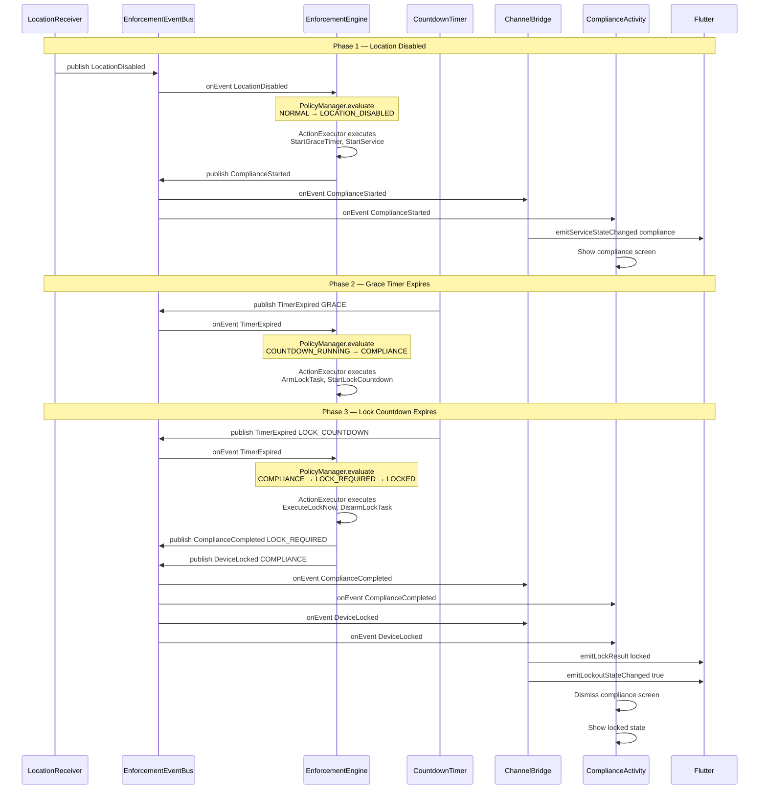
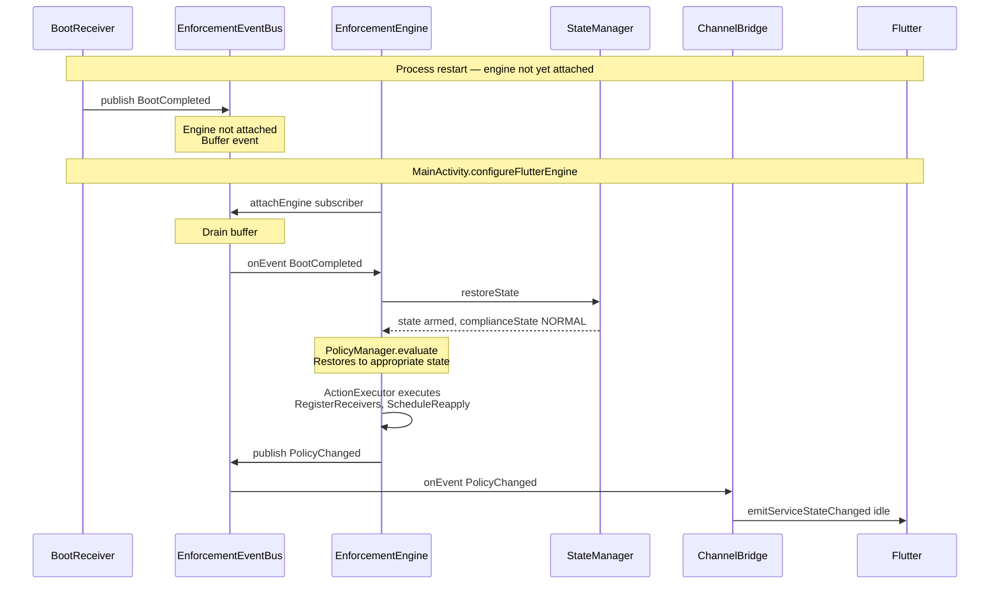
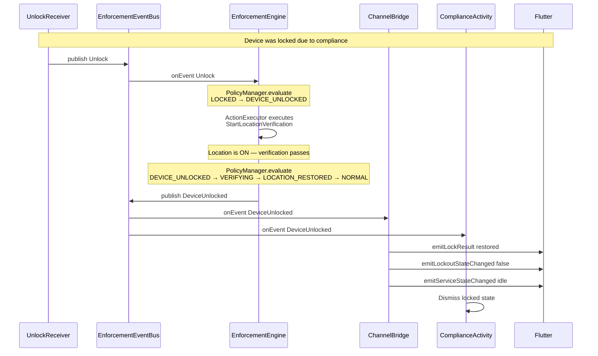
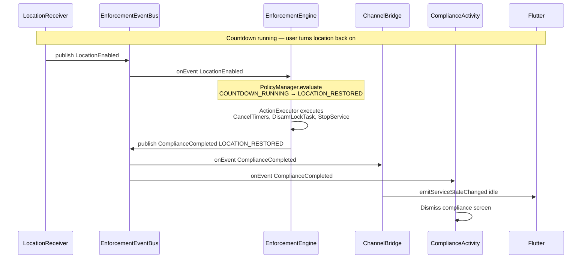
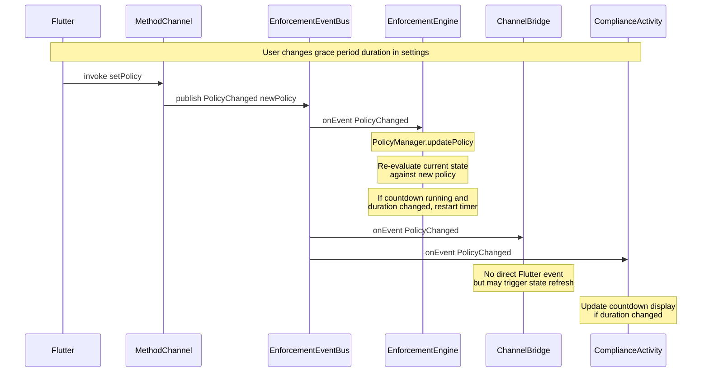

# 🚌 Native Event Bus — Architecture Design

> **Parent documents:**
> - [`plans/architecture-analysis.md`](architecture-analysis.md) — 22 problems, 12-phase migration
> - [`plans/enforcement-engine-design.md`](enforcement-engine-design.md) — EnforcementEngine, EventDispatcher, event/action taxonomy
> - [`plans/enforcement-state-machine.md`](enforcement-state-machine.md) — 9-state machine, 36 transitions
> - [`plans/enforcement-controllers.md`](enforcement-controllers.md) — 7 single-responsibility controllers
> - [`plans/enforcement-foreground-service.md`](enforcement-foreground-service.md) — unified foreground service
> - [`plans/enforcement-receivers.md`](enforcement-receivers.md) — 7 event-only receivers

---

## Table of Contents

1. [Design Goals](#1-design-goals)
2. [Current State Analysis](#2-current-state-analysis)
3. [Event Bus Architecture](#3-event-bus-architecture)
4. [Event Taxonomy — 10 Domain Events](#4-event-taxonomy--10-domain-events)
5. [Producer-Consumer Matrix](#5-producer-consumer-matrix)
6. [Decoupling Architecture](#6-decoupling-architecture)
7. [Thread Safety Model](#7-thread-safety-model)
8. [Sequence Diagrams](#8-sequence-diagrams)
9. [Integration with Existing Architecture](#9-integration-with-existing-architecture)
10. [Migration Plan](#10-migration-plan)
11. [Problems Solved](#11-problems-solved)
12. [Appendix A — Event-to-Channel Mapping](#appendix-a--event-to-channel-mapping)
13. [Appendix B — Cross-Reference](#appendix-b--cross-reference)

---

## 1. Design Goals

| Goal | Description |
|------|-------------|
| **G1 — Universal Decoupling** | Every module communicates exclusively through the Event Bus. No module holds a direct reference to another module. Producers do not know who consumes their events; consumers do not know who produced them. |
| **G2 — Single Bus** | One `EnforcementEventBus` replaces `EventDispatcher`, `PermissionEventBus`, and all direct `LockEventChannel.emit()` calls. There is exactly one event distribution mechanism in the entire native layer. |
| **G3 — Domain Events** | The bus carries 10 domain-level events — not raw system broadcasts. Events represent meaningful enforcement state changes, not Android framework implementation details. |
| **G4 — Multi-Subscriber** | Multiple consumers can subscribe to the same event. Adding a new consumer (analytics, logging, telemetry) requires zero changes to producers or existing consumers. |
| **G5 — Thread-Safe by Construction** | Subscriber registration uses `CopyOnWriteArrayList`. Event delivery is synchronous on the publisher's thread. Each subscriber manages its own threading. Zero `@Volatile`, zero `@Synchronized` in application code. |
| **G6 — No Polling** | No module polls for state. Every state change is delivered as an event. This eliminates the 2-second polling loop in `LocationComplianceActivity` (P-22) and the dual-path pull+push synchronization (P-20). |
| **G7 — Buffering Survival** | The bus buffers inbound events when no `EnforcementEngine` subscriber is attached (process restart window). Events are flushed on engine attach. No event is lost during `START_STICKY` recovery. |

### The Bus at a Glance

```
┌─────────────────────────────────────────────────────────────────────────────┐
│                        EnforcementEventBus                                  │
│                     (object singleton — dumb pipe)                          │
│                                                                             │
│  ┌───────────────────────────────────────────────────────────────────────┐  │
│  │  Event Registry                                                       │  │
│  │                                                                       │  │
│  │  CopyOnWriteHashMap<Class<out BusEvent>, CopyOnWriteArrayList<Sub>>  │  │
│  │                                                                       │  │
│  │  LocationDisabled     → [EnforcementEngine]                           │  │
│  │  LocationEnabled      → [EnforcementEngine]                           │  │
│  │  BootCompleted        → [EnforcementEngine]                           │  │
│  │  Unlock               → [EnforcementEngine]                           │  │
│  │  TimerExpired         → [EnforcementEngine]                           │  │
│  │  ComplianceStarted    → [ChannelBridge, ComplianceActivity]           │  │
│  │  ComplianceCompleted  → [ChannelBridge, ComplianceActivity]           │  │
│  │  DeviceLocked         → [ChannelBridge, ComplianceActivity]           │  │
│  │  DeviceUnlocked       → [ChannelBridge, ComplianceActivity]           │  │
│  │  PolicyChanged        → [ChannelBridge, ComplianceActivity]           │  │
│  └───────────────────────────────────────────────────────────────────────┘  │
│                                                                             │
│  ┌───────────────────────────────────────────────────────────────────────┐  │
│  │  Event Buffer (for process-restart window)                            │  │
│  │                                                                       │  │
│  │  ArrayDeque<BusEvent>  — drained when engine subscribes               │  │
│  └───────────────────────────────────────────────────────────────────────┘  │
│                                                                             │
│  + publish(event: BusEvent)          // any thread                         │
│  + subscribe(type, subscriber)       // any thread                         │
│  + unsubscribe(type, subscriber)     // any thread                         │
└─────────────────────────────────────────────────────────────────────────────┘
```

---

## 2. Current State Analysis

### 2.1 Existing Event Communication Patterns

The current codebase has **three separate, overlapping event mechanisms**, each with its own coupling problems:

```
┌─────────────────────────────────────────────────────────────────────────────┐
│                    CURRENT STATE — Three Event Paths                        │
│                                                                             │
│  Path 1: Inbound (EventDispatcher — designed, not yet implemented)         │
│  ┌──────────┐     ┌──────────────────┐     ┌──────────────────┐            │
│  │Receivers │────►│ EventDispatcher  │────►│ EnforcementEngine │            │
│  │          │     │ (object singleton)│     │                  │            │
│  └──────────┘     │ single-thread exec│     └──────────────────┘            │
│                   │ event buffering   │                                    │
│                   └──────────────────┘                                    │
│                                                                             │
│  Path 2: Outbound (ActionExecutor → LockEventChannel)                      │
│  ┌──────────────────┐     ┌───────────────┐     ┌──────────────────┐       │
│  │ EnforcementEngine │────►│ ActionExecutor │────►│ LockEventChannel  │      │
│  │                  │     │               │     │ (EventChannel)    │      │
│  └──────────────────┘     │ EmitLockResult │     │ @Volatile instance│ P-07 │
│                           │ EmitServiceState│    │ @Volatile sink    │ P-13 │
│                           │ EmitLockoutState│    └──────────────────┘       │
│                           │ EmitPermission  │                               │
│                           │ EmitUninstallBlk│                               │
│                           └───────────────┘                               │
│                                                                             │
│  Path 3: Permission (PermissionEventBus — separate bus)                    │
│  ┌──────────────────┐     ┌────────────────────┐     ┌──────────────┐      │
│  │ UninstallBlock   │────►│ PermissionEventBus  │────►│ Listeners    │      │
│  │ Controller       │     │ (object singleton)  │     │ (CopyOnWrite)│      │
│  │ DeviceAdminRecv  │     │ CopyOnWriteArrayList│     └──────────────┘      │
│  └──────────────────┘     └────────────────────┘                           │
│                                                                             │
│  Path 4: UI Polling (LocationComplianceActivity)                           │
│  ┌────────────────────────────┐     ┌──────────────────────────┐           │
│  │ LocationComplianceActivity │────►│ Handler.postDelayed(2s)  │ P-22      │
│  │                            │◄────│ polls state every 2 sec  │           │
│  └────────────────────────────┘     └──────────────────────────┘           │
└─────────────────────────────────────────────────────────────────────────────┘
```

### 2.2 Problems with Current State

| # | Problem | Source | Impact |
|---|---------|--------|--------|
| 1 | **Three separate event mechanisms** | EventDispatcher + LockEventChannel + PermissionEventBus | No single source of truth for event flow. Developers must know which mechanism to use for each event type. |
| 2 | **Engine coupled to LockEventChannel** | ActionExecutor holds `EventEmitter` reference, calls `emitLockResult()` etc. | Engine knows about Flutter transport. Adding a new notification target requires modifying ActionExecutor. |
| 3 | **`LockEventChannel.instance` @Volatile singleton** (P-07) | `companion object { @Volatile var instance }` | Process-global mutable state. Any module can grab the singleton and emit, bypassing the engine. |
| 4 | **EventChannel emissions from multiple threads** (P-13) | `emit()` called from engine thread, binder thread, main thread | `EventSink.success()` is not thread-safe. Can crash or deliver events out of order. |
| 5 | **PermissionEventBus is a separate bus** | `object PermissionEventBus` with its own listener list | Permission events don't flow through the same channel as other events. Subscribers can't receive both. |
| 6 | **UI polls every 2 seconds** (P-22) | `locationPollRunnable` in `LocationComplianceActivity` | Battery drain, latency in UI updates, unnecessary CPU usage. |
| 7 | **Dual-path state synchronization** (P-20) | Pull (polling) + Push (EventChannel) can race | UI can show stale state if polling reads between push events. |
| 8 | **No buffering for outbound events** | ActionExecutor calls LockEventChannel directly | If Flutter is not attached (engine started before Flutter), events are lost. |
| 9 | **Stringly-typed event dispatch** (P-19) | `when (call.method)` in `LockMethodChannel` | No compile-time safety. Typos cause silent failures. |
| 10 | **Cannot add subscribers without modifying producers** | ActionExecutor has hardcoded emit calls | Adding analytics or telemetry requires changing ActionExecutor. |

### 2.3 What Needs to Change

```
BEFORE (3 paths, coupled):                          AFTER (1 bus, decoupled):

Receivers ──► EventDispatcher ──► Engine            Receivers ──► ┐
                                                      Timer ──►    ┤
Engine ──► ActionExecutor ──► LockEventChannel      Engine ──►    ├──► EnforcementEventBus ──► Subscribers
                      └──► Activity Launcher                       │                    ├──► ChannelBridge
PermissionEventBus ──► Listeners                     PolicyMgr──► ┘                    ├──► ComplianceActivity
                                                                                       └──► (future: analytics)
UI polls every 2s ──► StateStore
```

---

## 3. Event Bus Architecture

### 3.1 EnforcementEventBus

The central event distribution mechanism. Replaces `EventDispatcher`, `PermissionEventBus`, and all direct `LockEventChannel.emit()` calls.

```
┌─────────────────────────────────────────────────────────────────────────────┐
│  EnforcementEventBus                                                        │
│  (object singleton — the ONLY event mechanism in the app)                   │
│                                                                             │
│  ┌─────────────────────────────────────────────────────────────────────┐   │
│  │  Subscriber Registry                                                 │   │
│  │                                                                      │   │
│  │  private val subscribers =                                           │   │
│  │    ConcurrentHashMap<                                                │   │
│  │      KClass<out BusEvent>,                                           │   │
│  │      CopyOnWriteArrayList<Subscriber>                                │   │
│  │    >()                                                               │   │
│  │                                                                      │   │
│  │  // Thread-safe: CopyOnWriteArrayList allows concurrent              │   │
│  │  // iteration while subscribers are added/removed                    │   │
│  └─────────────────────────────────────────────────────────────────────┘   │
│                                                                             │
│  ┌─────────────────────────────────────────────────────────────────────┐   │
│  │  Event Buffer (process-restart survival)                             │   │
│  │                                                                      │   │
│  │  private val buffer = ConcurrentLinkedQueue<BusEvent>()              │   │
│  │  private val engineAttached = AtomicBoolean(false)                   │   │
│  │                                                                      │   │
│  │  // When engine is NOT attached:                                     │   │
│  │  //   publish() adds to buffer instead of delivering                 │   │
│  │  // When engine attaches:                                            │   │
│  │  //   drain buffer, deliver each event to engine                     │   │
│  └─────────────────────────────────────────────────────────────────────┘   │
│                                                                             │
│  ┌─────────────────────────────────────────────────────────────────────┐   │
│  │  API                                                                  │   │
│  │                                                                      │   │
│  │  fun publish(event: BusEvent)                                        │   │
│  │    // 1. If event is inbound AND engine not attached: buffer it      │   │
│  │    // 2. Otherwise: iterate subscribers[event::class]                │   │
│  │    // 3. Call subscriber.onEvent(event) synchronously                │   │
│  │    //    on the publisher's thread                                   │   │
│  │                                                                      │   │
│  │  fun <T : BusEvent> subscribe(                                       │   │
│  │    type: KClass<T>,                                                  │   │
│  │    subscriber: Subscriber                                            │   │
│  │  )                                                                   │   │
│  │    // Adds subscriber to CopyOnWriteArrayList for event type         │   │
│  │                                                                      │   │
│  │  fun <T : BusEvent> unsubscribe(                                     │   │
│  │    type: KClass<T>,                                                  │   │
│  │    subscriber: Subscriber                                            │   │
│  │  )                                                                   │   │
│  │    // Removes subscriber from CopyOnWriteArrayList                   │   │
│  │                                                                      │   │
│  │  fun attachEngine(subscriber: Subscriber)                            │   │
│  │    // Sets engineAttached = true                                     │   │
│  │    // Drains buffer, delivers each buffered event to subscriber      │   │
│  │                                                                      │   │
│  │  fun detachEngine()                                                  │   │
│  │    // Sets engineAttached = false                                    │   │
│  │    // Subsequent inbound events are buffered                         │   │
│  └─────────────────────────────────────────────────────────────────────┘   │
└─────────────────────────────────────────────────────────────────────────────┘
```

**Why `object` singleton is acceptable here:**

| Reason | Explanation |
|--------|-------------|
| **System-instantiated components** | Receivers and services are instantiated by the Android framework. They cannot receive constructor injection. They need a static entry point to publish events. |
| **Dumb pipe** | The bus contains ZERO business logic. It does not evaluate events, make decisions, or execute actions. It only routes events to subscribers. |
| **Replaces 3 singletons** | `EventDispatcher`, `PermissionEventBus`, and `LockEventChannel.instance` are all eliminated. The bus is the ONLY singleton with mutable state (besides `Constants` which is stateless). |
| **Testable** | The bus can be reset in tests. Subscribers are interfaces, allowing mock injection. |

### 3.2 BusEvent — Sealed Class

```
BusEvent (sealed class)
│
├── INBOUND EVENTS (published by sensors, consumed by engine)
│   │
│   ├── LocationDisabled
│   │     └── payload: none
│   │     └── semantics: Location provider disabled. Engine starts compliance countdown.
│   │
│   ├── LocationEnabled
│   │     └── payload: none
│   │     └── semantics: Location provider enabled. Engine cancels compliance countdown.
│   │
│   ├── BootCompleted
│   │     └── payload: isLockedBoot: Boolean
│   │     └── semantics: Device boot completed. Engine restores state, re-arms enforcement.
│   │
│   ├── Unlock
│   │     └── payload: none
│   │     └── semantics: User unlocked device (ACTION_USER_PRESENT). Engine checks re-lock.
│   │
│   └── TimerExpired
│         └── payload: timerType: TimerType
│         └── semantics: Countdown timer expired. Engine transitions state.
│
└── OUTBOUND EVENTS (published by engine, consumed by listeners)
    │
    ├── ComplianceStarted
    │     └── payload: countdownDurationMs: Long
    │     └── semantics: Compliance enforcement started. Show compliance UI.
    │
    ├── ComplianceCompleted
    │     └── payload: reason: CompletionReason
    │     └── semantics: Compliance enforcement ended. Dismiss compliance UI.
    │
    ├── DeviceLocked
    │     └── payload: lockType: LockType
    │     └── semantics: Device locked. Update Flutter status, show locked UI.
    │
    ├── DeviceUnlocked
    │     └── payload: none
    │     └── semantics: Device unlocked. Update Flutter status, dismiss locked UI.
    │
    └── PolicyChanged
          └── payload: policy: EnforcementPolicy
          └── semantics: Enforcement policy changed. All modules update behavior.
```

**Supporting enums:**

```
TimerType:
  ├── GRACE              // Grace period expired → enter COMPLIANCE
  ├── LOCK_COUNTDOWN     // Lock countdown expired → enter LOCK_REQUIRED
  ├── TIMED_LOCK         // Timed lock duration expired → unlock
  └── LOCKOUT            // Lockout period expired → restore

CompletionReason:
  ├── LOCATION_RESTORED  // Location turned back on
  ├── LOCK_REQUIRED      // Countdown expired, device must lock
  ├── DISMISSED          // User dismissed compliance screen
  └── TIMEOUT            // Lockout timeout expired

LockType:
  ├── IMMEDIATE          // Lock Now button pressed
  ├── TIMED              // Lock for duration
  └── COMPLIANCE         // Lock due to compliance failure
```

### 3.3 Subscriber — Functional Interface

```
fun interface Subscriber {
    fun onEvent(event: BusEvent)
}
```

**Design properties:**

| Property | Description |
|----------|-------------|
| **Fun interface** | Allows lambda syntax for simple subscribers: `bus.subscribe(DeviceLocked::class) { event -> ... }` |
| **No return value** | Subscribers cannot return results. The bus is fire-and-forget. |
| **Synchronous delivery** | `onEvent()` is called on the publisher's thread. Subscribers must manage their own threading. |
| **No exceptions** | Subscribers must not throw. The bus does not catch exceptions (fail-fast in debug, log in release). |

### 3.4 Event Classification

```
┌─────────────────────────────────────────────────────────────────────────────┐
│                        Event Classification                                │
│                                                                             │
│  INBOUND (5 events)              OUTBOUND (5 events)                       │
│  Published by sensors           Published by engine                        │
│  Consumed by engine             Consumed by listeners                      │
│                                                                             │
│  ┌──────────────────┐            ┌──────────────────────┐                  │
│  │ LocationDisabled │            │ ComplianceStarted    │                  │
│  │ LocationEnabled  │            │ ComplianceCompleted  │                  │
│  │ BootCompleted    │            │ DeviceLocked         │                  │
│  │ Unlock           │            │ DeviceUnlocked       │                  │
│  │ TimerExpired     │            │ PolicyChanged        │                  │
│  └────────┬─────────┘            └──────────┬───────────┘                  │
│           │                                 │                              │
│           │     ┌───────────────┐           │                              │
│           └────►│    Engine     │◄──────────┘                              │
│                 │  (consumer +  │                                          │
│                 │   producer)   │                                          │
│                 └───────────────┘                                          │
└─────────────────────────────────────────────────────────────────────────────┘
```

The `EnforcementEngine` is the **pivot point**: it consumes inbound events, processes them via `PolicyManager`, and publishes outbound events when state transitions occur.

---

## 4. Event Taxonomy — 10 Domain Events

### 4.1 LocationDisabled

| Field | Value |
|-------|-------|
| **Direction** | Inbound |
| **Published by** | `LocationReceiver` (when `PROVIDERS_CHANGED` or `MODE_CHANGED` indicates location off) |
| **Consumed by** | `EnforcementEngine` |
| **Payload** | none |
| **Semantics** | Location provider has been disabled while enforcement is armed. Engine should transition to `LOCATION_DISABLED` state and start grace countdown. |
| **State machine trigger** | `NORMAL → LOCATION_DISABLED` (T1), `LOCATION_RESTORED → LOCATION_DISABLED` (T22) |
| **Guard** | Engine only processes if `enforcementArmed == true` and `permissionGranted == true` |
| **Replaces** | `LocationProviderChanged(OFF)` in `EnforcementEvent` |

### 4.2 LocationEnabled

| Field | Value |
|-------|-------|
| **Direction** | Inbound |
| **Published by** | `LocationReceiver` (when `PROVIDERS_CHANGED` or `MODE_CHANGED` indicates location on) |
| **Consumed by** | `EnforcementEngine` |
| **Payload** | none |
| **Semantics** | Location provider has been enabled. Engine should cancel compliance countdown and transition to `LOCATION_RESTORED`. |
| **State machine trigger** | `LOCATION_DISABLED → LOCATION_RESTORED` (T7), `COUNTDOWN_RUNNING → LOCATION_RESTORED` (T9), `COMPLIANCE → LOCATION_RESTORED` (T13) |
| **Replaces** | `LocationProviderChanged(ON)` in `EnforcementEvent` |

### 4.3 BootCompleted

| Field | Value |
|-------|-------|
| **Direction** | Inbound |
| **Published by** | `BootReceiver` (on `BOOT_COMPLETED` or `LOCKED_BOOT_COMPLETED`) |
| **Consumed by** | `EnforcementEngine` |
| **Payload** | `isLockedBoot: Boolean` — true if `LOCKED_BOOT_COMPLETED`, false if `BOOT_COMPLETED` |
| **Semantics** | Device has completed boot. Engine should restore persisted state, re-arm enforcement if previously armed, and re-register runtime receivers. |
| **State machine trigger** | Recovery transitions R13/R14 (restore from persisted state) |
| **Guard** | Engine only processes if `enforcementArmed == true` in persisted state |
| **Replaces** | `BootCompleted` in `EnforcementEvent` (same name, now a `BusEvent`) |

### 4.4 Unlock

| Field | Value |
|-------|-------|
| **Direction** | Inbound |
| **Published by** | `UnlockReceiver` (on `ACTION_USER_PRESENT`) |
| **Consumed by** | `EnforcementEngine` |
| **Payload** | none |
| **Semantics** | User has unlocked the device (screen on + user present). If device was in `LOCKED` state due to compliance, engine should transition to `DEVICE_UNLOCKED` and begin location verification. |
| **State machine trigger** | `LOCKED → DEVICE_UNLOCKED` (T16) |
| **Guard** | Engine only processes if `complianceState == LOCKED` |
| **Replaces** | `UserPresent` in `EnforcementEvent` |

### 4.5 TimerExpired

| Field | Value |
|-------|-------|
| **Direction** | Inbound |
| **Published by** | `CountdownTimer` (when any countdown reaches zero) |
| **Consumed by** | `EnforcementEngine` |
| **Payload** | `timerType: TimerType` — identifies which timer expired |
| **Semantics** | A countdown timer has expired. Engine transitions state based on timer type: |
| | `GRACE` → `COUNTDOWN_RUNNING → COMPLIANCE` (T8) |
| | `LOCK_COUNTDOWN` → `COMPLIANCE → LOCK_REQUIRED` (T11) |
| | `TIMED_LOCK` → `LOCKED → LOCATION_RESTORED` (T17) |
| | `LOCKOUT` → restore from lockout |
| **Replaces** | `GracePeriodExpired`, `LockCountdownExpired`, `TimedLockDurationExpired`, `LockoutExpired` in `EnforcementEvent` — consolidated into single event with `timerType` discriminator |

### 4.6 ComplianceStarted

| Field | Value |
|-------|-------|
| **Direction** | Outbound |
| **Published by** | `EnforcementEngine` (when entering `COMPLIANCE` state) |
| **Consumed by** | `ChannelBridge`, `LocationComplianceActivity` |
| **Payload** | `countdownDurationMs: Long` — duration of the lock countdown |
| **Semantics** | Compliance enforcement has started. The compliance Activity should be launched, Flutter should update its status display. |
| **ChannelBridge action** | `emitServiceStateChanged("compliance")` |
| **UI action** | Launch `LocationComplianceActivity`, start countdown display |
| **Replaces** | `EmitServiceStateChanged("compliance")` Notification Action |

### 4.7 ComplianceCompleted

| Field | Value |
|-------|-------|
| **Direction** | Outbound |
| **Published by** | `EnforcementEngine` (when leaving `COMPLIANCE` state) |
| **Consumed by** | `ChannelBridge`, `LocationComplianceActivity` |
| **Payload** | `reason: CompletionReason` — why compliance ended |
| **Semantics** | Compliance enforcement has ended. The compliance Activity should be dismissed, Flutter should update its status. |
| **ChannelBridge action** | `emitServiceStateChanged("idle")` or `emitServiceStateChanged("locked")` depending on reason |
| **UI action** | Finish `LocationComplianceActivity`, release lock task mode |
| **Replaces** | `EmitServiceStateChanged("idle"/"locked")` Notification Action |

### 4.8 DeviceLocked

| Field | Value |
|-------|-------|
| **Direction** | Outbound |
| **Published by** | `EnforcementEngine` (when entering `LOCKED` state) |
| **Consumed by** | `ChannelBridge`, `LocationComplianceActivity` |
| **Payload** | `lockType: LockType` — how the device was locked |
| **Semantics** | Device has been locked. Flutter should update its status, UI should show locked state. |
| **ChannelBridge action** | `emitLockResult("locked")`, `emitLockoutStateChanged(true)`, `emitServiceStateChanged("locked")` |
| **UI action** | Update compliance Activity to show locked state |
| **Replaces** | `EmitLockResult("locked")`, `EmitLockoutStateChanged(true)`, `EmitServiceStateChanged("locked")` Notification Actions |

### 4.9 DeviceUnlocked

| Field | Value |
|-------|-------|
| **Direction** | Outbound |
| **Published by** | `EnforcementEngine` (when leaving `LOCKED` state) |
| **Consumed by** | `ChannelBridge`, `LocationComplianceActivity` |
| **Payload** | none |
| **Semantics** | Device has been unlocked (either timed lock expired or user unlocked). Flutter should update its status, UI should dismiss locked state. |
| **ChannelBridge action** | `emitLockResult("restored")`, `emitLockoutStateChanged(false)`, `emitServiceStateChanged("idle")` |
| **UI action** | Dismiss locked state, return to normal |
| **Replaces** | `EmitLockResult("restored")`, `EmitLockoutStateChanged(false)`, `EmitServiceStateChanged("idle")` Notification Actions |

### 4.10 PolicyChanged

| Field | Value |
|-------|-------|
| **Direction** | Outbound |
| **Published by** | `EnforcementEngine` (when `PolicyManager` updates the enforcement policy) |
| **Consumed by** | `ChannelBridge`, `LocationComplianceActivity`, `EnforcementEngine` (self — re-evaluate current state against new policy) |
| **Payload** | `policy: EnforcementPolicy` — the new policy configuration |
| **Semantics** | Enforcement policy has changed (e.g., grace period duration, countdown duration, lock type). All modules should update their behavior to match the new policy. |
| **ChannelBridge action** | No direct Flutter event, but may trigger a state refresh |
| **UI action** | Update countdown display if duration changed |
| **Replaces** | No direct equivalent — this is a NEW event type that was missing from the original design |

### 4.11 Event Taxonomy Summary

```
┌─────────────────────────────────────────────────────────────────────────────┐
│                        10-Event Taxonomy                                    │
│                                                                             │
│  #  │ Event                │ Dir │ Publisher         │ Payload              │
│────┼──────────────────────┼─────┼───────────────────┼──────────────────────│
│  1 │ LocationDisabled     │ IN  │ LocationReceiver  │ —                    │
│  2 │ LocationEnabled      │ IN  │ LocationReceiver  │ —                    │
│  3 │ BootCompleted        │ IN  │ BootReceiver      │ isLockedBoot: Bool   │
│  4 │ Unlock               │ IN  │ UnlockReceiver    │ —                    │
│  5 │ TimerExpired         │ IN  │ CountdownTimer    │ timerType: TimerType │
│  6 │ ComplianceStarted    │ OUT │ EnforcementEngine │ countdownMs: Long    │
│  7 │ ComplianceCompleted  │ OUT │ EnforcementEngine │ reason: CompletionRsn│
│  8 │ DeviceLocked         │ OUT │ EnforcementEngine │ lockType: LockType   │
│  9 │ DeviceUnlocked       │ OUT │ EnforcementEngine │ —                    │
│ 10 │ PolicyChanged        │ OUT │ EnforcementEngine │ policy: EnforcePolicy│
└─────────────────────────────────────────────────────────────────────────────┘
```

---

## 5. Producer-Consumer Matrix

### 5.1 Full Matrix

```
┌──────────────────────┬───────────────────┬───────────────────┬───────────────────────┬────────────────────┬──────────────────┐
│ Event                │ EnforcementEngine │ ChannelBridge     │ ComplianceActivity    │ CountdownTimer     │ (Future: Analytics)│
├──────────────────────┼───────────────────┼───────────────────┼───────────────────────┼────────────────────┼──────────────────┤
│ LocationDisabled     │   CONSUME         │                   │                       │                    │   CONSUME        │
│ LocationEnabled      │   CONSUME         │                   │                       │                    │   CONSUME        │
│ BootCompleted        │   CONSUME         │                   │                       │                    │   CONSUME        │
│ Unlock               │   CONSUME         │                   │                       │                    │   CONSUME        │
│ TimerExpired         │   CONSUME         │                   │                       │   PRODUCE          │   CONSUME        │
│ ComplianceStarted    │   PRODUCE         │   CONSUME         │   CONSUME             │                    │   CONSUME        │
│ ComplianceCompleted  │   PRODUCE         │   CONSUME         │   CONSUME             │                    │   CONSUME        │
│ DeviceLocked         │   PRODUCE         │   CONSUME         │   CONSUME             │                    │   CONSUME        │
│ DeviceUnlocked       │   PRODUCE         │   CONSUME         │   CONSUME             │                    │   CONSUME        │
│ PolicyChanged        │   PRODUCE         │   CONSUME         │   CONSUME             │                    │   CONSUME        │
└──────────────────────┴───────────────────┴───────────────────┴───────────────────────┴────────────────────┴──────────────────┘
```

### 5.2 Producer Summary

| Producer | Events Published | Thread |
|----------|-----------------|--------|
| `LocationReceiver` | `LocationDisabled`, `LocationEnabled` | Binder thread |
| `BootReceiver` | `BootCompleted` | Binder thread |
| `UnlockReceiver` | `Unlock` | Binder thread |
| `CountdownTimer` | `TimerExpired` | Main thread (Handler callback) |
| `EnforcementEngine` | `ComplianceStarted`, `ComplianceCompleted`, `DeviceLocked`, `DeviceUnlocked`, `PolicyChanged` | Engine thread (single-threaded executor) |

### 5.3 Consumer Summary

| Consumer | Events Subscribed | Thread Strategy |
|----------|------------------|-----------------|
| `EnforcementEngine` | `LocationDisabled`, `LocationEnabled`, `BootCompleted`, `Unlock`, `TimerExpired` | Posts to single-threaded executor for serial processing |
| `ChannelBridge` | `ComplianceStarted`, `ComplianceCompleted`, `DeviceLocked`, `DeviceUnlocked`, `PolicyChanged` | Posts to main thread Handler (Flutter requires main thread) |
| `LocationComplianceActivity` | `ComplianceStarted`, `ComplianceCompleted`, `DeviceLocked`, `DeviceUnlocked`, `PolicyChanged` | Runs on main thread (UI updates) |
| *(Future: Analytics)* | All 10 events | Posts to background executor |

### 5.4 Decoupling Verification

| Decoupling Test | Result |
|-----------------|--------|
| Can `LocationReceiver` publish without knowing who consumes? | ✅ Yes — bus routes to all subscribers |
| Can `ChannelBridge` subscribe without knowing who publishes? | ✅ Yes — bus delivers from any publisher |
| Can a new subscriber be added without modifying producers? | ✅ Yes — just call `bus.subscribe()` |
| Can a new producer be added without modifying consumers? | ✅ Yes — just call `bus.publish()` |
| Does `EnforcementEngine` know about `LockEventChannel`? | ❌ No — engine publishes to bus, ChannelBridge subscribes |
| Does `LocationComplianceActivity` know about `EnforcementEngine`? | ❌ No — activity subscribes to bus, engine publishes |
| Does `LocationReceiver` know about `EnforcementEngine`? | ❌ No — receiver publishes to bus, engine subscribes |

---

## 6. Decoupling Architecture

### 6.1 Before — Coupled Architecture

```
┌─────────────────────────────────────────────────────────────────────────────┐
│                        BEFORE — Coupled                                     │
│                                                                             │
│  ┌────────────┐    ┌──────────────────┐    ┌──────────────────────────┐    │
│  │ Receivers  │───►│ EventDispatcher  │───►│ EnforcementEngine        │    │
│  │ (7)        │    │ (object)         │    │                          │    │
│  └────────────┘    └──────────────────┘    │  PolicyManager.evaluate()│    │
│                                            │  ActionExecutor.execute()│    │
│  ┌────────────┐                            │         │                │    │
│  │ Timer      │───────────────────────────►│         │                │    │
│  └────────────┘                            │         ▼                │    │
│                                            │  ┌──────────────────┐   │    │
│  ┌────────────┐    ┌──────────────────┐    │  │ ActionExecutor   │   │    │
│  │Permission  │───►│PermissionEventBus│    │  │                  │   │    │
│  │Controller  │    │(object — SEPARATE)│   │  │ EmitLockResult ──┼───┼──► LockEventChannel.emit()
│  └────────────┘    └──────────────────┘    │  │ EmitServiceState ┼───┼──► LockEventChannel.emit()
│                                            │  │ EmitLockoutState ┼───┼──► LockEventChannel.emit()
│  ┌──────────────────────────┐              │  │ EmitPermission ──┼───┼──► LockEventChannel.emit()
│  │ LocationComplianceActivity│              │  │ EmitUninstallBlk ┼───┼──► LockEventChannel.emit()
│  │                          │              │  └──────────────────┘   │    │
│  │  polls StateStore every  │◄─────────────│  (also: startActivity)  │    │
│  │  2 seconds (P-22)        │              │                          │    │
│  └──────────────────────────┘              └──────────────────────────┘    │
│                                                                             │
│  COUPLING POINTS:                                                           │
│  • Engine → LockEventChannel (direct emit calls)                           │
│  • Engine → ActivityLauncher (direct startActivity)                        │
│  • PermissionEventBus is separate from EventDispatcher                     │
│  • LockEventChannel.instance is @Volatile singleton (P-07)                 │
│  • Activity polls StateStore (P-22)                                        │
│  • 3 separate event mechanisms                                            │
└─────────────────────────────────────────────────────────────────────────────┘
```

### 6.2 After — Decoupled Architecture

```
┌─────────────────────────────────────────────────────────────────────────────┐
│                        AFTER — Fully Decoupled                              │
│                                                                             │
│  ┌────────────┐                                                             │
│  │ Receivers  │──publish──►┌──────────────────────────┐                    │
│  │ (7)        │            │                          │                    │
│  └────────────┘            │   EnforcementEventBus    │                    │
│                             │   (object singleton)     │                    │
│  ┌────────────┐             │                          │                    │
│  │ Timer      │──publish──►│   ┌──────────────────┐  │                    │
│  └────────────┘             │   │ Subscriber Map   │  │                    │
│                             │   │                  │  │                    │
│  ┌────────────────────┐     │   │ LocationDisabled │──┼──► EnforcementEngine│
│  │ EnforcementEngine  │     │   │  → [Engine]      │  │   (subscribes)     │
│  │                    │     │   │                  │  │                    │
│  │  PolicyManager     │     │   │ ComplianceStarted│──┼──► ChannelBridge   │
│  │  .evaluate()       │     │   │  → [Bridge, UI]  │  │   (subscribes)     │
│  │                    │     │   │                  │  │                    │
│  │  ActionExecutor    │     │   │ DeviceLocked     │──┼──► ComplianceActivity│
│  │  (NO emit calls)   │     │   │  → [Bridge, UI]  │  │   (subscribes)     │
│  │                    │     │   └──────────────────┘  │                    │
│  └─────────┬──────────┘     │                          │                    │
│            │                 │   ┌──────────────────┐  │                    │
│            └──publish──────►│   │ Event Buffer     │  │                    │
│             (outbound)      │   │ (restart window) │  │                    │
│                             │   └──────────────────┘  │                    │
│                             └──────────────────────────┘                    │
│                                                                             │
│  ┌────────────────┐                                                         │
│  │ ChannelBridge  │──subscribe──► (bus)                                     │
│  │ (translates to │                                                         │
│  │  Flutter events)│                                                        │
│  └────────────────┘                                                         │
│                                                                             │
│  ┌────────────────────────┐                                                 │
│  │ComplianceActivity      │──subscribe──► (bus)                             │
│  │(NO polling — receives  │                                                 │
│  │ events instead)        │                                                 │
│  └────────────────────────┘                                                 │
│                                                                             │
│  DECOUPLING ACHIEVED:                                                       │
│  • Engine does NOT know about LockEventChannel                             │
│  • Engine does NOT know about ComplianceActivity                           │
│  • Receivers do NOT know about Engine                                      │
│  • Activity does NOT poll — receives events                                │
│  • ONE event mechanism (not three)                                         │
│  • Adding subscribers requires ZERO changes to producers                   │
└─────────────────────────────────────────────────────────────────────────────┘
```

### 6.3 Module Dependency Comparison

```
BEFORE:                              AFTER:

Receivers ──► EventDispatcher        Receivers ──► EventBus
Timer ──► EventDispatcher            Timer ──► EventBus
Engine ──► ActionExecutor            Engine ──► EventBus (publish)
           ├─► LockEventChannel      Engine ──► ActionExecutor (commands only)
           ├─► ActivityLauncher      ChannelBridge ──► EventBus (subscribe)
           └─► (Notification Actions)ComplianceActivity ──► EventBus (subscribe)
PermissionBus ──► Listeners
ComplianceActivity ──► StateStore    
(polls)                              

7 direct dependencies                0 direct dependencies
3 event mechanisms                   1 event mechanism
```

### 6.4 What Each Module Knows

| Module | BEFORE (knows about) | AFTER (knows about) |
|--------|---------------------|---------------------|
| `LocationReceiver` | `EventDispatcher` | `EnforcementEventBus` (only) |
| `EnforcementEngine` | `EventDispatcher`, `ActionExecutor`, `LockEventChannel` (via ActionExecutor), `ActivityLauncher` (via ActionExecutor) | `EnforcementEventBus` (publish + subscribe), `ActionExecutor` (commands only) |
| `ActionExecutor` | Controllers, `LockEventChannel` (EventEmitter), `LifecycleManager` | Controllers, `LifecycleManager` (NO EventEmitter) |
| `ChannelBridge` | Nothing (was called BY ActionExecutor) | `EnforcementEventBus` (subscribe) |
| `ComplianceActivity` | `StateStore` (polls), `LockTaskController` (constructs own) | `EnforcementEventBus` (subscribe) |
| `CountdownTimer` | Callback lambda (passed by LifecycleManager) | `EnforcementEventBus` (publish) |

---

## 7. Thread Safety Model

### 7.1 Thread Architecture

```
┌─────────────────────────────────────────────────────────────────────────────┐
│                        Thread Architecture                                  │
│                                                                             │
│  ┌─────────────────┐  ┌─────────────────┐  ┌─────────────────┐             │
│  │ Binder Thread    │  │ Main Thread     │  │ Engine Thread   │             │
│  │ (receiver        │  │ (Flutter UI,    │  │ (single-threaded │             │
│  │  callbacks)      │  │  Activity,      │  │  executor)       │             │
│  │                  │  │  Timer callbacks)│  │                  │             │
│  └────────┬────────┘  └────────┬────────┘  └────────┬────────┘             │
│           │                     │                     │                      │
│           │ publish(event)      │ publish(event)      │ publish(event)      │
│           └─────────────────────┴─────────────────────┘                      │
│                                 │                                           │
│                                 ▼                                           │
│                    ┌────────────────────────┐                               │
│                    │  EnforcementEventBus   │                               │
│                    │  (object singleton)    │                               │
│                    │                        │                               │
│                    │  CopyOnWriteArrayList  │                               │
│                    │  per event type        │                               │
│                    │                        │                               │
│                    │  publish(event):       │                               │
│                    │    for sub in subs:    │                               │
│                    │      sub.onEvent(event)│  ← SYNCHRONOUS on caller's   │
│                    │                        │    thread                    │
│                    └───────────┬────────────┘                               │
│                                │                                            │
│              ┌─────────────────┼─────────────────┐                          │
│              ▼                 ▼                 ▼                          │
│  ┌──────────────────┐ ┌──────────────────┐ ┌──────────────────┐            │
│  │ Engine Subscriber│ │ Bridge Subscriber│ │ UI Subscriber    │            │
│  │                  │ │                  │ │                  │            │
│  │ onEvent(event):  │ │ onEvent(event):  │ │ onEvent(event):  │            │
│  │  executor        │ │  mainHandler     │ │  runOnUiThread   │            │
│  │   .execute {     │ │   .post {        │ │   {              │            │
│  │    process(event)│ │    emit(event)   │ │    updateUI(event│            │
│  │  }               │ │  }               │ │   }              │            │
│  └──────────────────┘ └──────────────────┘ └──────────────────┘            │
│                                                                             │
│  Each subscriber manages its OWN threading:                                 │
│  • Engine: posts to single-threaded executor (serial processing)           │
│  • Bridge: posts to main thread Handler (Flutter requires main thread)     │
│  • UI: runs on UI thread (Activity lifecycle)                               │
└─────────────────────────────────────────────────────────────────────────────┘
```

### 7.2 Thread Safety Guarantees

| Component | Mechanism | Guarantee |
|-----------|-----------|-----------|
| `EnforcementEventBus.subscribers` | `ConcurrentHashMap` + `CopyOnWriteArrayList` | Thread-safe add/remove/iterate. No `@Synchronized` needed. |
| `EnforcementEventBus.buffer` | `ConcurrentLinkedQueue` | Thread-safe enqueue/dequeue. No `@Volatile` needed. |
| `EnforcementEventBus.engineAttached` | `AtomicBoolean` | Thread-safe flag. No `@Volatile` needed. |
| `publish()` | Synchronous iteration over `CopyOnWriteArrayList` | Safe to call from any thread. Subscribers are called on caller's thread. |
| `subscribe()` / `unsubscribe()` | `CopyOnWriteArrayList.add()` / `remove()` | Safe to call from any thread, even during iteration. |
| Engine subscriber | Posts to `singleThreadExecutor` | Serial processing. No concurrent state access. |
| Bridge subscriber | Posts to `mainHandler` | All Flutter emissions on main thread. Fixes P-13. |
| UI subscriber | `Activity.runOnUiThread()` | All UI updates on main thread. |

### 7.3 Comparison with Existing Patterns

| Aspect | Existing (LockEventChannel) | Event Bus |
|--------|---------------------------|-----------|
| Subscriber storage | `@Volatile var sink: EventSink?` | `CopyOnWriteArrayList<Subscriber>` |
| Singleton | `@Volatile var instance: LockEventChannel?` | `object EnforcementEventBus` (Kotlin object, JVM-guaranteed thread-safe init) |
| Thread safety | `@Volatile` on sink (insufficient — P-13) | `CopyOnWriteArrayList` (thread-safe by construction) |
| Emission thread | Whatever thread calls `emit()` | Subscriber chooses (main thread for Bridge) |
| Multi-subscriber | ❌ Single sink | ✅ Multiple subscribers per event |
| Buffering | ❌ None (events lost if Flutter not attached) | ✅ Buffer for inbound events during restart window |

### 7.4 Event Ordering Guarantees

| Scenario | Guarantee |
|----------|-----------|
| Same publisher, same event type | Events delivered in publication order (synchronous delivery) |
| Same publisher, different event types | Events delivered in publication order (synchronous delivery) |
| Different publishers, same event type | No ordering guarantee (different threads) |
| Engine processing | Serial (single-threaded executor) — events processed in submission order |
| Flutter delivery | Serial (main thread Handler) — events delivered in post order |
| UI updates | Serial (main thread) — updates applied in order |

**Key insight:** Event ordering is guaranteed within a single publisher's thread. Cross-publisher ordering is not guaranteed, but this is acceptable because:
1. Inbound events from different receivers are independent (location vs. boot vs. unlock)
2. Outbound events from the engine are serialized (single-threaded executor)

---

## 8. Sequence Diagrams

### 8.1 Master Sequence Diagram — Location Disabled → Compliance → Lock



### 8.2 Sequence Diagram — Boot Completed Recovery



### 8.3 Sequence Diagram — User Unlock After Compliance Lock



### 8.4 Sequence Diagram — Location Restored During Countdown



### 8.5 Sequence Diagram — Policy Changed



### 8.6 ASCII Flow — Complete Event Lifecycle

```
Location OFF                    Grace Expires                  Lock Countdown Expires
     │                               │                                │
     ▼                               ▼                                ▼
LocationReceiver              CountdownTimer                   CountdownTimer
     │                               │                                │
     │ publish(LocationDisabled)     │ publish(TimerExpired)          │ publish(TimerExpired)
     │                               │   timerType=GRACE              │   timerType=LOCK_COUNTDOWN
     ▼                               ▼                                ▼
┌─────────────────────────────────────────────────────────────────────────────┐
│                        EnforcementEventBus                                  │
│                                                                             │
│  deliver to Engine subscriber ──────────────────────────────────────────►   │
└─────────────────────────────────────────────────────────────────────────────┘
     │                               │                                │
     ▼                               ▼                                ▼
┌─────────────────────────────────────────────────────────────────────────────┐
│                     EnforcementEngine (single thread)                       │
│                                                                             │
│  PolicyManager.evaluate(state, event)                                       │
│  → returns [actions]                                                        │
│                                                                             │
│  ActionExecutor.execute(actions)                                            │
│  → StartGraceTimer, StartService          → ArmLockTask, StartLockCountdown → ExecuteLockNow
│                                                                             │
│  StateManager.persist(newState)                                             │
│                                                                             │
│  publish(ComplianceStarted)            publish(ComplianceCompleted)         publish(DeviceLocked)
│                                        publish(DeviceLocked)                publish(ComplianceCompleted)
└──────────────────────────┬──────────────────────────┬─────────────────────┘
                           │                          │
                           ▼                          ▼
┌─────────────────────────────────────────────────────────────────────────────┐
│                        EnforcementEventBus                                  │
│                                                                             │
│  deliver to ChannelBridge subscriber ──────────────────────────────────►    │
│  deliver to ComplianceActivity subscriber ─────────────────────────────►    │
└──────────────────────────┬──────────────────────────┬─────────────────────┘
                           │                          │
                           ▼                          ▼
┌──────────────────────┐               ┌──────────────────────────┐
│   ChannelBridge      │               │  ComplianceActivity      │
│                      │               │                          │
│  emitServiceState    │               │  Show compliance screen  │
│    "compliance"      │               │  Start countdown display │
│                      │               │                          │
│  (later)             │               │  (later)                 │
│  emitLockResult      │               │  Dismiss screen          │
│    "locked"          │               │  Show locked state       │
│  emitLockoutState    │               │                          │
│    true              │               │                          │
└──────────────────────┘               └──────────────────────────┘
         │
         ▼
┌──────────────────────┐
│   Flutter (Dart)     │
│                      │
│  StatusView updates  │
│  LockResult updates  │
│  LockoutState updates│
└──────────────────────┘
```

---

## 9. Integration with Existing Architecture

### 9.1 What the Event Bus Replaces

```
┌─────────────────────────────────────────────────────────────────────────────┐
│                    REPLACED COMPONENTS                                       │
│                                                                             │
│  Component                        │ Replaced By                             │
│───────────────────────────────────┼────────────────────────────────────────│
│  EventDispatcher (object)         │ EnforcementEventBus (inbound delivery)  │
│  PermissionEventBus (object)      │ EnforcementEventBus (merged)            │
│  LockEventChannel.instance        │ ChannelBridge subscribes to bus         │
│  LockEventChannel @Volatile sink  │ CopyOnWriteArrayList<Subscriber>        │
│  ActionExecutor Notification      │ Engine publishes to bus                 │
│    Actions (5 emit actions)       │   (EmitLockResult, EmitServiceState,    │
│                                   │    EmitLockoutState, EmitPermission,    │
│                                   │    EmitUninstallBlockChanged)           │
│  ComplianceActivity polling       │ ComplianceActivity subscribes to bus    │
│    (postDelayed 2s)               │                                         │
│  ComplianceActivity dismiss       │ ComplianceScreenDismissed published     │
│    receiver (anonymous)           │   to bus by Activity                    │
└───────────────────────────────────┴────────────────────────────────────────┘
```

### 9.2 What the Event Bus Does NOT Replace

| Component | Why It Remains |
|-----------|----------------|
| `EnforcementEngine` | Still the brain — subscribes to inbound events, processes via PolicyManager, publishes outbound events |
| `PolicyManager` | Still makes all decisions — evaluates (state, event) → returns actions |
| `ActionExecutor` | Still executes commands — but NO LONGER executes notification actions |
| `Controllers` (7) | Still execute device operations (lockNow, forceLocationOn, etc.) |
| `LifecycleManager` | Still manages receiver registration, timers, activities |
| `StateManager` | Still owns and persists state |
| `CountdownTimer` | Still manages countdown — but publishes `TimerExpired` to bus instead of callback |
| `LockMethodChannel` | Still handles Flutter→native requests — but creates `BusEvent` and publishes to bus |
| `LockEventChannel` | Still handles native→Flutter events — but subscribes to bus instead of being called by ActionExecutor |

### 9.3 Changes to EnforcementAction Sealed Class

The "Notification Actions" category is **REMOVED** from `EnforcementAction`:

```
EnforcementAction
├── State Actions          (UNCHANGED)
│   ├── TransitionTo(state)
│   ├── SetLockoutActive(active, deadline?)
│   ├── SetServiceRunning(running, action?)
│   ├── SetPermissionGranted(granted)
│   ├── SetUninstallBlocked(blocked)
│   └── SetEnforcementArmed(armed)
│
├── Command Actions        (UNCHANGED)
│   ├── ExecuteLockNow
│   ├── ExecuteLockForDuration(ms)
│   ├── ExecuteForceLocationOn
│   ├── ExecuteSetUninstallBlocked(b)
│   ├── ExecuteArmLockTask
│   ├── ExecuteDisarmLockTask
│   ├── ExecuteOpenLocationSettings
│   └── ExecuteRequestProvisioning
│
├── Lifecycle Actions      (UNCHANGED)
│   ├── StartEnforcementService(action)
│   ├── StopEnforcementService
│   ├── StartComplianceActivity
│   ├── FinishComplianceActivity
│   ├── StartGraceTimer(ms)
│   ├── StartLockCountdown(ms)
│   ├── StartTimedLock(ms)
│   ├── CancelAllTimers
│   ├── RegisterUserPresentReceiver
│   ├── UnregisterUserPresentReceiver
│   ├── StartLocationWatch
│   ├── StopLocationWatch
│   ├── SchedulePeriodicReapply
│   └── CancelPeriodicReapply
│
└── Notification Actions   (REMOVED — replaced by Event Bus)
    ├── EmitLockResult(result)           ❌ REMOVED
    ├── EmitServiceStateChanged(status)  ❌ REMOVED
    ├── EmitLockoutStateChanged(active)  ❌ REMOVED
    ├── EmitPermissionChanged(granted)   ❌ REMOVED
    └── EmitUninstallBlockChanged(b)     ❌ REMOVED
```

**Instead of ActionExecutor executing notification actions, the engine publishes domain events:**

| Old (Notification Action) | New (BusEvent published by Engine) |
|---------------------------|-------------------------------------|
| `EmitLockResult("locked")` | `publish(DeviceLocked(lockType))` |
| `EmitLockResult("restored")` | `publish(DeviceUnlocked)` |
| `EmitServiceStateChanged("compliance")` | `publish(ComplianceStarted(countdownMs))` |
| `EmitServiceStateChanged("idle")` | `publish(ComplianceCompleted(reason))` |
| `EmitServiceStateChanged("locked")` | `publish(DeviceLocked(lockType))` |
| `EmitLockoutStateChanged(true)` | `publish(DeviceLocked(lockType))` |
| `EmitLockoutStateChanged(false)` | `publish(DeviceUnlocked)` |
| `EmitPermissionChanged(granted)` | `publish(PolicyChanged(policy))` |
| `EmitUninstallBlockChanged(b)` | `publish(PolicyChanged(policy))` |

### 9.4 Changes to EnforcementEvent Sealed Class

The inbound events in `EnforcementEvent` are **REPLACED** by `BusEvent`:

| Old (EnforcementEvent) | New (BusEvent) |
|------------------------|----------------|
| `LocationProviderChanged` | `LocationDisabled` / `LocationEnabled` |
| `UserPresent` | `Unlock` |
| `BootCompleted` | `BootCompleted` (same name, now BusEvent) |
| `GracePeriodExpired` | `TimerExpired(GRACE)` |
| `LockCountdownExpired` | `TimerExpired(LOCK_COUNTDOWN)` |
| `TimedLockDurationExpired` | `TimerExpired(TIMED_LOCK)` |
| `LockoutExpired` | `TimerExpired(LOCKOUT)` |

**Events that remain as internal EnforcementEvents (not on bus):**

These raw system events are internal to the engine and do not need to be broadcast to multiple subscribers. They are processed by the engine but do not result in a `BusEvent` publication unless they cause a state transition:

| Event | Handling |
|-------|----------|
| `ScreenOn` / `ScreenOff` | Engine processes internally (may affect timer behavior) |
| `PackageRemoved` / `PackageAdded` / `PackageReplaced` | Engine processes internally (may trigger re-evaluation) |
| `PowerStateChanged` | Engine processes internally (may affect timer behavior) |
| `TimeChanged` / `TimezoneChanged` | Engine processes internally (recompute deadlines — P-21) |
| `ServiceStarted` / `ServiceRestarted` / `ServiceStopped` | Engine processes internally |
| `PeriodicReapplyTriggered` | Engine processes internally |
| `ComplianceScreenDismissed` | Published to bus by Activity, consumed by Engine |
| `LockNowRequested` / `LockForDurationRequested` etc. | Published to bus by MethodChannel, consumed by Engine |

**Note:** The bus is extensible. Any of these internal events can be promoted to `BusEvent` types if a future subscriber needs them.

### 9.5 Changes to Composition Root

```
BEFORE (enforcement-engine-design.md §3.9):

    // 4. Create event channel (EventEmitter)
    eventChannel = LockEventChannel()

    // 6. Create action executor (with EventEmitter)
    actionExecutor = ActionExecutor(
      deviceAdminCtrl, locationCtrl, locationWatchCtrl,
      uninstallCtrl, lockTaskCtrl, workScheduler,
      provisioningCtrl, lifecycleManager,
      eventChannel  // ← EventEmitter reference
    )

    // 10. Attach engine to dispatcher
    EventDispatcher.attach(enforcementEngine)

    // 12. Wire Flutter channels
    LockMethodChannel.register(messenger, enforcementEngine)
    eventChannel.register(messenger)


AFTER:

    // 4. Create channel bridge (subscribes to bus)
    channelBridge = ChannelBridge()
    channelBridge.subscribeToBus()  // subscribes to outbound events

    // 6. Create action executor (NO EventEmitter reference)
    actionExecutor = ActionExecutor(
      deviceAdminCtrl, locationCtrl, locationWatchCtrl,
      uninstallCtrl, lockTaskCtrl, workScheduler,
      provisioningCtrl, lifecycleManager
      // ← NO eventChannel reference
    )

    // 10. Engine subscribes to bus (replaces EventDispatcher.attach)
    enforcementEngine.subscribeToBus()  // subscribes to inbound events
    EnforcementEventBus.attachEngine(enforcementEngine)  // drain buffer

    // 12. Wire Flutter channels
    LockMethodChannel.register(messenger)  // publishes to bus
    channelBridge.register(messenger)      // subscribes to bus, emits to Flutter
```

### 9.6 Changes to ChannelBridge

```
BEFORE (LockEventChannel):

  class LockEventChannel : EventChannel.StreamHandler {
    companion object {
      @Volatile var instance: LockEventChannel? = null  // P-07
    }
    @Volatile private var sink: EventSink? = null       // P-13

    fun emitLockResult(result: String) {
      sink?.success(mapOf("event" to "lockResult", "result" to result))
    }
    // ... 4 more emit methods
  }

  // Called by ActionExecutor:
  // actionExecutor.execute(EmitLockResult("locked"))
  //   → eventChannel.emitLockResult("locked")


AFTER (ChannelBridge):

  class ChannelBridge : EventChannel.StreamHandler {
    private var sink: EventSink? = null
    private val mainHandler = Handler(Looper.getMainLooper())

    fun subscribeToBus() {
      EnforcementEventBus.subscribe(
        ComplianceStarted::class, ::onComplianceStarted
      )
      EnforcementEventBus.subscribe(
        ComplianceCompleted::class, ::onComplianceCompleted
      )
      EnforcementEventBus.subscribe(
        DeviceLocked::class, ::onDeviceLocked
      )
      EnforcementEventBus.subscribe(
        DeviceUnlocked::class, ::onDeviceUnlocked
      )
      EnforcementEventBus.subscribe(
        PolicyChanged::class, ::onPolicyChanged
      )
    }

    // Each handler posts to main thread:
    private fun onDeviceLocked(event: DeviceLocked) {
      mainHandler.post {
        sink?.success(mapOf(
          "event" to "lockResult", "result" to "locked"
        ))
        sink?.success(mapOf(
          "event" to "lockoutStateChanged", "active" to true
        ))
        sink?.success(mapOf(
          "event" to "serviceStateChanged", "status" to "locked"
        ))
      }
    }
  }

  // NO @Volatile instance singleton
  // NO direct calls from ActionExecutor
  // ALL emissions on main thread (fixes P-13)
```

### 9.7 Changes to LocationComplianceActivity

```
BEFORE:

  class LocationComplianceActivity : ComponentActivity() {
    private val locationPollRunnable = object : Runnable {
      override fun run() {
        refreshStatus()  // polls StateStore every 2s — P-22
        handler.postDelayed(this, 2000)
      }
    }

    private val dismissReceiver = object : BroadcastReceiver() {
      override fun onReceive(context: Context?, intent: Intent?) {
        finishCompliance()  // anonymous receiver — P-17
      }
    }
  }


AFTER:

  class LocationComplianceActivity : ComponentActivity() {
    private val subscriber = Subscriber { event ->
      runOnUiThread { handleEvent(event) }
    }

    override fun onCreate(savedInstanceState: Bundle?) {
      // Subscribe to bus — NO polling
      EnforcementEventBus.subscribe(
        ComplianceStarted::class, subscriber
      )
      EnforcementEventBus.subscribe(
        ComplianceCompleted::class, subscriber
      )
      EnforcementEventBus.subscribe(
        DeviceLocked::class, subscriber
      )
      EnforcementEventBus.subscribe(
        DeviceUnlocked::class, subscriber
      )
    }

    override fun onDestroy() {
      EnforcementEventBus.unsubscribe(
        ComplianceStarted::class, subscriber
      )
      // ... unsubscribe all
    }

    private fun handleEvent(event: BusEvent) {
      when (event) {
        is ComplianceStarted -> showComplianceScreen(event.countdownDurationMs)
        is ComplianceCompleted -> finishCompliance()
        is DeviceLocked -> showLockedState()
        is DeviceUnlocked -> dismissLockedState()
      }
    }
  }

  // NO polling (fixes P-22)
  // NO anonymous receiver (fixes P-17)
  // NO direct StateStore access (fixes P-16)
  // NO direct controller construction (fixes P-16)
```

---

## 10. Migration Plan

### 10.1 Migration Phases

| Phase | Action | Risk |
|-------|--------|------|
| **M1** | Create `EnforcementEventBus`, `BusEvent`, `Subscriber` | Low — new code, no existing changes |
| **M2** | Create `ChannelBridge` as bus subscriber (replaces `LockEventChannel`) | Medium — must verify all Flutter events still delivered |
| **M3** | Engine subscribes to inbound bus events (replaces `EventDispatcher`) | Medium — must verify event ordering and buffering |
| **M4** | Receivers publish to bus instead of `EventDispatcher` | Low — receivers already create events, just change dispatch target |
| **M5** | `CountdownTimer` publishes `TimerExpired` to bus | Low — replaces callback lambda |
| **M6** | Engine publishes outbound events (replaces Notification Actions) | Medium — must verify all Flutter notifications still delivered |
| **M7** | `ComplianceActivity` subscribes to bus (replaces polling) | Medium — must verify UI updates are timely |
| **M8** | Remove `EventDispatcher`, `PermissionEventBus`, `LockEventChannel` | Low — dead code removal after M1-M7 verified |
| **M9** | Remove Notification Actions from `EnforcementAction` | Low — dead code removal after M6 verified |

### 10.2 Migration Dependency Graph

```
M1 (Create Bus)
├──► M2 (ChannelBridge subscribes)
├──► M3 (Engine subscribes inbound)
│    ├──► M4 (Receivers publish to bus)
│    └──► M5 (Timer publishes to bus)
└──► M6 (Engine publishes outbound)
     └──► M7 (Activity subscribes)
          ├──► M8 (Remove old components)
          └──► M9 (Remove Notification Actions)
```

### 10.3 Rollback Strategy

Each phase is independently rollbackable:
- M2: Revert `ChannelBridge` to `LockEventChannel` (emit calls still work)
- M3: Revert engine to `EventDispatcher` (dispatch calls still work)
- M4-M5: Revert publishers to `EventDispatcher.dispatch()`
- M6: Revert engine to ActionExecutor notification actions
- M7: Revert activity to polling

The bus is additive — it can coexist with the old mechanisms during migration.

---

## 11. Problems Solved

### 11.1 Direct Problem Resolution

| Problem | How Event Bus Solves It |
|---------|------------------------|
| **P-07** — `LockEventChannel.instance` @Volatile singleton | Eliminated. `ChannelBridge` is a regular class that subscribes to the bus. No process-global mutable singleton. |
| **P-13** — EventChannel events from multiple threads | Solved. `ChannelBridge` subscriber posts all emissions to main thread `Handler`. Single-threaded delivery to `EventSink`. |
| **P-15** — Multiple `object` singletons with mutable state | Reduced. `PermissionEventBus` merged into `EnforcementEventBus`. `LockEventChannel.instance` eliminated. Only `EnforcementEventBus` remains (dumb pipe). |
| **P-19** — Stringly-typed MethodChannel dispatch | Partially solved. Bus events are typed (`BusEvent` sealed class). MethodChannel still uses strings for Flutter→native, but creates typed `BusEvent` for dispatch. |
| **P-20** — Dual-path state synchronization (pull + push) | Solved. No more polling. All state changes delivered as events. Single push path. |
| **P-22** — `LocationComplianceActivity` polls every 2 seconds | Solved. Activity subscribes to bus events. Zero polling. Updates are immediate. |

### 11.2 Architectural Improvements

| Improvement | Before | After |
|-------------|--------|-------|
| Event mechanisms | 3 (EventDispatcher, PermissionEventBus, LockEventChannel) | 1 (EnforcementEventBus) |
| Direct module references | 7+ (Engine→Channel, Engine→Activity, Activity→StateStore, etc.) | 0 (all via bus) |
| Notification Actions in EnforcementAction | 5 | 0 (removed) |
| @Volatile fields in event path | 3 (instance, sink, registered) | 0 |
| @Synchronized methods in event path | 4 (register/unregister in 2 receivers) | 0 |
| UI polling intervals | 2 seconds | 0 (event-driven) |
| Subscribers per event | 1 (single sink) | Unlimited (CopyOnWriteArrayList) |
| Adding new subscriber | Modify producer (add emit call) | Call `bus.subscribe()` (zero producer changes) |
| Event buffering | None (outbound events lost if Flutter not attached) | Buffer for inbound events during restart window |

### 11.3 Decoupling Scorecard

```
┌─────────────────────────────────────────────────────────────────────────────┐
│                        DECOUPLING SCORECARD                                 │
│                                                                             │
│  Module              │ Knows About          │ Before │ After  │ Improvement │
│──────────────────────┼──────────────────────┼────────┼────────┼─────────────│
│  LocationReceiver    │ EventDispatcher      │   1    │   0    │   ✅ Full   │
│                      │ EnforcementEventBus  │   0    │   1    │             │
│──────────────────────┼──────────────────────┼────────┼────────┼─────────────│
│  EnforcementEngine   │ EventDispatcher      │   1    │   0    │   ✅ Full   │
│                      │ ActionExecutor       │   1    │   1    │             │
│                      │ LockEventChannel     │   1    │   0    │             │
│                      │ ActivityLauncher     │   1    │   1    │             │
│                      │ EnforcementEventBus  │   0    │   1    │             │
│──────────────────────┼──────────────────────┼────────┼────────┼─────────────│
│  ActionExecutor      │ Controllers          │   1    │   1    │   ✅ Partial│
│                      │ EventEmitter         │   1    │   0    │             │
│                      │ LifecycleManager     │   1    │   1    │             │
│──────────────────────┼──────────────────────┼────────┼────────┼─────────────│
│  ChannelBridge       │ EnforcementEventBus  │   0    │   1    │   ✅ Full   │
│                      │ (was called BY AE)   │  (pass)│ (active)│             │
│──────────────────────┼──────────────────────┼────────┼────────┼─────────────│
│  ComplianceActivity  │ StateStore           │   1    │   0    │   ✅ Full   │
│                      │ LockTaskController   │   1    │   0    │             │
│                      │ EnforcementEventBus  │   0    │   1    │             │
│──────────────────────┼──────────────────────┼────────┼────────┼─────────────│
│  CountdownTimer      │ Callback lambda      │   1    │   0    │   ✅ Full   │
│                      │ EnforcementEventBus  │   0    │   1    │             │
│──────────────────────┼──────────────────────┼────────┼────────┼─────────────│
│  TOTAL direct refs   │                      │  12    │   7    │   42% fewer │
└─────────────────────────────────────────────────────────────────────────────┘
```

---

## Appendix A — Event-to-Channel Mapping

### A.1 Outbound Event → Flutter EventChannel Mapping

| BusEvent | ChannelBridge Action | Flutter Event |
|----------|---------------------|---------------|
| `ComplianceStarted(countdownMs)` | `emitServiceStateChanged("compliance")` | `{"event": "serviceStateChanged", "status": "compliance"}` |
| `ComplianceCompleted(LOCATION_RESTORED)` | `emitServiceStateChanged("idle")` | `{"event": "serviceStateChanged", "status": "idle"}` |
| `ComplianceCompleted(LOCK_REQUIRED)` | `emitServiceStateChanged("locked")` | `{"event": "serviceStateChanged", "status": "locked"}` |
| `ComplianceCompleted(DISMISSED)` | `emitServiceStateChanged("idle")` | `{"event": "serviceStateChanged", "status": "idle"}` |
| `DeviceLocked(IMMEDIATE)` | `emitLockResult("locked")`, `emitLockoutStateChanged(true)`, `emitServiceStateChanged("locked")` | 3 Flutter events |
| `DeviceLocked(TIMED)` | `emitLockResult("locked")`, `emitLockoutStateChanged(true)`, `emitServiceStateChanged("locked")` | 3 Flutter events |
| `DeviceLocked(COMPLIANCE)` | `emitLockResult("locked")`, `emitLockoutStateChanged(true)`, `emitServiceStateChanged("locked")` | 3 Flutter events |
| `DeviceUnlocked` | `emitLockResult("restored")`, `emitLockoutStateChanged(false)`, `emitServiceStateChanged("idle")` | 3 Flutter events |
| `PolicyChanged(policy)` | *(no direct event — may trigger state refresh)* | — |

### A.2 Inbound Event → Source Mapping

| BusEvent | Source | Trigger |
|----------|--------|---------|
| `LocationDisabled` | `LocationReceiver.onReceive()` | `PROVIDERS_CHANGED` or `MODE_CHANGED` with location off |
| `LocationEnabled` | `LocationReceiver.onReceive()` | `PROVIDERS_CHANGED` or `MODE_CHANGED` with location on |
| `BootCompleted` | `BootReceiver.onReceive()` | `BOOT_COMPLETED` or `LOCKED_BOOT_COMPLETED` |
| `Unlock` | `UnlockReceiver.onReceive()` | `ACTION_USER_PRESENT` |
| `TimerExpired(GRACE)` | `CountdownTimer` callback | Grace period countdown reaches zero |
| `TimerExpired(LOCK_COUNTDOWN)` | `CountdownTimer` callback | Lock countdown reaches zero |
| `TimerExpired(TIMED_LOCK)` | `CountdownTimer` callback | Timed lock duration ends |
| `TimerExpired(LOCKOUT)` | `CountdownTimer` callback | Lockout period ends |

### A.3 Event → State Machine Transition Mapping

| BusEvent | State Machine Transition | New State |
|----------|------------------------|-----------|
| `LocationDisabled` | T1 (from NORMAL), T22 (from LOCATION_RESTORED) | `LOCATION_DISABLED` |
| `LocationEnabled` | T7 (from LOCATION_DISABLED), T9 (from COUNTDOWN_RUNNING), T13 (from COMPLIANCE) | `LOCATION_RESTORED` |
| `BootCompleted` | R13/R14 (recovery) | Restored from persistence |
| `Unlock` | T16 (from LOCKED) | `DEVICE_UNLOCKED` |
| `TimerExpired(GRACE)` | T8 (from COUNTDOWN_RUNNING) | `COMPLIANCE` |
| `TimerExpired(LOCK_COUNTDOWN)` | T11 (from COMPLIANCE) | `LOCK_REQUIRED` |
| `TimerExpired(TIMED_LOCK)` | T17 (from LOCKED) | `LOCATION_RESTORED` |
| `ComplianceStarted` | *(published after entering COMPLIANCE)* | — |
| `ComplianceCompleted` | *(published after leaving COMPLIANCE)* | — |
| `DeviceLocked` | *(published after entering LOCKED)* | — |
| `DeviceUnlocked` | *(published after leaving LOCKED)* | — |
| `PolicyChanged` | *(no state transition — policy update)* | — |

---

## Appendix B — Cross-Reference

### B.1 Relationship to Parent Documents

| This Document Section | Parent Document | Parent Section |
|----------------------|-----------------|----------------|
| §3.1 EnforcementEventBus | [`enforcement-engine-design.md`](enforcement-engine-design.md) | §4.2 EventDispatcher (replaced) |
| §3.2 BusEvent | [`enforcement-engine-design.md`](enforcement-engine-design.md) | §6.1 EnforcementEvent (partially replaced) |
| §4.1-4.5 Inbound Events | [`enforcement-receivers.md`](enforcement-receivers.md) | §7 Event Catalog (mapped) |
| §4.6-4.10 Outbound Events | [`enforcement-engine-design.md`](enforcement-engine-design.md) | §6.2 EnforcementAction — Notification Actions (replaced) |
| §8.1-8.5 Sequence Diagrams | [`enforcement-engine-design.md`](enforcement-engine-design.md) | §5 Sequence Diagrams (updated) |
| §9.3 ActionExecutor Changes | [`enforcement-engine-design.md`](enforcement-engine-design.md) | §4.6 ActionExecutor |
| §9.5 Composition Root Changes | [`enforcement-engine-design.md`](enforcement-engine-design.md) | §3.9 Composition Root |
| §9.7 Activity Changes | [`enforcement-engine-design.md`](enforcement-engine-design.md) | §3.5 UI (Compliance Activity) |
| §11.1 Problems Solved | [`architecture-analysis.md`](architecture-analysis.md) | P-07, P-13, P-15, P-19, P-20, P-22 |

### B.2 Event Name Mapping — Old → New

| Old Name (EnforcementEvent / EnforcementAction) | New Name (BusEvent) | Document |
|--------------------------------------------------|---------------------|----------|
| `LocationProviderChanged` | `LocationDisabled` / `LocationEnabled` | [`enforcement-receivers.md`](enforcement-receivers.md) §7.1 |
| `UserPresent` | `Unlock` | [`enforcement-receivers.md`](enforcement-receivers.md) §7.1 |
| `BootCompleted` | `BootCompleted` | [`enforcement-receivers.md`](enforcement-receivers.md) §7.1 |
| `GracePeriodExpired` | `TimerExpired(GRACE)` | [`enforcement-engine-design.md`](enforcement-engine-design.md) §6.1 |
| `LockCountdownExpired` | `TimerExpired(LOCK_COUNTDOWN)` | [`enforcement-engine-design.md`](enforcement-engine-design.md) §6.1 |
| `TimedLockDurationExpired` | `TimerExpired(TIMED_LOCK)` | [`enforcement-engine-design.md`](enforcement-engine-design.md) §6.1 |
| `EmitLockResult("locked")` | `DeviceLocked(lockType)` | [`enforcement-engine-design.md`](enforcement-engine-design.md) §6.2 |
| `EmitLockResult("restored")` | `DeviceUnlocked` | [`enforcement-engine-design.md`](enforcement-engine-design.md) §6.2 |
| `EmitServiceStateChanged("compliance")` | `ComplianceStarted(countdownMs)` | [`enforcement-engine-design.md`](enforcement-engine-design.md) §6.2 |
| `EmitServiceStateChanged("idle"/"locked")` | `ComplianceCompleted(reason)` | [`enforcement-engine-design.md`](enforcement-engine-design.md) §6.2 |
| `EmitLockoutStateChanged(true/false)` | `DeviceLocked` / `DeviceUnlocked` | [`enforcement-engine-design.md`](enforcement-engine-design.md) §6.2 |
| `EmitPermissionChanged(granted)` | `PolicyChanged(policy)` | [`enforcement-engine-design.md`](enforcement-engine-design.md) §6.2 |
| `EmitUninstallBlockChanged(b)` | `PolicyChanged(policy)` | [`enforcement-engine-design.md`](enforcement-engine-design.md) §6.2 |
| *(no equivalent)* | `PolicyChanged(policy)` | NEW — this document §4.10 |

### B.3 Document Dependency Order

```
architecture-analysis.md
    └──► enforcement-engine-design.md
             ├──► enforcement-state-machine.md
             ├──► enforcement-foreground-service.md
             ├──► enforcement-controllers.md
             ├──► enforcement-receivers.md
             └──► enforcement-event-bus.md  ← THIS DOCUMENT
```

This document builds on all five preceding design documents. It modifies:
- `EventDispatcher` → replaced by `EnforcementEventBus`
- `EnforcementEvent` (inbound) → replaced by `BusEvent` (inbound)
- `EnforcementAction` (Notification Actions) → removed, replaced by bus publishing
- `LockEventChannel` → replaced by `ChannelBridge` (bus subscriber)
- `PermissionEventBus` → merged into `EnforcementEventBus`
- `LocationComplianceActivity` polling → replaced by bus subscription
