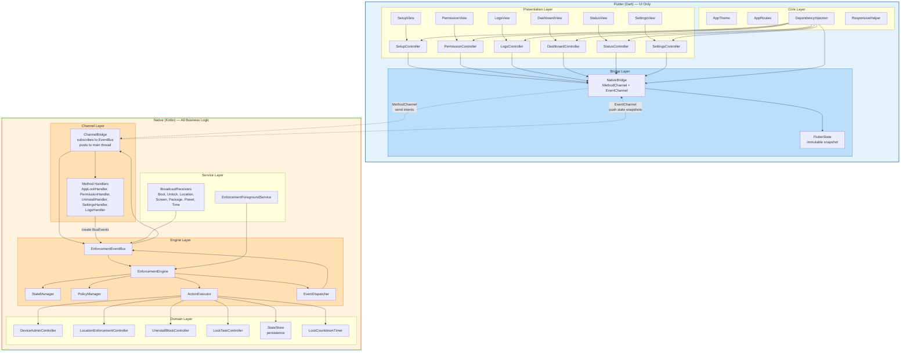
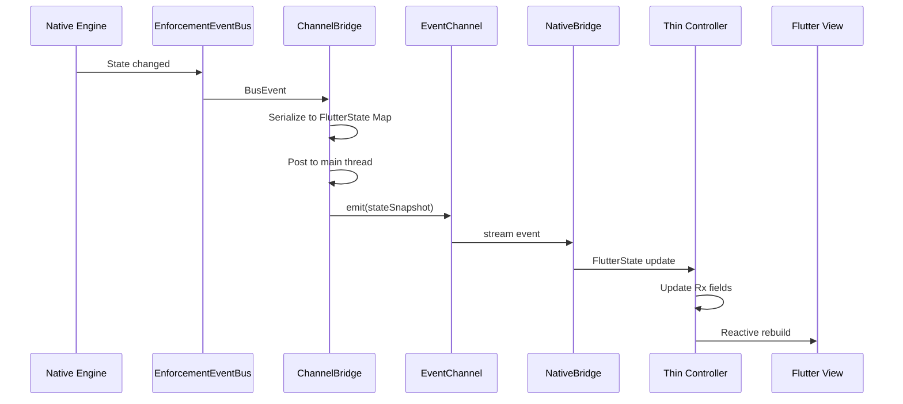
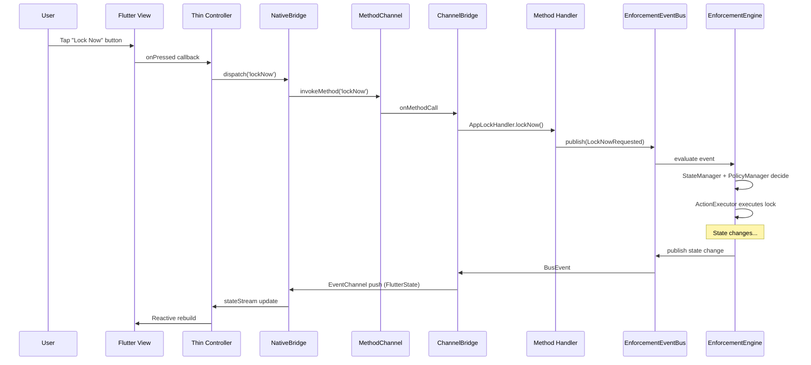
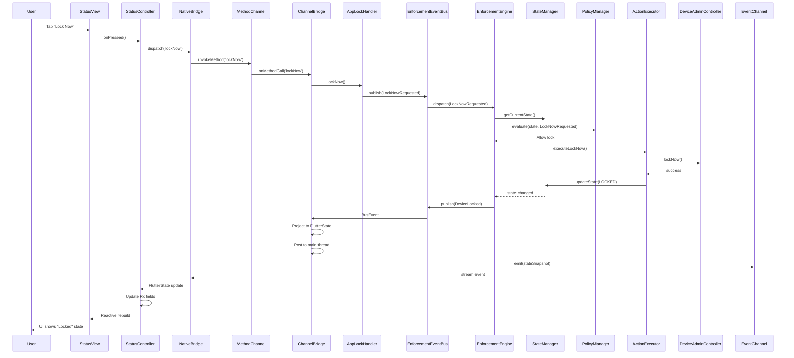
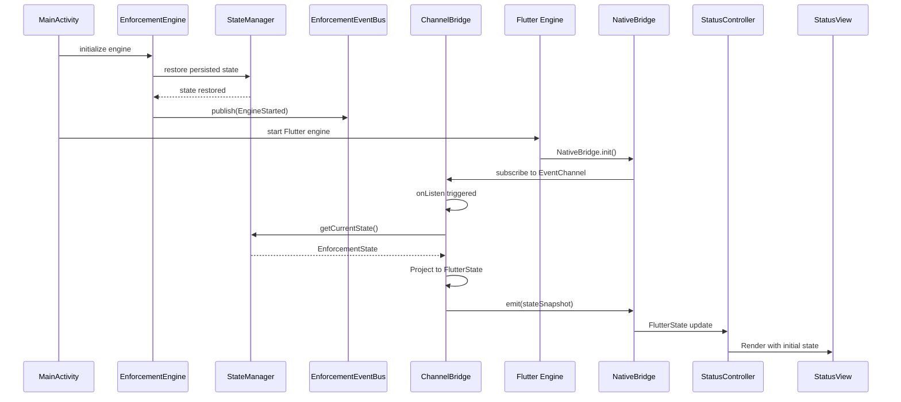
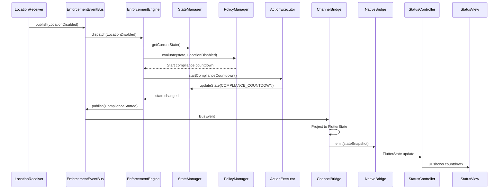
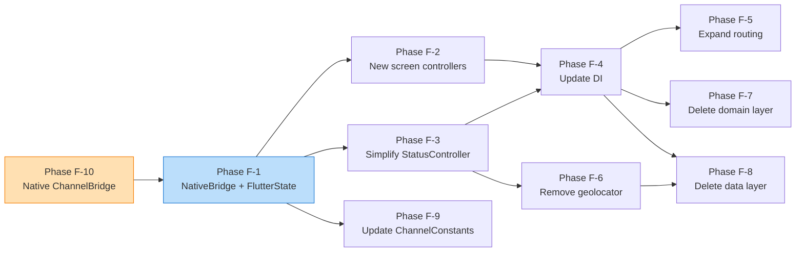

# 📱 Flutter UI-Only Refactor — Architecture Design

> **Parent Documents:** [`architecture-analysis.md`](architecture-analysis.md), [`enforcement-engine-design.md`](enforcement-engine-design.md), [`enforcement-event-bus.md`](enforcement-event-bus.md), [`enforcement-state-machine.md`](enforcement-state-machine.md), [`enforcement-foreground-service.md`](enforcement-foreground-service.md), [`enforcement-controllers.md`](enforcement-controllers.md), [`enforcement-receivers.md`](enforcement-receivers.md), [`enforcement-lifecycle-manager.md`](enforcement-lifecycle-manager.md)

---

## Table of Contents

1. [Design Goals](#1-design-goals)
2. [Current State — Flutter as a Full Application](#2-current-state--flutter-as-a-full-application)
3. [Target State — Flutter as UI-Only Shell](#3-target-state--flutter-as-ui-only-shell)
4. [Module Diagram](#4-module-diagram)
5. [Flutter Responsibility Areas](#5-flutter-responsibility-areas)
6. [Business Logic Migration — What Moves to Native](#6-business-logic-migration--what-moves-to-native)
7. [Layer Elimination Map](#7-layer-elimination-map)
8. [New Platform Channel Contract](#8-new-platform-channel-contract)
9. [State Synchronization — Push-Only Model](#9-state-synchronization--push-only-model)
10. [Removal of geolocator Plugin](#10-removal-of-geolocator-plugin)
11. [New Flutter Architecture — Package Tree](#11-new-flutter-architecture--package-tree)
12. [Thin Controller Pattern](#12-thin-controller-pattern)
13. [State Model — FlutterState Snapshot](#13-state-model--flutterstate-snapshot)
14. [Intent-Based Command Pattern](#14-intent-based-command-pattern)
15. [Screen-by-Screen Responsibility Breakdown](#15-screen-by-screen-responsibility-breakdown)
16. [Dependency Injection — Simplified](#16-dependency-injection--simplified)
17. [Routing — Expanded](#17-routing--expanded)
18. [Sequence Diagrams](#18-sequence-diagrams)
19. [Class Migration Map](#19-class-migration-map)
20. [Problems Solved](#20-problems-solved)
21. [Migration Phases](#21-migration-phases)
22. [Relationship to Parent Documents](#22-relationship-to-parent-documents)

---

## 1. Design Goals

### 1.1 The Golden Rule

> **Flutter renders screens. Native decides everything.**

Flutter must never:
- Evaluate a condition that determines whether to lock, unlock, start a service, or block an uninstall.
- Hold a timer, countdown, or deadline.
- Query a sensor, system service, or Android API directly.
- Maintain enforcement state beyond what Native pushes.
- Execute branching logic that controls enforcement behavior.

Flutter must only:
- Display state received from Native.
- Forward user actions to Native as intents.
- Render UI for six responsibility areas: Setup, Permission UI, Logs, Dashboard, Status, Settings.

### 1.2 Design Principles

| # | Principle | Rationale |
|---|-----------|-----------|
| DP-1 | **Single source of truth** | Native `EnforcementEngine` owns all state. Flutter holds a cached snapshot, never the authoritative copy. |
| DP-2 | **Push-only state delivery** | Native pushes state snapshots via `EventChannel`. Flutter never pulls (queries) state on demand. Eliminates P-20 dual-path race. |
| DP-3 | **Intent-based commands** | Flutter sends user actions as opaque intents via `MethodChannel`. Native interprets and decides. Flutter does not pre-validate. |
| DP-4 | **No domain layer** | Flutter has no entities, repositories, or use cases. All domain logic lives in Native. |
| DP-5 | **No data layer** | Flutter has no data sources, no `GetStorage`, no `geolocator`. All persistence and system queries are Native. |
| DP-6 | **Thin controllers** | GetX controllers hold only `Rx` state fields and one-line intent-dispatch methods. No business logic. |
| DP-7 | **Stateless rendering** | Views are pure functions of controller state. No conditional enforcement logic in widget trees. |

### 1.3 Boundary Test

Any Flutter code must pass this test:

> *If you replaced the Flutter UI with a completely different framework (e.g., Jetpack Compose), would the enforcement system still function correctly?*

If the answer is **no**, the code being tested contains enforcement logic and must move to Native.

---

## 2. Current State — Flutter as a Full Application

### 2.1 Current Architecture

Flutter currently implements a full Clean Architecture stack:

```
lib/
├── core/           ← Platform wrappers, constants, errors, theme, utils
├── domain/         ← Entities, repository abstractions, 18 use cases
├── data/           ← NativeDataSource, LocalDataSource, 5 repository implementations
├── presentation/   ← GetX controllers (with business logic), views, routes, bindings
└── config/         ← DependencyInjection composition root
```

### 2.2 What Flutter Currently Owns (That It Should Not)

| Responsibility | Current Location | Problem |
|---|---|---|
| **18 use cases** | [`lib/domain/usecases/`](lib/domain/usecases/) | Use cases wrap MethodChannel calls but add no value — they are pass-throughs. Native engine already encapsulates this logic. |
| **5 repository abstractions** | [`lib/domain/repositories/`](lib/domain/repositories/) | Abstract ports for lock, permission, service, uninstall, location. Native engine owns these domains; Flutter should not abstract them. |
| **5 repository implementations** | [`lib/data/repositories/`](lib/data/repositories/) | Concrete implementations that call `NativeDataSource`. Unnecessary indirection when Flutter is UI-only. |
| **NativeDataSource** | [`lib/data/datasources/native_data_source.dart`](lib/data/datasources/native_data_source.dart) | 218-line class wrapping MethodChannel + EventChannel with mapping functions. Replaced by a thin `NativeBridge`. |
| **LocalDataSource** | [`lib/data/datasources/local_data_source.dart`](lib/data/datasources/local_data_source.dart) | GetStorage-backed key/value store for `hasSeenWelcome`, `isDeviceAdminActive`, `lastLockTime`, `isDemoRunning`. All of this moves to Native persistence. |
| **LocationRepositoryImpl** | [`lib/data/repositories/location_repository_impl.dart`](lib/data/repositories/location_repository_impl.dart) | Backed by `geolocator` plugin. Duplicates native location detection (P-14). Must be removed entirely. |
| **AppState aggregate** | [`lib/domain/entities/app_state.dart`](lib/domain/entities/app_state.dart) | 8-field state snapshot with `copyWith`. Replaced by a simpler `FlutterState` model received from Native. |
| **StatusController business logic** | [`lib/presentation/status/controllers/status_controller.dart`](lib/presentation/status/controllers/status_controller.dart) | `startDemo`, `stopDemo`, `lockNow`, `lockForDuration`, `toggleUninstallBlock`, `selectLockMinutes`, `isOverdue` flag, 4 stream subscriptions, `_update` with debug logging. All enforcement logic. |
| **WelcomeController business logic** | [`lib/presentation/welcome/controllers/welcome_controller.dart`](lib/presentation/welcome/controllers/welcome_controller.dart) | `canProceed` getter (permission AND location dual-confirmation gating), `_refreshPermission`, `_refreshProvisioningAllowed`, `_refreshLocationEnabled`, `didChangeAppLifecycleState` re-checks. |
| **Dual-path state sync** | Pull on `onInit`/`onResume` + push via `EventChannel` | P-20: pull and push can race, producing inconsistent state. |
| **geolocator dependency** | [`pubspec.yaml`](pubspec.yaml) | P-14: duplicates native `LocationProviderChangeReceiver`. Adds bundle size, permission complexity, and a second location-detection path. |

### 2.3 Current Platform Channel Contract

**MethodChannel** `app_lock/methods` — 11 methods:

| Method | Flutter Caller | Purpose |
|---|---|---|
| `checkPermission` | WelcomeController | Pull permission status |
| `requestPermission` | WelcomeController | Trigger device admin provisioning |
| `isProvisioningAllowed` | WelcomeController | Check if provisioning is possible |
| `lockNow` | StatusController | Immediate lock |
| `lockForDuration` | StatusController | Timed lock |
| `startService` | StatusController (startDemo) | Start foreground service |
| `stopService` | StatusController (stopDemo) | Stop foreground service |
| `isServiceRunning` | StatusController (onInit) | Pull service status |
| `setUninstallBlocked` | StatusController (toggleUninstallBlock) | Toggle uninstall block |
| `isUninstallBlocked` | StatusController (onInit) | Pull uninstall block status |
| `isUninstallBlockSupported` | StatusController (onInit) | Pull capability |

**EventChannel** `app_lock/events` — 5 event types:

| Event Type | Payload Keys | Consumer |
|---|---|---|
| `permissionChanged` | `granted: bool` | WelcomeController, StatusController |
| `lockResult` | `result: String` | StatusController |
| `serviceStateChanged` | `status: String` | StatusController |
| `lockoutStateChanged` | `active: bool` | StatusController |
| `uninstallBlockChanged` | `blocked: bool` | StatusController |

### 2.4 Problems with Current State

| Problem ID | Description | Impact |
|---|---|---|
| **P-14** | [`geolocator`](lib/data/repositories/location_repository_impl.dart) plugin duplicates native `LocationProviderChangeReceiver` | Two location-detection paths can disagree; extra permission; bundle bloat |
| **P-20** | Dual-path state synchronization (pull on init/resume + push via EventChannel) | Race conditions produce inconsistent UI state |
| **P-13** | EventChannel events emitted from multiple threads without synchronization | UI thread violations, missed events |
| — | 18 use cases are pass-through wrappers | Dead indirection, maintenance burden |
| — | 5 repository abstractions + 5 implementations | Dead layer for a UI-only shell |
| — | `LocalDataSource` (GetStorage) duplicates native persistence | Two sources of truth for `isDemoRunning`, `lastLockTime` |
| — | `StatusController.isOverdue` static flag | Business logic (demo overdue detection) in Flutter |
| — | `WelcomeController.canProceed` gating logic | Enforcement decision (proceed only if permission + location) in Flutter |
| — | `StatusController` has 12 use case dependencies | Over-injected, hard to test, tightly coupled to domain layer |

---

## 3. Target State — Flutter as UI-Only Shell

### 3.1 Architecture Overview

```
┌─────────────────────────────────────────────────────┐
│                    Flutter (Dart)                     │
│                                                       │
│  ┌─────────┐  ┌─────────┐  ┌──────────────────────┐ │
│  │  Views   │  │ Thin    │  │  NativeBridge        │ │
│  │  (6      │←─│ Control-│←─│  (MethodChannel +    │ │
│  │  screens)│  │ lers    │  │   EventChannel only) │ │
│  └─────────┘  └─────────┘  └──────────┬───────────┘ │
│                                        │             │
└────────────────────────────────────────┼─────────────┘
                                         │
                          Platform Channel Boundary
                                         │
┌────────────────────────────────────────┼─────────────┐
│                    Native (Kotlin)     │             │
│                                        ▼             │
│  ┌─────────────────────────────────────────────────┐ │
│  │              ChannelBridge                       │ │
│  │  (subscribes to EnforcementEventBus,             │ │
│  │   posts all emissions to main thread)            │ │
│  └─────────────┬───────────────────┬───────────────┘ │
│                │                   │                 │
│                ▼                   ▼                 │
│  ┌──────────────────┐  ┌────────────────────────┐   │
│  │  Method Handlers  │  │  EnforcementEventBus   │   │
│  │  (thin adapters   │  │  (BusEvent stream)     │   │
│  │   → BusEvents)    │  └───────────┬────────────┘   │
│  └────────┬─────────┘              │                │
│           │                        │                │
│           ▼                        ▼                │
│  ┌──────────────────────────────────────────────────┐│
│  │            EnforcementEngine                     ││
│  │  (StateManager + PolicyManager +                 ││
│  │   ActionExecutor + EventDispatcher)              ││
│  └──────────────────────────────────────────────────┘│
└──────────────────────────────────────────────────────┘
```

### 3.2 What Flutter Keeps

| Component | Purpose |
|---|---|
| **Views** (6 screens) | Render UI based on controller state |
| **Thin controllers** | Hold `Rx` state fields, dispatch intents via `NativeBridge` |
| **NativeBridge** | Single class wrapping `MethodChannel` + `EventChannel` |
| **FlutterState model** | Immutable state snapshot received from Native |
| **App theme** | Material 3 theme configuration |
| **Routing** | GetX route table (expanded to 6 screens) |
| **Dependency injection** | Simplified — registers `NativeBridge` + 6 controllers |
| **Responsive helpers** | UI layout utilities |

### 3.3 What Flutter Eliminates

| Component | Eliminated Because |
|---|---|
| **Domain layer** (entities, repositories, use cases) | All domain logic lives in Native `EnforcementEngine` |
| **Data layer** (NativeDataSource, LocalDataSource, repository impls) | Replaced by single `NativeBridge` class |
| **geolocator plugin** | Native `LocationReceiver` + `LocationProviderChangeReceiver` handle location |
| **GetStorage** | Native persistence (`StateStore`) is the single source of truth |
| **AppState aggregate** | Replaced by `FlutterState` — a passive snapshot, not an aggregate root |
| **18 use cases** | Pass-through wrappers with no value |
| **5 repository abstractions** | Flutter does not own these domains |
| **5 repository implementations** | Unnecessary indirection |
| **Dual-path state sync** | Replaced by push-only model |
| **Business logic in controllers** | Controllers become thin intent dispatchers |

---

## 4. Module Diagram



### 4.1 Communication Flow Summary

```
User taps button in Flutter View
    → Thin Controller dispatches intent
    → NativeBridge.invokeMethod (MethodChannel)
    → ChannelBridge receives method call
    → Method Handler creates BusEvent
    → EnforcementEventBus publishes event
    → EnforcementEngine evaluates (StateManager + PolicyManager)
    → ActionExecutor executes (DeviceAdmin, LocationEnf, etc.)
    → StateManager updates state
    → EnforcementEventBus publishes state-change event
    → ChannelBridge receives event, serializes to Map
    → EventChannel pushes to Flutter
    → NativeBridge stream emits FlutterState
    → Thin Controller updates Rx fields
    → View re-renders
```

---

## 5. Flutter Responsibility Areas

Flutter owns exactly six responsibility areas. Each is a screen with a thin controller. None contain enforcement logic.

### 5.1 Responsibility Matrix

| # | Screen | Route | Controller | What It Displays | What It Sends |
|---|--------|-------|------------|------------------|---------------|
| 1 | **Setup** | `/setup` | `SetupController` | Provisioning guidance, ADB command, device-owner status | `requestProvisioning` intent |
| 2 | **Permission UI** | `/permissions` | `PermissionController` | Permission status, location status, provisioning allowed | `requestPermission`, `openLocationSettings` intents |
| 3 | **Logs** | `/logs` | `LogsController` | Event log entries (received from Native) | `clearLogs`, `exportLogs` intents |
| 4 | **Dashboard** | `/dashboard` | `DashboardController` | Overview cards: state, policy, timers, compliance | `navigateToStatus`, `navigateToSettings` (internal routing only) |
| 5 | **Status** | `/status` | `StatusController` | Lock state, service state, lockout state, uninstall block, demo controls | `lockNow`, `lockForDuration`, `startDemo`, `stopDemo`, `toggleUninstallBlock` intents |
| 6 | **Settings** | `/settings` | `SettingsController` | Policy configuration, lock duration presets, timer intervals | `updatePolicy`, `setLockDuration`, `clearOwner` intents |

### 5.2 What Each Screen Does NOT Do

| Screen | Does NOT |
|---|---|
| Setup | Does NOT check if provisioning is allowed (Native pushes `isProvisioningAllowed` in state) |
| Permission UI | Does NOT evaluate `canProceed` gating (Native decides; Flutter only displays the gate result) |
| Logs | Does NOT filter or interpret logs (Native sends pre-formatted log entries) |
| Dashboard | Does NOT aggregate state (Native sends a pre-aggregated snapshot) |
| Status | Does NOT execute lock/service/uninstall logic (sends intents only) |
| Settings | Does NOT validate policy values (Native validates and applies) |

---

## 6. Business Logic Migration — What Moves to Native

### 6.1 StatusController Business Logic → Native

| Current Flutter Logic | Native Destination | How |
|---|---|---|
| `startDemo()` → calls `StartServiceUseCase` | `EnforcementEngine` handles `StartServiceRequested` BusEvent | Flutter sends `startDemo` intent; Native handler creates `StartServiceRequested` event |
| `stopDemo()` → calls `StopServiceUseCase` | `EnforcementEngine` handles `StopServiceRequested` BusEvent | Flutter sends `stopDemo` intent |
| `lockNow()` → calls `LockNowUseCase` | `EnforcementEngine` handles `LockNowRequested` BusEvent | Flutter sends `lockNow` intent |
| `lockForDuration(minutes)` → calls `LockForDurationUseCase` | `EnforcementEngine` handles `LockForDurationRequested` BusEvent | Flutter sends `lockForDuration` intent with `durationMs` |
| `toggleUninstallBlock()` → calls `SetUninstallBlockedUseCase` | `EnforcementEngine` handles `SetUninstallBlockedRequested` BusEvent | Flutter sends `toggleUninstallBlock` intent |
| `selectLockMinutes(int)` → stores in RxInt | Moves to Settings screen; Native `PolicyManager` owns duration presets | Flutter sends `selectLockDuration` intent |
| `static const bool isOverdue = true` | Native `StateManager` computes overdue status | Included in `FlutterState.isOverdue` field pushed by Native |
| 4 stream subscriptions (service, lock, lockout, uninstall) | Replaced by single `FlutterState` stream from `ChannelBridge` | One subscription in `NativeBridge` |
| `_update()` with debug logging | Native `EventDispatcher` handles logging | Removed from Flutter entirely |
| `lockDurationPresets: [1, 2, 3, 4, 5, 10, 15, 30, 60]` | Native `PolicyManager` owns presets; pushes to Flutter in state | Flutter receives presets from Native |

### 6.2 WelcomeController Business Logic → Native

| Current Flutter Logic | Native Destination | How |
|---|---|---|
| `canProceed` getter (permission AND location) | Native `PolicyManager` evaluates gating | `FlutterState.canProceed` field pushed by Native |
| `_refreshPermission()` | Native pushes `permissionStatus` in state | Removed from Flutter |
| `_refreshProvisioningAllowed()` | Native pushes `isProvisioningAllowed` in state | Removed from Flutter |
| `_refreshLocationEnabled()` (via geolocator) | Native `LocationReceiver` detects; pushes `isLocationEnabled` in state | geolocator removed entirely |
| `didChangeAppLifecycleState` re-checks on resume | Not needed — push-only model means Flutter always has latest state | Removed from Flutter |
| `requestPermission()` | Flutter sends `requestPermission` intent | Native handler creates `RequestPermissionRequested` event |
| `openLocationSettings()` | Flutter sends `openLocationSettings` intent | Native handler launches settings activity |

### 6.3 Use Case Elimination Map

All 18 use cases are eliminated. Their MethodChannel calls are replaced by direct `NativeBridge` intent dispatches:

| Use Case | Eliminated | Replacement |
|---|---|---|
| `CheckPermissionUseCase` | ✅ | `FlutterState.isPermissionGranted` (pushed by Native) |
| `RequestPermissionUseCase` | ✅ | `NativeBridge.dispatch('requestPermission')` |
| `CheckProvisioningAllowedUseCase` | ✅ | `FlutterState.isProvisioningAllowed` (pushed by Native) |
| `CheckLocationEnabledUseCase` | ✅ | `FlutterState.isLocationEnabled` (pushed by Native) |
| `WatchLocationStatusUseCase` | ✅ | `FlutterState.isLocationEnabled` (pushed by Native) |
| `OpenLocationSettingsUseCase` | ✅ | `NativeBridge.dispatch('openLocationSettings')` |
| `WatchPermissionUseCase` | ✅ | `FlutterState.isPermissionGranted` (pushed by Native) |
| `LockNowUseCase` | ✅ | `NativeBridge.dispatch('lockNow')` |
| `LockForDurationUseCase` | ✅ | `NativeBridge.dispatch('lockForDuration', {durationMs})` |
| `WatchLockResultUseCase` | ✅ | `FlutterState.lastLockResult` (pushed by Native) |
| `WatchLockoutStateUseCase` | ✅ | `FlutterState.isLockoutActive` (pushed by Native) |
| `StartServiceUseCase` | ✅ | `NativeBridge.dispatch('startDemo')` |
| `StopServiceUseCase` | ✅ | `NativeBridge.dispatch('stopDemo')` |
| `WatchServiceStateUseCase` | ✅ | `FlutterState.isServiceRunning` (pushed by Native) |
| `SetUninstallBlockedUseCase` | ✅ | `NativeBridge.dispatch('toggleUninstallBlock')` |
| `IsUninstallBlockedUseCase` | ✅ | `FlutterState.isUninstallBlocked` (pushed by Native) |
| `IsUninstallBlockSupportedUseCase` | ✅ | `FlutterState.isUninstallBlockSupported` (pushed by Native) |
| `WatchUninstallBlockUseCase` | ✅ | `FlutterState.isUninstallBlocked` (pushed by Native) |

### 6.4 Repository Elimination Map

| Repository Abstraction | Repository Implementation | Eliminated |
|---|---|---|
| `LockRepository` | `LockRepositoryImpl` | ✅ |
| `PermissionRepository` | `PermissionRepositoryImpl` | ✅ |
| `BackgroundServiceRepository` | `BackgroundServiceRepositoryImpl` | ✅ |
| `UninstallRepository` | `UninstallRepositoryImpl` | ✅ |
| `LocationRepository` | `LocationRepositoryImpl` (geolocator) | ✅ |

### 6.5 Data Source Elimination Map

| Data Source | Eliminated | Replacement |
|---|---|---|
| `NativeDataSource` (218 lines) | ✅ | `NativeBridge` (~60 lines) |
| `LocalDataSource` (GetStorage) | ✅ | Native `StateStore` (persistence) |

---

## 7. Layer Elimination Map

### 7.1 Before — Full Clean Architecture

```
lib/
├── core/           ← KEPT (simplified)
│   ├── constants/  ← KEPT (channel_constants, app_constants)
│   ├── errors/     ← REMOVED (PlatformError no longer needed)
│   ├── platform/   ← REPLACED (app_method_channel, app_event_channel → NativeBridge)
│   ├── theme/      ← KEPT
│   └── utils/      ← KEPT (responsive_helper, app_logger)
├── domain/         ← ELIMINATED ENTIRELY
│   ├── entities/   ← REMOVED (app_state, lock_result, permission_status, service_status)
│   ├── repositories/ ← REMOVED (5 abstractions)
│   └── usecases/   ← REMOVED (18 use cases)
├── data/           ← ELIMINATED ENTIRELY
│   ├── datasources/ ← REMOVED (native_data_source, local_data_source)
│   └── repositories/ ← REMOVED (5 implementations)
├── presentation/   ← KEPT (simplified controllers, expanded views)
│   ├── routes/     ← KEPT (expanded to 6 routes)
│   ├── welcome/    ← RENAMED to setup/ + permissions/
│   ├── status/     ← KEPT (simplified controller)
│   ├── logs/       ← NEW
│   ├── dashboard/  ← NEW
│   ├── settings/   ← NEW
│   └── widgets/    ← KEPT
└── config/         ← KEPT (simplified DI)
```

### 7.2 After — UI-Only Shell

```
lib/
├── core/
│   ├── constants/
│   │   ├── channel_constants.dart    ← Method + Event channel names
│   │   └── app_constants.dart        ← App name, theme colors
│   ├── theme/
│   │   └── app_theme.dart            ← Material 3 theme
│   └── utils/
│       ├── app_logger.dart           ← Debug logging (UI only)
│       └── responsive_helper.dart    ← Layout utilities
├── bridge/
│   ├── native_bridge.dart            ← MethodChannel + EventChannel wrapper
│   └── flutter_state.dart            ← Immutable state snapshot model
├── presentation/
│   ├── routes/
│   │   └── app_routes.dart           ← 6 routes with bindings
│   ├── setup/
│   │   ├── bindings/setup_binding.dart
│   │   ├── controllers/setup_controller.dart
│   │   └── views/setup_view.dart
│   ├── permissions/
│   │   ├── bindings/permissions_binding.dart
│   │   ├── controllers/permissions_controller.dart
│   │   └── views/permissions_view.dart
│   ├── logs/
│   │   ├── bindings/logs_binding.dart
│   │   ├── controllers/logs_controller.dart
│   │   └── views/logs_view.dart
│   ├── dashboard/
│   │   ├── bindings/dashboard_binding.dart
│   │   ├── controllers/dashboard_controller.dart
│   │   └── views/dashboard_view.dart
│   ├── status/
│   │   ├── bindings/status_binding.dart
│   │   ├── controllers/status_controller.dart
│   │   └── views/status_view.dart
│   ├── settings/
│   │   ├── bindings/settings_binding.dart
│   │   ├── controllers/settings_controller.dart
│   │   └── views/settings_view.dart
│   └── widgets/
│       ├── section_header.dart
│       └── status_badge.dart
└── config/
    └── dependency_injection.dart     ← Registers NativeBridge + 6 controllers
```

### 7.3 File Count Comparison

| Layer | Before | After | Delta |
|---|---|---|---|
| `core/` | 10 files | 6 files | −4 |
| `domain/` | 23 files | 0 files | −23 |
| `data/` | 7 files | 0 files | −7 |
| `presentation/` | 9 files | 19 files | +10 |
| `bridge/` | 0 files | 2 files | +2 |
| `config/` | 1 file | 1 file | 0 |
| **Total** | **50 files** | **28 files** | **−22** |

---

## 8. New Platform Channel Contract

### 8.1 Design Philosophy

The channel contract changes from **query-response** to **intent-push**:

| Aspect | Before | After |
|---|---|---|
| **State delivery** | Pull (MethodChannel queries) + Push (EventChannel events) | Push-only (EventChannel state snapshots) |
| **Commands** | Method calls with return values (e.g., `lockNow() → bool`) | Intent dispatches with no return value (fire-and-forget) |
| **Event granularity** | 5 separate event types | 1 unified `stateSnapshot` event |
| **Thread safety** | Events from multiple threads (P-13) | All emissions on main thread via `ChannelBridge` |

### 8.2 MethodChannel — `app_lock/methods` (Intents)

Flutter sends intents. Native acknowledges receipt but does NOT return enforcement results. Results arrive asynchronously via the EventChannel state stream.

| Intent Method | Parameters | Returns | Native Handler |
|---|---|---|---|
| `requestProvisioning` | none | `void` | `PermissionHandler` → `RequestPermissionRequested` event |
| `requestPermission` | none | `void` | `PermissionHandler` → `RequestPermissionRequested` event |
| `openLocationSettings` | none | `void` | `PermissionHandler` → launches settings activity |
| `lockNow` | none | `void` | `AppLockHandler` → `LockNowRequested` event |
| `lockForDuration` | `durationMs: int` | `void` | `AppLockHandler` → `LockForDurationRequested` event |
| `startDemo` | none | `void` | `AppLockHandler` → `StartServiceRequested` event |
| `stopDemo` | none | `void` | `AppLockHandler` → `StopServiceRequested` event |
| `toggleUninstallBlock` | none | `void` | `UninstallHandler` → `SetUninstallBlockedRequested` event |
| `selectLockDuration` | `durationMs: int` | `void` | `SettingsHandler` → `PolicyChanged` event |
| `updatePolicy` | `policy: Map` | `void` | `SettingsHandler` → `PolicyChanged` event |
| `clearOwner` | none | `void` | `SettingsHandler` → `ClearOwnerRequested` event |
| `clearLogs` | none | `void` | `LogsHandler` → clears log buffer |
| `exportLogs` | none | `String` (file path) | `LogsHandler` → writes logs to file, returns path |

**Key change:** Methods like `checkPermission`, `isProvisioningAllowed`, `isServiceRunning`, `isUninstallBlocked`, `isUninstallBlockSupported` are **REMOVED**. Their values are delivered via the EventChannel state snapshot.

### 8.3 EventChannel — `app_lock/events` (State Snapshots)

A single event type replaces the previous 5:

| Event Type | Payload | Frequency |
|---|---|---|
| `stateSnapshot` | Full `FlutterState` Map (see §13) | On every state change in Native |

**Payload structure:**

```dart
{
  "type": "stateSnapshot",
  "state": {
    "isPermissionGranted": bool,
    "isProvisioningAllowed": bool,
    "isLocationEnabled": bool,
    "isServiceRunning": bool,
    "isDemoRunning": bool,
    "isLockoutActive": bool,
    "isUninstallBlocked": bool,
    "isUninstallBlockSupported": bool,
    "canProceed": bool,
    "isOverdue": bool,
    "lastLockResult": String?,
    "lastLockTime": int?,
    "lockoutDeadline": int?,
    "complianceState": String,
    "lockDurationPresets": List<int>,
    "selectedLockDurationMs": int?,
    "policy": Map<String, dynamic>?,
    "logs": List<Map<String, dynamic>>,
  }
}
```

### 8.4 Channel Contract Comparison

| Feature | Before (11 methods + 5 events) | After (13 intents + 1 event) |
|---|---|---|
| State queries | 5 pull methods (`checkPermission`, `isServiceRunning`, etc.) | 0 (all in state snapshot) |
| Commands | 6 command methods with return values | 13 intent methods (fire-and-forget) |
| Events | 5 granular event types | 1 unified `stateSnapshot` event |
| Race conditions | P-20 (pull + push can race) | None (push-only) |
| Thread safety | P-13 (multi-thread emission) | Guaranteed main-thread (ChannelBridge) |

---

## 9. State Synchronization — Push-Only Model

### 9.1 Before — Dual-Path (P-20)

```
Flutter Controller onInit:
  → Pull: checkPermission()     ← MethodChannel
  → Pull: isServiceRunning()    ← MethodChannel
  → Pull: isUninstallBlocked()  ← MethodChannel
  → Pull: isUninstallBlockSupported() ← MethodChannel
  → Subscribe: permissionChanges  ← EventChannel
  → Subscribe: serviceStateChanges ← EventChannel
  → Subscribe: lockoutStateChanges ← EventChannel
  → Subscribe: uninstallBlockChanges ← EventChannel

Flutter Controller onResume:
  → Re-pull all 4 values (in case they changed while paused)

Problem: Pull and push can interleave, producing inconsistent state.
```

### 9.2 After — Push-Only

```
Flutter NativeBridge onInit:
  → Subscribe: stateSnapshot stream ← EventChannel (single subscription)

Native ChannelBridge:
  → Subscribes to EnforcementEventBus
  → On every state change: serialize FlutterState → post to main thread → EventChannel.emit

Flutter Controller:
  → Receives FlutterState from NativeBridge.stream
  → Updates Rx fields
  → View re-renders

No pull. No re-fetch on resume. No race.
```

### 9.3 Why Push-Only Works

| Concern | Resolution |
|---|---|
| What if Flutter starts before Native has state? | Native `EnforcementEngine` initializes in `MainActivity.configureFlutterEngine()` before Flutter engine starts. By the time Flutter subscribes, Native pushes the current state immediately. |
| What if Flutter is paused and misses events? | Native `ChannelBridge` buffers events while EventChannel has no subscriber. On `onListen`, it pushes the latest snapshot first. |
| What if state changes rapidly? | `ChannelBridge` debounces — coalesces rapid state changes into a single snapshot push (e.g., 100ms window). |
| What if Flutter needs state for a decision? | Flutter never makes enforcement decisions. It only renders state. If a button should be disabled, `FlutterState.canProceed` or similar field tells Flutter. |

### 9.4 State Flow Diagram



---

## 10. Removal of geolocator Plugin

### 10.1 Problem (P-14)

[`LocationRepositoryImpl`](lib/data/repositories/location_repository_impl.dart) uses the `geolocator` Flutter package to detect location service status. This duplicates the native [`LocationProviderChangeReceiver`](android/app/src/main/kotlin/com/example/app_lock/admin/LocationProviderChangeReceiver.kt), creating two location-detection paths that can disagree.

### 10.2 Solution

| Step | Action |
|---|---|
| 1 | Remove `geolocator` from [`pubspec.yaml`](pubspec.yaml) dependencies |
| 2 | Delete [`lib/data/repositories/location_repository_impl.dart`](lib/data/repositories/location_repository_impl.dart) |
| 3 | Delete [`lib/domain/repositories/location_repository.dart`](lib/domain/repositories/location_repository.dart) |
| 4 | Delete [`lib/domain/usecases/check_location_enabled_usecase.dart`](lib/domain/usecases/check_location_enabled_usecase.dart) |
| 5 | Delete [`lib/domain/usecases/watch_location_status_usecase.dart`](lib/domain/usecases/watch_location_status_usecase.dart) |
| 6 | Delete [`lib/domain/usecases/open_location_settings_usecase.dart`](lib/domain/usecases/open_location_settings_usecase.dart) |
| 7 | Native `LocationReceiver` detects location changes → publishes `LocationDisabled`/`LocationEnabled` BusEvent → `EnforcementEngine` updates state → `ChannelBridge` pushes `FlutterState.isLocationEnabled` to Flutter |
| 8 | Flutter sends `openLocationSettings` intent → Native launches settings activity |

### 10.3 Benefits

| Benefit | Impact |
|---|---|
| Single location-detection path | No more disagreement between Flutter and Native |
| Reduced bundle size | `geolocator` + transitive dependencies removed |
| Simplified permissions | No Flutter-side location permission handling |
| Eliminated P-14 | Architecture analysis problem fully resolved |

---

## 11. New Flutter Architecture — Package Tree

```
lib/
│
├── main.dart                          ← Entry point: init DI → runApp(App())
├── app.dart                           ← GetMaterialApp with 6 routes
│
├── core/
│   ├── constants/
│   │   ├── channel_constants.dart     ← Channel names + intent method names
│   │   └── app_constants.dart         ← App name, theme constants
│   ├── theme/
│   │   └── app_theme.dart             ← Material 3 theme
│   └── utils/
│       ├── app_logger.dart            ← Debug logging (UI-only)
│       └── responsive_helper.dart     ← Layout utilities
│
├── bridge/
│   ├── native_bridge.dart             ← MethodChannel + EventChannel wrapper
│   └── flutter_state.dart             ← Immutable state snapshot model
│
├── presentation/
│   ├── routes/
│   │   └── app_routes.dart            ← 6 routes with bindings
│   │
│   ├── setup/
│   │   ├── bindings/
│   │   │   └── setup_binding.dart
│   │   ├── controllers/
│   │   │   └── setup_controller.dart
│   │   └── views/
│   │       └── setup_view.dart
│   │
│   ├── permissions/
│   │   ├── bindings/
│   │   │   └── permissions_binding.dart
│   │   ├── controllers/
│   │   │   └── permissions_controller.dart
│   │   └── views/
│   │       └── permissions_view.dart
│   │
│   ├── logs/
│   │   ├── bindings/
│   │   │   └── logs_binding.dart
│   │   ├── controllers/
│   │   │   └── logs_controller.dart
│   │   └── views/
│   │       └── logs_view.dart
│   │
│   ├── dashboard/
│   │   ├── bindings/
│   │   │   └── dashboard_binding.dart
│   │   ├── controllers/
│   │   │   └── dashboard_controller.dart
│   │   └── views/
│   │       └── dashboard_view.dart
│   │
│   ├── status/
│   │   ├── bindings/
│   │   │   └── status_binding.dart
│   │   ├── controllers/
│   │   │   └── status_controller.dart
│   │   └── views/
│   │       └── status_view.dart
│   │
│   ├── settings/
│   │   ├── bindings/
│   │   │   └── settings_binding.dart
│   │   ├── controllers/
│   │   │   └── settings_controller.dart
│   │   └── views/
│   │       └── settings_view.dart
│   │
│   └── widgets/
│       ├── section_header.dart
│       └── status_badge.dart
│
└── config/
    └── dependency_injection.dart      ← Registers NativeBridge + 6 controllers
```

---

## 12. Thin Controller Pattern

### 12.1 Controller Responsibilities

A thin controller does exactly three things:

1. **Holds `Rx` state fields** — populated from `FlutterState` snapshots.
2. **Subscribes to `NativeBridge.stateStream`** — updates Rx fields on new snapshots.
3. **Dispatches intents** — one-line methods calling `NativeBridge.dispatch(...)`.

### 12.2 What a Thin Controller Does NOT Do

- ❌ Call use cases
- ❌ Evaluate conditions
- ❌ Hold timers or deadlines
- ❌ Subscribe to multiple event streams
- ❌ Query platform channels directly
- ❌ Persist state to local storage
- ❌ Contain branching logic that affects enforcement

### 12.3 Example: StatusController (Before vs After)

**Before** (353 lines, 12 use case dependencies, business logic):

```
class StatusController extends GetxController {
  // 12 use case dependencies
  // Rx<AppState> state
  // RxBool isBusy
  // RxInt selectedLockMinutes
  // static const bool isOverdue = true
  // 4 stream subscriptions
  // toggleUninstallBlock() — business logic
  // startDemo() — business logic
  // stopDemo() — business logic
  // lockNow() — business logic
  // selectLockMinutes() — business logic
  // lockForDuration() — business logic
  // _update() with debug logging
}
```

**After** (~60 lines, 1 dependency, no business logic):

```
class StatusController extends GetxController {
  final NativeBridge bridge;
  
  // Rx state fields (populated from FlutterState)
  // isServiceRunning, isDemoRunning, isLockoutActive,
  // isUninstallBlocked, isUninstallBlockSupported,
  // lastLockResult, isOverdue, lockDurationPresets,
  // selectedLockDurationMs
  
  // onInit: subscribe to bridge.stateStream
  
  // Intent dispatch methods (one-liners):
  // lockNow() → bridge.dispatch('lockNow')
  // lockForDuration(ms) → bridge.dispatch('lockForDuration', {durationMs: ms})
  // startDemo() → bridge.dispatch('startDemo')
  // stopDemo() → bridge.dispatch('stopDemo')
  // toggleUninstallBlock() → bridge.dispatch('toggleUninstallBlock')
}
```

### 12.4 Controller Dependency Comparison

| Controller | Before (Use Cases) | After (Dependencies) |
|---|---|---|
| WelcomeController | 7 use cases | 1 (`NativeBridge`) |
| StatusController | 12 use cases | 1 (`NativeBridge`) |
| SetupController | — | 1 (`NativeBridge`) |
| PermissionController | — | 1 (`NativeBridge`) |
| LogsController | — | 1 (`NativeBridge`) |
| DashboardController | — | 1 (`NativeBridge`) |
| SettingsController | — | 1 (`NativeBridge`) |

---

## 13. State Model — FlutterState Snapshot

### 13.1 Design

`FlutterState` is a passive, immutable data class. It holds no logic. It is a serialized projection of Native `EnforcementState` suitable for Flutter rendering.

### 13.2 Fields

| Field | Type | Source | Consumer |
|---|---|---|---|
| `isPermissionGranted` | `bool` | `StateManager` | PermissionController, StatusController |
| `isProvisioningAllowed` | `bool` | `PolicyManager` | SetupController |
| `isLocationEnabled` | `bool` | `LocationReceiver` → `StateManager` | PermissionController |
| `isServiceRunning` | `bool` | `StateManager` | StatusController, DashboardController |
| `isDemoRunning` | `bool` | `StateManager` | StatusController |
| `isLockoutActive` | `bool` | `StateManager` | StatusController |
| `isUninstallBlocked` | `bool` | `UninstallBlockController` → `StateManager` | StatusController |
| `isUninstallBlockSupported` | `bool` | `UninstallBlockController` → `StateManager` | StatusController |
| `canProceed` | `bool` | `PolicyManager` (permission AND location) | SetupController, PermissionController |
| `isOverdue` | `bool` | `StateManager` (demo overdue) | StatusController |
| `lastLockResult` | `String?` | `DeviceAdminController` → `StateManager` | StatusController |
| `lastLockTime` | `int?` (epoch ms) | `StateManager` | StatusController, DashboardController |
| `lockoutDeadline` | `int?` (epoch ms) | `StateManager` | StatusController |
| `complianceState` | `String` | `StateManager` (enum name) | DashboardController |
| `lockDurationPresets` | `List<int>` | `PolicyManager` | SettingsController, StatusController |
| `selectedLockDurationMs` | `int?` | `PolicyManager` | SettingsController |
| `policy` | `Map<String, dynamic>?` | `PolicyManager` | SettingsController |
| `logs` | `List<Map<String, dynamic>>` | `EventDispatcher` (log buffer) | LogsController |

### 13.3 Relationship to Native EnforcementState

`FlutterState` is a **projection** of Native [`EnforcementState`](plans/enforcement-engine-design.md) (§6.3). Native `EnforcementState` contains internal fields (e.g., `stateMachineState`, `timerIds`, `deadlineTimestamps`, `policyVersion`) that Flutter does not need. `ChannelBridge` projects only the fields relevant to UI rendering.

```
Native EnforcementState (authoritative)
    │
    ▼ ChannelBridge.projection()
FlutterState (UI projection)
    │
    ▼ EventChannel
Flutter NativeBridge.stream
    │
    ▼ Thin Controller Rx fields
    │
    ▼ View renders
```

### 13.4 Comparison to Current AppState

| Aspect | Current `AppState` | New `FlutterState` |
|---|---|---|
| Fields | 8 | 18 (richer, covers all 6 screens) |
| Logic | `copyWith` method | None (pure data) |
| Source | Assembled by `StatusController` from 4 streams + 4 pulls | Received as single snapshot from Native |
| Authority | Flutter-side aggregate (can drift from Native) | Native projection (always consistent) |
| Updates | Incremental (per-field via separate streams) | Atomic (full snapshot replacement) |

---

## 14. Intent-Based Command Pattern

### 14.1 Design

Flutter sends user actions as **intents** — opaque command names with optional parameters. Native interprets intents and decides what to do. Flutter does not pre-validate, pre-check, or branch on intent results.

### 14.2 Intent Dispatch Flow



### 14.3 Fire-and-Forget Semantics

| Aspect | Behavior |
|---|---|
| Return value | `void` — Flutter does not wait for enforcement result |
| Error handling | Native logs errors; state snapshot reflects failure (e.g., `lastLockResult = "failed"`) |
| UI feedback | Button shows loading state immediately; actual result arrives via state stream |
| Retry | Flutter does NOT retry. If Native fails, it handles its own retry/recovery. |

### 14.4 Intent Catalog

| Intent | Parameters | Triggered By | Native Event |
|---|---|---|---|
| `requestProvisioning` | none | Setup screen "Enable" button | `RequestPermissionRequested` |
| `requestPermission` | none | Permission screen "Grant" button | `RequestPermissionRequested` |
| `openLocationSettings` | none | Permission screen "Open Settings" button | Launches `Settings.ACTION_LOCATION_SOURCE_SETTINGS` |
| `lockNow` | none | Status screen "Lock Now" button | `LockNowRequested` |
| `lockForDuration` | `durationMs: int` | Status screen duration picker | `LockForDurationRequested` |
| `startDemo` | none | Status screen "Start Demo" toggle | `StartServiceRequested` |
| `stopDemo` | none | Status screen "Stop Demo" toggle | `StopServiceRequested` |
| `toggleUninstallBlock` | none | Status screen uninstall toggle | `SetUninstallBlockedRequested` |
| `selectLockDuration` | `durationMs: int` | Settings screen duration selector | `PolicyChanged` |
| `updatePolicy` | `policy: Map` | Settings screen policy form | `PolicyChanged` |
| `clearOwner` | none | Settings screen "Clear Owner" button | `ClearOwnerRequested` |
| `clearLogs` | none | Logs screen "Clear" button | Clears log buffer |
| `exportLogs` | none | Logs screen "Export" button | Writes logs to file, returns path |

---

## 15. Screen-by-Screen Responsibility Breakdown

### 15.1 Setup Screen

| Aspect | Detail |
|---|---|
| **Route** | `/setup` |
| **Controller** | `SetupController` |
| **Displays** | App logo, warning card, ADB device-owner command, provisioning status, "Enable" button |
| **State fields** | `isProvisioningAllowed`, `isPermissionGranted` |
| **Intents** | `requestProvisioning` |
| **Navigation** | → `/permissions` when `isPermissionGranted` becomes true |
| **Does NOT** | Check provisioning allowed (Native pushes it), evaluate readiness gating |

### 15.2 Permission UI Screen

| Aspect | Detail |
|---|---|
| **Route** | `/permissions` |
| **Controller** | `PermissionController` |
| **Displays** | Permission status card, location status card, provisioning guidance, "Grant Permission" button, "Open Location Settings" button, "Continue" button |
| **State fields** | `isPermissionGranted`, `isLocationEnabled`, `canProceed` |
| **Intents** | `requestPermission`, `openLocationSettings` |
| **Navigation** | → `/dashboard` when `canProceed` becomes true |
| **Does NOT** | Evaluate `canProceed` (Native pushes it), query geolocator, re-check on resume |

### 15.3 Logs Screen

| Aspect | Detail |
|---|---|
| **Route** | `/logs` |
| **Controller** | `LogsController` |
| **Displays** | Scrollable list of log entries (timestamp, level, message), "Clear" button, "Export" button |
| **State fields** | `logs` (List of log entry maps) |
| **Intents** | `clearLogs`, `exportLogs` |
| **Does NOT** | Filter logs, interpret log levels, format timestamps (Native sends pre-formatted entries) |

### 15.4 Dashboard Screen

| Aspect | Detail |
|---|---|
| **Route** | `/dashboard` |
| **Controller** | `DashboardController` |
| **Displays** | Overview cards: compliance state, service status, lockout status, last lock time, uninstall block status, quick-action buttons |
| **State fields** | `complianceState`, `isServiceRunning`, `isLockoutActive`, `lastLockTime`, `isUninstallBlocked` |
| **Intents** | None (navigation only) |
| **Navigation** | → `/status`, → `/settings`, → `/logs` |
| **Does NOT** | Aggregate state (Native sends pre-aggregated snapshot) |

### 15.5 Status Screen

| Aspect | Detail |
|---|---|
| **Route** | `/status` |
| **Controller** | `StatusController` |
| **Displays** | Permission tile, service tile, lock tile, lockout tile, timed-lock tile, demo tile, uninstall-block tile, action buttons, duration picker dialog |
| **State fields** | `isPermissionGranted`, `isServiceRunning`, `isDemoRunning`, `isLockoutActive`, `isUninstallBlocked`, `isUninstallBlockSupported`, `lastLockResult`, `isOverdue`, `lockDurationPresets`, `selectedLockDurationMs` |
| **Intents** | `lockNow`, `lockForDuration`, `startDemo`, `stopDemo`, `toggleUninstallBlock` |
| **Does NOT** | Execute lock/service/uninstall logic, hold timers, evaluate overdue status, manage stream subscriptions |

### 15.6 Settings Screen

| Aspect | Detail |
|---|---|
| **Route** | `/settings` |
| **Controller** | `SettingsController` |
| **Displays** | Policy configuration form (lock duration presets, timer intervals, compliance thresholds), "Clear Owner" button with confirmation dialog |
| **State fields** | `policy`, `lockDurationPresets`, `selectedLockDurationMs` |
| **Intents** | `selectLockDuration`, `updatePolicy`, `clearOwner` |
| **Does NOT** | Validate policy values (Native validates), apply policy (Native applies) |

---

## 16. Dependency Injection — Simplified

### 16.1 Before

[`DependencyInjection`](lib/config/dependency_injection.dart) registers:
- `AppMethodChannel` (singleton)
- `AppEventChannel` (singleton)
- `GetStorage` (singleton)
- `NativeDataSource` (singleton)
- `LocalDataSource` (singleton)
- 5 repository implementations (singletons)
- 18 use cases (factory or singleton)

Total: ~28 registrations

### 16.2 After

`DependencyInjection` registers:
- `NativeBridge` (singleton)
- 6 controllers (factory via GetX bindings)

Total: 7 registrations

### 16.3 Registration Flow

```
DependencyInjection.init():
  1. Create NativeBridge (registers MethodChannel + EventChannel handlers)
  2. NativeBridge subscribes to EventChannel state stream
  3. Register NativeBridge as permanent singleton
  4. Route bindings create controllers on-demand, injecting NativeBridge
```

---

## 17. Routing — Expanded

### 17.1 Route Table

| Route | Screen | Binding | Initial |
|---|---|---|---|
| `/setup` | SetupView | SetupBinding | ✅ (if not provisioned) |
| `/permissions` | PermissionsView | PermissionsBinding | ✅ (if provisioned but not permitted) |
| `/dashboard` | DashboardView | DashboardBinding | ✅ (if permitted) |
| `/status` | StatusView | StatusBinding | |
| `/logs` | LogsView | LogsBinding | |
| `/settings` | SettingsView | SettingsBinding | |

### 17.2 Navigation Logic

Navigation is driven by `FlutterState` fields, not by controller logic:

| Condition | Navigation |
|---|---|
| `!isProvisioningAllowed` | Stay on `/setup` |
| `isProvisioningAllowed && !isPermissionGranted` | Navigate to `/permissions` |
| `isPermissionGranted && !isLocationEnabled` | Stay on `/permissions` (show location prompt) |
| `canProceed` (permission + location) | Navigate to `/dashboard` |

This navigation logic is **routing logic**, not enforcement logic. It determines which screen to show, not whether to enforce.

---

## 18. Sequence Diagrams

### 18.1 "Lock Now" Button Tap — Full Flow



### 18.2 App Launch — Initial State Push



### 18.3 Location Turned Off — Push-Only Notification



---

## 19. Class Migration Map

### 19.1 Flutter Classes — Eliminated

| Class | File | Eliminated Because |
|---|---|---|
| `NativeDataSource` | [`lib/data/datasources/native_data_source.dart`](lib/data/datasources/native_data_source.dart) | Replaced by `NativeBridge` |
| `LocalDataSource` | [`lib/data/datasources/local_data_source.dart`](lib/data/datasources/local_data_source.dart) | Native `StateStore` handles persistence |
| `LocationRepositoryImpl` | [`lib/data/repositories/location_repository_impl.dart`](lib/data/repositories/location_repository_impl.dart) | geolocator removed; Native handles location |
| `LockRepositoryImpl` | [`lib/data/repositories/lock_repository_impl.dart`](lib/data/repositories/lock_repository_impl.dart) | No repository layer in UI-only shell |
| `PermissionRepositoryImpl` | [`lib/data/repositories/permission_repository_impl.dart`](lib/data/repositories/permission_repository_impl.dart) | No repository layer |
| `BackgroundServiceRepositoryImpl` | [`lib/data/repositories/background_service_repository_impl.dart`](lib/data/repositories/background_service_repository_impl.dart) | No repository layer |
| `UninstallRepositoryImpl` | [`lib/data/repositories/uninstall_repository_impl.dart`](lib/data/repositories/uninstall_repository_impl.dart) | No repository layer |
| `AppState` | [`lib/domain/entities/app_state.dart`](lib/domain/entities/app_state.dart) | Replaced by `FlutterState` |
| `LockResult` | [`lib/domain/entities/lock_result.dart`](lib/domain/entities/lock_result.dart) | Included in `FlutterState.lastLockResult` |
| `PermissionStatus` | [`lib/domain/entities/permission_status.dart`](lib/domain/entities/permission_status.dart) | Included in `FlutterState.isPermissionGranted` |
| `ServiceStatus` | [`lib/domain/entities/service_status.dart`](lib/domain/entities/service_status.dart) | Included in `FlutterState.isServiceRunning` |
| `LockRepository` | [`lib/domain/repositories/lock_repository.dart`](lib/domain/repositories/lock_repository.dart) | No domain layer |
| `PermissionRepository` | [`lib/domain/repositories/permission_repository.dart`](lib/domain/repositories/permission_repository.dart) | No domain layer |
| `BackgroundServiceRepository` | [`lib/domain/repositories/background_service_repository.dart`](lib/domain/repositories/background_service_repository.dart) | No domain layer |
| `UninstallRepository` | [`lib/domain/repositories/uninstall_repository.dart`](lib/domain/repositories/uninstall_repository.dart) | No domain layer |
| `LocationRepository` | [`lib/domain/repositories/location_repository.dart`](lib/domain/repositories/location_repository.dart) | No domain layer |
| 18 use cases | [`lib/domain/usecases/`](lib/domain/usecases/) | All pass-throughs; replaced by intent dispatches |
| `AppMethodChannel` | [`lib/core/platform/app_method_channel.dart`](lib/core/platform/app_method_channel.dart) | Merged into `NativeBridge` |
| `AppEventChannel` | [`lib/core/platform/app_event_channel.dart`](lib/core/platform/app_event_channel.dart) | Merged into `NativeBridge` |
| `PlatformError` | [`lib/core/errors/app_error.dart`](lib/core/errors/app_error.dart) | No error types needed in UI-only shell |
| `StorageKeys` | [`lib/core/constants/storage_keys.dart`](lib/core/constants/storage_keys.dart) | No local storage |

### 19.2 Flutter Classes — Kept (Simplified)

| Class | File | Changes |
|---|---|---|
| `App` | [`lib/app.dart`](lib/app.dart) | Expanded route table (6 routes) |
| `main` | [`lib/main.dart`](lib/main.dart) | Simplified bootstrap (no GetStorage init) |
| `DependencyInjection` | [`lib/config/dependency_injection.dart`](lib/config/dependency_injection.dart) | Reduced from ~28 to 7 registrations |
| `AppRoutes` | [`lib/presentation/routes/app_routes.dart`](lib/presentation/routes/app_routes.dart) | Expanded to 6 routes |
| `ChannelConstants` | [`lib/core/constants/channel_constants.dart`](lib/core/constants/channel_constants.dart) | Updated method names (intents) |
| `AppConstants` | [`lib/core/constants/app_constants.dart`](lib/core/constants/app_constants.dart) | Unchanged |
| `AppTheme` | [`lib/core/theme/app_theme.dart`](lib/core/theme/app_theme.dart) | Unchanged |
| `AppLogger` | [`lib/core/utils/app_logger.dart`](lib/core/utils/app_logger.dart) | Simplified (UI-only logging) |
| `ResponsiveHelper` | [`lib/core/utils/responsive_helper.dart`](lib/core/utils/responsive_helper.dart) | Unchanged |
| `SectionHeader` | [`lib/presentation/widgets/section_header.dart`](lib/presentation/widgets/section_header.dart) | Unchanged |
| `StatusBadge` | [`lib/presentation/widgets/status_badge.dart`](lib/presentation/widgets/status_badge.dart) | Unchanged |

### 19.3 Flutter Classes — New

| Class | File | Purpose |
|---|---|---|
| `NativeBridge` | `lib/bridge/native_bridge.dart` | Single class wrapping MethodChannel + EventChannel |
| `FlutterState` | `lib/bridge/flutter_state.dart` | Immutable state snapshot model |
| `SetupController` | `lib/presentation/setup/controllers/setup_controller.dart` | Thin controller for Setup screen |
| `SetupView` | `lib/presentation/setup/views/setup_view.dart` | Setup screen UI |
| `SetupBinding` | `lib/presentation/setup/bindings/setup_binding.dart` | GetX binding |
| `PermissionController` | `lib/presentation/permissions/controllers/permissions_controller.dart` | Thin controller for Permission screen |
| `PermissionView` | `lib/presentation/permissions/views/permissions_view.dart` | Permission screen UI |
| `PermissionBinding` | `lib/presentation/permissions/bindings/permissions_binding.dart` | GetX binding |
| `LogsController` | `lib/presentation/logs/controllers/logs_controller.dart` | Thin controller for Logs screen |
| `LogsView` | `lib/presentation/logs/views/logs_view.dart` | Logs screen UI |
| `LogsBinding` | `lib/presentation/logs/bindings/logs_binding.dart` | GetX binding |
| `DashboardController` | `lib/presentation/dashboard/controllers/dashboard_controller.dart` | Thin controller for Dashboard screen |
| `DashboardView` | `lib/presentation/dashboard/views/dashboard_view.dart` | Dashboard screen UI |
| `DashboardBinding` | `lib/presentation/dashboard/bindings/dashboard_binding.dart` | GetX binding |
| `SettingsController` | `lib/presentation/settings/controllers/settings_controller.dart` | Thin controller for Settings screen |
| `SettingsView` | `lib/presentation/settings/views/settings_view.dart` | Settings screen UI |
| `SettingsBinding` | `lib/presentation/settings/bindings/settings_binding.dart` | GetX binding |

### 19.4 Flutter Classes — Transformed

| Before | After | Transformation |
|---|---|---|
| `WelcomeController` (7 use cases, business logic) | `SetupController` + `PermissionController` | Split into two thin controllers; all business logic removed |
| `WelcomeView` | `SetupView` + `PermissionView` | Split into two screens |
| `WelcomeBinding` | `SetupBinding` + `PermissionBinding` | Split |
| `StatusController` (12 use cases, 353 lines) | `StatusController` (~60 lines, 1 dependency) | Drastically simplified |
| `StatusView` | `StatusView` | Mostly unchanged (UI stays similar) |
| `StatusBinding` | `StatusBinding` | Simplified (1 dependency instead of 12) |

### 19.5 Native Classes — New (Supporting Flutter)

| Class | Package | Purpose |
|---|---|---|
| `ChannelBridge` | `com.example.app_lock.channels` | Replaces `LockEventChannel`; subscribes to `EnforcementEventBus`, projects `EnforcementState` to `FlutterState`, posts to main thread |
| `SettingsHandler` | `com.example.app_lock.channels.handlers` | Handles `selectLockDuration`, `updatePolicy`, `clearOwner` intents |
| `LogsHandler` | `com.example.app_lock.channels.handlers` | Handles `clearLogs`, `exportLogs` intents; maintains log buffer |

---

## 20. Problems Solved

### 20.1 Direct Problem Resolution

| Problem | Document | Resolution in This Design |
|---|---|---|
| **P-13** — EventChannel events emitted from multiple threads | [`architecture-analysis.md`](architecture-analysis.md) §P-13 | `ChannelBridge` subscribes to `EnforcementEventBus` and posts ALL emissions to main thread before EventChannel delivery. Flutter receives events on a single thread. |
| **P-14** — Flutter geolocator duplicates native location detection | [`architecture-analysis.md`](architecture-analysis.md) §P-14 | `geolocator` plugin removed entirely. Location status delivered via `FlutterState.isLocationEnabled` from Native `LocationReceiver`. |
| **P-19** — Method Channel dispatch is stringly-typed giant when-branch | [`architecture-analysis.md`](architecture-analysis.md) §P-19 | Native `ChannelBridge` dispatches to dedicated handler classes (`AppLockHandler`, `PermissionHandler`, `UninstallHandler`, `SettingsHandler`, `LogsHandler`). Each handler is a thin adapter. |
| **P-20** — Dual-path state synchronization can race | [`architecture-analysis.md`](architecture-analysis.md) §P-20 | Push-only model. No pull methods. Single `stateSnapshot` event stream. No race possible. |

### 20.2 Architectural Improvements

| Improvement | Impact |
|---|---|
| **Eliminated domain layer** | 23 files removed. No dead indirection. Flutter no longer pretends to be a domain expert. |
| **Eliminated data layer** | 7 files removed. No repository abstractions or implementations. Single `NativeBridge` replaces all. |
| **Eliminated 18 use cases** | Pass-through wrappers removed. Intent dispatch is a one-liner. |
| **Eliminated GetStorage** | No dual persistence. Native `StateStore` is the single source of truth. |
| **Thin controllers** | `StatusController` goes from 353 lines / 12 dependencies to ~60 lines / 1 dependency. |
| **Single state stream** | 4 separate EventChannel subscriptions replaced by 1 unified `stateSnapshot` stream. |
| **Atomic state updates** | Full snapshot replacement eliminates partial-update inconsistencies. |
| **Expanded to 6 screens** | Setup, Permission UI, Logs, Dashboard, Status, Settings — clear separation of concerns. |
| **Intent-based commands** | Fire-and-forget semantics eliminate return-value coupling. Native decides asynchronously. |

### 20.3 Problems NOT Addressed by This Document

| Problem | Addressed By |
|---|---|
| P-01 through P-12 | [`enforcement-engine-design.md`](enforcement-engine-design.md), [`enforcement-controllers.md`](enforcement-controllers.md), [`enforcement-receivers.md`](enforcement-receivers.md), [`enforcement-foreground-service.md`](enforcement-foreground-service.md) |
| P-15 through P-18 | [`enforcement-engine-design.md`](enforcement-engine-design.md), [`enforcement-lifecycle-manager.md`](enforcement-lifecycle-manager.md) |
| P-21, P-22 | [`enforcement-state-machine.md`](enforcement-state-machine.md), [`enforcement-controllers.md`](enforcement-controllers.md) |

---

## 21. Migration Phases

### 21.1 Phase Overview

| Phase | Focus | Dependencies |
|---|---|---|
| Phase F-1 | Create `NativeBridge` + `FlutterState` | None (new files) |
| Phase F-2 | Create thin controllers for new screens (Setup, Permissions, Logs, Dashboard, Settings) | Phase F-1 |
| Phase F-3 | Simplify `StatusController` (remove business logic, use `NativeBridge`) | Phase F-1 |
| Phase F-4 | Update `DependencyInjection` (remove domain/data registrations) | Phase F-1, F-2, F-3 |
| Phase F-5 | Expand routing (6 routes) | Phase F-2, F-3 |
| Phase F-6 | Remove `geolocator` from `pubspec.yaml` | Phase F-3 (StatusController no longer uses it) |
| Phase F-7 | Delete domain layer (entities, repositories, use cases) | Phase F-4 |
| Phase F-8 | Delete data layer (datasources, repository impls) | Phase F-4, F-6 |
| Phase F-9 | Update `ChannelConstants` (new intent method names) | Phase F-1 |
| Phase F-10 | Native: implement `ChannelBridge` (replaces `LockEventChannel`) | Native engine + event bus must be ready |

### 21.2 Phase Dependency Graph



### 21.3 Rollback Strategy

| Scenario | Rollback Action |
|---|---|
| `NativeBridge` fails to receive state | Revert to pull-based queries (temporary); investigate `ChannelBridge` emission |
| Thin controller missing state field | Add field to `FlutterState` projection in `ChannelBridge`; no Flutter logic change needed |
| Intent not recognized by Native | Add handler in `ChannelBridge` method dispatch; no Flutter change needed |
| geolocator removal breaks location UI | Verify Native `LocationReceiver` pushes `isLocationEnabled` in state snapshot |

---

## 22. Relationship to Parent Documents

### 22.1 Document Dependency Order

```
1. architecture-analysis.md          ← Identifies all problems (P-01 through P-22)
2. enforcement-engine-design.md      ← Designs native engine (replaces scattered controllers)
3. enforcement-state-machine.md      ← Designs state machine (replaces ad-hoc state management)
4. enforcement-foreground-service.md ← Designs unified service (replaces two services)
5. enforcement-controllers.md        ← Designs native controllers (replaces God objects)
6. enforcement-receivers.md          ← Designs receivers (replaces coupled receivers)
7. enforcement-event-bus.md          ← Designs event bus (replaces direct calls)
8. enforcement-lifecycle-manager.md  ← Designs lifecycle manager (replaces scattered init)
9. enforcement-flutter-ui-only.md    ← THIS DOCUMENT — Designs Flutter as UI-only shell
```

### 22.2 Cross-References

| This Document Section | Parent Document Section |
|---|---|
| §4 Module Diagram | [`enforcement-engine-design.md`](enforcement-engine-design.md) §3.6 Channel Bridge |
| §6 Business Logic Migration | [`enforcement-engine-design.md`](enforcement-engine-design.md) §8.2 Responsibility Migration Map |
| §8 Platform Channel Contract | [`enforcement-event-bus.md`](enforcement-event-bus.md) §9.6 Changes to ChannelBridge |
| §9 Push-Only Model | [`architecture-analysis.md`](architecture-analysis.md) §P-20 Dual-Path State Synchronization |
| §10 geolocator Removal | [`architecture-analysis.md`](architecture-analysis.md) §P-14, Direction G |
| §13 FlutterState | [`enforcement-engine-design.md`](enforcement-engine-design.md) §6.3 EnforcementState |
| §18 Sequence Diagrams | [`enforcement-engine-design.md`](enforcement-engine-design.md) §5.1 Lock Now, §5.2 Location Turned Off |
| §19 Class Migration Map | [`enforcement-engine-design.md`](enforcement-engine-design.md) §8.1 Class Migration Map |
| §20 Problems Solved | [`architecture-analysis.md`](architecture-analysis.md) §P-13, §P-14, §P-19, §P-20 |

### 22.3 What This Document Adds

The eight parent documents design the **Native** enforcement engine. This document designs the **Flutter** side of the boundary:

| Parent Documents Cover | This Document Covers |
|---|---|
| Native engine architecture | Flutter UI-only architecture |
| Native event bus | Flutter state stream consumption |
| Native state machine | Flutter state projection (`FlutterState`) |
| Native foreground service | Flutter screen rendering |
| Native controllers | Flutter thin controllers |
| Native receivers | Flutter intent dispatch |
| Native lifecycle manager | Flutter dependency injection |
| Native channel bridge | Flutter `NativeBridge` |

Together, the nine documents provide a complete architecture for the refactored system: Native owns all enforcement logic; Flutter is a pure UI shell that renders state and forwards user intents.

---

## Appendix A: Before/After Summary

### A.1 Flutter File Count

| Category | Before | After | Delta |
|---|---|---|---|
| Domain layer | 23 files | 0 files | −23 |
| Data layer | 7 files | 0 files | −7 |
| Core (platform, errors, storage) | 10 files | 6 files | −4 |
| Bridge | 0 files | 2 files | +2 |
| Presentation (controllers, views, bindings) | 9 files | 19 files | +10 |
| Config | 1 file | 1 file | 0 |
| **Total** | **50 files** | **28 files** | **−22** |

### A.2 Flutter Dependencies

| Dependency | Before | After |
|---|---|---|
| `get` (GetX) | ✅ | ✅ |
| `get_storage` | ✅ | ❌ Removed |
| `geolocator` | ✅ | ❌ Removed |

### A.3 Controller Complexity

| Metric | Before (StatusController) | After (StatusController) |
|---|---|---|
| Lines of code | 353 | ~60 |
| Use case dependencies | 12 | 0 |
| Total dependencies | 12 | 1 (`NativeBridge`) |
| Stream subscriptions | 4 | 0 (handled by `NativeBridge`) |
| Business logic methods | 6 | 0 |
| Intent dispatch methods | 0 | 5 |

### A.4 State Synchronization

| Metric | Before | After |
|---|---|---|
| State delivery paths | 2 (pull + push) | 1 (push only) |
| MethodChannel query methods | 5 | 0 |
| EventChannel event types | 5 | 1 (`stateSnapshot`) |
| Race condition risk | Yes (P-20) | None |
| Thread safety | No (P-13) | Guaranteed (main thread) |
