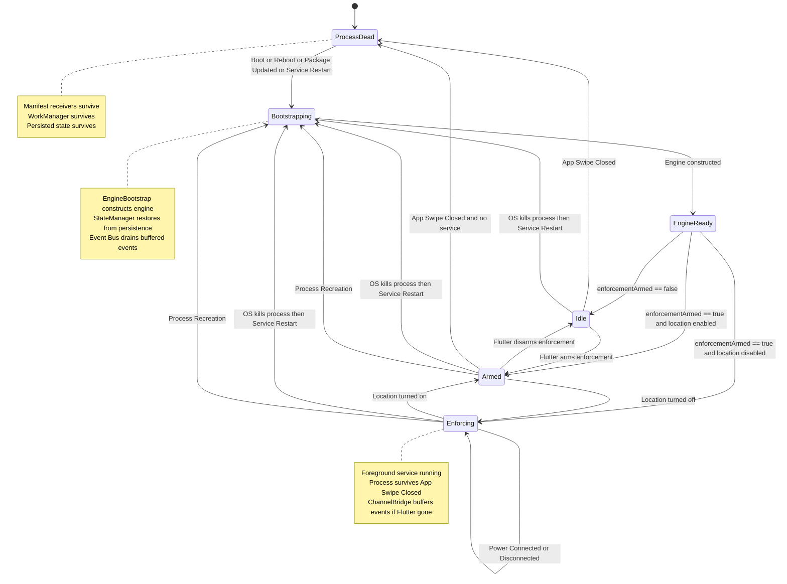
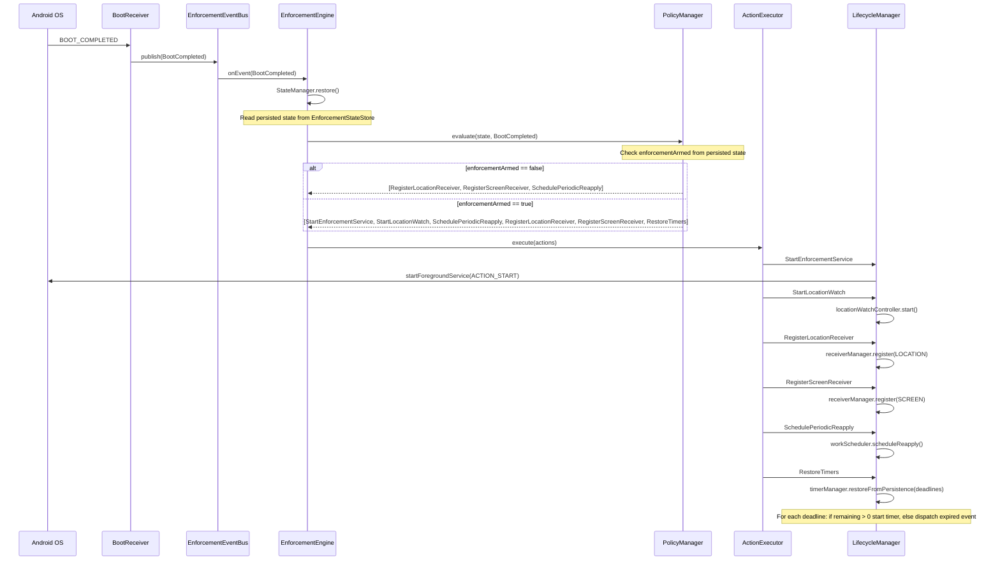
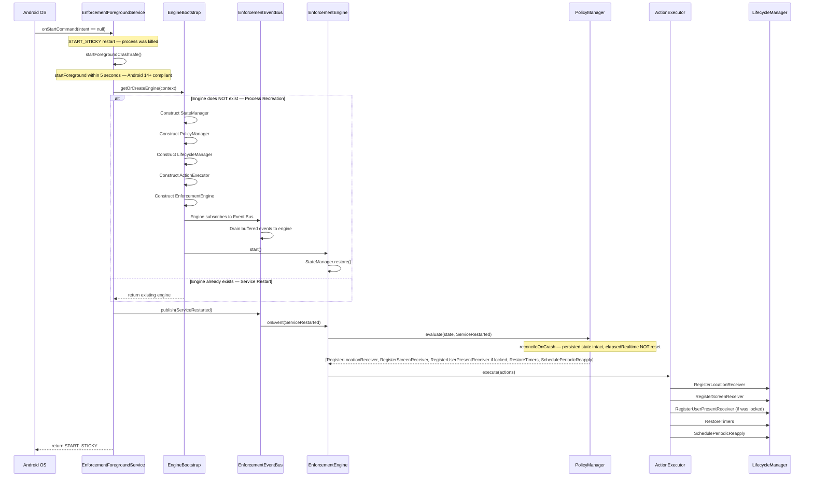
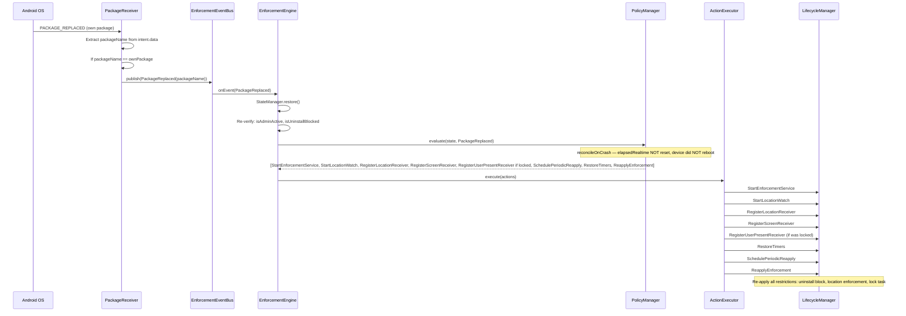
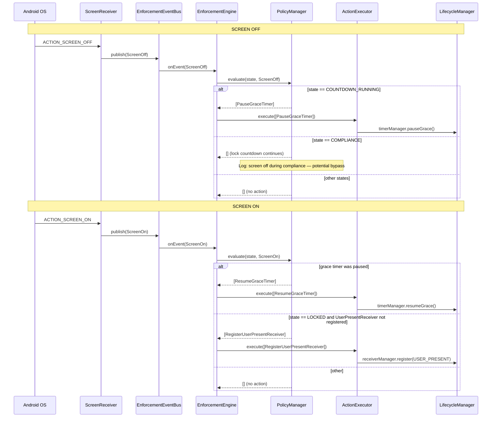
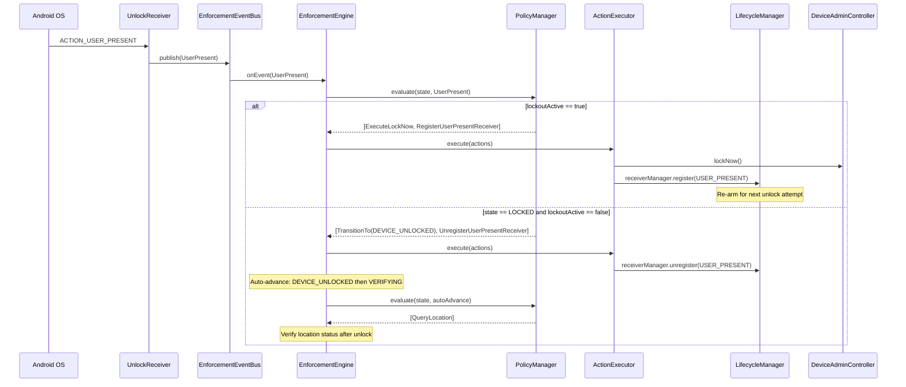
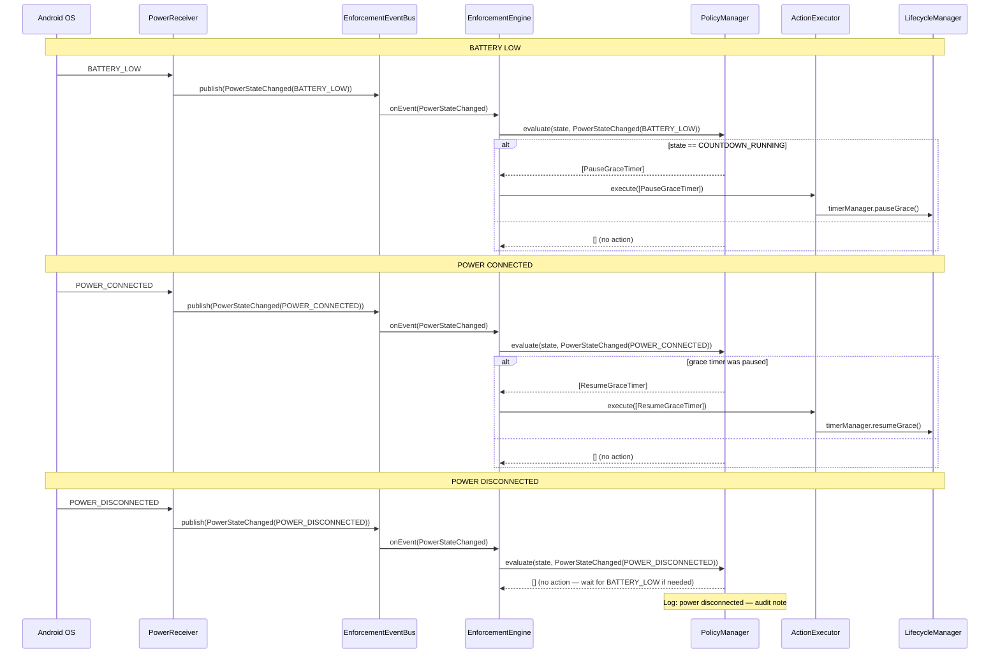
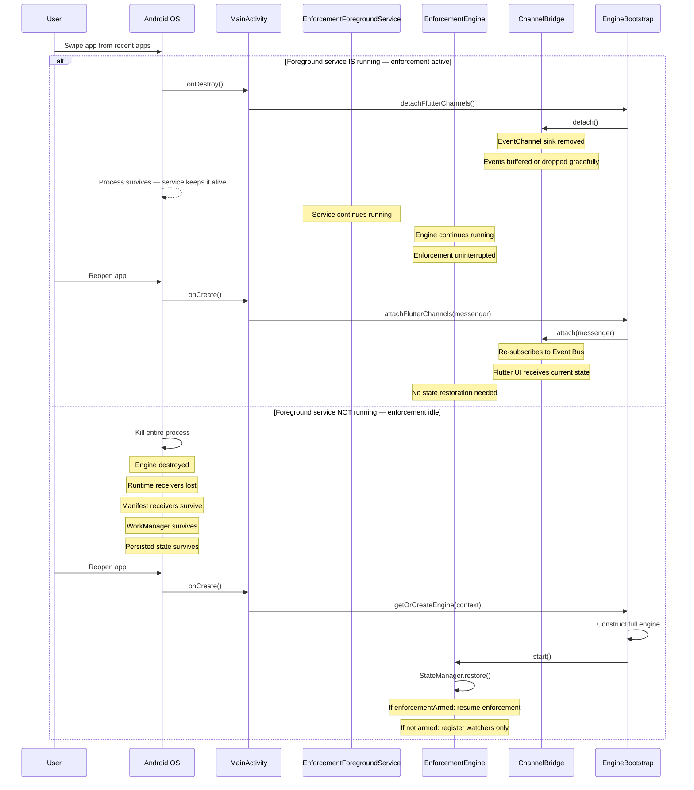
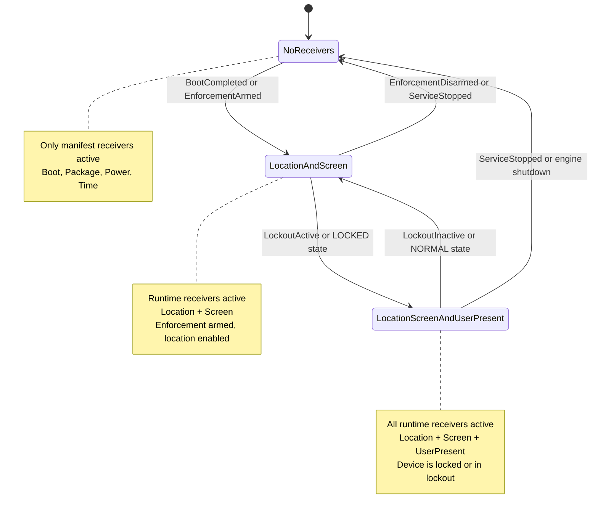

# 🔄 LifecycleManager — Lifecycle Scenario Design

> **Parent documents:**
> - [`plans/architecture-analysis.md`](architecture-analysis.md) — 22 problems, 12-phase migration
> - [`plans/enforcement-engine-design.md`](enforcement-engine-design.md) — EnforcementEngine, ActionExecutor, Composition Root
> - [`plans/enforcement-state-machine.md`](enforcement-state-machine.md) — 9-state machine, crash/reboot recovery
> - [`plans/enforcement-foreground-service.md`](enforcement-foreground-service.md) — unified foreground service, START_STICKY
> - [`plans/enforcement-controllers.md`](enforcement-controllers.md) — 7 single-responsibility controllers
> - [`plans/enforcement-receivers.md`](enforcement-receivers.md) — 7 event-only receivers, registration lifecycle
> - [`plans/enforcement-event-bus.md`](enforcement-event-bus.md) — Native Event Bus, 10 domain events

---

## Table of Contents

1. [Design Goals](#1-design-goals)
2. [Current State Analysis](#2-current-state-analysis)
3. [LifecycleManager Architecture](#3-lifecyclemanager-architecture)
4. [Responsibility Boundary](#4-responsibility-boundary)
5. [Lifecycle Scenario Catalog — 12 Scenarios](#5-lifecycle-scenario-catalog--12-scenarios)
6. [Master Lifecycle Diagram](#6-master-lifecycle-diagram)
7. [Scenario Sequence Diagrams](#7-scenario-sequence-diagrams)
8. [Receiver Registration Management](#8-receiver-registration-management)
9. [Service Management](#9-service-management)
10. [Timer Management](#10-timer-management)
11. [Activity Management](#11-activity-management)
12. [Work Management](#12-work-management)
13. [Process Bootstrap — Handling Process Recreation](#13-process-bootstrap--handling-process-recreation)
14. [Integration with Event Bus](#14-integration-with-event-bus)
15. [Thread Safety Model](#15-thread-safety-model)
16. [Problems Solved](#16-problems-solved)
17. [Appendix A — Scenario × Action Matrix](#appendix-a--scenario-x-action-matrix)
18. [Appendix B — Cross-Reference with Parent Documents](#appendix-b--cross-reference-with-parent-documents)

---

## 1. Design Goals

| Goal | Description |
|------|-------------|
| **G1 — Single Lifecycle Authority** | `LifecycleManager` is the ONLY component that starts/stops services, activities, timers, receivers, work, and location watch. No other module directly calls `startService()`, `registerReceiver()`, `timer.start()`, or `WorkManager.enqueue()`. |
| **G2 — Scenario-Driven** | Each of the 12 lifecycle scenarios has a defined entry point, event, engine response, and set of lifecycle actions. No scenario is handled ad-hoc or scattered across modules. |
| **G3 — Recovery-First** | Every destructive scenario (boot, reboot, service restart, process recreation, app swipe closed) has a recovery procedure that restores enforcement state from persistence. No scenario results in a permanently broken state. |
| **G4 — Idempotent Operations** | Every lifecycle operation is idempotent. Starting an already-running service is a no-op. Registering an already-registered receiver is a no-op. Cancelling an already-cancelled timer is a no-op. This eliminates race conditions and double-execution. |
| **G5 — No Business Logic** | `LifecycleManager` executes WHAT the engine tells it to execute. It does not decide WHEN (that's `PolicyManager`) or WHY (that's the engine). It is a pure command executor for lifecycle actions. |
| **G6 — Process-Death Survival** | The design survives process death via: (a) persisted state in `EnforcementStateStore`, (b) `START_STICKY` service restart, (c) manifest-registered receivers that trigger process recreation, (d) `WorkManager` periodic reapply as fallback. |
| **G7 — Event Bus Integration** | All lifecycle scenarios flow through the `EnforcementEventBus`. Receivers publish events; the engine subscribes and evaluates; the engine emits actions; `ActionExecutor` delegates lifecycle actions to `LifecycleManager`. No direct calls from receivers to `LifecycleManager`. |

### LifecycleManager at a Glance

```
┌─────────────────────────────────────────────────────────────────────────────┐
│                        LifecycleManager                                      │
│                   (created in Composition Root)                              │
│                                                                             │
│  ┌───────────────────────────────────────────────────────────────────────┐  │
│  │  Managed Resources                                                    │  │
│  │                                                                       │  │
│  │  ┌──────────────┐  ┌──────────────┐  ┌──────────────┐               │  │
│  │  │ Service      │  │ Activity     │  │ Timers       │               │  │
│  │  │ Manager      │  │ Manager      │  │ Manager      │               │  │
│  │  │              │  │              │  │              │               │  │
│  │  │ start/stop   │  │ start/finish │  │ start/cancel │               │  │
│  │  │ foreground   │  │ compliance   │  │ grace/lock/  │               │  │
│  │  │ service      │  │ activity     │  │ timed/pause/ │               │  │
│  │  │              │  │              │  │ resume       │               │  │
│  │  └──────────────┘  └──────────────┘  └──────────────┘               │  │
│  │                                                                       │  │
│  │  ┌──────────────┐  ┌──────────────┐  ┌──────────────┐               │  │
│  │  │ Receiver     │  │ Work         │  │ Location     │               │  │
│  │  │ Manager      │  │ Manager      │  │ Watch Mgr    │               │  │
│  │  │              │  │              │  │              │               │  │
│  │  │ register/    │  │ schedule/    │  │ start/stop   │               │  │
│  │  │ unregister   │  │ cancel       │  │ realtime     │               │  │
│  │  │ runtime      │  │ periodic     │  │ location     │               │  │
│  │  │ receivers    │  │ reapply      │  │ watch        │               │  │
│  │  └──────────────┘  └──────────────┘  └──────────────┘               │  │
│  └───────────────────────────────────────────────────────────────────────┘  │
│                                                                             │
│  ┌───────────────────────────────────────────────────────────────────────┐  │
│  │  Action Interface (called by ActionExecutor)                          │  │
│  │                                                                       │  │
│  │  fun execute(action: LifecycleAction)                                 │  │
│  │    when (action) {                                                    │  │
│  │      StartEnforcementService -> serviceManager.start(action)          │  │
│  │      StopEnforcementService  -> serviceManager.stop()                 │  │
│  │      StartComplianceActivity -> activityManager.start()               │  │
│  │      FinishComplianceActivity-> activityManager.finish()              │  │
│  │      StartGraceTimer(ms)    -> timerManager.startGrace(ms)            │  │
│  │      StartLockCountdown(ms) -> timerManager.startLockCountdown(ms)    │  │
│  │      StartTimedLock(ms)     -> timerManager.startTimedLock(ms)        │  │
│  │      PauseGraceTimer        -> timerManager.pauseGrace()              │  │
│  │      ResumeGraceTimer       -> timerManager.resumeGrace()             │  │
│  │      CancelAllTimers        -> timerManager.cancelAll()               │  │
│  │      RegisterUserPresentRecv-> receiverManager.register(USER_PRESENT) │  │
│  │      UnregisterUserPresentR -> receiverManager.unregister(USER_PRESENT│  │
│  │      RegisterLocationRecv   -> receiverManager.register(LOCATION)     │  │
│  │      UnregisterLocationRecv -> receiverManager.unregister(LOCATION)   │  │
│  │      RegisterScreenRecv     -> receiverManager.register(SCREEN)       │  │
│  │      UnregisterScreenRecv   -> receiverManager.unregister(SCREEN)     │  │
│  │      UnregisterAllReceivers -> receiverManager.unregisterAll()        │  │
│  │      StartLocationWatch     -> locationWatchManager.start()           │  │
│  │      StopLocationWatch      -> locationWatchManager.stop()            │  │
│  │      SchedulePeriodicReapply-> workManager.scheduleReapply()          │  │
│  │      CancelPeriodicReapply  -> workManager.cancelReapply()            │  │
│  │      RestoreState           -> stateManager.restore()                 │  │
│  │      ReapplyEnforcement     -> reapplyAllRestrictions()               │  │
│  │    }                                                                  │  │
│  └───────────────────────────────────────────────────────────────────────┘  │
└─────────────────────────────────────────────────────────────────────────────┘
```

---

## 2. Current State Analysis

### 2.1 How Lifecycle Is Currently Handled

The current codebase has **no centralized lifecycle manager**. Lifecycle operations are scattered across at least 6 components:

```
┌─────────────────────────────────────────────────────────────────────────────┐
│              CURRENT STATE — Lifecycle Scattered Across 6 Components         │
│                                                                             │
│  ┌──────────────────────────────┐                                          │
│  │ LocationComplianceCoordinator│  ← starts/stops service, registers/      │
│  │ (object singleton, 635 lines)│    unregisters receivers, starts/stops   │
│  │                              │    timers, schedules work                 │
│  └──────────────────────────────┘                                          │
│                                                                             │
│  ┌──────────────────────────────┐                                          │
│  │ LockoutManager               │  ← registers/unregisters UserPresent     │
│  │ (object singleton)           │    receiver, starts/cancels lockout      │
│  │                              │    timer                                  │
│  └──────────────────────────────┘                                          │
│                                                                             │
│  ┌──────────────────────────────┐                                          │
│  │ AppLockForegroundService     │  ← starts timers, manages countdown,     │
│  │ (312 lines)                  │    schedules self-stop                    │
│  └──────────────────────────────┘                                          │
│                                                                             │
│  ┌──────────────────────────────┐                                          │
│  │ LocationComplianceFGService  │  ← registers/unregisters location        │
│  │ (166 lines)                  │    receiver, manages own lifecycle        │
│  └──────────────────────────────┘                                          │
│                                                                             │
│  ┌──────────────────────────────┐                                          │
│  │ LocationComplianceActivity   │  ← registers dismiss receiver, polls     │
│  │ (337 lines)                  │    every 2s, manages lock task mode       │
│  └──────────────────────────────┘                                          │
│                                                                             │
│  ┌──────────────────────────────┐                                          │
│  │ LocationEnforcementController│  ← schedules/cancels WorkManager,        │
│  │ (368 lines)                  │    starts/stops realtime watch            │
│  └──────────────────────────────┘                                          │
└─────────────────────────────────────────────────────────────────────────────┘
```

### 2.2 Problems with Current State

| # | Problem | Source | Impact |
|---|---------|--------|--------|
| 1 | **No single lifecycle authority** | 6 components each manage their own lifecycle | Impossible to reason about system-wide lifecycle state. No component knows the full picture. |
| 2 | **`LocationComplianceCoordinator` is a God Object** (P-05) | 635 lines, manages service + receivers + timers + work + activity | Violates single responsibility. Any lifecycle change requires modifying the coordinator. |
| 3 | **`LockoutManager` independently registers receivers** | `object LockoutManager` registers `UserPresentReceiver` in `armLockout()` | Two components (coordinator + LockoutManager) can register the same receiver, causing duplicates. |
| 4 | **Service manages its own timers** | `AppLockForegroundService.startCountdown()`, `scheduleSelfStop()` | Timer lifecycle is coupled to service lifecycle. If service is killed, timers are lost with no restoration. |
| 5 | **No recovery on process death** | No persisted timer deadlines, no state restoration | If the process is killed, all enforcement state is lost. Grace period resets, lock countdown resets. |
| 6 | **No boot recovery** | `LocationComplianceBootReceiver` just starts service | Boot receiver doesn't restore state, re-register receivers, or restore timers. Enforcement is broken after reboot. |
| 7 | **No handling of package update** | No `PACKAGE_REPLACED` receiver | After app update, process is killed and recreated. Enforcement state is lost. No re-verification. |
| 8 | **No screen on/off handling** | No screen receiver | Grace timer continues counting when screen is off (battery waste). No bypass detection. |
| 9 | **No power state handling** | No power receiver | Battery saver mode not detected. No timer pausing on low battery. |
| 10 | **App swipe closed breaks enforcement** | No foreground service when not actively enforcing | If user swipes app closed when enforcement is idle, process dies. Next enforcement trigger has no engine. |
| 11 | **`LocationComplianceActivity` polls every 2s** (P-22) | `locationPollRunnable` in activity | Battery drain, UI latency, racing with push events (P-20). |
| 12 | **Receiver leak on service restart** (P-17) | `LocationComplianceForegroundService` registers receiver in `onCreate`, never unregisters | After START_STICKY restart, old receiver leaks, new receiver is registered. Duplicate events. |

### 2.3 What Needs to Change

```
BEFORE (scattered, no recovery):              AFTER (centralized, recovery-first):

6 components manage lifecycle:                LifecycleManager manages ALL lifecycle:
  Coordinator ──► service, receivers,           ActionExecutor ──► LifecycleManager
    timers, work, activity                        ├──► ServiceManager
  LockoutManager ──► receiver, timer              ├──► ActivityManager
  Service ──► timers, self-stop                   ├──► TimerManager
  FGService ──► receiver                          ├──► ReceiverManager
  Activity ──► receiver, polling                  ├──► WorkManager
  Controller ──► work, watch                      └──► LocationWatchManager

No recovery on death:                          Full recovery on death:
  Process killed → state lost                   Process killed → START_STICKY → restore
  Reboot → enforcement broken                   Reboot → BootCompleted → reconcile
  Package update → enforcement lost             Package update → PackageReplaced → reapply
```

---

## 3. LifecycleManager Architecture

### 3.1 Class Structure

```
┌─────────────────────────────────────────────────────────────────────────────┐
│  LifecycleManager                                                            │
│  (class — created once in Composition Root, injected into ActionExecutor)   │
│                                                                             │
│  constructor(                                                                │
│    context: Context,                    // application context               │
│    timerManager: TimerManager,          // grace/lock/timed timer control   │
│    activityLauncher: ActivityLauncher,  // launches compliance activity     │
│    stateManager: StateManager,          // for RestoreState action          │
│    locationWatchController: LocationWatchController,                        │
│    workScheduler: WorkScheduler         // WorkManager wrapper              │
│  )                                                                          │
│                                                                             │
│  // ── Internal state ──                                                     │
│  private val serviceManager = ServiceManager(context)                       │
│  private val activityManager = ActivityManager(context, activityLauncher)   │
│  private val receiverManager = ReceiverManager(context)                     │
│                                                                             │
│  // ── Public API (called by ActionExecutor) ──                              │
│  fun execute(action: LifecycleAction)                                       │
│                                                                             │
│  // ── Bootstrap (called on process recreation) ──                           │
│  fun bootstrap()                                                             │
│    // Called when engine is reconstructed after process death               │
│    // Restores all managed resources from persistence                        │
│    // Re-registers runtime receivers based on persisted state               │
│    // Restores timers from persisted deadlines                              │
│                                                                             │
│  // ── Shutdown (called on engine stop) ──                                   │
│  fun shutdown()                                                              │
│    // Unregisters ALL runtime receivers                                     │
│    // Cancels ALL timers                                                    │
│    // Does NOT stop foreground service (engine decides that)                │
│    // Does NOT cancel WorkManager (survives process death)                  │
└─────────────────────────────────────────────────────────────────────────────┘
```

### 3.2 Sub-Managers

Each resource type has a dedicated sub-manager. All sub-managers are internal to `LifecycleManager` — no external module has access to them.

#### ServiceManager

```
┌─────────────────────────────────────────────────────────────────────────────┐
│  ServiceManager                                                               │
│                                                                             │
│  private var isRunning: Boolean = false  // in-memory tracking              │
│                                                                             │
│  fun start(action: ServiceAction)                                            │
│    // Idempotent: if isRunning, no-op                                       │
│    // Creates Intent with action extra                                      │
│    // Calls Context.startForegroundService(intent)                          │
│    // Sets isRunning = true                                                 │
│                                                                             │
│  fun stop()                                                                  │
│    // Idempotent: if !isRunning, no-op                                      │
│    // Creates Intent with ACTION_STOP                                       │
│    // Calls Context.startForegroundService(intent)                          │
│    //    (not stopService — service stops itself after processing)          │
│    // Sets isRunning = false                                                │
│                                                                             │
│  fun onServiceDestroyed()                                                    │
│    // Called by EnforcementForegroundService.onDestroy()                    │
│    // Sets isRunning = false                                                │
│    // Does NOT restart — engine decides whether to restart                  │
└─────────────────────────────────────────────────────────────────────────────┘
```

#### ActivityManager

```
┌─────────────────────────────────────────────────────────────────────────────┐
│  ActivityManager                                                             │
│                                                                             │
│  private var isShowing: Boolean = false                                     │
│                                                                             │
│  fun start()                                                                 │
│    // Idempotent: if isShowing, no-op                                       │
│    // Launches LocationComplianceActivity via ActivityLauncher              │
│    // Sets isShowing = true                                                 │
│                                                                             │
│  fun finish()                                                                │
│    // Idempotent: if !isShowing, no-op                                      │
│    // Sends broadcast to activity to finish itself                          │
│    //    (activity registers a dismiss receiver)                             │
│    // Sets isShowing = false                                                │
│                                                                             │
│  fun onActivityDestroyed()                                                   │
│    // Called when activity is destroyed (user dismissed, OS killed)         │
│    // Sets isShowing = false                                                │
└─────────────────────────────────────────────────────────────────────────────┘
```

#### TimerManager

```
┌─────────────────────────────────────────────────────────────────────────────┐
│  TimerManager                                                                 │
│                                                                             │
│  private val activeTimers: MutableMap<String, TimerHandle>                  │
│    // Key: "grace" | "lockCountdown" | "timedLock"                          │
│    // Value: TimerHandle(deadline, remaining, isPaused, handler)            │
│                                                                             │
│  fun startGrace(durationMs: Long)                                           │
│    // Cancels existing grace timer (if any)                                 │
│    // Creates new timer with wall-clock deadline                            │
│    // Posts TimerExpired event to Event Bus when fired                      │
│                                                                             │
│  fun startLockCountdown(durationMs: Long)                                   │
│    // Same pattern as startGrace                                            │
│                                                                             │
│  fun startTimedLock(durationMs: Long)                                       │
│    // Same pattern as startGrace                                            │
│                                                                             │
│  fun pauseGrace()                                                            │
│    // Pauses grace timer — records remaining time                           │
│    // Removes handler callback                                              │
│    // Does NOT cancel — timer can be resumed                                │
│                                                                             │
│  fun resumeGrace()                                                           │
│    // Resumes paused grace timer with remaining time                        │
│    // Recalculates deadline from remaining time                             │
│                                                                             │
│  fun cancelAll()                                                             │
│    // Cancels all active timers                                             │
│    // Clears activeTimers map                                               │
│                                                                             │
│  fun restoreFromPersistence(deadlines: PersistedDeadlines)                  │
│    // For each deadline:                                                    │
│    //   remaining = deadline - currentTime                                  │
│    //   if remaining > 0: start timer with remaining                        │
│    //   if remaining <= 0: dispatch expired event immediately               │
└─────────────────────────────────────────────────────────────────────────────┘
```

#### ReceiverManager

```
┌─────────────────────────────────────────────────────────────────────────────┐
│  ReceiverManager                                                              │
│                                                                             │
│  private val activeReceivers: MutableMap<ReceiverType, BroadcastReceiver>   │
│    // Key: USER_PRESENT | LOCATION | SCREEN                                 │
│    // Value: BroadcastReceiver instance                                      │
│                                                                             │
│  fun register(type: ReceiverType)                                           │
│    // Idempotent: if already in map, no-op                                  │
│    // Creates receiver instance                                             │
│    // Registers with Context.registerReceiver()                             │
│    //   with correct RECEIVER_EXPORTED / RECEIVER_NOT_EXPORTED flag         │
│    // Adds to activeReceivers map                                           │
│                                                                             │
│  fun unregister(type: ReceiverType)                                         │
│    // Idempotent: if not in map, no-op                                      │
│    // Calls Context.unregisterReceiver()                                    │
│    // Swallows exceptions (receiver may already be unregistered)            │
│    // Removes from activeReceivers map                                      │
│                                                                             │
│  fun unregisterAll()                                                         │
│    // Unregisters ALL runtime receivers                                     │
│    // Clears activeReceivers map                                            │
│    // Called on ServiceStopped, engine shutdown                             │
│                                                                             │
│  // NOTE: Manifest-registered receivers (Boot, Package, Power, Time)        │
│  // are NOT managed here — they are always active by definition.            │
└─────────────────────────────────────────────────────────────────────────────┘
```

---

## 4. Responsibility Boundary

### 4.1 What LifecycleManager DOES

| Responsibility | Description |
|----------------|-------------|
| **Service management** | Starts/stops `EnforcementForegroundService` with appropriate actions (`ACTION_START`, `ACTION_STOP`) |
| **Activity management** | Starts/finishes `LocationComplianceActivity` |
| **Timer management** | Starts/cancels grace, lock countdown, and timed lock timers; pauses/resumes grace timer |
| **Receiver management** | Registers/unregisters runtime receivers (`UserPresentReceiver`, `LocationReceiver`, `ScreenReceiver`) |
| **Work management** | Schedules/cancels periodic reapply work via `WorkManager` |
| **Location watch** | Starts/stops realtime location watch via `LocationWatchController` |
| **State restoration** | Restores in-memory state from persistence on boot/crash/process-recreation |
| **Resource cleanup** | Unregisters all receivers, cancels all timers on shutdown |

### 4.2 What LifecycleManager DOES NOT Do

| Non-responsibility | Who does it | Why |
|--------------------|-------------|-----|
| **Decide WHEN to start/stop** | `PolicyManager` | LifecycleManager is a command executor, not a decision maker |
| **Evaluate enforcement state** | `PolicyManager` + `StateManager` | State evaluation requires business logic |
| **Execute DPM commands** | Controllers (`DeviceAdminController`, `LocationController`, etc.) | DPM commands are command actions, not lifecycle actions |
| **Decide which receivers to register** | `PolicyManager` | PolicyManager evaluates state and returns `RegisterUserPresentReceiver` as an action |
| **Persist state** | `StateManager` | LifecycleManager calls `StateManager.restore()` but does not write persistence itself |
| **Dispatch events** | Receivers, Service, Timer | LifecycleManager consumes actions, it does not produce events |
| **Manage manifest receivers** | Android OS | Manifest receivers are always active; no registration needed |

### 4.3 Decision Boundary Table

```
┌─────────────────────────────────────────────────────────────────────────────┐
│                    DECISION BOUNDARY                                         │
│                                                                             │
│  Event arrives ──► Engine evaluates ──► PolicyManager decides ──►           │
│  ActionExecutor routes ──► LifecycleManager executes                       │
│                                                                             │
│  Example: ScreenOff event                                                   │
│    1. ScreenReceiver publishes ScreenOff to Event Bus                       │
│    2. Engine receives ScreenOff, calls PolicyManager.evaluate()             │
│    3. PolicyManager returns [PauseGraceTimer] (if COUNTDOWN_RUNNING)       │
│    4. ActionExecutor routes PauseGraceTimer to LifecycleManager             │
│    5. LifecycleManager calls timerManager.pauseGrace()                      │
│                                                                             │
│  LifecycleManager never sees the event. It only sees the action.            │
└─────────────────────────────────────────────────────────────────────────────┘
```

---

## 5. Lifecycle Scenario Catalog — 12 Scenarios

### Scenario 1: Boot

| Aspect | Detail |
|--------|--------|
| **Definition** | Device powered on from off state. First boot after install, or boot with no prior persisted enforcement state. |
| **Trigger** | `BOOT_COMPLETED` broadcast |
| **Receiver** | `BootReceiver` (manifest-registered — active even when process is dead) |
| **Event dispatched** | `BootCompleted(isLockedBoot: Boolean)` |
| **Engine response** | `PolicyManager` checks `enforcementArmed` (restored from persistence). If `false` or no persisted state → register watchers only. If `true` → full reconciliation. |
| **Lifecycle actions** | `StartEnforcementService`, `StartLocationWatch`, `SchedulePeriodicReapply`, `RegisterLocationReceiver`, `RegisterScreenReceiver`, `RestoreTimers` (if enforcement was active) |
| **State reconciliation** | `reconcileOnReboot(persistedState, currentTime, locationEnabled)` — if no persisted state, → `NORMAL` |
| **Key concern** | `elapsedRealtime` resets to 0. All deadlines must be persisted as wall-clock ms. |
| **Recovery guarantee** | After boot, enforcement state is fully restored from persistence. If enforcement was active, it resumes. If device was `LOCKED`, re-lock is executed (reboot unlocks device). |

**Boot flow:**
```
Device powers on
  └─ Android sends BOOT_COMPLETED
     └─ BootReceiver (manifest) instantiated by OS
        └─ BootReceiver.onReceive()
           └─ EnforcementEventBus.publish(BootCompleted)
              └─ Engine receives BootCompleted
                 └─ StateManager.restore()  // read persisted state
                 └─ PolicyManager.evaluate(state, BootCompleted)
                    ├─ if !enforcementArmed:
                    │   └─ [RegisterLocationReceiver, RegisterScreenReceiver,
                    │       SchedulePeriodicReapply]
                    │   └─ → NORMAL
                    └─ if enforcementArmed:
                        └─ reconcileOnReboot(persistedState, currentTime, locationEnabled)
                        └─ [StartEnforcementService, StartLocationWatch,
                            SchedulePeriodicReapply, RegisterLocationReceiver,
                            RegisterScreenReceiver, RestoreTimers]
                        └─ → reconciled state
```

---

### Scenario 2: Reboot

| Aspect | Detail |
|--------|--------|
| **Definition** | Device was running and restarted. Prior persisted enforcement state exists. |
| **Trigger** | `BOOT_COMPLETED` broadcast (same as Boot) |
| **Receiver** | `BootReceiver` (manifest-registered) |
| **Event dispatched** | `BootCompleted(isLockedBoot: Boolean)` |
| **Engine response** | Same as Boot, but `enforcementArmed == true` (persisted from before reboot). Full reconciliation runs. |
| **Lifecycle actions** | Same as Boot when armed: `StartEnforcementService`, `StartLocationWatch`, `SchedulePeriodicReapply`, `RegisterLocationReceiver`, `RegisterScreenReceiver`, `RestoreTimers` |
| **State reconciliation** | `reconcileOnReboot(persistedState, currentTime, locationEnabled)` — full reconciliation with persisted state |
| **Key concern** | Device was `LOCKED` before reboot → after reboot, device is unlocked → must re-lock immediately. Grace/lock countdown deadlines may have expired during reboot downtime. |
| **Difference from Boot** | Boot = no prior state (first boot). Reboot = prior state exists, full reconciliation needed. Both trigger `BOOT_COMPLETED`. The reconciliation logic handles both: if no persisted state → `NORMAL`; if persisted state → reconcile. |

**Reboot reconciliation logic** (from [`enforcement-state-machine.md`](enforcement-state-machine.md) §11.3):
```
reconcileOnReboot(persistedState, currentTime, locationEnabled):

  if (!persistedState.enforcementArmed || !persistedState.permissionGranted):
    → NORMAL  (enforcement not active, just re-arm watchers)

  if (locationEnabled):
    → LOCATION_RESTORED  (cleanup → NORMAL)

  // Location is OFF — resume enforcement from persisted state
  switch (persistedState.currentState):
    case NORMAL:           → LOCATION_DISABLED  (start fresh cycle)
    case LOCATION_DISABLED:
    case COUNTDOWN_RUNNING:
      if deadline expired: → COMPLIANCE  (grace expired during reboot)
      else:                → COUNTDOWN_RUNNING  (resume grace)
    case COMPLIANCE:
      if deadline expired: → LOCK_REQUIRED  (lock countdown expired)
      else:                → COMPLIANCE  (resume lock countdown)
    case LOCK_REQUIRED:
    case LOCKED:           → LOCK_REQUIRED  (re-execute lockNow — reboot unlocked device)
    case DEVICE_UNLOCKED:
    case VERIFYING:        → COMPLIANCE  (start new countdown)
    case LOCATION_RESTORED: → LOCATION_DISABLED  (start fresh cycle)
```

---

### Scenario 3: Package Updated

| Aspect | Detail |
|--------|--------|
| **Definition** | App updated to a new version (via Play Store, ADB, or MDM). Process killed during update and recreated. |
| **Trigger** | `PACKAGE_REPLACED` broadcast (with own package name) |
| **Receiver** | `PackageReceiver` (manifest-registered) |
| **Event dispatched** | `PackageReplaced(packageName: String)` |
| **Engine response** | Re-verify enforcement state, restore from persistence, reapply all restrictions. |
| **Lifecycle actions** | `RestoreState`, `StartEnforcementService` (if was running), `StartLocationWatch` (if was watching), `RegisterLocationReceiver`, `RegisterScreenReceiver`, `RegisterUserPresentReceiver` (if was locked), `SchedulePeriodicReapply`, `RestoreTimers` |
| **State reconciliation** | Same as `reconcileOnCrash()` — persisted state is intact, `elapsedRealtime` is NOT reset (device didn't reboot) |
| **Key concern** | App code may have changed. Device admin permissions must be re-verified (`isAdminActive()`). Uninstall block must be re-verified. All restrictions must be reapplied. |
| **Difference from Boot** | `elapsedRealtime` is NOT reset. Device did not reboot. Persisted state is intact. No `BootCompleted` — this is a package-level event. |
| **Difference from Service Restart** | Entire process was killed (not just service). Engine needs full reconstruction. But `elapsedRealtime` continues (no reboot). |

**Package Updated flow:**
```
App updated (Play Store / ADB / MDM)
  └─ OS kills app process
  └─ OS installs new APK
  └─ OS sends PACKAGE_REPLACED for own package
     └─ PackageReceiver (manifest) instantiated by OS
        └─ PackageReceiver.onReceive()
           └─ Extract packageName from intent.data
           └─ If packageName == ownPackage:
              └─ EnforcementEventBus.publish(PackageReplaced(packageName))
                 └─ Engine receives PackageReplaced
                    └─ StateManager.restore()
                    └─ Re-verify: isAdminActive(), isUninstallBlocked()
                    └─ PolicyManager.evaluate(state, PackageReplaced)
                       └─ [StartEnforcementService, StartLocationWatch,
                           RegisterLocationReceiver, RegisterScreenReceiver,
                           RegisterUserPresentReceiver (if was locked),
                           SchedulePeriodicReapply, RestoreTimers,
                           ReapplyEnforcement]
                    └─ reconcileOnCrash(persistedState, currentTime, locationEnabled)
```

---

### Scenario 4: Screen On

| Aspect | Detail |
|--------|--------|
| **Definition** | Device screen turned on (user pressed power button, notification, etc.) |
| **Trigger** | `ACTION_SCREEN_ON` broadcast |
| **Receiver** | `ScreenReceiver` (runtime-registered by `LifecycleManager`) |
| **Event dispatched** | `ScreenOn` |
| **Engine response** | Resume paused grace timer (if was paused on `ScreenOff`). If in `LOCKED` state, ensure `UserPresentReceiver` is registered (prepare for unlock detection). |
| **Lifecycle actions** | `ResumeGraceTimer` (if was paused), `RegisterUserPresentReceiver` (if `LOCKED` and not already registered) |
| **State reconciliation** | None — screen on does not change compliance state. Only affects timer pause/resume. |
| **Key concern** | If `ScreenOff` paused the grace timer, `ScreenOn` must resume it with the correct remaining time. The `TimerManager` tracks paused state. |
| **Battery optimization** | Resuming the timer means CPU wakes up. This is expected — the user is actively using the device. |

**Screen On flow:**
```
User presses power button / notification wakes screen
  └─ Android sends ACTION_SCREEN_ON
     └─ ScreenReceiver (runtime) receives broadcast
        └─ EnforcementEventBus.publish(ScreenOn)
           └─ Engine receives ScreenOn
              └─ PolicyManager.evaluate(state, ScreenOn)
                 ├─ if state == COUNTDOWN_RUNNING && graceTimerPaused:
                 │   └─ [ResumeGraceTimer]
                 ├─ if state == LOCKED && userPresentReceiver not registered:
                 │   └─ [RegisterUserPresentReceiver]
                 └─ else:
                     └─ []  (no action needed)
```

---

### Scenario 5: Screen Off

| Aspect | Detail |
|--------|--------|
| **Definition** | Device screen turned off (user pressed power button, screen timeout) |
| **Trigger** | `ACTION_SCREEN_OFF` broadcast |
| **Receiver** | `ScreenReceiver` (runtime-registered by `LifecycleManager`) |
| **Event dispatched** | `ScreenOff` |
| **Engine response** | Pause grace timer (battery optimization — no need to count down when user can't see the screen). Note screen-off during compliance (potential bypass attempt — user may be trying to avoid the compliance screen). |
| **Lifecycle actions** | `PauseGraceTimer` (if `COUNTDOWN_RUNNING`) |
| **State reconciliation** | None — screen off does not change compliance state. Only affects timer pause/resume. |
| **Key concern** | Lock countdown timer is NOT paused (it must fire even when screen is off — the device must lock). Only the grace timer is paused (user can't respond to compliance screen when screen is off). |
| **Bypass detection** | If screen turns off during `COMPLIANCE` state, log as potential bypass attempt. The lock countdown continues — if it expires, the device locks regardless. |

**Screen Off flow:**
```
Screen turns off (power button / timeout)
  └─ Android sends ACTION_SCREEN_OFF
     └─ ScreenReceiver (runtime) receives broadcast
        └─ EnforcementEventBus.publish(ScreenOff)
           └─ Engine receives ScreenOff
              └─ PolicyManager.evaluate(state, ScreenOff)
                 ├─ if state == COUNTDOWN_RUNNING:
                 │   └─ [PauseGraceTimer]
                 ├─ if state == COMPLIANCE:
                 │   └─ []  (lock countdown continues — do NOT pause)
                 │   └─ Log: screen off during compliance — potential bypass
                 └─ else:
                     └─ []  (no action needed)
```

---

### Scenario 6: User Unlock

| Aspect | Detail |
|--------|--------|
| **Definition** | User unlocked the device (entered PIN/pattern/password, or biometric unlock) |
| **Trigger** | `ACTION_USER_PRESENT` broadcast |
| **Receiver** | `UnlockReceiver` (runtime-registered by `LifecycleManager` when entering `LOCKED` state) |
| **Event dispatched** | `UserPresent` |
| **Engine response** | If in `LOCKED` state: transition to `DEVICE_UNLOCKED`, then auto-advance to `VERIFYING` (query location). If `lockoutActive`: re-lock immediately (`ExecuteLockNow`). |
| **Lifecycle actions** | `UnregisterUserPresentReceiver` (after processing — no longer needed until next lock), `StartLocationWatch` (to verify location) |
| **State reconciliation** | State machine transition: `LOCKED` → `DEVICE_UNLOCKED` → `VERIFYING` |
| **Key concern** | If `lockoutActive` is true (user in lockout period), the device must be re-locked immediately. The `UserPresent` event triggers `ExecuteLockNow` — the user sees the lock screen again. |
| **Re-lock flow** | `UserPresent` → `PolicyManager` checks `lockoutActive` → if true: `[ExecuteLockNow, EmitLockResult("locked")]` → device locks again → `RegisterUserPresentReceiver` (for next unlock attempt) |

**User Unlock flow:**
```
User unlocks device (PIN / pattern / biometric)
  └─ Android sends ACTION_USER_PRESENT
     └─ UnlockReceiver (runtime) receives broadcast
        └─ EnforcementEventBus.publish(UserPresent)
           └─ Engine receives UserPresent
              └─ PolicyManager.evaluate(state, UserPresent)
                 ├─ if lockoutActive:
                 │   └─ [ExecuteLockNow, EmitLockResult("locked"),
                 │       RegisterUserPresentReceiver]  // re-arm for next unlock
                 └─ if state == LOCKED && !lockoutActive:
                     └─ [TransitionTo(DEVICE_UNLOCKED),
                         UnregisterUserPresentReceiver]
                     └─ auto-advance: DEVICE_UNLOCKED → VERIFYING
                     └─ [QueryLocation]  // verify location status
```

---

### Scenario 7: Battery Saver

| Aspect | Detail |
|--------|--------|
| **Definition** | Device entered low battery state (`BATTERY_LOW`) or recovered from low battery (`BATTERY_OKAY`) |
| **Trigger** | `BATTERY_LOW` or `BATTERY_OKAY` broadcast |
| **Receiver** | `PowerReceiver` (manifest-registered) |
| **Event dispatched** | `PowerStateChanged(BATTERY_LOW)` or `PowerStateChanged(BATTERY_OKAY)` |
| **Engine response** | On `BATTERY_LOW`: pause grace timer (battery optimization), reduce notification update frequency. On `BATTERY_OKAY`: resume grace timer, restore notification frequency. |
| **Lifecycle actions** | `PauseGraceTimer` (on `BATTERY_LOW`), `ResumeGraceTimer` (on `BATTERY_OKAY`) |
| **State reconciliation** | None — battery state does not change compliance state. Only affects timer pause/resume and notification frequency. |
| **Key concern** | Lock countdown timer is NOT paused on `BATTERY_LOW` — the device must still lock when the countdown expires. Only the grace timer is paused. |
| **Doze mode** | `PowerStateChanged(IDLE_MODE)` may also fire. Doze mode delays WorkManager jobs. The periodic reapply may be delayed, but this is acceptable — it's a fallback, not the primary enforcement mechanism. |
| **Notification frequency** | On `BATTERY_LOW`, notification updates are reduced (e.g., only update on state change, not on every tick). On `BATTERY_OKAY`, normal notification updates resume. |

**Battery Saver flow:**
```
Battery drops below threshold / recovers
  └─ Android sends BATTERY_LOW / BATTERY_OKAY
     └─ PowerReceiver (manifest) receives broadcast
        └─ EnforcementEventBus.publish(PowerStateChanged(BATTERY_LOW/OKAY))
           └─ Engine receives PowerStateChanged
              └─ PolicyManager.evaluate(state, PowerStateChanged)
                 ├─ if BATTERY_LOW && state == COUNTDOWN_RUNNING:
                 │   └─ [PauseGraceTimer, ReduceNotificationFrequency]
                 └─ if BATTERY_OKAY && graceTimerPaused:
                     └─ [ResumeGraceTimer, RestoreNotificationFrequency]
```

---

### Scenario 8: Power Connected

| Aspect | Detail |
|--------|--------|
| **Definition** | Charger connected to device |
| **Trigger** | `POWER_CONNECTED` broadcast |
| **Receiver** | `PowerReceiver` (manifest-registered) |
| **Event dispatched** | `PowerStateChanged(POWER_CONNECTED)` |
| **Engine response** | Resume full enforcement. Resume paused grace timer. Restore notification frequency. |
| **Lifecycle actions** | `ResumeGraceTimer` (if was paused), `RestoreNotificationFrequency` |
| **State reconciliation** | None — power connection does not change compliance state. |
| **Key concern** | If grace timer was paused (due to `ScreenOff` or `BATTERY_LOW`), `POWER_CONNECTED` resumes it. The device is on external power, so battery optimization is no longer needed. |
| **Relationship to Battery Saver** | `POWER_CONNECTED` typically precedes `BATTERY_OKAY`. Both resume paused timers. The `TimerManager` handles this idempotently — resuming an already-running timer is a no-op. |

**Power Connected flow:**
```
Charger connected
  └─ Android sends POWER_CONNECTED
     └─ PowerReceiver (manifest) receives broadcast
        └─ EnforcementEventBus.publish(PowerStateChanged(POWER_CONNECTED))
           └─ Engine receives PowerStateChanged
              └─ PolicyManager.evaluate(state, PowerStateChanged)
                 └─ if graceTimerPaused:
                     └─ [ResumeGraceTimer, RestoreNotificationFrequency]
                 └─ else:
                     └─ []  (no action needed — timers already running)
```

---

### Scenario 9: Power Disconnected

| Aspect | Detail |
|--------|--------|
| **Definition** | Charger disconnected from device |
| **Trigger** | `POWER_DISCONNECTED` broadcast |
| **Receiver** | `PowerReceiver` (manifest-registered) |
| **Event dispatched** | `PowerStateChanged(POWER_DISCONNECTED)` |
| **Engine response** | Note transition to battery power. Do NOT pause timers yet — wait for `BATTERY_LOW` if battery is low. Prepare for potential battery saver mode. |
| **Lifecycle actions** | None (immediate) — timers continue running. |
| **State reconciliation** | None — power disconnection does not change compliance state. |
| **Key concern** | `POWER_DISCONNECTED` does NOT pause timers. The device may still have plenty of battery. Timers are only paused on `BATTERY_LOW` or `ScreenOff`. |
| **Logging** | Power disconnection is logged for audit purposes. If the user disconnects power during compliance enforcement, it may indicate an attempt to drain battery and bypass enforcement. |

**Power Disconnected flow:**
```
Charger disconnected
  └─ Android sends POWER_DISCONNECTED
     └─ PowerReceiver (manifest) receives broadcast
        └─ EnforcementEventBus.publish(PowerStateChanged(POWER_DISCONNECTED))
           └─ Engine receives PowerStateChanged
              └─ PolicyManager.evaluate(state, PowerStateChanged)
                 └─ []  (no lifecycle action — timers continue)
                 └─ Log: power disconnected — note for audit
```

---

### Scenario 10: Service Restart

| Aspect | Detail |
|--------|--------|
| **Definition** | OS killed the app process and recreated the `EnforcementForegroundService` with a null intent (`START_STICKY` restart). The engine already exists (was constructed by the service's bootstrap or by `MainActivity`). |
| **Trigger** | `EnforcementForegroundService.onStartCommand(intent == null)` |
| **Source** | `EnforcementForegroundService` (not a receiver) |
| **Event dispatched** | `ServiceRestarted` |
| **Engine response** | `StateManager.restore()`, `reconcileOnCrash()`, re-arm receivers, restore timers, re-schedule WorkManager. |
| **Lifecycle actions** | `RestoreState`, `RegisterLocationReceiver`, `RegisterScreenReceiver`, `RegisterUserPresentReceiver` (if was locked), `RestoreTimers`, `SchedulePeriodicReapply` |
| **State reconciliation** | `reconcileOnCrash(persistedState, currentTime, locationEnabled)` — persisted state is intact, `elapsedRealtime` is NOT reset (process death, not reboot) |
| **Key concern** | Runtime receivers are lost (process was killed). All runtime receivers must be re-registered based on persisted state. Timers must be restored from persisted deadlines. |
| **Difference from Process Recreation** | In Service Restart, the engine is already constructed (either by `MainActivity` or by a previous bootstrap). In Process Recreation, the engine needs to be constructed first. |
| **Crash-safe startForeground** | The service calls `startForeground()` as the very first thing in `onStartCommand` — before dispatching `ServiceRestarted`. This prevents `ForegroundServiceDidNotStartInTimeException` on Android 14+. |

**Service Restart flow** (from [`enforcement-foreground-service.md`](enforcement-foreground-service.md) §11.3):
```
OS kills process under memory pressure
  └─ OS recreates EnforcementForegroundService (START_STICKY)
     └─ Service.onCreate()
        └─ Initialize timerScheduler, notificationHelper
        └─ Create notification channel
     └─ Service.onStartCommand(intent == null, flags, startId)
        └─ Step 1: startForegroundCrashSafe()
           └─ startForeground(NOTIFICATION_ID, notification, type)
           └─ isRunning = true
        └─ Step 2: EnforcementEventBus.publish(ServiceRestarted)
           └─ Engine receives ServiceRestarted
              └─ Step 3: StateManager.restore()
                 ├─ Read persisted state
                 ├─ Read persisted deadlines
                 └─ Build in-memory EnforcementState
              └─ PolicyManager.evaluate(state, ServiceRestarted)
                 └─ reconcileOnCrash(persistedState, currentTime, locationEnabled)
              └─ ActionExecutor.execute(actions)
                 ├─ TransitionTo(reconciledState)
                 ├─ RegisterLocationReceiver
                 ├─ RegisterScreenReceiver
                 ├─ RegisterUserPresentReceiver (if was locked)
                 ├─ RestoreTimers (with remaining duration)
                 ├─ SchedulePeriodicReapply
                 └─ UpdateNotification
        └─ Step 4: return START_STICKY
```

---

### Scenario 11: Process Recreation

| Aspect | Detail |
|--------|--------|
| **Definition** | OS killed the entire app process. The `EnforcementForegroundService` is recreated by `START_STICKY`, but the engine does NOT exist yet (no `MainActivity` to construct it). The engine must be bootstrapped before `ServiceRestarted` can be processed. |
| **Trigger** | `EnforcementForegroundService.onStartCommand(intent == null)` — but engine is not yet constructed |
| **Source** | `EnforcementForegroundService` (bootstrap path) |
| **Event dispatched** | `ServiceRestarted` (after bootstrap completes) |
| **Engine response** | Same as Service Restart — but only after the engine is constructed |
| **Lifecycle actions** | Bootstrap: construct engine, state manager, policy manager, action executor, lifecycle manager. Then: same as Service Restart. |
| **State reconciliation** | Same as `reconcileOnCrash()` |
| **Key concern** | Who constructs the engine when `MainActivity` is not running? The service must bootstrap the engine itself. |
| **Difference from Service Restart** | Process Recreation includes engine construction. Service Restart assumes the engine already exists. |
| **Event Bus buffering** | The `EnforcementEventBus` buffers the `ServiceRestarted` event until the engine subscribes. This ensures no event is lost during the bootstrap window. |

**Process Recreation flow:**
```
OS kills entire process (memory pressure / ANR / crash)
  └─ OS recreates EnforcementForegroundService (START_STICKY)
     └─ Service.onCreate()
        └─ Initialize timerScheduler, notificationHelper
     └─ Service.onStartCommand(intent == null, flags, startId)
        └─ Step 1: startForegroundCrashSafe()
        └─ Step 2: Check if engine exists
           ├─ if engine exists (MainActivity constructed it earlier):
           │   └─ Dispatch ServiceRestarted directly
           │   └─ (same as Scenario 10: Service Restart)
           └─ if engine does NOT exist:
               └─ Step 2a: Bootstrap engine
                  ├─ Create StateManager
                  ├─ Create PolicyManager
                  ├─ Create LifecycleManager
                  ├─ Create ActionExecutor
                  ├─ Create EnforcementEngine
                  ├─ Engine subscribes to Event Bus
                  └─ Engine.start()  // restores state
               └─ Step 2b: Dispatch ServiceRestarted
                  └─ Engine processes ServiceRestarted
                  └─ (same as Scenario 10: Service Restart)
        └─ Step 3: return START_STICKY
```

**Detailed bootstrap sequence:**
```
┌─────────────────────────────────────────────────────────────────────────────┐
│  PROCESS RECREATION BOOTSTRAP                                                │
│                                                                             │
│  EnforcementForegroundService.onStartCommand(null)                          │
│    │                                                                        │
│    ├─ 1. startForegroundCrashSafe()                                         │
│    │     └─ Notification visible within 5 seconds (Android 14+ compliant)   │
│    │                                                                        │
│    ├─ 2. EngineBootstrap.getOrCreateEngine(context)                         │
│    │     │                                                                  │
│    │     ├─ if engine already exists:                                       │
│    │     │   └─ return existing engine                                     │
│    │     │                                                                  │
│    │     └─ if engine does NOT exist:                                       │
│    │         ├─ Create persistence layer                                    │
│    │         │   ├─ ComplianceStateStore(context)                           │
│    │         │   └─ EnforcementStateStore(context)                          │
│    │         ├─ Create controllers                                          │
│    │         │   ├─ DeviceAdminController(context)                          │
│    │         │   ├─ LocationController(context)                             │
│    │         │   ├─ LocationWatchController(context)                        │
│    │         │   ├─ UninstallController(context)                            │
│    │         │   ├─ LockTaskController(context)                             │
│    │         │   ├─ WorkScheduler(context)                                  │
│    │         │   └─ ProvisioningController(activityLauncher)                │
│    │         ├─ Create timer                                                │
│    │         │   └─ CountdownTimer(Handler(mainLooper))                     │
│    │         ├─ Create lifecycle manager                                    │
│    │         │   └─ LifecycleManager(context, timer, ...)                   │
│    │         ├─ Create action executor                                      │
│    │         │   └─ ActionExecutor(controllers, lifecycleManager)           │
│    │         ├─ Create state manager                                        │
│    │         │   └─ StateManager(complianceStore, enforcementStore)         │
│    │         ├─ Create policy manager                                       │
│    │         │   └─ PolicyManager(EnforcementPolicy.default)                │
│    │         ├─ Create enforcement engine                                   │
│    │         │   └─ EnforcementEngine(stateManager, policyManager,          │
│    │         │       lifecycleManager, actionExecutor)                      │
│    │         ├─ Engine subscribes to Event Bus                              │
│    │         │   └─ EnforcementEventBus.subscribe(engine)                   │
│    │         │   └─ Buffered events are drained to engine                   │
│    │         ├─ Engine.start()                                              │
│    │         │   └─ StateManager.restore()                                  │
│    │         │   └─ State is now in-memory                                  │
│    │         └─ return engine                                               │
│    │                                                                        │
│    ├─ 3. EnforcementEventBus.publish(ServiceRestarted)                     │
│    │     └─ Engine receives ServiceRestarted                                │
│    │     └─ PolicyManager.evaluate(state, ServiceRestarted)                │
│    │     └─ reconcileOnCrash() → recovery actions                           │
│    │                                                                        │
│    └─ 4. return START_STICKY                                                │
└─────────────────────────────────────────────────────────────────────────────┘
```

**EngineBootstrap design:**
```
┌─────────────────────────────────────────────────────────────────────────────┐
│  EngineBootstrap                                                              │
│  (object singleton — process-level engine factory)                           │
│                                                                             │
│  @Volatile private var engine: EnforcementEngine? = null                    │
│                                                                             │
│  fun getOrCreateEngine(context: Context): EnforcementEngine                 │
│    engine?.let { return it }                                                │
│    synchronized(this) {                                                     │
│      engine?.let { return it }  // double-check                             │
│      val newEngine = constructEngine(context)                               │
│      engine = newEngine                                                     │
│      return newEngine                                                       │
│    }                                                                        │
│                                                                             │
│  fun getEngine(): EnforcementEngine?                                        │
│    return engine                                                            │
│                                                                             │
│  fun attachFlutterChannels(messenger: BinaryMessenger)                      │
│    // Called by MainActivity when Flutter engine is ready                   │
│    // Registers LockMethodChannel and LockEventChannel                      │
│    // ChannelBridge subscribes to Event Bus and forwards to Flutter         │
│    engine?.let {                                                            │
│      LockMethodChannel.register(messenger, it)                              │
│      ChannelBridge.attach(messenger)                                        │
│    }                                                                        │
│                                                                             │
│  fun detachFlutterChannels()                                                │
│    // Called by MainActivity.onDestroy()                                    │
│    // ChannelBridge detaches from Event Bus                                 │
│    // Engine continues running (service keeps process alive)                │
│    ChannelBridge.detach()                                                   │
└─────────────────────────────────────────────────────────────────────────────┘
```

**Key design decisions for Process Recreation:**

1. **EngineBootstrap is a process-level singleton** — it survives across `MainActivity` recreations. The engine is created once per process and reused.

2. **Service can bootstrap without Flutter** — the engine operates without Flutter channels. `ChannelBridge` subscribes to the Event Bus and buffers events until Flutter attaches.

3. **MainActivity attaches Flutter channels** — when the user opens the app, `MainActivity.configureFlutterEngine()` calls `EngineBootstrap.attachFlutterChannels()`. The existing engine is reused; no state restoration needed.

4. **MainActivity.onDestroy() does NOT destroy the engine** — it only detaches Flutter channels. The engine continues running as long as the foreground service is alive.

5. **Double-checked locking** — `EngineBootstrap.getOrCreateEngine()` uses double-checked locking to ensure the engine is created exactly once, even if multiple threads call it simultaneously.

---

### Scenario 12: App Swipe Closed

| Aspect | Detail |
|--------|--------|
| **Definition** | User swiped the app away from the recent apps list. |
| **Trigger** | User gesture (swipe from recent apps) |
| **Source** | Android OS (kills process) |
| **Event dispatched** | None directly — the process is killed |
| **Engine response** | Depends on whether the foreground service is running. |
| **Lifecycle actions** | None directly — the process is killed |
| **State reconciliation** | On next launch: `StateManager.restore()` from persistence |
| **Key concern** | If the foreground service is running, the process survives. If not, the process is killed. |

**Two sub-scenarios:**

#### Sub-scenario 12a: App Swipe Closed — Service Running (Enforcement Active)

```
User swipes app from recent apps
  └─ Android kills MainActivity (Flutter UI destroyed)
  └─ EnforcementForegroundService continues running (foreground services survive)
  └─ Process survives (service keeps process alive)
  └─ Engine continues running
  └─ ChannelBridge detaches (EventChannel sink is gone)
     └─ Events are buffered or dropped (ChannelBridge handles gracefully)
  └─ Enforcement continues uninterrupted

  When user reopens app:
  └─ MainActivity.onCreate()
     └─ configureFlutterEngine()
        └─ EngineBootstrap.attachFlutterChannels(messenger)
           └─ ChannelBridge re-attaches to Event Bus
           └─ Flutter UI receives current state
           └─ No state restoration needed — engine was running
```

| Aspect | Detail |
|--------|--------|
| **Process survival** | ✅ Process survives — foreground service keeps it alive |
| **Engine survival** | ✅ Engine continues running |
| **Enforcement continuity** | ✅ Enforcement is uninterrupted |
| **Flutter UI** | ❌ Destroyed — `MainActivity` is killed |
| **EventChannel** | ❌ Sink is gone — `ChannelBridge` buffers/drops events |
| **Recovery** | When user reopens app, `MainActivity` is recreated, Flutter channels re-attached. No state restoration needed. |

#### Sub-scenario 12b: App Swipe Closed — Service NOT Running (Enforcement Idle)

```
User swipes app from recent apps
  └─ Android kills entire process (no foreground service to keep it alive)
  └─ Engine is destroyed
  └─ Runtime receivers are lost
  └─ Manifest receivers survive (Boot, Package, Power, Time)
  └─ WorkManager survives (persisted)
  └─ Persisted state survives (EnforcementStateStore)

  When user reopens app:
  └─ MainActivity.onCreate()
     └─ configureFlutterEngine()
        └─ EngineBootstrap.getOrCreateEngine(context)
           └─ Engine is constructed (full Composition Root)
           └─ Engine.start()
              └─ StateManager.restore()  // read persisted state
              └─ Register watchers based on persisted state
              └─ If enforcementArmed: start service, start location watch, etc.
```

| Aspect | Detail |
|--------|--------|
| **Process survival** | ❌ Process is killed — no foreground service |
| **Engine survival** | ❌ Engine is destroyed |
| **Enforcement continuity** | ⚠️ Enforcement is paused — but persisted state survives |
| **Flutter UI** | ❌ Destroyed |
| **EventChannel** | ❌ Gone |
| **Recovery** | When user reopens app, full engine reconstruction. State restored from persistence. If `enforcementArmed`, enforcement resumes. |
| **Fallback** | If user doesn't reopen app, manifest receivers will trigger process recreation on next broadcast (e.g., `BootCompleted`, `PACKAGE_REPLACED`, `BATTERY_LOW`). `WorkManager` periodic reapply also triggers process recreation. |

**App Swipe Closed decision flow:**
```
User swipes app from recent apps
  │
  ├─ Is EnforcementForegroundService running?
  │
  ├─ YES (enforcementArmed == true):
  │   └─ Process survives
  │   └─ Service continues
  │   └─ Engine continues
  │   └─ ChannelBridge detaches (buffers events)
  │   └─ Enforcement uninterrupted
  │   └─ On reopen: re-attach Flutter channels (no state restoration)
  │
  └─ NO (enforcementArmed == false, or NORMAL state):
      └─ Process is killed
      └─ Engine destroyed
      └─ Runtime receivers lost
      └─ Manifest receivers survive
      └─ WorkManager survives
      └─ Persisted state survives
      └─ On reopen: full engine reconstruction + state restoration
      └─ Fallback: manifest receivers / WorkManager trigger process recreation
```

---

## 6. Master Lifecycle Diagram



### Lifecycle State Definitions

| State | Description | Foreground Service | Engine | Runtime Receivers |
|-------|-------------|-------------------|--------|-------------------|
| **ProcessDead** | No process running. Manifest receivers and WorkManager survive. | Not running | Not constructed | Not registered |
| **Bootstrapping** | Process created, engine being constructed. `startForeground` called crash-safe. | Starting | Being constructed | Not yet registered |
| **EngineReady** | Engine constructed, state restored from persistence. | Running | Running | Being registered based on state |
| **Idle** | Enforcement not armed. Watchers registered (location, screen). WorkManager scheduled. | Not running | Running | Location + Screen registered |
| **Armed** | Enforcement armed, location enabled. Service running, location watch active. | Running | Running | Location + Screen registered |
| **Enforcing** | Location disabled, enforcement active. May be in countdown, compliance, or locked state. | Running | Running | Location + Screen + UserPresent (if locked) registered |

---

## 7. Scenario Sequence Diagrams

### 7.1 Boot / Reboot Recovery Sequence



### 7.2 Service Restart / Process Recreation Sequence



### 7.3 Package Updated Sequence



### 7.4 Screen On / Off Sequence



### 7.5 User Unlock Sequence



### 7.6 Power Events Sequence



### 7.7 App Swipe Closed Sequence



---

## 8. Receiver Registration Management

### 8.1 Receiver Classification

| Receiver | Registration | Managed By | Active When |
|----------|-------------|------------|-------------|
| `BootReceiver` | Manifest | Android OS | Always (even when process is dead) |
| `PackageReceiver` | Manifest | Android OS | Always |
| `PowerReceiver` | Manifest | Android OS | Always |
| `TimeReceiver` | Manifest | Android OS | Always |
| `UnlockReceiver` | Runtime | `LifecycleManager` | When `lockoutActive` or state == `LOCKED` |
| `LocationReceiver` | Runtime | `LifecycleManager` | When `enforcementArmed` |
| `ScreenReceiver` | Runtime | `LifecycleManager` | When `enforcementArmed` |

### 8.2 Registration Triggers

```
┌─────────────────────────────────────────────────────────────────────────────┐
│                    REGISTRATION TRIGGERS                                     │
│                                                                             │
│  RegisterLocationReceiver:                                                  │
│    Triggered by: BootCompleted, DeviceAdminEnabled,                         │
│                  SetEnforcementArmed(true)                                  │
│    Condition: enforcementArmed == true                                      │
│                                                                             │
│  RegisterScreenReceiver:                                                    │
│    Triggered by: BootCompleted, SetEnforcementArmed(true)                   │
│    Condition: enforcementArmed == true                                      │
│                                                                             │
│  RegisterUserPresentReceiver:                                               │
│    Triggered by: SetLockoutActive(true), TransitionTo(LOCKED),              │
│                  ScreenOn (if LOCKED)                                       │
│    Condition: lockoutActive == true OR state == LOCKED                      │
│                                                                             │
│  UnregisterUserPresentReceiver:                                             │
│    Triggered by: SetLockoutActive(false), TransitionTo(NORMAL),             │
│                  TransitionTo(LOCATION_RESTORED), UserPresent (processed)   │
│                                                                             │
│  UnregisterLocationReceiver:                                                │
│    Triggered by: SetEnforcementArmed(false)                                 │
│                                                                             │
│  UnregisterScreenReceiver:                                                  │
│    Triggered by: SetEnforcementArmed(false)                                 │
│                                                                             │
│  UnregisterAllReceivers:                                                    │
│    Triggered by: ServiceStopped, engine.shutdown()                          │
└─────────────────────────────────────────────────────────────────────────────┘
```

### 8.3 Registration Lifecycle Diagram



### 8.4 Idempotency Guarantees

| Operation | Idempotent? | Behavior if already in desired state |
|-----------|-------------|--------------------------------------|
| `register(USER_PRESENT)` | ✅ Yes | No-op — receiver already registered |
| `register(LOCATION)` | ✅ Yes | No-op — receiver already registered |
| `register(SCREEN)` | ✅ Yes | No-op — receiver already registered |
| `unregister(USER_PRESENT)` | ✅ Yes | No-op — receiver not in map |
| `unregister(LOCATION)` | ✅ Yes | No-op — receiver not in map |
| `unregister(SCREEN)` | ✅ Yes | No-op — receiver not in map |
| `unregisterAll()` | ✅ Yes | No-op — map is empty |

### 8.5 Export Flag Matrix

| Receiver | Export Flag | Reason |
|----------|-------------|--------|
| `UnlockReceiver` | `RECEIVER_NOT_EXPORTED` | `ACTION_USER_PRESENT` is a system broadcast — not exported |
| `LocationReceiver` | `RECEIVER_NOT_EXPORTED` | `PROVIDERS_CHANGED`, `MODE_CHANGED` are system broadcasts |
| `ScreenReceiver` | `RECEIVER_NOT_EXPORTED` | `ACTION_SCREEN_ON`, `ACTION_SCREEN_OFF` are system broadcasts |

> **Note:** All runtime receivers use `RECEIVER_NOT_EXPORTED` because they only receive system broadcasts. This fixes P-02 (the `RECEIVER_EXPORTED` vs `RECEIVER_NOT_EXPORTED` inconsistency in the current codebase).

---

## 9. Service Management

### 9.1 Service Lifecycle States

```
┌─────────────────────────────────────────────────────────────────────────────┐
│                    SERVICE LIFECYCLE                                         │
│                                                                             │
│  ┌──────────┐                                                               │
│  │  STOPPED  │◄────────────────────────────────────────────────────────┐    │
│  │          │                                                          │    │
│  └────┬─────┘                                                          │    │
│       │                                                                │    │
│       │ StartEnforcementService(action)                                │    │
│       │ LifecycleManager calls Context.startForegroundService()        │    │
│       │ with Intent extra = action                                     │    │
│       │                                                                │    │
│       ▼                                                                │    │
│  ┌──────────┐     ┌──────────────┐     ┌──────────────┐               │    │
│  │ CREATED  │────►│   STARTED    │────►│   RUNNING    │               │    │
│  │          │     │              │     │              │               │    │
│  │ onCreate │     │ onStartCmd   │     │ Foreground   │               │    │
│  │          │     │ startFG      │     │ notification │               │    │
│  │ Init     │     │ Parse action │     │ Timers active│               │    │
│  │ channel  │     │ Dispatch     │     │ Engine active│               │    │
│  └──────────┘     │ event        │     │              │               │    │
│                   └──────┬───────┘     └──────┬───────┘               │    │
│                          │                    │                       │    │
│                          │ intent == null     │ ACTION_STOP           │    │
│                          │ (START_STICKY)      │ received              │    │
│                          ▼                    ▼                       │    │
│                   ┌──────────────┐     ┌──────────────┐               │    │
│                   │  Dispatch     │     │  Dispatch    │               │    │
│                   │  ServiceRe    │     │  ServiceSt   │               │    │
│                   │  started     │     │  opped       │               │    │
│                   └──────┬───────┘     └──────┬───────┘               │    │
│                          │                    │                       │    │
│                          │                    ▼                       │    │
│                          │             ┌──────────┐                   │    │
│                          │             │  STOPPED  │───────────────────┘    │
│                          │             │ onDestroy │                        │
│                          │             │ stopSelf  │                        │
│                          │             └──────────┘                        │
│                          │                                                 │
│                          │ OS kills process                                 │
│                          ▼                                                 │
│                   ┌──────────────┐                                        │
│                   │ OS restarts  │                                        │
│                   │ null intent  │                                        │
│                   │ START_STICKY │                                        │
│                   └──────┬───────┘                                        │
│                          │                                                 │
│                          └─────────────────────────────────────────────────┘
│                          (back to STARTED)
└─────────────────────────────────────────────────────────────────────────────┘
```

### 9.2 Service Start Actions

| Action | Intent Extra | Service Behavior | When Used |
|--------|-------------|------------------|-----------|
| `StartEnforcementService(NONE)` | `ACTION_START` | Start foreground, dispatch `ServiceStarted` | Boot, enforcement armed |
| `StartEnforcementService(COUNTDOWN)` | `ACTION_START` + `EXTRA_ACTION=countdown` | Start foreground, start grace timer | Location turned off |
| `StartEnforcementService(COMPLIANCE)` | `ACTION_START` + `EXTRA_ACTION=compliance` | Start foreground, start compliance activity | Grace expired |
| `StartEnforcementService(TIMED_LOCK)` | `ACTION_START` + `EXTRA_ACTION=timed_lock` + `EXTRA_DURATION=ms` | Start foreground, start timed lock | LockForDuration requested |
| `StopEnforcementService` | `ACTION_STOP` | Dispatch `ServiceStopped`, stop self | Enforcement disarmed, location restored |

### 9.3 ServiceManager In-Memory Tracking

```
┌─────────────────────────────────────────────────────────────────────────────┐
│  ServiceManager State Tracking                                               │
│                                                                             │
│  private var isRunning: Boolean = false                                     │
│                                                                             │
│  // This is an in-memory flag. It is NOT the source of truth.               │
│  // The source of truth is:                                                 │
│  //   1. EnforcementState.serviceRunning (persisted)                        │
│  //   2. The actual service running state (OS-level)                        │
│  //                                                                         │
│  // The flag is used for:                                                   │
│  //   - Idempotency: don't call startForegroundService() twice              │
│  //   - Quick check: avoid IPC to check if service is running               │
│  //                                                                         │
│  // On process recreation, the flag is reset to false.                      │
│  // The engine restores the actual state from persistence.                  │
│  // If persisted state says serviceRunning == true, the engine              │
│  // instructs LifecycleManager to start the service.                        │
│  //                                                                         │
│  // This fixes P-18 (AppLockForegroundService.isRunning static flag drift). │
└─────────────────────────────────────────────────────────────────────────────┘
```

---

## 10. Timer Management

### 10.1 Timer Catalog

| Timer ID | Started By | Cancelled By | Fired Event | Persisted Deadline |
|----------|-----------|-------------|-------------|-------------------|
| `grace` | `StartGraceTimer(ms)` | `CancelAllTimers`, `PauseGraceTimer` | `GracePeriodExpired` | `countdownDeadline` (wall-clock ms) |
| `lockCountdown` | `StartLockCountdown(ms)` | `CancelAllTimers` | `LockCountdownExpired` | `lockCountdownDeadline` (wall-clock ms) |
| `timedLock` | `StartTimedLock(ms)` | `CancelAllTimers` | `TimedLockExpired` | `timedLockDeadline` (wall-clock ms) |

### 10.2 Timer Pause/Resume

| Operation | Affects | Does NOT Affect | Rationale |
|-----------|---------|-----------------|-----------|
| `PauseGraceTimer` | Grace timer only | Lock countdown, timed lock | User can't respond to compliance screen when screen is off or battery is low |
| `ResumeGraceTimer` | Grace timer only | Lock countdown, timed lock | Lock countdown must fire regardless of screen/battery state |
| `CancelAllTimers` | All timers | — | Used on state transitions to `NORMAL` or `LOCATION_RESTORED` |

### 10.3 Timer Restoration

```
restoreFromPersistence(deadlines: PersistedDeadlines):

  // Grace timer
  if (deadlines.countdownDeadline != null):
    remaining = deadlines.countdownDeadline - System.currentTimeMillis()
    if (remaining > 0):
      startGrace(remaining)
    else:
      EnforcementEventBus.publish(TimerExpired(GracePeriodExpired))
      // Grace expired while process was dead — dispatch immediately

  // Lock countdown timer
  if (deadlines.lockCountdownDeadline != null):
    remaining = deadlines.lockCountdownDeadline - System.currentTimeMillis()
    if (remaining > 0):
      startLockCountdown(remaining)
    else:
      EnforcementEventBus.publish(TimerExpired(LockCountdownExpired))

  // Timed lock timer
  if (deadlines.timedLockDeadline != null):
    remaining = deadlines.timedLockDeadline - System.currentTimeMillis()
    if (remaining > 0):
      startTimedLock(remaining)
    else:
      EnforcementEventBus.publish(TimerExpired(TimedLockExpired))
```

### 10.4 Wall-Clock vs elapsedRealtime

| Clock | Used For | Why |
|-------|---------|-----|
| `System.currentTimeMillis()` (wall-clock) | Persisted deadlines | Survives reboot — wall-clock continues across reboots (NTP-corrected) |
| `SystemClock.elapsedRealtime()` | In-memory timer durations | Not affected by clock changes, includes sleep time |
| `SystemClock.elapsedRealtimeNanos()` | Lockout deadline | Same as elapsedRealtime but nanosecond precision |

> **Critical:** `elapsedRealtime` resets to 0 on reboot. This is why all persisted deadlines use wall-clock ms. The existing [`LocationComplianceStateStore`](android/app/src/main/kotlin/com/example/app_lock/compliance/LocationComplianceStateStore.kt:68) already uses wall-clock for `countdownDeadline`. This addresses P-21.

---

## 11. Activity Management

### 11.1 Compliance Activity Lifecycle

```
┌─────────────────────────────────────────────────────────────────────────────┐
│                    COMPLIANCE ACTIVITY LIFECYCLE                             │
│                                                                             │
│  ┌──────────┐                                                               │
│  │ NOT      │                                                               │
│  │ SHOWING  │                                                               │
│  └────┬─────┘                                                               │
│       │                                                                     │
│       │ StartComplianceActivity                                             │
│       │ LifecycleManager calls ActivityLauncher.startActivity()             │
│       │                                                                     │
│       ▼                                                                     │
│  ┌──────────┐     ┌──────────────┐     ┌──────────────┐                    │
│  │ STARTING │────►│   SHOWING    │────►│  FINISHING   │                    │
│  │          │     │              │     │              │                    │
│  │ Intent   │     │ Activity     │     │ FinishCompl  │                    │
│  │ sent     │     │ visible      │     │ Activity     │                    │
│  │          │     │ Lock task    │     │ Send dismiss │                    │
│  └──────────┘     │ armed        │     │ broadcast    │                    │
│                   └──────┬───────┘     └──────┬───────┘                    │
│                          │                    │                            │
│                          │ User dismisses     │ Activity finishes          │
│                          │ Lock countdown     │                            │
│                          │ expires            │                            │
│                          ▼                    ▼                            │
│                   ┌──────────────┐     ┌──────────┐                       │
│                   │  Compliance  │     │  NOT     │                       │
│                   │  ScreenDis   │────►│  SHOWING │                       │
│                   │  missed      │     │          │                       │
│                   └──────────────┘     └──────────┘                       │
└─────────────────────────────────────────────────────────────────────────────┘
```

### 11.2 Activity Start/Finish

| Action | Method | Behavior |
|--------|--------|----------|
| `StartComplianceActivity` | `activityManager.start()` | Launches `LocationComplianceActivity` via `ActivityLauncher`. Sets `isShowing = true`. |
| `FinishComplianceActivity` | `activityManager.finish()` | Sends dismiss broadcast to activity. Activity calls `finish()`. Sets `isShowing = false`. |

### 11.3 Activity Destruction Scenarios

| Scenario | Handling |
|----------|----------|
| User presses back button | Activity finishes itself. `ComplianceScreenDismissed` event dispatched. Engine transitions to `LOCK_REQUIRED`. |
| Lock countdown expires | Engine dispatches `FinishComplianceActivity`. Activity finishes. Engine transitions to `LOCK_REQUIRED`. |
| Location restored | Engine dispatches `FinishComplianceActivity`. Activity finishes. Engine transitions to `LOCATION_RESTORED`. |
| OS kills activity (memory pressure) | `onDestroy()` called. `activityManager.onActivityDestroyed()` sets `isShowing = false`. Engine may re-launch if still in `COMPLIANCE` state. |
| Process killed | Activity is gone. On recovery, engine checks persisted state. If `COMPLIANCE`, re-launches activity. |

---

## 12. Work Management

### 12.1 Periodic Reapply

| Aspect | Detail |
|--------|--------|
| **Work ID** | `ENFORCEMENT_REAPPLY_WORK` |
| **Interval** | 15 minutes (minimum allowed by `WorkManager`) |
| **Constraints** | None (must run even in Doze mode — it's a fallback) |
| **Action** | Dispatches `PeriodicReapplyTriggered` event to Event Bus |
| **Engine response** | `PolicyManager` re-evaluates state, re-applies all restrictions |
| **Purpose** | Fallback for when receivers miss an event, or process was dead for extended period |

### 12.2 Schedule/Cancel

| Action | Method | Behavior |
|--------|--------|----------|
| `SchedulePeriodicReapply` | `workScheduler.scheduleReapply()` | Enqueues periodic work request. Idempotent — if already scheduled, no-op. |
| `CancelPeriodicReapply` | `workScheduler.cancelReapply()` | Cancels periodic work by work ID. Idempotent. |

### 12.3 WorkManager Survival

```
┌─────────────────────────────────────────────────────────────────────────────┐
│  WorkManager Survival Across Process Death                                   │
│                                                                             │
│  WorkManager persists work requests to disk.                                │
│  When the process is killed and recreated, WorkManager restores             │
│  the work schedule automatically.                                           │
│                                                                             │
│  This means:                                                                │
│  - Periodic reapply continues across process death                          │
│  - Periodic reapply continues across reboot                                 │
│  - No re-scheduling needed on recovery (but engine does it anyway           │
│    for idempotency)                                                         │
│                                                                             │
│  The periodic reapply is the LAST LINE OF DEFENSE:                          │
│  1. Real-time receivers (Location, Screen, UserPresent) — immediate         │
│  2. Foreground service (START_STICKY) — seconds to minutes delay            │
│  3. WorkManager periodic reapply — up to 15 minutes delay                   │
│                                                                             │
│  If all else fails, the next time the user opens the app,                   │
│  the engine restores state from persistence.                                │
└─────────────────────────────────────────────────────────────────────────────┘
```

---

## 13. Process Bootstrap — Handling Process Recreation

### 13.1 The Problem

When the OS kills the app process, it recreates the `EnforcementForegroundService` with a null intent (`START_STICKY`). But the engine is NOT automatically reconstructed — it was created in `MainActivity.configureFlutterEngine()`, and `MainActivity` may not exist.

```
┌─────────────────────────────────────────────────────────────────────────────┐
│  THE BOOTSTRAP PROBLEM                                                       │
│                                                                             │
│  Normal flow:                                                               │
│    User opens app → MainActivity → configureFlutterEngine → Engine created  │
│                                                                             │
│  Process death flow:                                                        │
│    OS kills process → OS recreates Service (START_STICKY)                   │
│    → Service.onStartCommand(null) → needs engine → engine doesn't exist!    │
│                                                                             │
│  The service cannot process ServiceRestarted without an engine.             │
│  The Event Bus buffers the event, but who constructs the engine?            │
└─────────────────────────────────────────────────────────────────────────────┘
```

### 13.2 The Solution: EngineBootstrap

`EngineBootstrap` is a process-level singleton that constructs the engine on demand. It can be called by:

1. **`MainActivity.configureFlutterEngine()`** — normal app launch
2. **`EnforcementForegroundService.onStartCommand(null)`** — START_STICKY restart

```
┌─────────────────────────────────────────────────────────────────────────────┐
│  EngineBootstrap — Process-Level Engine Factory                              │
│                                                                             │
│  object EngineBootstrap {                                                   │
│                                                                             │
│    @Volatile private var engine: EnforcementEngine? = null                  │
│    @Volatile private var flutterAttached: Boolean = false                  │
│                                                                             │
│    fun getOrCreateEngine(context: Context): EnforcementEngine               │
│      // Called by: MainActivity, EnforcementForegroundService               │
│      // Constructs engine if not exists (full Composition Root)             │
│      // Returns existing engine if already constructed                      │
│      // Thread-safe: double-checked locking                                 │
│                                                                             │
│    fun attachFlutterChannels(messenger: BinaryMessenger)                    │
│      // Called by: MainActivity.configureFlutterEngine()                    │
│      // Registers LockMethodChannel, ChannelBridge                          │
│      // ChannelBridge subscribes to Event Bus                               │
│      // Sets flutterAttached = true                                          │
│                                                                             │
│    fun detachFlutterChannels()                                              │
│      // Called by: MainActivity.onDestroy()                                 │
│      // ChannelBridge detaches from Event Bus                               │
│      // Engine continues running (service keeps process alive)              │
│      // Sets flutterAttached = false                                         │
│                                                                             │
│    fun getEngine(): EnforcementEngine?                                      │
│      // Returns current engine or null                                      │
│  }                                                                          │
└─────────────────────────────────────────────────────────────────────────────┘
```

### 13.3 Bootstrap Flow Comparison

```
┌─────────────────────────────────────────────────────────────────────────────┐
│  NORMAL APP LAUNCH                                                           │
│                                                                             │
│  User opens app                                                              │
│    └─ MainActivity.onCreate()                                               │
│       └─ configureFlutterEngine(flutterEngine)                              │
│          └─ EngineBootstrap.getOrCreateEngine(context)                      │
│             └─ Engine constructed (first time)                              │
│          └─ EngineBootstrap.attachFlutterChannels(messenger)                │
│             └─ LockMethodChannel registered                                 │
│             └─ ChannelBridge attached to Event Bus                          │
│          └─ Engine.start()                                                  │
│             └─ StateManager.restore()                                       │
│             └─ Register watchers based on persisted state                   │
│                                                                             │
│  RESULT: Engine running, Flutter channels attached, enforcement restored    │
└─────────────────────────────────────────────────────────────────────────────┘

┌─────────────────────────────────────────────────────────────────────────────┐
│  PROCESS RECREATION (START_STICKY)                                           │
│                                                                             │
│  OS kills process → OS recreates Service                                     │
│    └─ Service.onStartCommand(intent == null)                                │
│       └─ startForegroundCrashSafe()                                         │
│       └─ EngineBootstrap.getOrCreateEngine(context)                         │
│          └─ Engine constructed (process was killed)                         │
│          └─ Engine subscribes to Event Bus                                  │
│          └─ Buffered events drained to engine                               │
│       └─ Engine.start()                                                     │
│          └─ StateManager.restore()                                          │
│       └─ EnforcementEventBus.publish(ServiceRestarted)                     │
│          └─ Engine processes ServiceRestarted                               │
│          └─ reconcileOnCrash() → recovery actions                           │
│       └─ return START_STICKY                                                │
│                                                                             │
│  RESULT: Engine running, Flutter NOT attached, enforcement restored          │
│          ChannelBridge buffers events for Flutter                            │
│                                                                             │
│  LATER: User opens app                                                       │
│    └─ MainActivity.onCreate()                                               │
│       └─ configureFlutterEngine(flutterEngine)                              │
│          └─ EngineBootstrap.getOrCreateEngine(context)                      │
│             └─ Engine already exists — return existing                      │
│          └─ EngineBootstrap.attachFlutterChannels(messenger)                │
│             └─ ChannelBridge re-attaches to Event Bus                       │
│             └─ Flutter UI receives current state                            │
│          └─ Engine.start() — no-op (already started)                        │
│                                                                             │
│  RESULT: Engine running, Flutter attached, enforcement continues             │
└─────────────────────────────────────────────────────────────────────────────┘
```

### 13.4 ChannelBridge Behavior Without Flutter

```
┌─────────────────────────────────────────────────────────────────────────────┐
│  ChannelBridge — Event Bus to Flutter Transport                              │
│                                                                             │
│  When Flutter is attached:                                                   │
│    Event Bus event → ChannelBridge.onEvent() → EventSink.success() → Flutter│
│                                                                             │
│  When Flutter is NOT attached (process recreation, app swipe closed):       │
│    Event Bus event → ChannelBridge.onEvent() → buffer or drop               │
│                                                                             │
│  Buffering strategy:                                                         │
│    - State-change events (DeviceLocked, DeviceUnlocked, ComplianceStarted,  │
│      ComplianceCompleted, PolicyChanged): BUFFERED                          │
│      When Flutter reattaches, latest state is sent immediately              │
│    - Transient events (TimerExpired, intermediate state): DROPPED           │
│      These are not useful to Flutter after the fact                         │
│                                                                             │
│  This ensures:                                                               │
│    - Flutter always shows correct current state when reattached             │
│    - No event flood when Flutter reattaches after long absence              │
│    - Enforcement continues correctly without Flutter                        │
└─────────────────────────────────────────────────────────────────────────────┘
```

---

## 14. Integration with Event Bus

### 14.1 Event Flow for Lifecycle Scenarios

All 12 lifecycle scenarios flow through the `EnforcementEventBus`:

```
┌─────────────────────────────────────────────────────────────────────────────┐
│                    LIFECYCLE EVENT FLOW                                      │
│                                                                             │
│  ┌──────────────┐                                                           │
│  │ Boot         │──► BootCompleted ──► Event Bus ──► Engine ──► Actions     │
│  │ Reboot       │──► BootCompleted ──► Event Bus ──► Engine ──► Actions     │
│  │ Package Upd  │──► PackageReplaced ──► Event Bus ──► Engine ──► Actions   │
│  │ Screen On    │──► ScreenOn ──► Event Bus ──► Engine ──► Actions          │
│  │ Screen Off   │──► ScreenOff ──► Event Bus ──► Engine ──► Actions         │
│  │ User Unlock  │──► UserPresent ──► Event Bus ──► Engine ──► Actions       │
│  │ Battery Saver│──► PowerStateChanged ──► Event Bus ──► Engine ──► Actions │
│  │ Power Conn   │──► PowerStateChanged ──► Event Bus ──► Engine ──► Actions │
│  │ Power Disc   │──► PowerStateChanged ──► Event Bus ──► Engine ──► Actions │
│  │ Service Rest │──► ServiceRestarted ──► Event Bus ──► Engine ──► Actions  │
│  │ Process Rec  │──► ServiceRestarted ──► Event Bus ──► Engine ──► Actions  │
│  │ App Swipe    │──► (no event — process killed or service survives)        │
│  └──────────────┘                                                           │
│                                                                             │
│  Engine ──► ActionExecutor ──► LifecycleManager ──► Sub-Managers            │
│                                              ├──► ServiceManager            │
│                                              ├──► ActivityManager           │
│                                              ├──► TimerManager              │
│                                              ├──► ReceiverManager           │
│                                              ├──► WorkManager               │
│                                              └──► LocationWatchManager      │
└─────────────────────────────────────────────────────────────────────────────┘
```

### 14.2 Event-to-Scenario Mapping

| Scenario | Event | Publisher | Consumer | Lifecycle Actions Triggered |
|----------|-------|-----------|----------|---------------------------|
| Boot | `BootCompleted` | `BootReceiver` | `EnforcementEngine` | `StartEnforcementService`, `StartLocationWatch`, `SchedulePeriodicReapply`, `RegisterLocationReceiver`, `RegisterScreenReceiver`, `RestoreTimers` |
| Reboot | `BootCompleted` | `BootReceiver` | `EnforcementEngine` | Same as Boot + full reconciliation |
| Package Updated | `PackageReplaced` | `PackageReceiver` | `EnforcementEngine` | `RestoreState`, `StartEnforcementService`, `StartLocationWatch`, `RegisterLocationReceiver`, `RegisterScreenReceiver`, `RegisterUserPresentReceiver`, `SchedulePeriodicReapply`, `RestoreTimers`, `ReapplyEnforcement` |
| Screen On | `ScreenOn` | `ScreenReceiver` | `EnforcementEngine` | `ResumeGraceTimer`, `RegisterUserPresentReceiver` |
| Screen Off | `ScreenOff` | `ScreenReceiver` | `EnforcementEngine` | `PauseGraceTimer` |
| User Unlock | `UserPresent` | `UnlockReceiver` | `EnforcementEngine` | `ExecuteLockNow` (if lockout), `UnregisterUserPresentReceiver`, `TransitionTo(DEVICE_UNLOCKED)` |
| Battery Saver | `PowerStateChanged(BATTERY_LOW/OKAY)` | `PowerReceiver` | `EnforcementEngine` | `PauseGraceTimer` / `ResumeGraceTimer` |
| Power Connected | `PowerStateChanged(POWER_CONNECTED)` | `PowerReceiver` | `EnforcementEngine` | `ResumeGraceTimer` |
| Power Disconnected | `PowerStateChanged(POWER_DISCONNECTED)` | `PowerReceiver` | `EnforcementEngine` | None (log only) |
| Service Restart | `ServiceRestarted` | `EnforcementForegroundService` | `EnforcementEngine` | `RestoreState`, `RegisterLocationReceiver`, `RegisterScreenReceiver`, `RegisterUserPresentReceiver`, `RestoreTimers`, `SchedulePeriodicReapply` |
| Process Recreation | `ServiceRestarted` (after bootstrap) | `EnforcementForegroundService` | `EnforcementEngine` | Same as Service Restart |
| App Swipe Closed | None (process killed) | N/A | N/A | On next launch: full restoration |

### 14.3 New Lifecycle Actions

The following actions extend the `EnforcementAction` sealed class (in addition to those defined in [`enforcement-engine-design.md`](enforcement-engine-design.md) §6.2 and [`enforcement-receivers.md`](enforcement-receivers.md) §7.3):

```
EnforcementAction
├── Lifecycle Actions (→ LifecycleManager)
│   ├── ... (existing actions from engine design)
│   ├── ... (registration actions from receivers design)
│   │
│   ├── PauseGraceTimer              // NEW — pause grace timer (ScreenOff, BatteryLow)
│   ├── ResumeGraceTimer             // NEW — resume paused grace timer (ScreenOn, PowerConnected, BatteryOkay)
│   ├── RestoreState                 // NEW — restore state from persistence (PackageReplaced, ProcessRecreation)
│   ├── ReapplyEnforcement           // NEW — re-apply all restrictions (PackageReplaced)
│   └── UnregisterAllReceivers       // NEW — unregister all runtime receivers (ServiceStopped, shutdown)
```

---

## 15. Thread Safety Model

### 15.1 Threading Architecture

```
┌─────────────────────────────────────────────────────────────────────────────┐
│                    THREADING MODEL                                           │
│                                                                             │
│  ┌───────────────────────────────────────────────────────────────────────┐  │
│  │  Engine Thread (single-threaded executor)                             │  │
│  │                                                                       │  │
│  │  All lifecycle actions are executed on this thread.                   │  │
│  │  ActionExecutor.execute() is called here.                             │  │
│  │  LifecycleManager.execute() is called here.                           │  │
│  │  All sub-managers are called here.                                    │  │
│  │                                                                       │  │
│  │  This ensures:                                                        │  │
│  │  - No concurrent access to managed resources                         │  │
│  │  - No need for @Synchronized or @Volatile                             │  │
│  │  - Actions execute in the order the engine emits them                 │  │
│  └───────────────────────────────────────────────────────────────────────┘  │
│                                                                             │
│  ┌───────────────────────────────────────────────────────────────────────┐  │
│  │  Main Thread (UI)                                                     │  │
│  │                                                                       │  │
│  │  ActivityManager.start() posts to main thread (UI operations)         │  │
│  │  Notification updates post to main thread                             │  │
│  │  ChannelBridge posts to main thread (EventSink.success)               │  │
│  └───────────────────────────────────────────────────────────────────────┘  │
│                                                                             │
│  ┌───────────────────────────────────────────────────────────────────────┐  │
│  │  Binder Threads (receivers)                                           │  │
│  │                                                                       │  │
│  │  Receivers publish events to Event Bus on binder thread.              │  │
│  │  Event Bus delivers synchronously on publisher's thread.              │  │
│  │  Engine receives on binder thread, submits to engine thread.          │  │
│  └───────────────────────────────────────────────────────────────────────┘  │
└─────────────────────────────────────────────────────────────────────────────┘
```

### 15.2 Thread Safety Guarantees

| Component | Thread Safety Mechanism | Why |
|-----------|------------------------|-----|
| `LifecycleManager` | Single-threaded (engine thread) | All actions execute on engine's single-threaded executor |
| `ServiceManager` | Single-threaded (engine thread) | `isRunning` flag accessed only on engine thread |
| `ActivityManager` | Single-threaded (engine thread) for state, main thread for UI | `isShowing` flag on engine thread, `startActivity()` on main thread |
| `TimerManager` | Single-threaded (engine thread) | `activeTimers` map accessed only on engine thread |
| `ReceiverManager` | Single-threaded (engine thread) | `activeReceivers` map accessed only on engine thread |
| `EngineBootstrap` | Double-checked locking | `@Volatile` + `synchronized` — only place that needs explicit synchronization |

### 15.3 Elimination of @Synchronized and @Volatile

| Current Code | New Design | Why |
|-------------|------------|-----|
| `LockoutManager` with 10+ `@Synchronized` methods | `LifecycleManager` on single-threaded executor | No concurrent access — one thread |
| `LocationComplianceCoordinator` with 20+ `@Synchronized` methods | `LifecycleManager` + `PolicyManager` on single-threaded executor | No concurrent access — one thread |
| `LocationComplianceStateStore` with 9 `@Synchronized` methods | `StateManager` on single-threaded executor | No concurrent access — one thread |
| `LockEventChannel` with `@Volatile instance` and `@Volatile sink` | `ChannelBridge` on main thread, `EventBus` with `CopyOnWriteArrayList` | Thread-safe by construction |
| `AppLockForegroundService.isRunning` static flag | `ServiceManager.isRunning` on engine thread | No static mutable state |

> The only `@Volatile` in the new design is `EngineBootstrap.engine` — which is necessary for the double-checked locking pattern in the process-level singleton.

---

## 16. Problems Solved

| Problem | Source | How LifecycleManager Solves It |
|---------|--------|-------------------------------|
| **P-05 — God Object** | `LocationComplianceCoordinator` (635 lines) | LifecycleManager centralizes all lifecycle operations. Coordinator is dissolved. |
| **P-08 — Two Foreground Services** | `AppLockForegroundService` + `LocationComplianceForegroundService` | LifecycleManager manages a single unified `EnforcementForegroundService`. |
| **P-09 — START_STICKY Null Intent** | Services restart with null intent, crash | LifecycleManager + EngineBootstrap handle null-intent restart with full state restoration. |
| **P-15 — Multiple object singletons** | `LockoutManager`, `LocationComplianceCoordinator`, `PermissionEventBus` | LifecycleManager is a class (not object), created once in Composition Root. No process-global mutable state. |
| **P-17 — Receiver Leak on Restart** | `LocationComplianceForegroundService` registers receiver in `onCreate`, never unregisters | `ReceiverManager` tracks all registrations. `unregisterAll()` on `ServiceStopped`. Idempotent registration prevents duplicates. |
| **P-18 — isRunning Flag Drift** | `AppLockForegroundService.isRunning` static flag | `ServiceManager.isRunning` is in-memory, on engine thread. Persisted `serviceRunning` in `EnforcementState` is the source of truth. |
| **P-21 — Wall-Clock for Deadlines** | `LocationComplianceStateStore` uses wall-clock | All persisted deadlines use wall-clock ms. `TimerManager.restoreFromPersistence()` recalculates remaining time from wall-clock deadlines. |
| **P-22 — UI Polling** | `LocationComplianceActivity` polls every 2s | `ActivityManager` + Event Bus deliver state changes as events. No polling. |

### Additional Problems Solved by LifecycleManager

| Problem | Description | Solution |
|---------|-------------|----------|
| **No boot recovery** | Current `BootReceiver` just starts service, no state restoration | `BootCompleted` event triggers full reconciliation via `reconcileOnReboot()` |
| **No package update handling** | No `PACKAGE_REPLACED` receiver | `PackageReceiver` dispatches `PackageReplaced`, engine re-verifies and reapplies |
| **No screen on/off handling** | No screen receiver | `ScreenReceiver` dispatches `ScreenOn`/`ScreenOff`, engine pauses/resumes grace timer |
| **No power state handling** | No power receiver | `PowerReceiver` dispatches `PowerStateChanged`, engine pauses/resumes timers |
| **No process recreation handling** | Engine only constructed in `MainActivity` | `EngineBootstrap` constructs engine on demand from service or activity |
| **App swipe closed breaks enforcement** | No foreground service when idle | If enforcement armed, service keeps process alive. If not armed, manifest receivers + WorkManager trigger recovery. |
| **Scattered lifecycle management** | 6 components manage lifecycle independently | `LifecycleManager` is the single authority for all lifecycle operations |

---

## Appendix A — Scenario × Action Matrix

This matrix shows which lifecycle actions are triggered by each scenario:

| Action | Boot | Reboot | Pkg Updated | Screen On | Screen Off | User Unlock | Battery Saver | Power Conn | Power Disc | Service Restart | Process Rec | App Swipe |
|--------|------|--------|-------------|-----------|------------|-------------|---------------|------------|------------|-----------------|-------------|-----------|
| StartEnforcementService | ✓ | ✓ | ✓ | | | | | | | | ✓ | |
| StopEnforcementService | | | | | | | | | | | | |
| StartComplianceActivity | | | | | | | | | | | | |
| FinishComplianceActivity | | | | | | | | | | | | |
| StartGraceTimer | | | | | | | | | | | | |
| StartLockCountdown | | | | | | | | | | | | |
| StartTimedLock | | | | | | | | | | | | |
| PauseGraceTimer | | | | | ✓ | | ✓ | | | | | |
| ResumeGraceTimer | | | | ✓ | | | ✓ | ✓ | | | | |
| CancelAllTimers | | | | | | | | | | | | |
| RegisterUserPresentReceiver | | | ✓ | ✓ | | | | | | ✓ | ✓ | |
| UnregisterUserPresentReceiver | | | | | | ✓ | | | | | | |
| RegisterLocationReceiver | ✓ | ✓ | ✓ | | | | | | | ✓ | ✓ | |
| UnregisterLocationReceiver | | | | | | | | | | | | |
| RegisterScreenReceiver | ✓ | ✓ | ✓ | | | | | | | ✓ | ✓ | |
| UnregisterScreenReceiver | | | | | | | | | | | | |
| UnregisterAllReceivers | | | | | | | | | | | | ✓† |
| StartLocationWatch | ✓ | ✓ | ✓ | | | | | | | | ✓ | |
| StopLocationWatch | | | | | | | | | | | | |
| SchedulePeriodicReapply | ✓ | ✓ | ✓ | | | | | | | ✓ | ✓ | |
| CancelPeriodicReapply | | | | | | | | | | | | |
| RestoreState | | | ✓ | | | | | | | ✓ | ✓ | |
| RestoreTimers | ✓ | ✓ | ✓ | | | | | | | ✓ | ✓ | |
| ReapplyEnforcement | | | ✓ | | | | | | | | | |
| ExecuteLockNow | | | | | | ✓‡ | | | | | | |

† `UnregisterAllReceivers` is called on next launch if process was killed (sub-scenario 12b). If service survived (sub-scenario 12a), no action needed.

‡ `ExecuteLockNow` is only triggered by User Unlock when `lockoutActive == true`.

---

## Appendix B — Cross-Reference with Parent Documents

### B.1 Parent Document References

| Reference | Section | What It Provides |
|-----------|---------|-----------------|
| [`enforcement-engine-design.md`](enforcement-engine-design.md) §4.5 | LifecycleManager responsibilities | Service, activity, timer, receiver, work, location watch management |
| [`enforcement-engine-design.md`](enforcement-engine-design.md) §4.6 | ActionExecutor | Routes lifecycle actions to LifecycleManager |
| [`enforcement-engine-design.md`](enforcement-engine-design.md) §3.9 | Composition Root | Where LifecycleManager is constructed and injected |
| [`enforcement-engine-design.md`](enforcement-engine-design.md) §6.2 | EnforcementAction sealed class | Lifecycle Actions taxonomy |
| [`enforcement-engine-design.md`](enforcement-engine-design.md) §5.3 | Boot Completed sequence | Boot recovery flow |
| [`enforcement-engine-design.md`](enforcement-engine-design.md) §5.4 | Service Restarted sequence | START_STICKY recovery flow |
| [`enforcement-engine-design.md`](enforcement-engine-design.md) §5.5 | User Present sequence | User unlock flow |
| [`enforcement-state-machine.md`](enforcement-state-machine.md) §10 | Crash Recovery | `reconcileOnCrash()` logic |
| [`enforcement-state-machine.md`](enforcement-state-machine.md) §11 | Reboot Recovery | `reconcileOnReboot()` logic |
| [`enforcement-state-machine.md`](enforcement-state-machine.md) §10.4 | Timer Restoration | `restoreTimers()` logic |
| [`enforcement-foreground-service.md`](enforcement-foreground-service.md) §6 | Service Lifecycle State Machine | Service states and transitions |
| [`enforcement-foreground-service.md`](enforcement-foreground-service.md) §11 | START_STICKY Recovery | Null-intent restart flow |
| [`enforcement-foreground-service.md`](enforcement-foreground-service.md) §12 | Crash-Safe startForeground | ServiceGuard pattern |
| [`enforcement-receivers.md`](enforcement-receivers.md) §6 | Receiver Designs | 7 receivers and their events |
| [`enforcement-receivers.md`](enforcement-receivers.md) §7.3 | Lifecycle Actions for Registration | Register/Unregister receiver actions |
| [`enforcement-receivers.md`](enforcement-receivers.md) §8 | Registration Strategy | Manifest vs runtime, registration lifecycle |
| [`enforcement-event-bus.md`](enforcement-event-bus.md) §3 | Event Bus Architecture | EnforcementEventBus design |
| [`enforcement-event-bus.md`](enforcement-event-bus.md) §4 | Event Taxonomy | 10 domain events |
| [`enforcement-controllers.md`](enforcement-controllers.md) | Controller Designs | 7 single-responsibility controllers |

### B.2 Problem Cross-Reference

| Problem | Addressed In | How |
|---------|-------------|-----|
| P-05 | §2.2, §16 | LifecycleManager replaces God Object coordinator |
| P-08 | §9, §16 | Single unified service managed by ServiceManager |
| P-09 | §5 (Scenario 10), §13, §16 | EngineBootstrap + START_STICKY recovery |
| P-15 | §3, §15, §16 | LifecycleManager is a class, not object singleton |
| P-17 | §8, §16 | ReceiverManager with idempotent registration/unregistration |
| P-18 | §9.3, §16 | In-memory isRunning on engine thread, persisted state as source of truth |
| P-21 | §10.4, §16 | Wall-clock deadlines for cross-reboot timer restoration |
| P-22 | §11, §16 | Event-driven activity updates, no polling |

### B.3 New Components Introduced

| Component | Type | Purpose |
|-----------|------|---------|
| `LifecycleManager` | Class | Centralized lifecycle authority — manages service, activity, timers, receivers, work, location watch |
| `ServiceManager` | Class (internal) | Manages foreground service start/stop |
| `ActivityManager` | Class (internal) | Manages compliance activity start/finish |
| `TimerManager` | Class (internal) | Manages grace, lock countdown, timed lock timers with pause/resume |
| `ReceiverManager` | Class (internal) | Manages runtime receiver registration/unregistration |
| `EngineBootstrap` | Object singleton | Process-level engine factory — constructs engine on demand from service or activity |
| `ChannelBridge` | Class | Event Bus to Flutter transport — buffers events when Flutter is not attached |

### B.4 New Lifecycle Actions Introduced

| Action | Target | Purpose | Scenarios |
|--------|--------|---------|-----------|
| `PauseGraceTimer` | `TimerManager` | Pause grace timer (battery optimization) | Screen Off, Battery Saver |
| `ResumeGraceTimer` | `TimerManager` | Resume paused grace timer | Screen On, Power Connected, Battery OK |
| `RestoreState` | `StateManager` | Restore state from persistence | Package Updated, Service Restart, Process Recreation |
| `ReapplyEnforcement` | `LifecycleManager` | Re-apply all restrictions | Package Updated |
| `UnregisterAllReceivers` | `ReceiverManager` | Unregister all runtime receivers | Service Stopped, engine shutdown |
