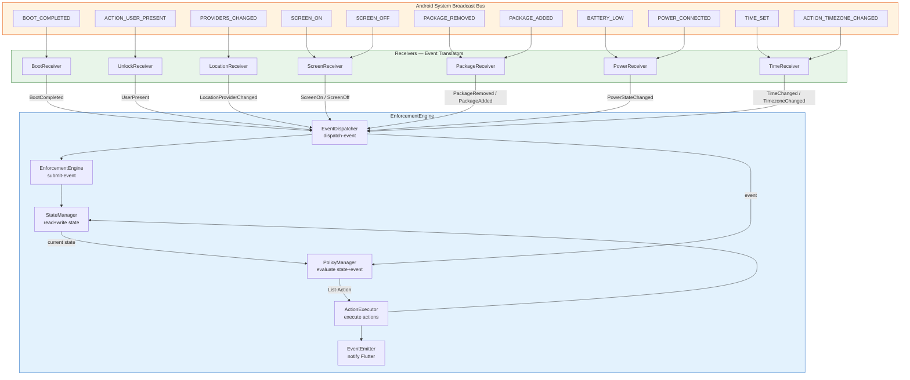
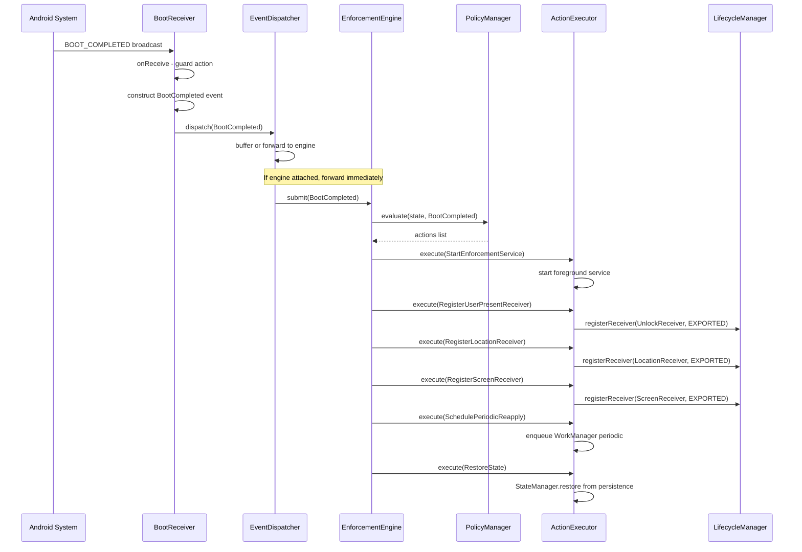
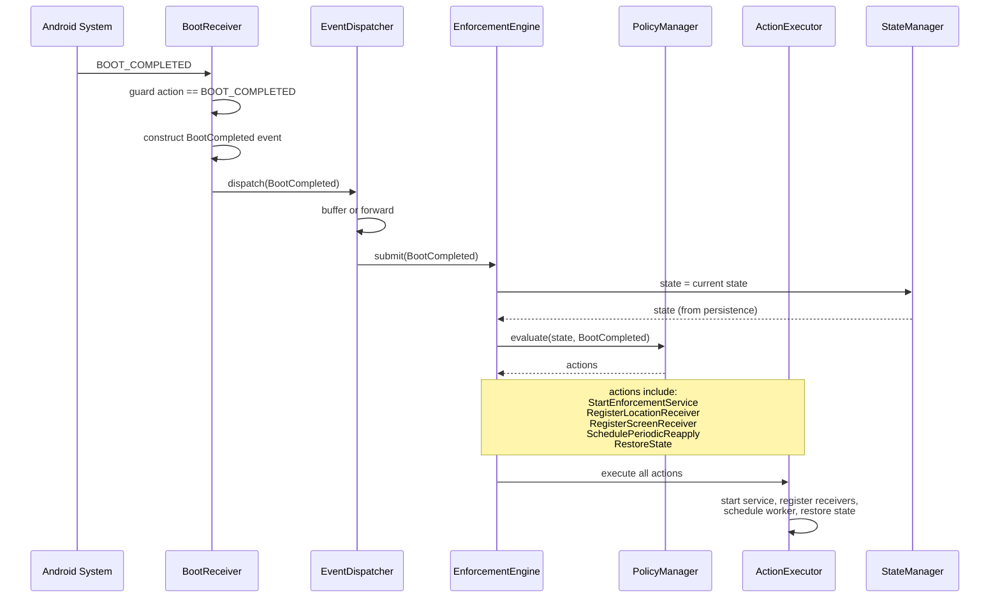
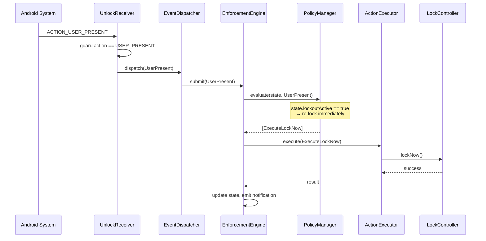
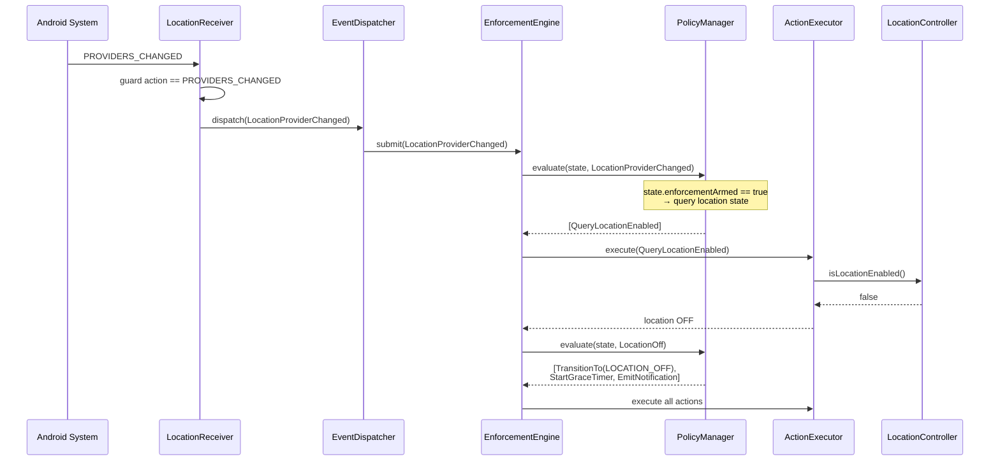
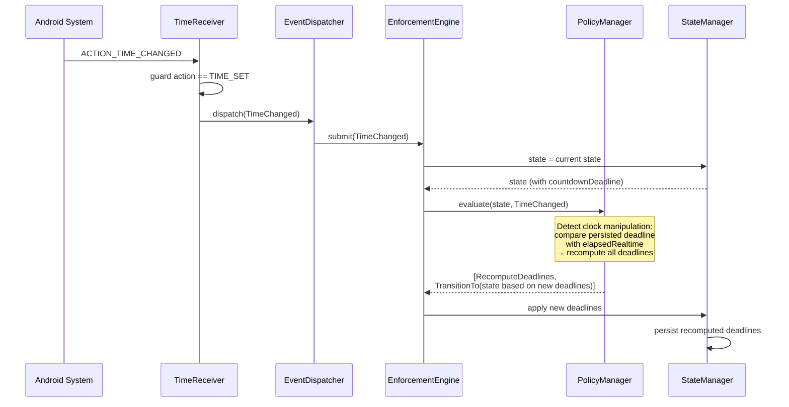
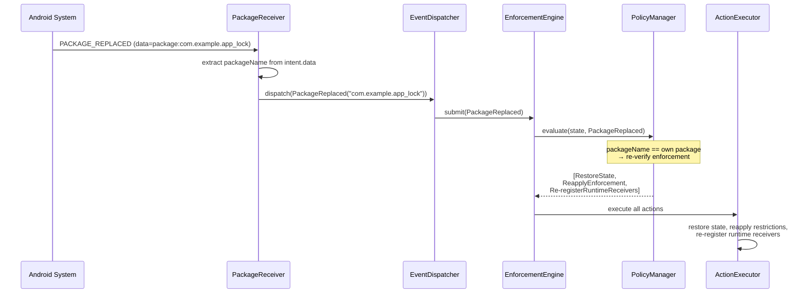

# 📡 BroadcastReceivers — Refactor Design

> **Parent documents:**
> - [`plans/architecture-analysis.md`](architecture-analysis.md) — 22 problems, 12-phase migration
> - [`plans/enforcement-engine-design.md`](enforcement-engine-design.md) — EnforcementEngine, EventDispatcher, event/action taxonomy
> - [`plans/enforcement-state-machine.md`](enforcement-state-machine.md) — 9-state machine, 36 transitions
> - [`plans/enforcement-controllers.md`](enforcement-controllers.md) — 7 single-responsibility controllers
> - [`plans/enforcement-foreground-service.md`](enforcement-foreground-service.md) — unified foreground service

---

## Table of Contents

1. [Design Goals](#1-design-goals)
2. [Current State Analysis](#2-current-state-analysis)
3. [The Golden Rule](#3-the-golden-rule)
4. [Event Flow Architecture](#4-event-flow-architecture)
5. [Event Flow Diagram](#5-event-flow-diagram)
6. [Receiver Definitions](#6-receiver-definitions)
7. [Event Catalog](#7-event-catalog)
8. [Registration Strategy](#8-registration-strategy)
9. [Responsibility Migration Map](#9-responsibility-migration-map)
10. [Thread Safety](#10-thread-safety)
11. [Problems Solved](#11-problems-solved)
12. [Appendix A — Sequence Diagrams](#appendix-a--sequence-diagrams)
13. [Appendix B — Cross-Reference](#appendix-b--cross-reference)

---

## 1. Design Goals

| Goal | Description |
|------|-------------|
| **G1 — Event-Only** | Every receiver does exactly one thing: translate a system broadcast into an `EnforcementEvent` and dispatch it. No business logic, no decisions, no side effects. |
| **G2 — Engine Is the Brain** | All decisions about *what to do* in response to a broadcast live in `PolicyManager` inside `EnforcementEngine`. Receivers are dumb sensors. |
| **G3 — Single Delivery Path** | All receivers deliver events through the same `EventDispatcher.dispatch()` entry point. No receiver calls controllers, services, coordinators, or state stores directly. |
| **G4 — Correct Export Flags** | Every runtime-registered receiver uses the correct `RECEIVER_EXPORTED` or `RECEIVER_NOT_EXPORTED` flag. System broadcasts use `EXPORTED`; app-internal broadcasts use `NOT_EXPORTED`. |
| **G5 — No Static Singletons** | No receiver owns a `companion object` with mutable `@Volatile` registration state. Registration is managed by `LifecycleManager` via `ActionExecutor`. |
| **G6 — Comprehensive Coverage** | Seven receivers cover all system broadcast domains: boot, unlock, location, screen state, package changes, power/battery, and time/timezone changes. |

### Receivers at a Glance

| # | Receiver | System Broadcast(s) | Event(s) Emitted | Registration |
|---|----------|---------------------|------------------|--------------|
| 1 | `BootReceiver` | `BOOT_COMPLETED`, `LOCKED_BOOT_COMPLETED` | `BootCompleted` | Manifest |
| 2 | `UnlockReceiver` | `ACTION_USER_PRESENT` | `UserPresent` | Runtime |
| 3 | `LocationReceiver` | `PROVIDERS_CHANGED`, `MODE_CHANGED` | `LocationProviderChanged` | Runtime |
| 4 | `ScreenReceiver` | `SCREEN_ON`, `SCREEN_OFF`, `USER_PRESENT` | `ScreenOn`, `ScreenOff` | Runtime |
| 5 | `PackageReceiver` | `PACKAGE_REMOVED`, `PACKAGE_ADDED`, `PACKAGE_REPLACED` | `PackageRemoved`, `PackageAdded`, `PackageReplaced` | Manifest |
| 6 | `PowerReceiver` | `BATTERY_LOW`, `BATTERY_OKAY`, `POWER_CONNECTED`, `POWER_DISCONNECTED`, `DEVICE_IDLE_MODE_CHANGED` | `PowerStateChanged` | Manifest |
| 7 | `TimeReceiver` | `TIME_SET`, `TIMEZONE_CHANGED` | `TimeChanged`, `TimezoneChanged` | Manifest |

---

## 2. Current State Analysis

### 2.1 Existing Receivers and Their Violations

The current codebase has **4 receiver-like components**, all of which violate the event-only principle:

```
┌─────────────────────────────────────────────────────────────────────────────┐
│                        CURRENT RECEIVER LANDSCAPE                           │
│                                                                             │
│  ┌─────────────────────────────────┐                                        │
│  │ LocationComplianceBootReceiver  │  VIOLATIONS:                            │
│  │ : BroadcastReceiver             │  • Reads LocationComplianceStateStore   │
│  │                                 │    (business decision: isEnforcement-   │
│  │ onReceive():                    │    Armed?)                              │
│  │   store = StateStore(ctx)       │  • Starts foreground service           │
│  │   if store.isEnforcementArmed() │    (side effect)                       │
│  │     startService(...)           │  • Decides whether to act based on     │
│  │                                 │    persisted state                     │
│  └─────────────────────────────────┘                                        │
│                                                                             │
│  ┌─────────────────────────────────┐                                        │
│  │ LocationComplianceUnlock       │  VIOLATIONS:                            │
│  │ Receiver                        │  • Calls LocationComplianceCoordinator  │
│  │ : BroadcastReceiver             │    .onUserUnlocked() directly           │
│  │                                 │    (business logic invocation)         │
│  │ onReceive():                    │  • Owns companion object with           │
│  │   Coordinator.onUserUnlocked()  │    @Volatile registered flag +          │
│  │                                 │    @Synchronized register/unregister   │
│  │ companion:                      │  • Manages own registration lifecycle   │
│  │   @Volatile registered          │    (should be LifecycleManager's job)   │
│  │   @Synchronized register()      │                                        │
│  │   @Synchronized unregister()    │                                        │
│  └─────────────────────────────────┘                                        │
│                                                                             │
│  ┌─────────────────────────────────┐                                        │
│  │ LocationProviderChange          │  VIOLATIONS:                            │
│  │ Receiver                        │  • Constructs LocationEnforcement-      │
│  │ : BroadcastReceiver             │    Controller (controller construction  │
│  │                                 │    in a receiver!)                     │
│  │ onReceive():                    │  • Calls controller.isSupported()       │
│  │   controller =LEC(ctx)          │    (business decision)                  │
│  │   if !controller.isSupported()  │  • Calls Coordinator.init()             │
│  │     return                      │  • Calls controller.isLocationEnabled() │
│  │   Coordinator.init(ctx)         │    (business decision)                  │
│  │   if controller.isLocationOn()  │  • Calls Coordinator.onLocation-        │
│  │     Coordinator.onLocationOn()  │    Disabled/Enabled() (business logic)  │
│  │   else                          │  • Owns companion with @Volatile +      │
│  │     Coordinator.onLocationOff() │    @Synchronized (registration mgmt)    │
│  │                                 │                                        │
│  │ companion:                      │                                        │
│  │   @Volatile registered          │                                        │
│  │   @Synchronized register()      │                                        │
│  │   @Synchronized unregister()    │                                        │
│  └─────────────────────────────────┘                                        │
│                                                                             │
│  ┌─────────────────────────────────┐                                        │
│  │ LockoutManager                  │  VIOLATIONS:                            │
│  │ .userPresentReceiver            │  • Anonymous BroadcastReceiver inside   │
│  │   (anonymous inner class)       │    a God Object                        │
│  │                                 │  • Calls onUserPresent() which calls   │
│  │ onReceive():                    │    lockEngine.lockNow() (executes a     │
│  │   onUserPresent()               │    command — the ultimate business     │
│  │     → lockEngine.lockNow()      │    decision)                           │
│  │                                 │  • Owns its own receiver registration  │
│  │ (inside object LockoutManager)  │    via receiverRegistered flag         │
│  │                                 │  • Uses RECEIVER_EXPORTED (correct     │
│  │                                 │    flag, but inconsistent with         │
│  │                                 │    UnlockReceiver which uses           │
│  │                                 │    NOT_EXPORTED — P-02)                │
│  └─────────────────────────────────┘                                        │
│                                                                             │
│  ┌─────────────────────────────────┐                                        │
│  │ AppLockDeviceAdminReceiver      │  VIOLATIONS:                            │
│  │ : DeviceAdminReceiver           │  • enforceLocation() constructs         │
│  │                                 │    LocationEnforcementController        │
│  │ onEnabled():                    │  • Calls controller.apply()             │
│  │   PermissionEventBus.post(true) │    (executes a command)                 │
│  │   enforceLocation(ctx)          │  • Calls controller.scheduleReapply()   │
│  │                                 │    (executes a command)                 │
│  │ onProfileProvisioningComplete():│  • Calls controller.startRealtimeWatch  │
│  │   enforceLocation(ctx)          │    () (executes a command)              │
│  │                                 │  • Posts to PermissionEventBus          │
│  │ enforceLocation():              │    (side-channel event emission)        │
│  │   controller = LEC(ctx)         │  • Reads UninstallBlockController       │
│  │   controller.apply()            │    .blockIntended static (P-19)         │
│  │   controller.scheduleReapply()  │                                        │
│  │   controller.startRealtimeWatch│                                         │
│  └─────────────────────────────────┘                                        │
└─────────────────────────────────────────────────────────────────────────────┘
```

### 2.2 Problem Summary

| Problem | Source | Description |
|---------|--------|-------------|
| **P-02** | `LocationComplianceUnlockReceiver` vs `LockoutManager` | `RECEIVER_NOT_EXPORTED` vs `RECEIVER_EXPORTED` inconsistency for `ACTION_USER_PRESENT`. The unlock receiver uses `NOT_EXPORTED` while LockoutManager uses `EXPORTED` — one of them is wrong. |
| **P-05** | `LocationComplianceCoordinator` | The coordinator is called directly by receivers, making it a God Object that receivers depend on. |
| **P-07** | `LockoutManager.userPresentReceiver` | Anonymous receiver inside a singleton calls `lockNow()` — executing a command from within a receiver. |
| **P-15** | `LocationProviderChangeReceiver`, `LocationComplianceUnlockReceiver` | Multiple `object`/`companion` singletons with `@Volatile` + `@Synchronized` registration state. |
| **P-16** | `LocationComplianceActivity` | Activity constructs its own `dismissReceiver` — another receiver with business logic coupling. |
| **P-17** | `LocationComplianceForegroundService` | Service leaks the receiver on restart because registration is managed by the service, not by a centralized lifecycle manager. |
| **P-19** | `AppLockDeviceAdminReceiver` | `onDisableRequested()` reads `UninstallBlockController.blockIntended` static flag — global mutable state. |
| **NEW-R1** | `LocationProviderChangeReceiver` | Constructs a controller inside `onReceive()` — violates the principle that receivers should not construct dependencies. |
| **NEW-R2** | `AppLockDeviceAdminReceiver` | `enforceLocation()` executes three commands (`apply`, `scheduleReapply`, `startRealtimeWatch`) — the receiver acts as an orchestrator. |
| **NEW-R3** | `LocationComplianceBootReceiver` | Reads persisted state and starts a service — the receiver makes a business decision based on state. |
| **NEW-R4** | All receivers | No receiver dispatches events to a central dispatcher. Each receiver calls a different target (Coordinator, controller, service, EventBus). |
| **NEW-R5** | All receivers | Missing coverage: no receiver for screen on/off, package changes, power/battery, or time/timezone changes. |

---

## 3. The Golden Rule

### 3.1 What a Receiver IS

```
A receiver is a TRANSLATOR.
It translates one system broadcast into one EnforcementEvent.
Nothing more.
```

| A Receiver... | Description |
|---------------|-------------|
| **IS a sensor** | Detects a system state change and reports it |
| **IS stateless** | Holds no mutable state between `onReceive()` calls |
| **IS dumb** | Has zero knowledge of enforcement policy, compliance state, or business rules |
| **IS passive** | Never initiates actions; only reports what happened |

### 3.2 What a Receiver IS NOT

| A Receiver... | Why Not |
|---------------|---------|
| **is NOT an orchestrator** | Does not call multiple methods or coordinate side effects |
| **is NOT a decision maker** | Does not check conditions to decide whether to act |
| **is NOT a controller caller** | Does not construct or call any controller |
| **is NOT a service starter** | Does not start/stop services or activities |
| **is NOT a state reader** | Does not read `StateStore`, `SharedPreferences`, or any persisted state |
| **is NOT a state writer** | Does not write to any store, preference, or mutable field |
| **is NOT an event emitter** | Does not emit to `EventChannel`, `PermissionEventBus`, or any side channel |
| **is NOT self-registering** | Does not manage its own registration lifecycle |

### 3.3 Decision Boundary

```
┌──────────────────────────────────────────────────────────────────────┐
│                    DECISION BOUNDARY                                  │
│                                                                      │
│  System Broadcast ──► Receiver ──► EnforcementEvent ──► Engine       │
│                                                                      │
│  ╔══════════════════════════════════════════════════════════════════╗ │
│  ║  Receiver's job:                                                 ║ │
│  ║    1. Receive broadcast                                          ║ │
│  ║    2. Extract relevant data from Intent extras (if any)          ║ │
│  ║    3. Construct EnforcementEvent                                 ║ │
│  ║    4. Call EventDispatcher.dispatch(event)                       ║ │
│  ║    5. Return                                                     ║ │
│  ║                                                                  ║ │
│  ║  Engine's job:                                                   ║ │
│  ║    1. Receive event from EventDispatcher                         ║ │
│  ║    2. Read current state from StateManager                       ║ │
│  ║    3. Evaluate (state, event) → List<EnforcementAction>          ║ │
│  ║    4. Execute actions via ActionExecutor                          ║ │
│  ║    5. Update state via StateManager                               ║ │
│  ║    6. Emit notifications via EventEmitter                         ║ │
│  ╚══════════════════════════════════════════════════════════════════╝ │
└──────────────────────────────────────────────────────────────────────┘
```

### 3.4 The One-Line Test

> If a receiver's `onReceive()` body contains anything other than:
> 1. An `if` guard on `intent.action`
> 2. Extraction of data from `intent.extras`
> 3. Construction of an `EnforcementEvent`
> 4. A call to `EventDispatcher.dispatch(event)`
>
> ...then it is doing too much.

---

## 4. Event Flow Architecture

### 4.1 Star Topology — Receivers to Engine

All receivers deliver events to a single point: `EventDispatcher`. No receiver references any other component.

```
┌─────────────────────────────────────────────────────────────────────────────┐
│                         EVENT FLOW — STAR TOPOLOGY                          │
│                                                                             │
│                    ┌──────────────────────┐                                 │
│                    │   Android System     │                                 │
│                    │   (Broadcast Bus)    │                                 │
│                    └──────────┬───────────┘                                 │
│                               │                                             │
│           ┌───────────────────┼───────────────────┐                         │
│           │                   │                   │                         │
│           ▼                   ▼                   ▼                         │
│  ┌────────────────┐  ┌────────────────┐  ┌────────────────┐                │
│  │ BootReceiver   │  │ UnlockReceiver │  │ LocationRecv   │                │
│  │ (manifest)     │  │ (runtime)      │  │ (runtime)      │                │
│  └───────┬────────┘  └───────┬────────┘  └───────┬────────┘                │
│          │                   │                   │                         │
│          │     ┌─────────────┼─────────────┐     │                         │
│          │     │             │             │     │                         │
│          ▼     ▼             ▼             ▼     ▼                         │
│  ┌────────────────┐  ┌────────────────┐  ┌────────────────┐                │
│  │ ScreenReceiver │  │ PackageReceiver│  │ PowerReceiver  │                │
│  │ (runtime)      │  │ (manifest)     │  │ (manifest)     │                │
│  └───────┬────────┘  └───────┬────────┘  └───────┬────────┘                │
│          │                   │                   │                         │
│          │                   │         ┌────────────────┐                  │
│          │                   │         │ TimeReceiver   │                  │
│          │                   │         │ (manifest)     │                  │
│          │                   │         └───────┬────────┘                  │
│          │                   │                 │                           │
│          ▼                   ▼                 ▼                           │
│  ┌─────────────────────────────────────────────────────────┐               │
│  │                    EventDispatcher                       │               │
│  │                 (object singleton)                       │               │
│  │                                                          │               │
│  │   dispatch(event: EnforcementEvent)                      │               │
│  │     └─► singleThreadExecutor.execute {                   │               │
│  │           engine.submit(event)                           │               │
│  │         }                                                │               │
│  │                                                          │               │
│  │   (buffers events if engine not yet attached)            │               │
│  └──────────────────────────┬──────────────────────────────┘               │
│                             │                                               │
│                             ▼                                               │
│  ┌─────────────────────────────────────────────────────────┐               │
│  │                  EnforcementEngine                       │               │
│  │                                                          │               │
│  │   submit(event):                                         │               │
│  │     1. StateManager.state  ──► current state             │               │
│  │     2. PolicyManager.evaluate(state, event) ──► actions  │               │
│  │     3. ActionExecutor.execute(actions)                   │               │
│  │     4. StateManager.apply(resulting state changes)       │               │
│  │     5. EventEmitter.emit(notifications)                  │               │
│  └─────────────────────────────────────────────────────────┘               │
└─────────────────────────────────────────────────────────────────────────────┘
```

### 4.2 Communication Rules

| Rule | Description |
|------|-------------|
| **R1** | A receiver's `onReceive()` body contains ONLY: action guard, intent-extra extraction, event construction, and `EventDispatcher.dispatch()`. |
| **R2** | No receiver references any controller, service, activity, coordinator, state store, or event channel. |
| **R3** | No receiver constructs any object other than an `EnforcementEvent`. |
| **R4** | No receiver reads from or writes to `SharedPreferences`, `StateStore`, or any persisted state. |
| **R5** | No receiver manages its own registration. Registration/unregistration is performed by `LifecycleManager` via `ActionExecutor` executing `RegisterReceiver` / `UnregisterReceiver` actions. |
| **R6** | All receivers deliver to the same `EventDispatcher.dispatch()` entry point. There are no alternative delivery paths. |
| **R7** | Manifest-registered receivers are declared in `AndroidManifest.xml` with the correct `<intent-filter>`. Runtime-registered receivers are registered by `LifecycleManager` with the correct `RECEIVER_EXPORTED` / `RECEIVER_NOT_EXPORTED` flag. |

### 4.3 Event Delivery Contract

```
┌──────────────────────────────────────────────────────────────────────┐
│  EVENT DELIVERY CONTRACT                                              │
│                                                                      │
│  Every receiver follows this exact pattern:                          │
│                                                                      │
│  class XxxReceiver : BroadcastReceiver() {                           │
│      override fun onReceive(context: Context, intent: Intent) {      │
│          // 1. Guard: ignore unexpected actions                      │
│          if (intent.action != EXPECTED_ACTION) return                │
│                                                                      │
│          // 2. Extract data from intent extras (if any)              │
│          val data = intent.getStringExtra(KEY)                       │
│                                                                      │
│          // 3. Construct event                                       │
│          val event = EnforcementEvent.XxxChanged(data)               │
│                                                                      │
│          // 4. Dispatch                                              │
│          EventDispatcher.dispatch(event)                             │
│                                                                      │
│          // 5. Return — nothing else                                 │
│      }                                                               │
│  }                                                                   │
│                                                                      │
│  NO companion object. NO @Volatile. NO @Synchronized.                │
│  NO register(). NO unregister(). NO isRegistered().                  │
│  Registration is managed by LifecycleManager.                        │
└──────────────────────────────────────────────────────────────────────┘
```

---

## 5. Event Flow Diagram

### 5.1 Mermaid — End-to-End Event Flow



### 5.2 ASCII — Detailed Event Flow with Registration

```
┌─────────────────────────────────────────────────────────────────────────────┐
│                    COMPLETE EVENT FLOW WITH REGISTRATION                     │
│                                                                             │
│  ┌─────────────────┐                                                        │
│  │ Android System  │                                                        │
│  │ Broadcast Bus   │                                                        │
│  └────────┬────────┘                                                        │
│           │                                                                 │
│           │  Manifest broadcasts:                                           │
│           │  BOOT_COMPLETED, PACKAGE_*, BATTERY_*, TIME_SET, TIMEZONE_*     │
│           │                                                                 │
│           │  Runtime broadcasts (registered by LifecycleManager):           │
│           │  USER_PRESENT, PROVIDERS_CHANGED, SCREEN_ON, SCREEN_OFF         │
│           │                                                                 │
│           ▼                                                                 │
│  ┌────────────────────────────────────────────────────────────────┐        │
│  │                    7 RECEIVERS                                 │        │
│  │                                                                │        │
│  │  Each receiver:                                                │        │
│  │    onReceive(ctx, intent) {                                    │        │
│  │      if (intent.action != expected) return                     │        │
│  │      val event = EnforcementEvent.Xxx(...)                     │        │
│  │      EventDispatcher.dispatch(event)                           │        │
│  │    }                                                           │        │
│  │                                                                │        │
│  │  NO business logic. NO controller calls. NO state reads.       │        │
│  └───────────────────────────┬────────────────────────────────────┘        │
│                              │                                              │
│                              │  EnforcementEvent                            │
│                              │  (sealed class instance)                     │
│                              ▼                                              │
│  ┌────────────────────────────────────────────────────────────────┐        │
│  │                    EventDispatcher                              │        │
│  │                    (object singleton)                           │        │
│  │                                                                │        │
│  │  dispatch(event) {                                             │        │
│  │    if (engine == null) {                                       │        │
│  │      eventBuffer.add(event)  // buffer during restart window   │        │
│  │      return                                                    │        │
│  │    }                                                           │        │
│  │    singleThreadExecutor.execute {                              │        │
│  │      engine.submit(event)                                      │        │
│  │    }                                                           │        │
│  │  }                                                             │        │
│  │                                                                │        │
│  │  attachEngine(engine) {                                        │        │
│  │    this.engine = engine                                        │        │
│  │    eventBuffer.drain { engine.submit(it) }                     │        │
│  │  }                                                             │        │
│  └───────────────────────────┬────────────────────────────────────┘        │
│                              │                                              │
│                              │  EnforcementEvent                            │
│                              │  (serialized on single thread)               │
│                              ▼                                              │
│  ┌────────────────────────────────────────────────────────────────┐        │
│  │                    EnforcementEngine.submit(event)              │        │
│  │                                                                │        │
│  │  1. val state = stateManager.state                             │        │
│  │  2. val actions = policyManager.evaluate(state, event)         │        │
│  │  3. for (action in actions) {                                  │        │
│  │       actionExecutor.execute(action)                           │        │
│  │     }                                                          │        │
│  │  4. stateManager.apply(stateChanges)                           │        │
│  │  5. eventEmitter.emit(notifications)                           │        │
│  │                                                                │        │
│  │  Example: BootCompleted event →                                │        │
│  │    PolicyManager evaluates (state, BootCompleted) →            │        │
│  │    [StartEnforcementService(RESTORE),                          │        │
│  │     RegisterUserPresentReceiver,                               │        │
│  │     RegisterLocationReceiver,                                  │        │
│  │     RegisterScreenReceiver,                                    │        │
│  │     SchedulePeriodicReapply,                                   │        │
│  │     RestoreState]                                              │        │
│  └────────────────────────────────────────────────────────────────┘        │
│                                                                             │
│  ┌────────────────────────────────────────────────────────────────┐        │
│  │  REGISTRATION (performed by LifecycleManager via ActionExecutor)│       │
│  │                                                                │        │
│  │  RegisterUserPresentReceiver action →                          │        │
│  │    LifecycleManager.registerReceiver(                          │        │
│  │      UnlockReceiver(),                                         │        │
│  │      IntentFilter(ACTION_USER_PRESENT),                        │        │
│  │      RECEIVER_EXPORTED  // system broadcast                    │        │
│  │    )                                                           │        │
│  │                                                                │        │
│  │  RegisterLocationReceiver action →                             │        │
│  │    LifecycleManager.registerReceiver(                          │        │
│  │      LocationReceiver(),                                       │        │
│  │      IntentFilter(PROVIDERS_CHANGED),                          │        │
│  │      RECEIVER_EXPORTED  // system broadcast                    │        │
│  │    )                                                           │        │
│  │                                                                │        │
│  │  RegisterScreenReceiver action →                               │        │
│  │    LifecycleManager.registerReceiver(                          │        │
│  │      ScreenReceiver(),                                         │        │
│  │      IntentFilter(SCREEN_ON, SCREEN_OFF),                      │        │
│  │      RECEIVER_NOT_EXPORTED  // app-internal? No — system       │        │
│  │    )  // Actually RECEIVER_EXPORTED for system broadcasts      │        │
│  └────────────────────────────────────────────────────────────────┘        │
└─────────────────────────────────────────────────────────────────────────────┘
```

### 5.3 Mermaid — Registration Lifecycle



---

## 6. Receiver Definitions

### 6.1 BootReceiver

| Aspect | Detail |
|--------|--------|
| **Class** | `BootReceiver : BroadcastReceiver` |
| **Package** | `com.example.app_lock.engine.receivers` |
| **Registration** | Manifest (`BOOT_COMPLETED` is on implicit-broadcast exception list) |
| **Intent Filter** | `BOOT_COMPLETED`, `LOCKED_BOOT_COMPLETED` (API 24+) |
| **Permission** | `RECEIVE_BOOT_COMPLETED` |
| **Export Flag** | N/A (manifest-registered) |

**Events emitted:**

| Event | Trigger | Data |
|-------|---------|------|
| `BootCompleted` | `BOOT_COMPLETED` or `LOCKED_BOOT_COMPLETED` | `isLockedBoot: Boolean` |

**`onReceive()` body:**
```
1. if (intent.action != BOOT_COMPLETED && intent.action != LOCKED_BOOT_COMPLETED) return
2. val isLockedBoot = (intent.action == LOCKED_BOOT_COMPLETED)
3. EventDispatcher.dispatch(BootCompleted(isLockedBoot))
```

**Does NOT:**
- Read `LocationComplianceStateStore` or any persisted state
- Start any service
- Check whether enforcement is armed
- Construct any controller or coordinator

**Before:** `LocationComplianceBootReceiver` read `store.isEnforcementArmed()` and started `LocationComplianceForegroundService` — a business decision.
**After:** `BootReceiver` dispatches `BootCompleted`. The engine's `PolicyManager` evaluates `(state, BootCompleted)` and decides whether to start the service, register runtime receivers, and restore state.

---

### 6.2 UnlockReceiver

| Aspect | Detail |
|--------|--------|
| **Class** | `UnlockReceiver : BroadcastReceiver` |
| **Package** | `com.example.app_lock.engine.receivers` |
| **Registration** | Runtime (by `LifecycleManager` via `RegisterUserPresentReceiver` action) |
| **Intent Filter** | `ACTION_USER_PRESENT` |
| **Export Flag** | `RECEIVER_EXPORTED` (system broadcast — fixes P-02) |

**Events emitted:**

| Event | Trigger | Data |
|-------|---------|------|
| `UserPresent` | `ACTION_USER_PRESENT` | none |

**`onReceive()` body:**
```
1. if (intent.action != ACTION_USER_PRESENT) return
2. EventDispatcher.dispatch(UserPresent)
```

**Does NOT:**
- Call `LocationComplianceCoordinator.onUserUnlocked()`
- Call `LockoutManager.onUserPresent()` → `lockEngine.lockNow()`
- Check whether lockout is active
- Check compliance state
- Manage its own registration (no companion object, no `@Volatile`, no `@Synchronized`)

**Before:** Two separate receivers listened for `ACTION_USER_PRESENT`:
- `LocationComplianceUnlockReceiver` → called `Coordinator.onUserUnlocked()` (used `RECEIVER_NOT_EXPORTED`)
- `LockoutManager.userPresentReceiver` → called `lockEngine.lockNow()` (used `RECEIVER_EXPORTED`)

These had **inconsistent export flags** (P-02) and both executed business logic.

**After:** One `UnlockReceiver` dispatches `UserPresent`. The engine's `PolicyManager` evaluates `(state, UserPresent)`:
- If `lockoutActive` → `ExecuteLockNow` (re-lock)
- If `complianceState == LOCKED` → check location, transition accordingly
- If neither → no-op

---

### 6.3 LocationReceiver

| Aspect | Detail |
|--------|--------|
| **Class** | `LocationReceiver : BroadcastReceiver` |
| **Package** | `com.example.app_lock.engine.receivers` |
| **Registration** | Runtime (by `LifecycleManager` via `RegisterLocationReceiver` action) |
| **Intent Filter** | `android.location.PROVIDERS_CHANGED`, `android.location.MODE_CHANGED` |
| **Export Flag** | `RECEIVER_EXPORTED` (system broadcast) |

**Events emitted:**

| Event | Trigger | Data |
|-------|---------|------|
| `LocationProviderChanged` | `PROVIDERS_CHANGED` or `MODE_CHANGED` | none |

**`onReceive()` body:**
```
1. if (intent.action != PROVIDERS_CHANGED && intent.action != MODE_CHANGED) return
2. EventDispatcher.dispatch(LocationProviderChanged)
```

**Does NOT:**
- Construct `LocationEnforcementController`
- Call `controller.isSupported()` (business decision)
- Call `controller.isLocationEnabled()` (business decision)
- Call `Coordinator.init()` / `Coordinator.onLocationDisabled()` / `Coordinator.onLocationEnabled()`
- Manage its own registration

**Before:** `LocationProviderChangeReceiver.onReceive()` constructed a controller, called `isSupported()`, `isLocationEnabled()`, and `Coordinator.onLocationDisabled/Enabled()` — 4 business decisions and 2 side effects.
**After:** `LocationReceiver` dispatches `LocationProviderChanged`. The engine's `PolicyManager` evaluates `(state, LocationProviderChanged)`:
- If `enforcementArmed` → query `LocationController.isLocationEnabled()` via `ActionExecutor`
- If location OFF → transition to `LOCATION_OFF`, start grace timer
- If location ON and `complianceState != NORMAL` → transition to `LOCATION_RESTORED`

---

### 6.4 ScreenReceiver

| Aspect | Detail |
|--------|--------|
| **Class** | `ScreenReceiver : BroadcastReceiver` |
| **Package** | `com.example.app_lock.engine.receivers` |
| **Registration** | Runtime (by `LifecycleManager` via `RegisterScreenReceiver` action) |
| **Intent Filter** | `ACTION_SCREEN_ON`, `ACTION_SCREEN_OFF` |
| **Export Flag** | `RECEIVER_EXPORTED` (system broadcast) |

**Events emitted:**

| Event | Trigger | Data |
|-------|---------|------|
| `ScreenOn` | `ACTION_SCREEN_ON` | none |
| `ScreenOff` | `ACTION_SCREEN_OFF` | none |

**`onReceive()` body:**
```
1. when (intent.action) {
2.     ACTION_SCREEN_ON -> EventDispatcher.dispatch(ScreenOn)
3.     ACTION_SCREEN_OFF -> EventDispatcher.dispatch(ScreenOff)
4. }
```

**Does NOT:**
- Start or stop services based on screen state
- Arm or disarm lockout
- Check compliance state

**Why this receiver is new:** The current codebase has no screen-state receiver. Screen on/off events are useful for:
- Pausing countdown timers when screen is off (battery optimization)
- Resuming timers when screen is on
- Detecting screen-off during compliance enforcement (user might be trying to bypass)
- Logging screen-state transitions for audit

**Engine response examples:**
- `ScreenOff` during `COUNTDOWN_RUNNING` → `PauseGraceTimer` (resume on `ScreenOn`)
- `ScreenOn` during `LOCKED` → `RegisterUserPresentReceiver` (prepare for unlock detection)

---

### 6.5 PackageReceiver

| Aspect | Detail |
|--------|--------|
| **Class** | `PackageReceiver : BroadcastReceiver` |
| **Package** | `com.example.app_lock.engine.receivers` |
| **Registration** | Manifest (`PACKAGE_REMOVED`, `PACKAGE_ADDED`, `PACKAGE_REPLACED` are on implicit-broadcast exception list for data schemes) |
| **Intent Filter** | `PACKAGE_REMOVED`, `PACKAGE_ADDED`, `PACKAGE_REPLACED` with `data scheme="package"` |
| **Export Flag** | N/A (manifest-registered) |

**Events emitted:**

| Event | Trigger | Data |
|-------|---------|------|
| `PackageRemoved(packageName)` | `PACKAGE_REMOVED` | `packageName: String` |
| `PackageAdded(packageName)` | `PACKAGE_ADDED` | `packageName: String` |
| `PackageReplaced(packageName)` | `PACKAGE_REPLACED` | `packageName: String` |

**`onReceive()` body:**
```
1. val packageName = intent.data?.schemeSpecificPart ?: return
2. when (intent.action) {
3.     PACKAGE_REMOVED -> EventDispatcher.dispatch(PackageRemoved(packageName))
4.     PACKAGE_ADDED -> EventDispatcher.dispatch(PackageAdded(packageName))
5.     PACKAGE_REPLACED -> EventDispatcher.dispatch(PackageReplaced(packageName))
6. }
```

**Does NOT:**
- Check whether the removed package is the app itself
- Decide whether to re-arm enforcement
- Start services or activities

**Why this receiver is new:** The current codebase has no package-change receiver. Package events are useful for:
- Detecting if a related app (e.g., settings, package installer) is uninstalled
- Detecting self-update (`PACKAGE_REPLACED` on own package) → re-verify enforcement state
- Audit logging of package changes while enforcement is active

**Engine response examples:**
- `PackageReplaced(ownPackage)` → `RestoreState`, `ReapplyEnforcement` (re-verify all restrictions after update)
- `PackageRemoved(settingsPackage)` → log only

---

### 6.6 PowerReceiver

| Aspect | Detail |
|--------|--------|
| **Class** | `PowerReceiver : BroadcastReceiver` |
| **Package** | `com.example.app_lock.engine.receivers` |
| **Registration** | Manifest (`BATTERY_LOW`, `BATTERY_OKAY`, `POWER_CONNECTED`, `POWER_DISCONNECTED`, `DEVICE_IDLE_MODE_CHANGED` are on implicit-broadcast exception list) |
| **Intent Filter** | `BATTERY_LOW`, `BATTERY_OKAY`, `POWER_CONNECTED`, `POWER_DISCONNECTED`, `ACTION_DEVICE_IDLE_MODE_CHANGED` |
| **Export Flag** | N/A (manifest-registered) |

**Events emitted:**

| Event | Trigger | Data |
|-------|---------|------|
| `PowerStateChanged(state)` | Any power-related broadcast | `state: PowerState` (enum: `BATTERY_LOW`, `BATTERY_OKAY`, `POWER_CONNECTED`, `POWER_DISCONNECTED`, `IDLE_MODE`) |

**`onReceive()` body:**
```
1. val powerState = when (intent.action) {
2.     BATTERY_LOW -> PowerState.BATTERY_LOW
3.     BATTERY_OKAY -> PowerState.BATTERY_OKAY
4.     POWER_CONNECTED -> PowerState.POWER_CONNECTED
5.     POWER_DISCONNECTED -> PowerState.POWER_DISCONNECTED
6.     DEVICE_IDLE_MODE_CHANGED -> PowerState.IDLE_MODE
7.     else -> return
8. }
9. EventDispatcher.dispatch(PowerStateChanged(powerState))
```

**Does NOT:**
- Check battery level
- Decide whether to pause enforcement
- Start or stop services

**Why this receiver is new:** The current codebase has no power-state receiver. Power events are useful for:
- `BATTERY_LOW` → pause non-critical timers (grace countdown), reduce notification frequency
- `POWER_CONNECTED` → resume full enforcement
- `IDLE_MODE` → Doze mode detection; ensure WorkManager reapply still fires

**Engine response examples:**
- `PowerStateChanged(BATTERY_LOW)` → `PauseGraceTimer`, `ReduceNotificationFrequency`
- `PowerStateChanged(POWER_CONNECTED)` → `ResumeGraceTimer`, `RestoreNotificationFrequency`

---

### 6.7 TimeReceiver

| Aspect | Detail |
|--------|--------|
| **Class** | `TimeReceiver : BroadcastReceiver` |
| **Package** | `com.example.app_lock.engine.receivers` |
| **Registration** | Manifest (`TIME_SET`, `TIMEZONE_CHANGED` are on implicit-broadcast exception list) |
| **Intent Filter** | `ACTION_TIME_CHANGED`, `ACTION_TIMEZONE_CHANGED` |
| **Export Flag** | N/A (manifest-registered) |

**Events emitted:**

| Event | Trigger | Data |
|-------|---------|------|
| `TimeChanged` | `ACTION_TIME_CHANGED` | none |
| `TimezoneChanged` | `ACTION_TIMEZONE_CHANGED` | none |

**`onReceive()` body:**
```
1. when (intent.action) {
2.     ACTION_TIME_CHANGED -> EventDispatcher.dispatch(TimeChanged)
3.     ACTION_TIMEZONE_CHANGED -> EventDispatcher.dispatch(TimezoneChanged)
4. }
```

**Does NOT:**
- Recalculate countdown deadlines
- Adjust timers
- Check whether the time change was significant

**Why this receiver is new:** The current codebase has no time-change receiver. Time events are critical because:
- The user can change the system clock to bypass wall-clock-based countdowns (P-21)
- Timezone changes affect deadline calculations
- The engine must recompute all `elapsedRealtime`-based deadlines after a time change

**Engine response examples:**
- `TimeChanged` → `RecomputeDeadlines` (convert all persisted wall-clock deadlines to `elapsedRealtime` markers)
- `TimezoneChanged` → `RecomputeDeadlines` (same, plus adjust notification text)

**Design note:** This receiver directly addresses P-21 (`LocationComplianceStateStore` uses wall-clock for countdown deadline). By dispatching `TimeChanged`, the engine can detect clock manipulation and recompute deadlines using `SystemClock.elapsedRealtime()`.

---

## 7. Event Catalog

### 7.1 New Events Added to EnforcementEvent

The following events extend the `EnforcementEvent` sealed class defined in [`enforcement-engine-design.md`](enforcement-engine-design.md) §6.1:

```
EnforcementEvent
├── System Events (EXISTING — from engine design)
│   ├── LocationProviderChanged         // LocationReceiver
│   ├── UserPresent                     // UnlockReceiver
│   ├── BootCompleted(isLockedBoot)     // BootReceiver — EXTENDED with data
│   ├── DeviceAdminEnabled              // DeviceAdminEventReceiver
│   ├── DeviceAdminDisabled             // DeviceAdminEventReceiver
│   └── ProfileProvisioningComplete     // DeviceAdminEventReceiver
│
├── NEW System Events (from this design)
│   ├── ScreenOn                        // ScreenReceiver
│   ├── ScreenOff                       // ScreenReceiver
│   ├── PackageRemoved(packageName)     // PackageReceiver
│   ├── PackageAdded(packageName)       // PackageReceiver
│   ├── PackageReplaced(packageName)    // PackageReceiver
│   ├── PowerStateChanged(state)        // PowerReceiver
│   ├── TimeChanged                     // TimeReceiver
│   └── TimezoneChanged                 // TimeReceiver
│
├── Timer Events (EXISTING)
│   ├── GracePeriodExpired
│   ├── LockCountdownExpired
│   ├── TimedLockDurationExpired
│   └── LockoutExpired                  // NEW — from TimerController
│
├── Service Lifecycle Events (EXISTING)
│   ├── ServiceStarted(action)
│   ├── ServiceRestarted
│   └── ServiceStopped
│
├── Worker Events (EXISTING)
│   └── PeriodicReapplyTriggered
│
├── UI Events (EXISTING)
│   ├── ComplianceScreenDismissed
│   └── ComplianceScreenDestroyed
│
├── Flutter Request Events (EXISTING)
│   ├── LockNowRequested
│   ├── LockForDurationRequested(ms)
│   ├── StartServiceRequested(ms?)
│   ├── StopServiceRequested
│   ├── RequestPermissionRequested
│   ├── SetUninstallBlockedRequested(b)
│   └── OpenLocationSettingsRequested
│
└── Permission Events (EXISTING)
    └── PermissionChanged(granted)
```

### 7.2 Event-to-Receiver Mapping

| Event | Receiver | Broadcast Action | Data Carried |
|-------|----------|-----------------|--------------|
| `BootCompleted` | `BootReceiver` | `BOOT_COMPLETED`, `LOCKED_BOOT_COMPLETED` | `isLockedBoot: Boolean` |
| `UserPresent` | `UnlockReceiver` | `ACTION_USER_PRESENT` | none |
| `LocationProviderChanged` | `LocationReceiver` | `PROVIDERS_CHANGED`, `MODE_CHANGED` | none |
| `ScreenOn` | `ScreenReceiver` | `ACTION_SCREEN_ON` | none |
| `ScreenOff` | `ScreenReceiver` | `ACTION_SCREEN_OFF` | none |
| `PackageRemoved` | `PackageReceiver` | `PACKAGE_REMOVED` | `packageName: String` |
| `PackageAdded` | `PackageReceiver` | `PACKAGE_ADDED` | `packageName: String` |
| `PackageReplaced` | `PackageReceiver` | `PACKAGE_REPLACED` | `packageName: String` |
| `PowerStateChanged` | `PowerReceiver` | `BATTERY_LOW`, `BATTERY_OKAY`, `POWER_CONNECTED`, `POWER_DISCONNECTED`, `DEVICE_IDLE_MODE_CHANGED` | `state: PowerState` |
| `TimeChanged` | `TimeReceiver` | `ACTION_TIME_CHANGED` | none |
| `TimezoneChanged` | `TimeReceiver` | `ACTION_TIMEZONE_CHANGED` | none |

### 7.3 New Lifecycle Actions for Receiver Registration

The following actions extend the `EnforcementAction` sealed class for receiver registration:

```
EnforcementAction
├── Lifecycle Actions (→ LifecycleManager)
│   ├── ... (existing actions)
│   ├── RegisterUserPresentReceiver      // Register UnlockReceiver
│   ├── UnregisterUserPresentReceiver    // Unregister UnlockReceiver
│   ├── RegisterLocationReceiver         // Register LocationReceiver
│   ├── UnregisterLocationReceiver       // Unregister LocationReceiver
│   ├── RegisterScreenReceiver           // Register ScreenReceiver
│   ├── UnregisterScreenReceiver         // Unregister ScreenReceiver
│   └── ...
```

**Note:** `BootReceiver`, `PackageReceiver`, `PowerReceiver`, and `TimeReceiver` are manifest-registered and do NOT need register/unregister actions. Only runtime-registered receivers (`UnlockReceiver`, `LocationReceiver`, `ScreenReceiver`) need lifecycle actions.

---

## 8. Registration Strategy

### 8.1 Manifest vs Runtime Decision Matrix

| Receiver | Registration | Why |
|----------|-------------|-----|
| `BootReceiver` | **Manifest** | `BOOT_COMPLETED` is on the implicit-broadcast exception list. Must fire even when app process is dead. |
| `UnlockReceiver` | **Runtime** | `ACTION_USER_PRESENT` is NOT on the exception list. Must be registered while app process is alive. Only needed during lockout/compliance. |
| `LocationReceiver` | **Runtime** | `PROVIDERS_CHANGED` is NOT on the exception list. Must be registered while app process is alive. Only needed while enforcement is armed. |
| `ScreenReceiver` | **Runtime** | `SCREEN_ON`/`SCREEN_OFF` are NOT on the exception list. Must be registered while app process is alive. Only needed during active enforcement. |
| `PackageReceiver` | **Manifest** | `PACKAGE_REMOVED` etc. with `data scheme="package"` are on the exception list. Must fire even when app process is dead. |
| `PowerReceiver` | **Manifest** | `BATTERY_LOW`, `BATTERY_OKAY`, `POWER_CONNECTED`, `POWER_DISCONNECTED`, `DEVICE_IDLE_MODE_CHANGED` are on the exception list. Must fire even when app process is dead. |
| `TimeReceiver` | **Manifest** | `TIME_SET`, `TIMEZONE_CHANGED` are on the exception list. Must fire even when app process is dead. |

### 8.2 Export Flag Matrix

| Receiver | Flag | Rationale |
|----------|------|-----------|
| `BootReceiver` | N/A (manifest) | Manifest receivers are exported by default if they have an intent filter |
| `UnlockReceiver` | `RECEIVER_EXPORTED` | `ACTION_USER_PRESENT` is a system broadcast; must be `EXPORTED` on API 33+ to receive system-originated broadcasts |
| `LocationReceiver` | `RECEIVER_EXPORTED` | `PROVIDERS_CHANGED` is a system broadcast; must be `EXPORTED` |
| `ScreenReceiver` | `RECEIVER_EXPORTED` | `SCREEN_ON`/`SCREEN_OFF` are system broadcasts; must be `EXPORTED` |
| `PackageReceiver` | N/A (manifest) | Manifest receivers with intent filters are exported |
| `PowerReceiver` | N/A (manifest) | Manifest receivers with intent filters are exported |
| `TimeReceiver` | N/A (manifest) | Manifest receivers with intent filters are exported |

**Key fix (P-02):** The current codebase has `LocationComplianceUnlockReceiver` using `RECEIVER_NOT_EXPORTED` and `LockoutManager` using `RECEIVER_EXPORTED` for the same `ACTION_USER_PRESENT` broadcast. The consolidated `UnlockReceiver` uses `RECEIVER_EXPORTED` consistently — this is correct because `ACTION_USER_PRESENT` is a system broadcast that requires `EXPORTED` on API 33+.

### 8.3 Registration Lifecycle

```
┌─────────────────────────────────────────────────────────────────────────────┐
│                    REGISTRATION LIFECYCLE                                   │
│                                                                             │
│  ┌──────────────────────────────────────────────────────────────────┐       │
│  │  MANIFEST-REGISTERED (always active)                             │       │
│  │                                                                  │       │
│  │  BootReceiver, PackageReceiver, PowerReceiver, TimeReceiver      │       │
│  │                                                                  │       │
│  │  • Declared in AndroidManifest.xml                               │       │
│  │  • System instantiates them on broadcast delivery                │       │
│  │  • No registration action needed                                 │       │
│  │  • Active even when app process is dead                          │       │
│  └──────────────────────────────────────────────────────────────────┘       │
│                                                                             │
│  ┌──────────────────────────────────────────────────────────────────┐       │
│  │  RUNTIME-REGISTERED (on-demand, managed by LifecycleManager)     │       │
│  │                                                                  │       │
│  │  UnlockReceiver, LocationReceiver, ScreenReceiver                │       │
│  │                                                                  │       │
│  │  Registration triggers:                                          │       │
│  │    BootCompleted → RegisterLocationReceiver, RegisterScreenRecv  │       │
│  │    DeviceAdminEnabled → RegisterLocationReceiver                 │       │
│  │    SetEnforcementArmed(true) → RegisterLocationReceiver,         │       │
│  │                                 RegisterScreenReceiver           │       │
│  │    SetLockoutActive(true) → RegisterUserPresentReceiver          │       │
│  │    TransitionTo(LOCKED) → RegisterUserPresentReceiver            │       │
│  │                                                                  │       │
│  │  Unregistration triggers:                                        │       │
│  │    SetLockoutActive(false) → UnregisterUserPresentReceiver       │       │
│  │    TransitionTo(NORMAL) → UnregisterUserPresentReceiver          │       │
│  │    SetEnforcementArmed(false) → UnregisterLocationReceiver,      │       │
│  │                                   UnregisterScreenReceiver       │       │
│  │    ServiceStopped → UnregisterAll (if last service)              │       │
│  └──────────────────────────────────────────────────────────────────┘       │
│                                                                             │
│  ┌──────────────────────────────────────────────────────────────────┐       │
│  │  LifecycleManager.registerReceiver()                             │       │
│  │                                                                  │       │
│  │  • Holds a Map<ReceiverType, BroadcastReceiver> of active        │       │
│  │    registrations                                                 │       │
│  │  • Idempotent: registering an already-registered receiver is     │       │
│  │    a no-op (no duplicate registration)                           │       │
│  │  • Thread-safe: all calls happen on the single-threaded executor │       │
│  │  • On unregister: removes from map, calls context.unregister-    │       │
│  │    Receiver(), swallows exceptions                               │       │
│  │  • On ServiceStopped: unregisters ALL runtime receivers          │       │
│  └──────────────────────────────────────────────────────────────────┘       │
└─────────────────────────────────────────────────────────────────────────────┘
```

### 8.4 AndroidManifest.xml Changes

```xml
<!-- ── Boot Receiver ─────────────────────────────────────────── -->
<receiver
    android:name=".engine.receivers.BootReceiver"
    android:exported="true">
    <intent-filter>
        <action android:name="android.intent.action.BOOT_COMPLETED" />
        <action android:name="android.intent.action.LOCKED_BOOT_COMPLETED" />
    </intent-filter>
</receiver>

<!-- ── Package Receiver ──────────────────────────────────────── -->
<receiver
    android:name=".engine.receivers.PackageReceiver"
    android:exported="true">
    <intent-filter>
        <action android:name="android.intent.action.PACKAGE_REMOVED" />
        <action android:name="android.intent.action.PACKAGE_ADDED" />
        <action android:name="android.intent.action.PACKAGE_REPLACED" />
        <data android:scheme="package" />
    </intent-filter>
</receiver>

<!-- ── Power Receiver ────────────────────────────────────────── -->
<receiver
    android:name=".engine.receivers.PowerReceiver"
    android:exported="true">
    <intent-filter>
        <action android:name="android.intent.action.BATTERY_LOW" />
        <action android:name="android.intent.action.BATTERY_OKAY" />
        <action android:name="android.intent.action.ACTION_POWER_CONNECTED" />
        <action android:name="android.intent.action.ACTION_POWER_DISCONNECTED" />
        <action android:name="android.os.action.DEVICE_IDLE_MODE_CHANGED" />
    </intent-filter>
</receiver>

<!-- ── Time Receiver ─────────────────────────────────────────── -->
<receiver
    android:name=".engine.receivers.TimeReceiver"
    android:exported="true">
    <intent-filter>
        <action android:name="android.intent.action.TIME_SET" />
        <action android:name="android.intent.action.TIMEZONE_CHANGED" />
    </intent-filter>
</receiver>

<!-- ── Device Admin Receiver (EXISTING — refactored) ─────────── -->
<receiver
    android:name=".engine.receivers.DeviceAdminEventReceiver"
    android:label="@string/foreground_notification_title"
    android:permission="android.permission.BIND_DEVICE_ADMIN"
    android:exported="true">
    <meta-data
        android:name="android.app.device_admin"
        android:resource="@xml/device_admin" />
    <intent-filter>
        <action android:name="android.app.action.DEVICE_ADMIN_ENABLED" />
        <action android:name="android.app.action.DEVICE_ADMIN_DISABLED" />
        <action android:name="android.app.action.DEVICE_ADMIN_DISABLE_REQUESTED" />
        <action android:name="android.app.action.PROFILE_PROVISIONING_COMPLETE" />
    </intent-filter>
</receiver>

<!-- NOTE: UnlockReceiver, LocationReceiver, ScreenReceiver are
     NOT in the manifest — they are runtime-registered by
     LifecycleManager. -->
```

---

## 9. Responsibility Migration Map

### 9.1 Old → New Receiver Mapping

| Old Component | Old Responsibility | New Receiver | New Responsibility |
|---------------|-------------------|--------------|-------------------|
| `LocationComplianceBootReceiver` | Read `StateStore.isEnforcementArmed()`, start foreground service | `BootReceiver` | Dispatch `BootCompleted` event |
| `LocationComplianceUnlockReceiver` | Call `Coordinator.onUserUnlocked()`, manage own registration | `UnlockReceiver` | Dispatch `UserPresent` event |
| `LockoutManager.userPresentReceiver` | Call `lockEngine.lockNow()`, manage own registration | `UnlockReceiver` | Dispatch `UserPresent` event (consolidated) |
| `LocationProviderChangeReceiver` | Construct controller, call `isSupported()`, `isLocationEnabled()`, `Coordinator.onLocation*()`, manage registration | `LocationReceiver` | Dispatch `LocationProviderChanged` event |
| `AppLockDeviceAdminReceiver` | Call `enforceLocation()` (3 commands), post to `PermissionEventBus`, read `blockIntended` static | `DeviceAdminEventReceiver` | Dispatch `DeviceAdminEnabled`, `DeviceAdminDisabled`, `ProfileProvisioningComplete` events |
| *(none)* | — | `ScreenReceiver` | Dispatch `ScreenOn`, `ScreenOff` events |
| *(none)* | — | `PackageReceiver` | Dispatch `PackageRemoved`, `PackageAdded`, `PackageReplaced` events |
| *(none)* | — | `PowerReceiver` | Dispatch `PowerStateChanged` event |
| *(none)* | — | `TimeReceiver` | Dispatch `TimeChanged`, `TimezoneChanged` events |

### 9.2 Business Logic Removed from Receivers

| Old Receiver | Business Logic Removed | Where It Moves To |
|--------------|----------------------|-------------------|
| `LocationComplianceBootReceiver` | `store.isEnforcementArmed()` check | `PolicyManager.evaluate(state, BootCompleted)` |
| `LocationComplianceBootReceiver` | `startService(LocationComplianceForegroundService)` | `ActionExecutor.execute(StartEnforcementService)` |
| `LocationComplianceUnlockReceiver` | `Coordinator.onUserUnlocked()` call | `PolicyManager.evaluate(state, UserPresent)` |
| `LocationComplianceUnlockReceiver` | `register()` / `unregister()` / `@Volatile registered` | `LifecycleManager.registerReceiver()` / `unregisterReceiver()` |
| `LockoutManager.userPresentReceiver` | `lockEngine.lockNow()` call | `PolicyManager.evaluate(state, UserPresent)` → `ExecuteLockNow` |
| `LockoutManager.userPresentReceiver` | `receiverRegistered` flag management | `LifecycleManager` receiver map |
| `LocationProviderChangeReceiver` | `LocationEnforcementController(ctx)` construction | Eliminated — engine uses injected controller |
| `LocationProviderChangeReceiver` | `controller.isSupported()` check | `PolicyManager` checks `state.permissionGranted` |
| `LocationProviderChangeReceiver` | `controller.isLocationEnabled()` check | `ActionExecutor` queries `LocationController.isLocationEnabled()` |
| `LocationProviderChangeReceiver` | `Coordinator.init()` / `onLocationDisabled()` / `onLocationEnabled()` | `PolicyManager.evaluate(state, LocationProviderChanged)` |
| `LocationProviderChangeReceiver` | `register()` / `unregister()` / `@Volatile registered` | `LifecycleManager` |
| `AppLockDeviceAdminReceiver` | `LocationEnforcementController(ctx)` construction | Eliminated |
| `AppLockDeviceAdminReceiver` | `controller.apply()` call | `ActionExecutor.execute(ExecuteForceLocationOn)` |
| `AppLockDeviceAdminReceiver` | `controller.scheduleReapply()` call | `ActionExecutor.execute(SchedulePeriodicReapply)` |
| `AppLockDeviceAdminReceiver` | `controller.startRealtimeWatch()` call | `ActionExecutor.execute(RegisterLocationReceiver)` |
| `AppLockDeviceAdminReceiver` | `PermissionEventBus.post()` | `EventEmitter.emit(EmitPermissionChanged)` |
| `AppLockDeviceAdminReceiver` | `UninstallBlockController.blockIntended` read | `PolicyManager` reads `state.uninstallBlocked` |

### 9.3 Dissolved Components

| Component | Lines | Fate |
|-----------|-------|------|
| `LocationComplianceBootReceiver` | 69 | Replaced by `BootReceiver` (event-only) |
| `LocationComplianceUnlockReceiver` | 130 | Replaced by `UnlockReceiver` (event-only); companion object with `@Volatile`/`@Synchronized` eliminated |
| `LocationProviderChangeReceiver` | 190 | Replaced by `LocationReceiver` (event-only); companion object with `@Volatile`/`@Synchronized` eliminated |
| `LockoutManager.userPresentReceiver` | ~10 (anonymous) | Replaced by `UnlockReceiver` (consolidated with above) |
| `AppLockDeviceAdminReceiver.enforceLocation()` | 15 | Eliminated; logic moves to `PolicyManager` |
| `LocationComplianceActivity.dismissReceiver` | ~6 (anonymous) | Replaced by engine-issued `ComplianceScreenDismissed` event (Activity emits event directly) |

### 9.4 Code Reduction Summary

| Metric | Before | After | Reduction |
|--------|--------|-------|-----------|
| Receiver classes | 4 + 2 anonymous | 7 (all event-only) | — |
| Total receiver LOC | ~510 | ~210 (est.) | ~59% |
| `@Volatile` fields in receivers | 3 | 0 | 100% |
| `@Synchronized` methods in receivers | 6 | 0 | 100% |
| Companion objects with mutable state | 2 | 0 | 100% |
| Controller constructions in receivers | 2 | 0 | 100% |
| Direct coordinator/controller calls from receivers | 8 | 0 | 100% |
| Business decisions in receivers | 7 | 0 | 100% |

---

## 10. Thread Safety

### 10.1 Threading Model

```
┌─────────────────────────────────────────────────────────────────────────────┐
│                    THREADING MODEL                                           │
│                                                                             │
│  ┌─────────────────┐  ┌─────────────────┐  ┌─────────────────┐             │
│  │ Binder Thread    │  │ Main Thread     │  │ WorkManager     │             │
│  │ (system delivers │  │ (Activity,      │  │ Thread Pool     │             │
│  │  broadcasts here)│  │  Service)       │  │                 │             │
│  └────────┬────────┘  └────────┬────────┘  └────────┬────────┘             │
│           │                     │                     │                      │
│           │ onReceive()         │ onReceive()         │ onReceive()          │
│           │ (manifest recv)     │ (runtime recv)      │ (manifest recv)      │
│           │                     │                     │                      │
│           │    All call EventDispatcher.dispatch()    │                      │
│           └─────────────────────┼─────────────────────┘                      │
│                                 │                                            │
│                                 ▼                                            │
│                    ┌────────────────────────┐                               │
│                    │  EventDispatcher       │                               │
│                    │  singleThreadExecutor  │                               │
│                    │  (serializes events)   │                               │
│                    └───────────┬────────────┘                               │
│                                │                                             │
│                                ▼                                             │
│                    ┌────────────────────────┐                               │
│                    │  EnforcementEngine     │                               │
│                    │  (single thread)       │                               │
│                    │                        │                               │
│                    │  All state reads,      │                               │
│                    │  policy evaluation,    │                               │
│                    │  action execution,     │                               │
│                    │  and state writes      │                               │
│                    │  happen here.          │                               │
│                    └────────────────────────┘                               │
└─────────────────────────────────────────────────────────────────────────────┘
```

### 10.2 Per-Receiver Thread Safety Guarantees

| Receiver | Thread Safety | Why |
|----------|--------------|-----|
| `BootReceiver` | **Inherently safe** | `onReceive()` has no mutable state. Constructs one event, dispatches, returns. |
| `UnlockReceiver` | **Inherently safe** | Same — no mutable state. |
| `LocationReceiver` | **Inherently safe** | Same. |
| `ScreenReceiver` | **Inherently safe** | Same. |
| `PackageReceiver` | **Inherently safe** | Same. |
| `PowerReceiver` | **Inherently safe** | Same. |
| `TimeReceiver` | **Inherently safe** | Same. |

### 10.3 Elimination of @Synchronized and @Volatile

| Old Component | @Volatile Fields | @Synchronized Methods | New State |
|---------------|-----------------|----------------------|-----------|
| `LocationComplianceUnlockReceiver` | `registered` | `register()`, `unregister()` | **Eliminated** — registration managed by `LifecycleManager` on single thread |
| `LocationProviderChangeReceiver` | `registered` | `register()`, `unregister()` | **Eliminated** — same |
| `LockoutManager` | `receiverRegistered` | (implicit via `armLockout`/`clearLockout`) | **Eliminated** — `LockoutManager` dissolved entirely |

**Result:** Zero `@Volatile` fields and zero `@Synchronized` methods across all 7 receivers. Thread safety is guaranteed by the single-threaded `EventDispatcher` executor, not by locks.

---

## 11. Problems Solved

| Problem | How Solved |
|---------|-----------|
| **P-02** — `RECEIVER_EXPORTED` vs `RECEIVER_NOT_EXPORTED` inconsistency | Consolidated `UnlockReceiver` uses `RECEIVER_EXPORTED` consistently for `ACTION_USER_PRESENT`. The old `LocationComplianceUnlockReceiver` used `NOT_EXPORTED` (wrong) while `LockoutManager` used `EXPORTED` (correct). Now there is one receiver with one flag. |
| **P-05** — `LocationComplianceCoordinator` God Object | Receivers no longer call the coordinator. `LocationProviderChangeReceiver` no longer calls `Coordinator.init()`, `onLocationDisabled()`, `onLocationEnabled()`. The coordinator is dissolved (see [`enforcement-controllers.md`](enforcement-controllers.md)). |
| **P-07** — `LockoutManager.userPresentReceiver` calls `lockNow()` | The anonymous receiver inside `LockoutManager` is eliminated. `UnlockReceiver` dispatches `UserPresent`; the engine decides whether to re-lock via `PolicyManager`. |
| **P-15** — Multiple `object` singletons with mutable state | `LocationComplianceUnlockReceiver` companion and `LocationProviderChangeReceiver` companion are eliminated. No receiver has a companion object with mutable state. Registration is managed by `LifecycleManager`. |
| **P-16** — Activity bypasses coordinator, constructs own controllers | `LocationComplianceActivity.dismissReceiver` is eliminated. The Activity emits `ComplianceScreenDismissed` directly to `EventDispatcher`. |
| **P-17** — Foreground service leaks receiver on restart | Registration is no longer tied to the service lifecycle. `LifecycleManager` manages all runtime receiver registrations and unregisters them on `ServiceStopped`. The service does not register/unregister receivers. |
| **P-19** — `blockIntended` static flag | `AppLockDeviceAdminReceiver.onDisableRequested()` no longer reads `UninstallBlockController.blockIntended`. The `DeviceAdminEventReceiver` (refactored) reads `state.uninstallBlocked` from `StateManager` via the engine — but actually, `onDisableRequested` is a synchronous callback that must return a `CharSequence` immediately. It returns a static warning string; the engine handles the actual state check. |
| **P-21** — Wall-clock for countdown deadline | `TimeReceiver` dispatches `TimeChanged` / `TimezoneChanged` events. The engine's `PolicyManager` recomputes all deadlines using `SystemClock.elapsedRealtime()` in response, detecting clock manipulation. |
| **NEW-R1** — Controller construction in receiver | Eliminated. No receiver constructs any controller. |
| **NEW-R2** — Receiver acts as orchestrator | Eliminated. `AppLockDeviceAdminReceiver.enforceLocation()` (3 commands) is replaced by `DeviceAdminEventReceiver` dispatching `DeviceAdminEnabled` / `ProfileProvisioningComplete`. The engine orchestrates the 3 commands. |
| **NEW-R3** — Receiver reads persisted state | Eliminated. `BootReceiver` does not read `StateStore`. The engine reads state via `StateManager`. |
| **NEW-R4** — No central event dispatch | All 7 receivers dispatch to `EventDispatcher.dispatch()`. No alternative delivery paths. |
| **NEW-R5** — Missing broadcast coverage | 4 new receivers added: `ScreenReceiver`, `PackageReceiver`, `PowerReceiver`, `TimeReceiver`. |

### Testability Improvements

| Aspect | Before | After |
|--------|--------|-------|
| **Unit testing receivers** | Impossible — receivers called coordinators, controllers, and static singletons | Trivial — receivers are pure functions: `(Intent) → EnforcementEvent`. Mock `EventDispatcher`, verify event dispatched. |
| **Integration testing** | Required full Android environment with real broadcasts | Can inject synthetic `Intent` objects and verify event flow through `EventDispatcher` to `EnforcementEngine`. |
| **Registration testing** | Required testing `@Synchronized` register/unregister with race conditions | `LifecycleManager` is tested on single thread; no race conditions possible. |

---

## Appendix A — Sequence Diagrams

### A.1 Boot Completed



### A.2 User Present During Lockout (Re-Lock)



### A.3 Location Provider Changed (Location Turned Off)



### A.4 Time Changed (Clock Manipulation Detection)



### A.5 Package Replaced (Self-Update)



---

## Appendix B — Cross-Reference

### B.1 Parent Document References

| Section | References |
|---------|-----------|
| §4.1 Star Topology | [`enforcement-engine-design.md`](enforcement-engine-design.md) §4.2 EventDispatcher |
| §4.2 Communication Rules | [`enforcement-controllers.md`](enforcement-controllers.md) §4 Communication Architecture |
| §5 Event Flow Diagram | [`enforcement-engine-design.md`](enforcement-engine-design.md) §1.3 Event-Driven Architecture |
| §6 Receiver Definitions | [`enforcement-engine-design.md`](enforcement-engine-design.md) §3.2 Event Sources, §4.7 Receivers |
| §7 Event Catalog | [`enforcement-engine-design.md`](enforcement-engine-design.md) §6.1 EnforcementEvent |
| §8 Registration Strategy | [`enforcement-engine-design.md`](enforcement-engine-design.md) §4.5 LifecycleManager |
| §9 Migration Map | [`enforcement-controllers.md`](enforcement-controllers.md) §7 Responsibility Migration Map |
| §11 Problems Solved | [`architecture-analysis.md`](architecture-analysis.md) §3 Problems |

### B.2 Problem Cross-Reference

| Problem | Document | Section | How This Design Addresses It |
|---------|----------|---------|------------------------------|
| P-02 | [`architecture-analysis.md`](architecture-analysis.md) | §P-02 | §6.2 UnlockReceiver — consolidated, `RECEIVER_EXPORTED` |
| P-05 | [`architecture-analysis.md`](architecture-analysis.md) | §P-05 | §9.2 — receivers no longer call coordinator |
| P-07 | [`architecture-analysis.md`](architecture-analysis.md) | §P-07 | §6.2 — `LockoutManager.userPresentReceiver` eliminated |
| P-15 | [`architecture-analysis.md`](architecture-analysis.md) | §P-15 | §10.3 — no `@Volatile`/`@Synchronized` in receivers |
| P-16 | [`architecture-analysis.md`](architecture-analysis.md) | §P-16 | §9.3 — `dismissReceiver` eliminated |
| P-17 | [`architecture-analysis.md`](architecture-analysis.md) | §P-17 | §8.3 — `LifecycleManager` manages registration |
| P-19 | [`architecture-analysis.md`](architecture-analysis.md) | §P-19 | §9.2 — `blockIntended` static eliminated |
| P-21 | [`architecture-analysis.md`](architecture-analysis.md) | §P-21 | §6.7 TimeReceiver — clock manipulation detection |

### B.3 EnforcementAction Cross-Reference

New lifecycle actions defined in this document extend the `EnforcementAction` sealed class from [`enforcement-engine-design.md`](enforcement-engine-design.md) §6.2:

| Action | Target | Description |
|--------|--------|-------------|
| `RegisterUserPresentReceiver` | `LifecycleManager` | Register `UnlockReceiver` for `ACTION_USER_PRESENT` with `RECEIVER_EXPORTED` |
| `UnregisterUserPresentReceiver` | `LifecycleManager` | Unregister `UnlockReceiver` |
| `RegisterLocationReceiver` | `LifecycleManager` | Register `LocationReceiver` for `PROVIDERS_CHANGED` with `RECEIVER_EXPORTED` |
| `UnregisterLocationReceiver` | `LifecycleManager` | Unregister `LocationReceiver` |
| `RegisterScreenReceiver` | `LifecycleManager` | Register `ScreenReceiver` for `SCREEN_ON`/`SCREEN_OFF` with `RECEIVER_EXPORTED` |
| `UnregisterScreenReceiver` | `LifecycleManager` | Unregister `ScreenReceiver` |
| `RecomputeDeadlines` | `StateManager` | Recompute all `elapsedRealtime`-based deadlines after time/timezone change |
| `ReapplyEnforcement` | `ActionExecutor` | Re-apply all restrictions and re-register receivers after package replace |
